# 产品说明

> **读者**：产品、业务、管理员、需要判断"现在能不能用"的人。
> **回答**：能做什么、给谁用、现在做到哪一步、还缺什么、接下来做什么。
> **不写**：表字段、代码路径、部署命令。能力状态只在本文件维护，其他文档引用这里的结论。
> 能力状态以仓库源码与实际入口为准；"目标值"类数字均非实测。

## 1 产品定位

**本章回答：这个产品是什么，解决谁的什么问题，DoD Agent 在其中处于什么位置。**

"我的工作台"是一个多 Agent 任务平台。用户先选择一个具体的 Agent，提交问题或任务；系统把每次提交记录为一个 Run（任务），把连续追问组织在同一个 Thread（会话）中；管理员为每个 Agent 配置工作流、模型、系统提示词、回复偏好、上下文窗口与预算，并通过"发布"让配置对新任务生效。

DoD Agent 是平台承载的一种业务场景：面向值班答疑、告警诊断与跟进。平台本身不绑定 DoD，也不设"Agent 类型"枚举或市场，每个 Agent 都是团队下独立可配置的对象。

| 维度 | 说明 |
| --- | --- |
| 用户入口 | 以 Agent 为入口：选 Agent，提问，查看任务记录，在会话里追问 |
| 管理入口 | 管理员维护 Agent、模型、Skill，并发布到新任务 |
| 结果可信度 | 结果带"状态"：已完成、部分完成、失败等；部分完成不等于成功 |
| 可追溯 | 每个 Run 固定执行时的配置版本；之后修改配置不影响已受理的任务 |
| 当前可用主链路 | 选择 Agent → 提交问题 → 排队执行 → 模型回答 → 在任务记录中查看；多轮追问读取同会话内已完成的问答 |
| 尚未具备 | 真实企业数据源（监控/日志/Trace/知识库）的验收、真实 Jira/SeaTalk/DoD 交付、事件中心与统计页面 |

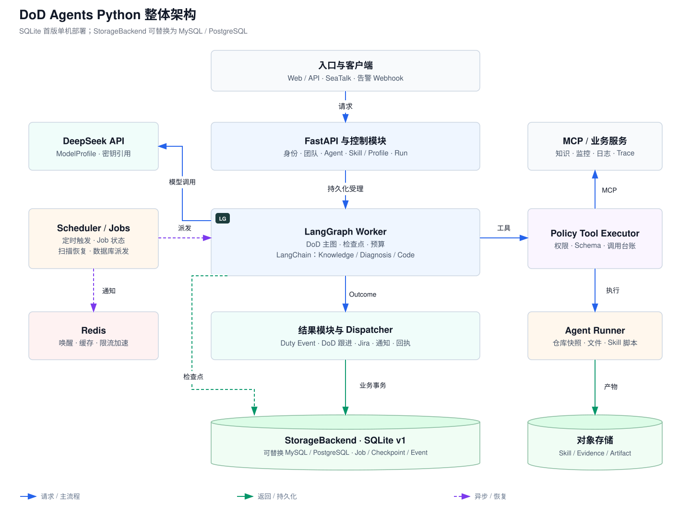

产品由三类运行单元组成：用户与管理员使用的 Web 工作台、负责受理与执行任务的 Agent 服务（API、Worker、Scheduler），以及可独立部署、提供只读数据查询的 MCP Server。任务受理后即被持久化，不依赖进程内存，服务重启不会丢失已受理的任务。

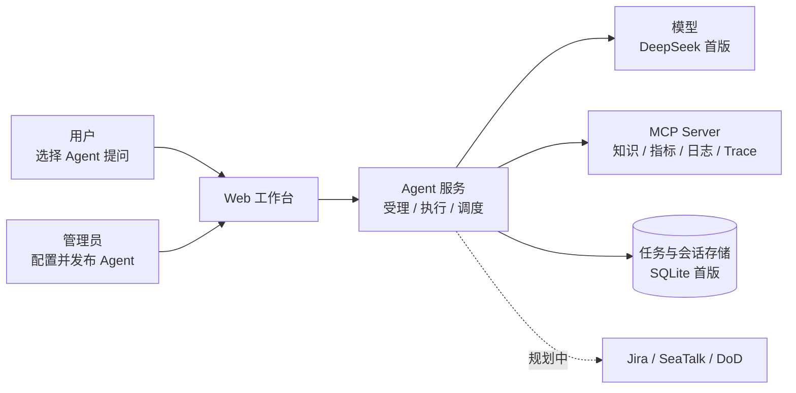

## 2 用户与场景

**本章回答：谁在用，用来做什么，各场景现在能做到什么程度。**

### 2.1 四类典型场景

| 场景 | 用户想要什么 | 产品给出什么 | 当前程度 |
| --- | --- | --- | --- |
| 值班答疑 | 快速得到业务问题的解释，能继续追问 | 直接 LLM 问答（单轮、多轮）；知识问答提供可核对的来源摘录 | 直接问答可用；v16 输出摘录并保持 partial，v19 可在引用及独立支持检查通过后给出结论；真实模型与业务质量待验收 |
| 告警 RCA | 告警到来后，得到范围确认、基线证据和待办提示 | 确认服务/环境/区域/时间窗，采集指标、日志、Trace 基线，保留未完成项；必要时向值班人追问 | 仅在合成/开发环境验证；结果一律为"部分完成"，不产出确定根因 |
| 代码分析 | 结合固定仓库快照解释实现 | 按固定 commit 读取有界文件行，形成仓库证据，可与知识检索合并 | 本地实现；结论仍提示需进一步验证 |
| SOP / 巡检 | 按固定步骤周期性检查 | 版本化的步骤流程，含依赖、条件、超时、失败策略；手动或定时触发 | 流程执行与调度已实现；顺序执行，暂无并行；无管理页面 |

### 2.2 角色

| 角色 | 主要职责 | 典型操作 |
| --- | --- | --- |
| 管理员 | 维护团队的 Agent、模型、Skill，发布配置，授权成员 | 创建 Agent、配置提示词与预算、发布 Skill 版本、发布 Agent |
| 值班人 | 提问、查看诊断结果、补充信息、确认动作 | 提交问题、查看任务详情、在会话中追问；补充缺失的区域；审批提案动作 |
| 开发 | 分析代码，维护 Skill 与工作流，对接数据源 | 发起代码分析、编写与发布 Skill、检查任务结果与证据 |

团队内权限分四级：查看（viewer）、执行（operator）、维护（maintainer）、管理（admin）。读取任务需要查看权限，提交任务需要执行权限，创建/保存 Skill 与 Agent 配置需要维护权限，发布 Skill 需要管理权限。

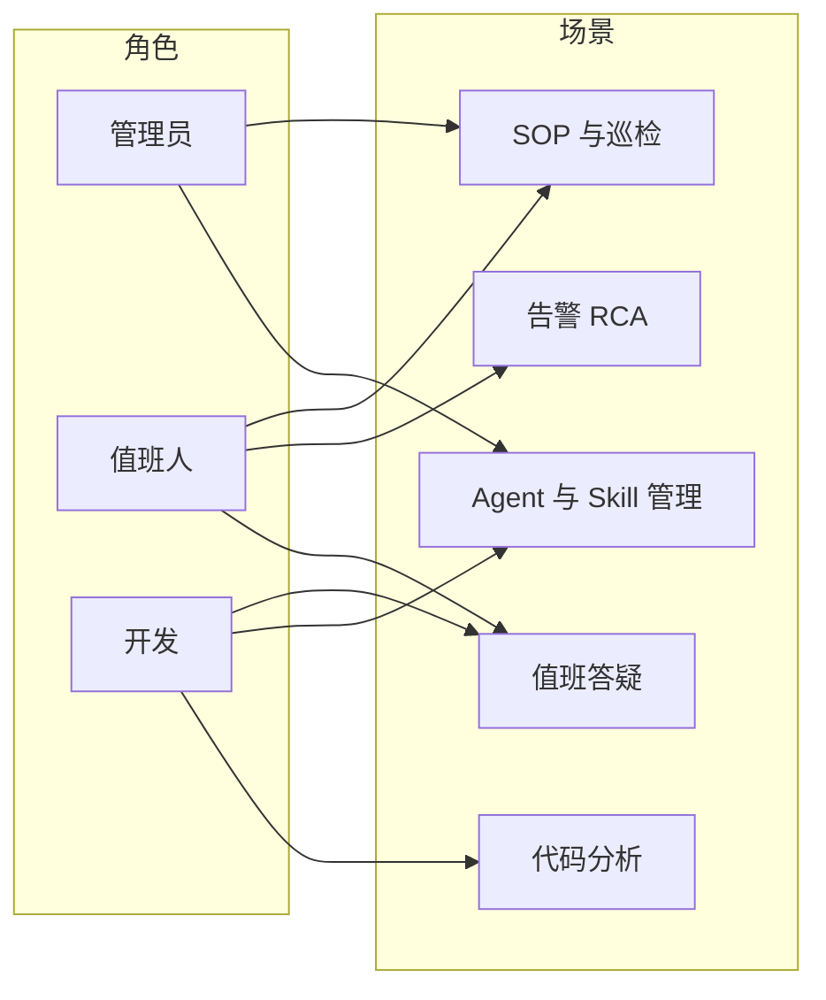

### 2.3 角色-场景矩阵

| 角色 \ 场景 | 值班答疑 | 告警 RCA | 代码分析 | SOP / 巡检 | Agent 与 Skill 管理 |
| --- | --- | --- | --- | --- | --- |
| 管理员 | 查看 | 配置接入 | 配置仓库 | 配置计划 | 主要使用者 |
| 值班人 | 主要使用者 | 主要使用者 | 偶尔 | 查看结果 | 无 |
| 开发 | 偶尔 | 复核结论 | 主要使用者 | 编写流程 | 编写 Skill |

### 2.4 用户旅程

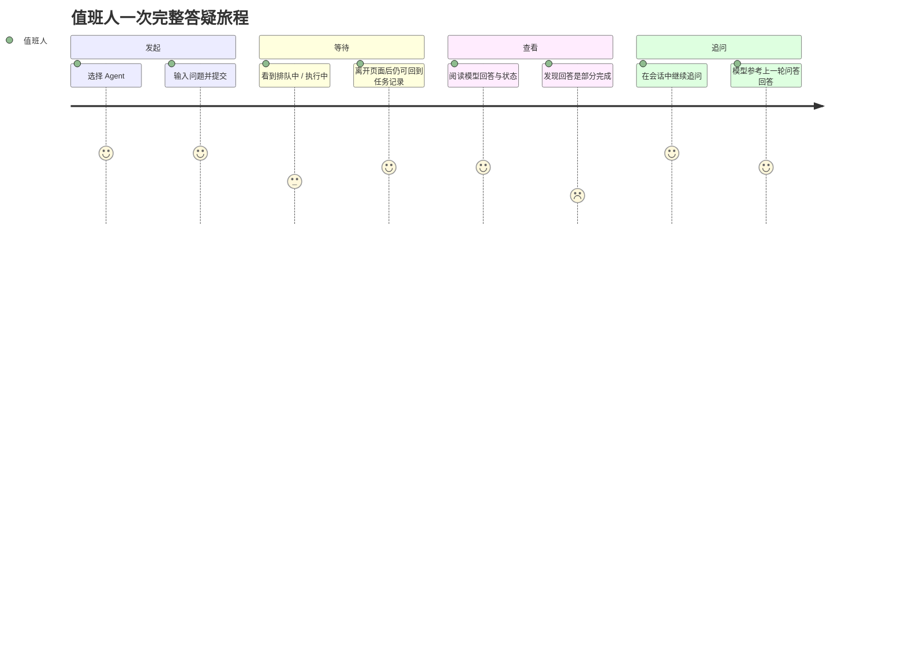

## 3 核心概念

**本章回答：用户在界面上会遇到哪些对象，它们之间是什么关系。**

| 概念 | 含义 | 用户感知 |
| --- | --- | --- |
| Agent | 团队下一个独立可配置的工作对象，有名称、工作流、模型、提示词、回复偏好、上下文与预算 | 工作台里"选择 Agent"；任务记录显示所属 Agent |
| 任务（Run） | 一次独立执行，从提交到出结果；包括等待补充与恢复 | 任务记录与任务详情；每个新问题产生新 Run |
| 会话（Thread） | 连续追问的容器，包含多条消息和多个 Run；同一会话不跨 Agent | 会话页；追问时读取同会话内已完成的历史问答 |
| Skill | 团队共享的能力说明（Markdown 指令），由管理员发布版本，Agent 绑定精确版本后生效 | Skills 页创建与发布；Agent 页"添加 Skill" |
| 模型 | 模型端点、模型名、温度、输出与上下文上限、超时的版本化配置；密钥只存引用 | 模型配置页；发布后 Agent 需重新绑定并发布 |
| 预算 | 单个 Run 的上限：耗时、模型调用次数、工具调用次数、Token | Agent 配置项；未设上限不等于无限 |
| 工作流 | 决定任务如何执行的流程版本，如直接问答、知识问答、告警 RCA、SOP | Agent 配置中的"工作流"选项 |
| 发布 | 把草稿变为不可变版本；新 Run 固定使用发布版本 | "保存"不等于"生效"，发布后对新任务生效 |

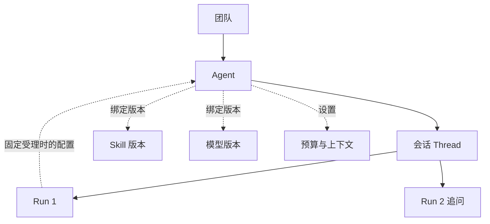

两条关键规则：

1. 每个 Run 与 Thread 必须关联一个具体 Agent；Agent 名称可以修改，历史任务依据受理时固定的版本。
2. 同一会话同一时刻只接受一个未结束的显式追问；冲突时提示"会话忙"。

## 4 能力清单与状态

**本章回答：原 P0 要求的 13 项能力，现在各自做到了哪一步，依据是什么。**

状态含义：✅ 已实现（代码存在且有页面或可用入口）；🟡 部分（代码存在，但缺页面、缺真实外部连接、或仅在合成/本地环境验证）；⏳ 规划（源码中不存在或仅为占位）。

### 4.1 FR 总表

| 编号 | 能力 | P0 目标 | 状态 | 状态说明 |
| --- | --- | --- | --- | --- |
| FR-01 | 统一入口 | Web/API、SeaTalk、告警 Webhook，签名验证、去重、线程关联 | 🟡 | Web/API 可用；告警与 SeaTalk 仅有合成/开发环境入口，真实协议未接入 |
| FR-02 | 团队和 Agent 管理 | 成员/角色、Agent 草稿与发布、模型、提示词、偏好、上下文、预算 | 🟡 | Agent、模型、Skill 管理页可用；团队成员、仓库、工具绑定仅有接口无页面 |
| FR-03 | 单轮与多轮答疑 | 直接 LLM 问答、有界历史追问；知识问答、业务工具、引用 | 🟡 | 直接问答可用；v19 带引用结论和独立支持检查已实现，真实模型与业务质量待验收；v16 仍为 partial |
| FR-04 | 告警诊断 | 规范化告警、时间锚点、历史事件、监控/日志/Trace、代码分析 | 🟡 | 范围确认与基线采集在合成数据上验证；无真实数据与根因结论 |
| FR-05 | Agent 协作 | 主图 + Knowledge/Diagnosis/Code 专家，按需调用，共用预算 | 🟡 | 专家与多专家流程存在；无并行与完整证据合成 |
| FR-06 | Skill 和知识 | 导入、校验、版本、发布/回滚、按需加载、知识检索 | 🟡 | Skill 共享库可用；内置知识库支持条目、版本和检索；Skill 仅加载 SKILL.md 文本 |
| FR-07 | Agent 执行 | 仓库快照、文件读取、脚本执行、受控环境、产物 | 🟡 | 快照读取与 Runner 代码存在；真实容器/对象存储未验收 |
| FR-08 | 工具 | MCP 发现/调用、Schema 校验、身份注入、台账 | 🟡 | MCP 客户端与治理已实现；授权连接和只读工具管理已接入页面，企业真实上游与工具对话未验收 |
| FR-09 | SOP 和巡检 | 版本化工作流、变量、分支、有限并行、定时与手动触发 | 🟡 | 顺序执行与条件分支、定时调度已实现；无并行，无页面 |
| FR-10 | 任务生命周期 | 排队、异步、SSE、取消、等待输入/确认、恢复、持久化 | 🟡 | 网页已实现实时流、取消、补充输入与 Run 级审批；待手工验收 |
| FR-11 | 业务结果 | Duty Event、DoD 跟进、Jira、SeaTalk 通知 | 🟡 | 事件、审批、动作台账与本地模拟回执可用；真实发送器默认关闭 |
| FR-12 | 运营与评估 | Run 详情、用量、反馈、知识缺口、基础统计 | 🟡 | 任务详情、反馈入口、知识缺口、用量费用和基础统计页已接入；真实业务基线与正式生产验收仍待完成 |
| FR-13 | 可替换存储 | SQLite 首版，MySQL/PostgreSQL 后续 | 🟡 | SQLite 已运行并有恢复测试；MySQL/PostgreSQL 未实现 |

FR 级别没有"整体已实现"的项：完整 DoD P0 要求至少接通一套真实知识源、监控/日志源与代码仓库，当前均未完成。下面按细项拆分，使进展可见。

### 4.2 细项状态与依据

| 编号 | 细项 | 状态 | 状态依据（源码路径） |
| --- | --- | --- | --- |
| FR-01.1 | Web 提交任务（选 Agent、提问） | ✅ | web 的 Workbench 页；agent 的 api/runs |
| FR-01.2 | 告警 Webhook（签名、去重、线程） | 🟡 | ingress/alerts（仅 synthetic-alert-v2） |
| FR-01.3 | SeaTalk 消息接入 | 🟡 | ingress/seatalk（仅 Synthetic 绑定）；M3 验收写明真实协议未接入 |
| FR-02.1 | Agent 创建、草稿、保存、发布 | ✅ | web 的 Agents 页；api/agents |
| FR-02.2 | 模型配置、版本发布、探针 | ✅ | web 的 Models 页；api/model_profiles |
| FR-02.3 | 提示词、回复偏好、历史轮数、预算 | ✅ | web 的 Agents 页（校验与表单） |
| FR-02.4 | 团队成员与角色管理 | 🟡 | api/teams 仅成员读写；无管理页 |
| FR-02.5 | 仓库、工具绑定 | 🟡 | api/repositories、api/tool_bindings；页面为 Placeholder |
| FR-03.1 | 直接 LLM 单轮问答 | ✅ | runtime/graphs/direct_qa（conversation.single_turn）；DeepSeek 实测验收 |
| FR-03.2 | 多轮追问 | ✅ | runtime/graphs/conversation_qa（conversation.multi_turn）；web 的 Threads 页 |
| FR-03.3 | 知识问答与引用 | 🟡 | runtime/graphs/qa_v16 保持 partial；knowledge_qa（knowledge.citation_review）校验引用并独立检查支持性；真实模型及业务质量待验收 |
| FR-04.1 | 告警范围确认与补充区域 | 🟡 | runtime/graphs/rca_synthetic；网页支持登记的区域输入 schema，待真实业务验收 |
| FR-04.2 | 指标/日志/Trace 基线采集 | 🟡 | runtime/graphs/rca_synthetic；仅合成上游 |
| FR-04.3 | 根因结论 | ⏳ | M3 验收：无完整根因；合成结果恒为 partial |
| FR-05.1 | 专家子流程（Knowledge/Diagnosis/Code） | 🟡 | runtime/experts；知识摘录图 |
| FR-05.2 | 专家并行 | ⏳ | M3 验收：受控并行未完成；当前顺序执行 |
| FR-06.1 | 团队共享 Skill 库（创建、草稿、发布、历史版本） | ✅ | web 的 Skills 页；api/skill_library；skill_management/library |
| FR-06.2 | Agent 绑定 Skill 精确版本 | ✅ | web 的 Agents 页"添加 Skill"；上限 16 个 |
| FR-06.3 | Skill 包导入（Git/产物） | 🟡 | api/skills、skill_management/importer；无页面 |
| FR-06.4 | 按需加载脚本与参考资料 | ⏳ | skill_management/loader 与 conversation_qa 仅加载 SKILL.md |
| FR-07.1 | 固定仓库快照与文件读取 | 🟡 | execution/snapshots、api/repositories；真实仓库未验收 |
| FR-07.2 | Runner 脚本执行与产物 | 🟡 | runner/service；M2 验收：真实容器与对象存储未验收 |
| FR-08.1 | MCP 客户端与工具治理 | ✅ | tools/mcp、tools/policy、tools/permissions；实验工具对话首批仅 knowledge_search |
| FR-08.2 | MCP Server 只读工具 | 🟡 | apps/mcp-server（四类只读工具）；仅合成上游 |
| FR-08.3 | 工具连接管理页 | ✅ | admin 查看授权连接、后台发现、保存/探测/发布只读绑定 |
| FR-09.1 | SOP 固定工作流（依赖、条件、输出校验） | ✅ | runtime/graphs/sop、sop_graph（sop.conditional） |
| FR-09.2 | 有限并行 | ⏳ | 实现为 DAG 拓扑序串行 |
| FR-09.3 | 定时与手动触发 | 🟡 | api/schedules、jobs/scheduler；页面为 Placeholder |
| FR-10.1 | 异步受理、幂等、持久化、查回 | ✅ | api/runs、api/admission；M1 验收 AT-01 |
| FR-10.2 | 事件流与断点回放（后端） | ✅ | api/events；M1 验收 AT-15 |
| FR-10.3 | 取消、补充输入、确认（网页） | 🟡 | 详情页支持取消、区域输入及 Run 级审批；待手工验收 |
| FR-10.4 | 崩溃与租约接管恢复 | ✅ | jobs/leases、jobs/reconciler；M1 验收 AT-12–14 |
| FR-10.5 | 网页流式展示 | 🟡 | 详情页接入 SSE 和草稿展示；连接失败时回退轮询，待真实浏览器验收 |
| FR-11.1 | Incident 记录与关联 | 🟡 | incidents/service、api/incidents；事件中心页为 Placeholder |
| FR-11.2 | 动作审批与不确定结果对账 | 🟡 | api/actions、delivery/reconcile；仅本地模拟器回执 |
| FR-11.3 | 真实 Jira / SeaTalk / DoD 交付 | ⏳ | M3 验收：真实发送器默认关闭；connectors/dod 仅骨架 |
| FR-12.1 | 任务详情（结果、证据 ID、状态） | ✅ | web 的 RunDetail 页 |
| FR-12.2 | 用量与费用查询 | ✅ | 详情显示逐 Run 用量，任务列表批量显示费用；未知计费与多币种分开表达 |
| FR-12.3 | 用户反馈 | ✅ | 详情和聊天回答共用反馈组件；知识负反馈在同一事务内生成去重缺口 |
| FR-12.4 | 基础统计页 | ✅ | stats-v1 授权聚合；按当前可见 Agent、终态分母、上海自然日趋势 |
| FR-12.5 | 离线人工质量评估 | ✅ | cli/evaluate、evaluation/report |
| FR-13.1 | SQLite 存储、检查点、备份恢复 | ✅ | persistence、cli/backup；M1 验收 AT-25–28 |
| FR-13.2 | MySQL / PostgreSQL | ⏳ | 路线图 M5；源码无适配器 |

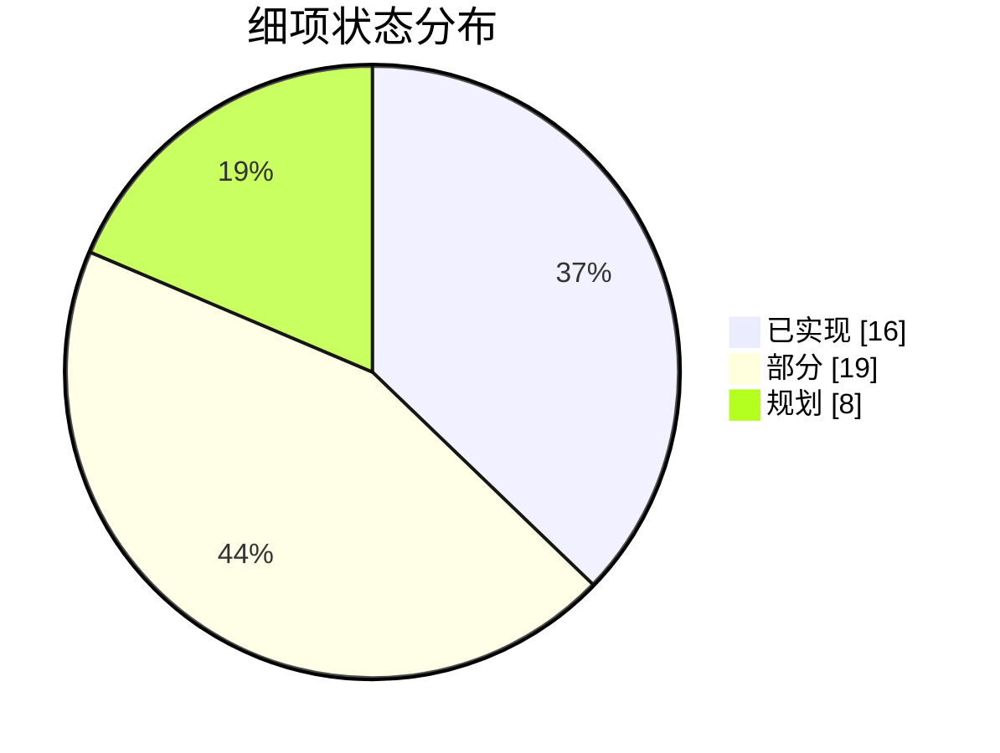

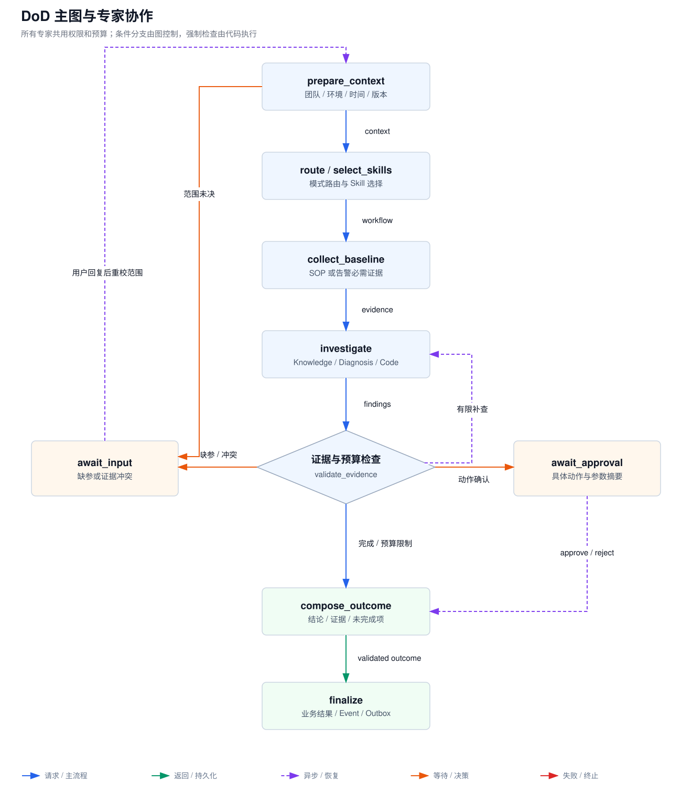

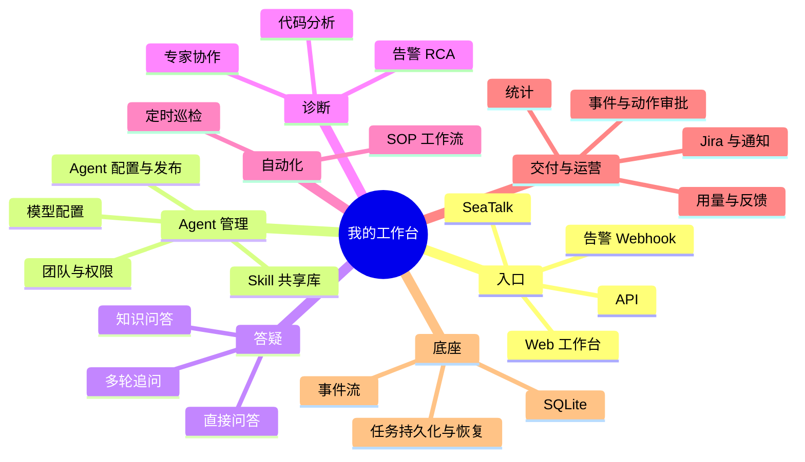

## 5 关键用户流程

**本章回答：用户怎样完成一次提问、一次告警诊断、一次 Skill 发布，每一步系统做了什么。**

### 5.1 提问 → 结果 → 追问

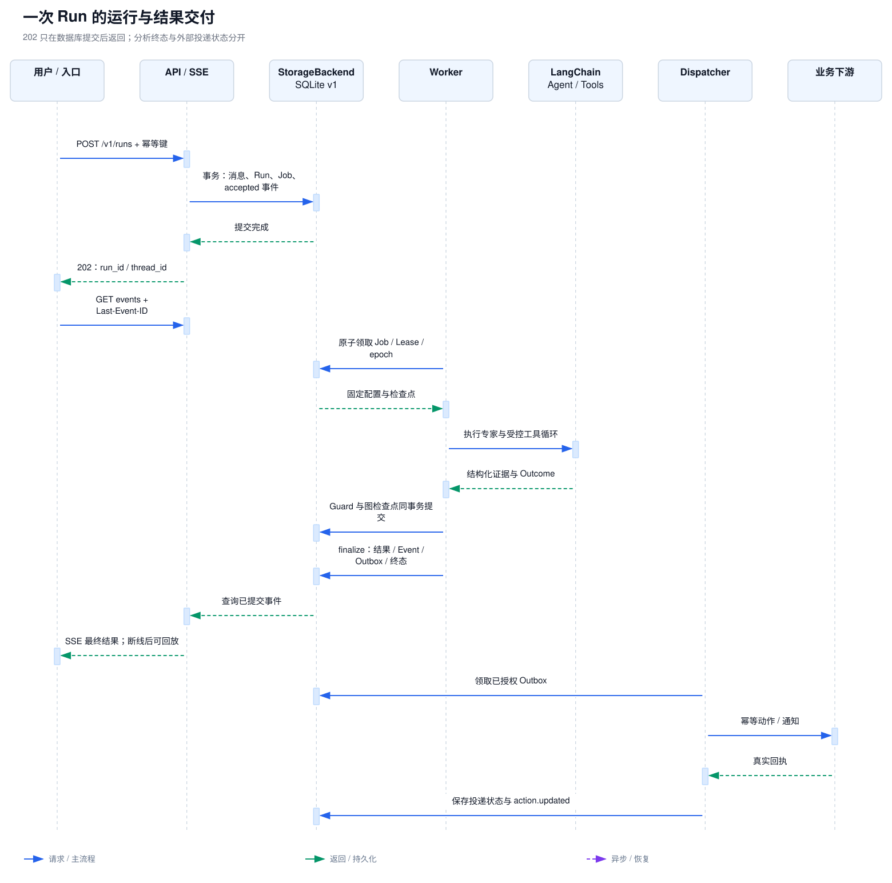

流程要点：

1. 用户选择 Agent 并选择"问答方式"（纯 LLM 问答或知识问答），提交问题。
2. 系统立即返回"已受理"，不等待模型；任务进入"排队中"。重复提交同一请求只会产生一个任务。
3. Worker 领取任务，按受理时固定的配置调用模型，写入结果。
4. 用户在任务记录或详情页查看状态与结果；执行中的任务自动刷新。
5. 在会话页追问：系统新建一个 Run，并带入同会话内已完成的最近 N 轮问答（默认 8 轮，可配置 0–8）。

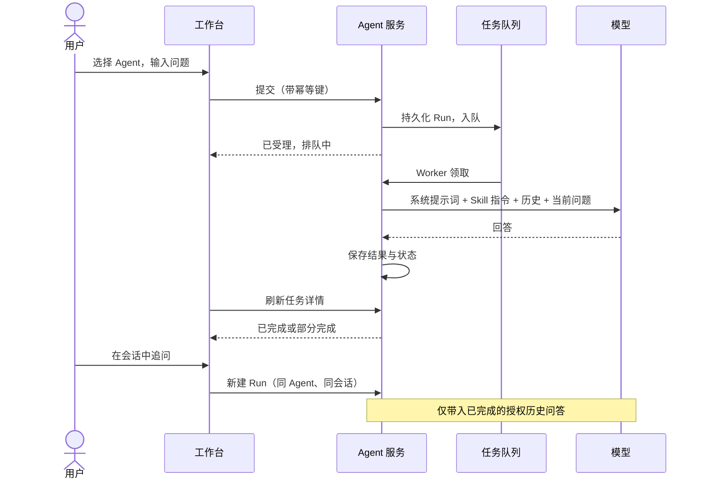

追问的边界：

| 情形 | 产品行为 |
| --- | --- |
| 同会话仍有未结束的任务 | 拒绝新追问，提示"会话忙" |
| 历史中含不兼容的旧工作流 | 提示新建会话 |
| 历史轮数设为 0 | 不带历史，但会话记录保留 |
| 历史过长 | 按模型上下文与预算裁剪；不自动摘要 |
| 模型回答 | 前缀"以下内容由模型生成，未经外部知识源验证" |

### 5.2 告警诊断 → 人工补充 → 确认

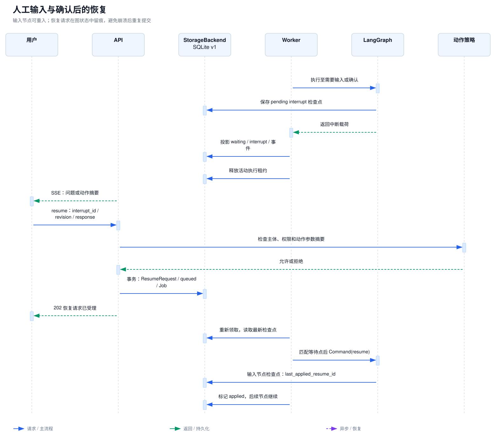

告警进入后，系统先确认服务、环境、区域与时间窗。若区域缺失或冲突，任务进入"等待输入"，值班人补充具名区域后，原任务继续（不新建任务）。随后系统采集基线并生成"分析未完成"的报告；如配置了动作提案，会生成待审批的 Jira/SeaTalk 动作，人工确认后才由发送器执行。

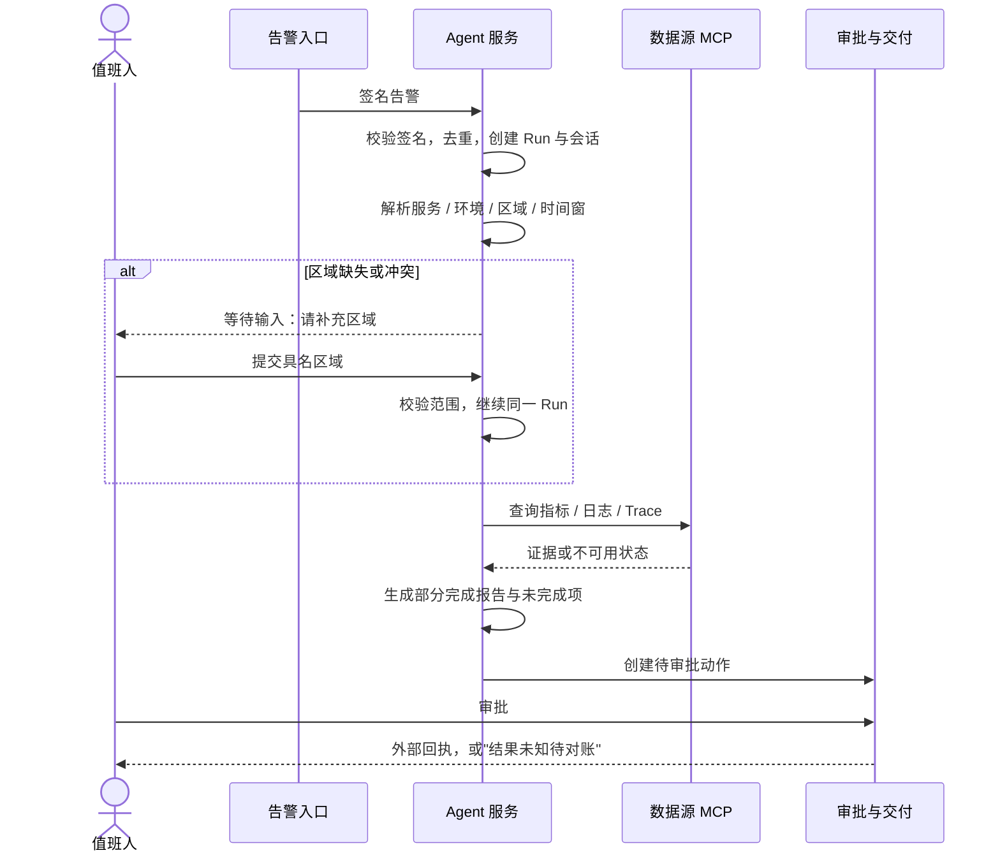

要点：

- 缺区域时不会"猜一个区域继续"。
- 基线读取成功不等于根因确认，也不把业务判为正常。
- 动作"已创建提案"、"已审批"、"外部已确认"是三个独立状态；只有收到回执才显示 Jira 已创建或通知已送达。
- 已发送但响应丢失的动作显示为"结果未知"，不会自动重发。
- 当前状态：网页支持补充区域和 Run 级等待审批；外部 Action 审批仍需通过接口处理。

### 5.3 Skill 管理与发布

Skill 是团队共享资产，创建一次，被多个 Agent 引用；Skill 的新版本不会自动升级任何 Agent。

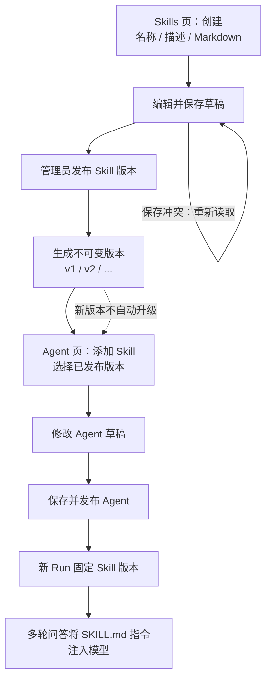

| 环节 | 规则 |
| --- | --- |
| 创建 | 名称限小写字母、数字、连字符，最长 128；描述非空，最多 1000 字符；正文非空，最多 32000 字节 |
| 草稿 | 只能改描述与正文，名称不可改；保存不改变已发布版本 |
| 发布 | 管理员操作；每次发布生成新版本，旧版本不可修改 |
| 绑定 | 每个 Agent 最多 16 个不同 Skill，同一 Skill 不可同时绑多个版本 |
| 生效 | 绑定或换版后须保存并发布 Agent；已受理的任务保留原版本 |
| 回滚 | 在 Agent 上换回旧版本并重新发布 |
| 可用性 | 绑定的 Skill 不可用（缺失、损坏、被撤权）时，任务以部分完成结束，不会少加载 Skill 继续回答 |
| 范围 | 当前只加载 Markdown 指令；Skill 不会授予工具、密钥或网络权限 |

### 5.4 Run 生命周期（用户视角）

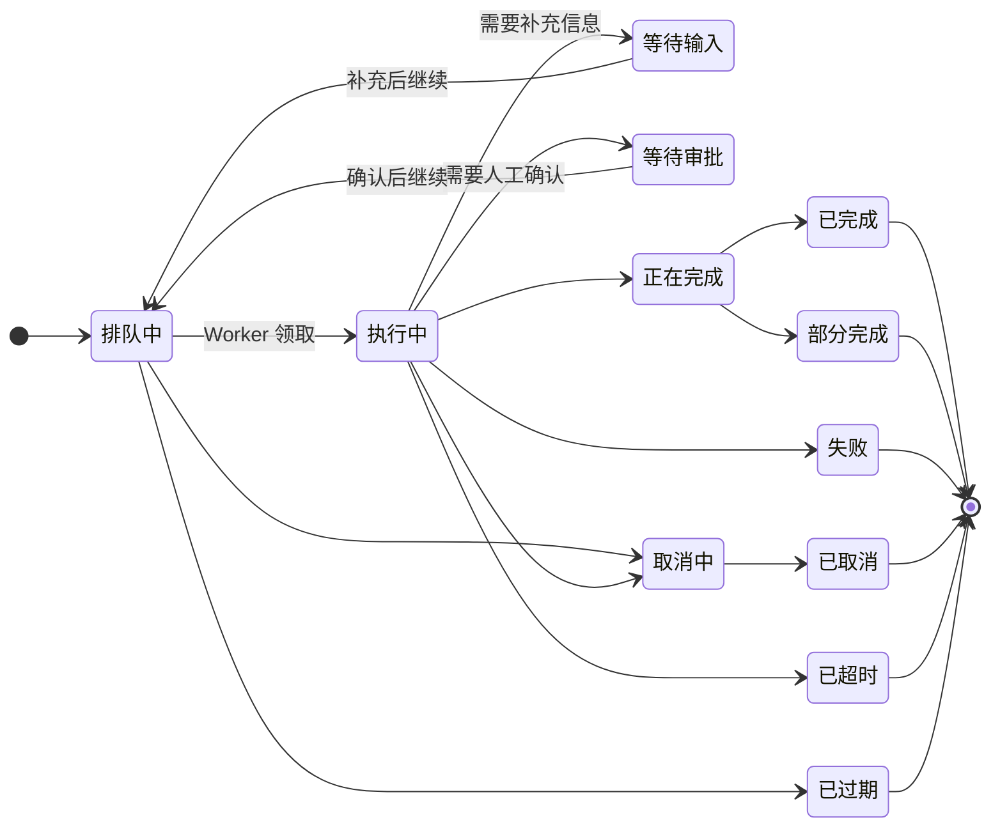

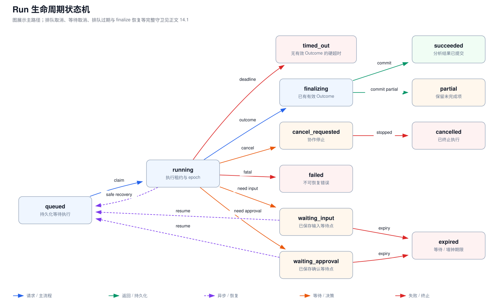

阅读指引：

| 状态 | 含义 | 界面应如何呈现 |
| --- | --- | --- |
| 排队中 | 已持久化，等待执行 | 不显示百分比 |
| 执行中 | Worker 正在处理 | 自动刷新 |
| 等待输入/审批 | 需要人处理，不占用执行资源 | 提示需要谁做什么 |
| 部分完成 | 有结果但有未完成项 | 与"已完成"区分展示，列出未完成项 |
| 已取消 / 已超时 / 已过期 | 非正常终止 | 保留原因 |

## 6 管理端

**本章回答：管理端有哪些页面，各自交付到什么程度，Agent 可以配置什么。**

### 6.1 信息架构

主导航为工作台、任务记录、会话、事件中心；管理导航为 Agent 管理、模型配置、Skills、工具连接、定时任务、数据统计。身份方面，本地界面使用 Bearer Token，仅保存在当前标签页；这不是完整的生产登录。

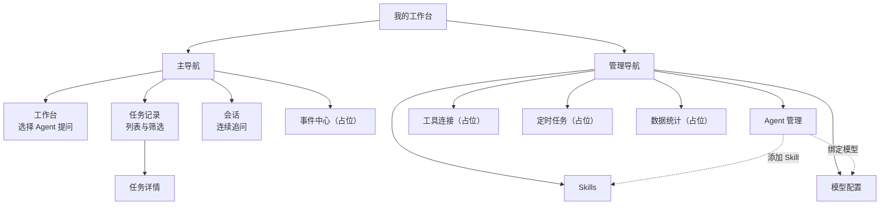

### 6.2 页面与交付状态

| 页面 | 状态 | 已有功能 | 缺口 | 状态依据 |
| --- | --- | --- | --- | --- |
| 工作台 | ✅ | 选择 Agent、选择问答方式、提交问题 | 提交成功不代表模型已完成 | views/Workbench.vue |
| 任务记录 | ✅ | 真实任务列表，按 Agent、状态筛选，游标分页，批量费用摘要 | 产物列 | views/Runs.vue |
| 任务详情 | 🟡 | 状态、结果、证据 ID、所属 Agent、实时流、取消、等待处理、用量与反馈 | 外部 Action 审批、证据详情、时间线 | views/RunDetail.vue |
| 会话 | ✅ | 会话列表、新建、查看消息、连续追问，冲突与不兼容提示 | 无会话重命名与归档 | views/Threads.vue |
| Agent 管理 | ✅ | 创建、草稿编辑、保存、发布；工作流/模型/提示词/偏好/上下文/预算；添加与移除 Skill、选版本 | 仓库、工具绑定无表单 | views/Agents.vue |
| 模型配置 | ✅ | 模型草稿、发布版本、探针 | 密钥由部署提供，页面不管理凭据值 | views/Models.vue |
| Skills | ✅ | 查询、创建、草稿保存、发布、历史版本查看、未保存提示 | 仅单文档 Markdown；无多文件包、远端拉取 | views/Skills.vue |
| 工具连接 | ✅ | admin 按 Agent 查看部署授权连接、发现工具、维护只读绑定 | 跨业务工具 | views/Tools.vue |
| 定时任务 | ⏳ | 占位（后端接口已有） | 计划、历史、手动触发 UI | views/Placeholder.vue |
| 事件中心 | ⏳ | 占位（后端接口已有） | 事件结论、证据、跟进 UI | views/Placeholder.vue |
| 数据统计 | ✅ | stats-v1 汇总、费用完整性、缺口与日趋势 | 更多维度和导出 | views/Statistics.vue |
| 示例任务详情 | 演示 | 显示"示例任务，非真实数据" | 不属于真实记录 | views/DemoRunDetail.vue |

页面统计：✅ 6、🟡 1、⏳ 4（另有 1 个演示页）。后端接口存在不代表页面完成。

### 6.3 Agent 配置项

配置生命周期：创建 Agent → 编辑草稿 → 保存 → 显式发布 → 新任务固定该版本。

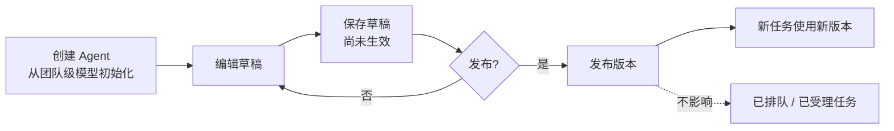

| 配置项 | 取值与限制 | 生效说明 |
| --- | --- | --- |
| 名称与描述 | 描述最多 1000 字符 | 仅作管理说明，不进入模型指令 |
| 工作流 | 默认"仅记录输入"；直接问答选 v17（单轮）或 v18（多轮） | 工作流决定可做什么；直接问答只支持问答模式 |
| 模型 | 默认模型必填；可按角色（如汇总）指定模型 | 角色未指定时用默认模型；精确版本固定 |
| 系统提示词 | 最多 12000 字符 | 作为 Agent 指令进入模型；不改变权限与工具授权 |
| 回复语言 | 自动 / 中文 / 英文 | 提示偏好，不做严格语言检测 |
| 回复格式 | 默认 / Markdown / JSON | 提示偏好，不保证合法 JSON |
| 上下文：历史轮数 | 0–8，默认 8 | 仅多轮工作流；是最大值，实际受上下文窗口与预算约束；0 不传历史但不删除记录 |
| 预算 | 耗时、模型调用数、工具调用数、Token，均可留空 | 与系统限制取小；留空不等于无限 |
| Skill | 最多 16 个，精确版本 | 多轮工作流加载其 Markdown 指令；单轮不加载 |
| 仓库与工具 | 高级配置，保留合法字段 | 直接问答不使用 |

"上下文管理"目前只管理最近历史问答的输入窗口，不包含自动摘要、知识库、长期记忆或跨会话记忆。

### 6.4 添加 Skill 的交互

| 操作 | 行为 |
| --- | --- |
| 打开弹窗 | 重新读取共享库，聚焦搜索，可按名称或描述过滤 |
| 选择 | 多选，默认最新已发布版本；已绑定与未发布项不可选 |
| 数量 | 现有绑定加待选不超过 16 |
| 添加 | 仅追加到本地草稿，不直接保存或发布 |
| 取消 / 关闭 / Esc | 丢弃本次选择，不改变绑定 |
| 换版与移除 | 原位替换版本、保留顺序；仍须保存并发布才生效 |
| 无法解析的历史引用 | 保留并标记"无法解析的技能"，不静默删除 |
| 加载失败 | 不清空已有绑定 |

### 6.5 发布与异常体验

| 情形 | 产品要求 |
| --- | --- |
| 保存失败 | 保留输入，提示修正；版本冲突提示重新读取 |
| 保存 ≠ 生效 | 草稿保存后明确提示"需发布才对新任务生效" |
| 新建 Agent 缺模型 | 提示"模型不可用"的具体原因，不借用其他 Agent 的模型 |
| 发布模型后 | Agent 须重新绑定并发布，新任务才使用新模型 |
| 部署凭据未授权 | 显示实际原因，不能靠重新创建 Agent 解决 |
| 状态区分 | 空数据、无权限、服务不可用、排队、执行中、部分完成、失败必须可区分 |
| 错误提示 | 保留错误码与可读提示，如模型不可用、会话忙、工作流不兼容 |
| 外部动作 | "分析完成"、"通知待投递"、"动作待对账"分开显示 |
| 进度 | 不以固定秒数生成虚假百分比 |
| 演示数据 | 必须明确标识，不得混入真实记录 |

### 6.6 页面信息架构（页面关系）

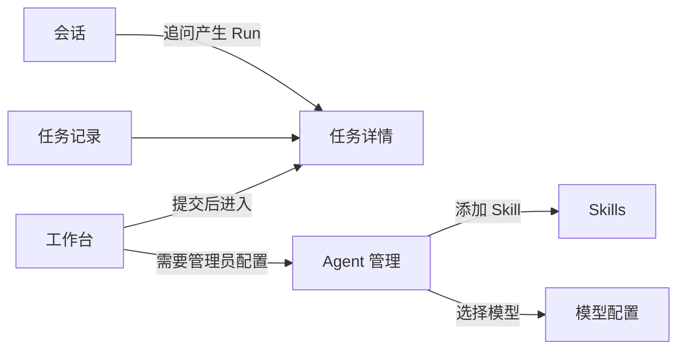

## 7 非功能目标

**本章回答：服务应满足什么容量、可用性与恢复目标。**

**以下全部为目标值，非实测。** 它们是验收门槛，需在后续容量与故障测试中验证；仅"90 秒内恢复"在 M1 本地故障演练中有实测记录（见第 8 章），其余尚无实测。

### 7.1 容量与服务目标

| 项目 | 目标值（非实测） | 说明 |
| --- | --- | --- |
| 受理延迟 | p95 ≤ 500 毫秒 | SQLite 本地持久磁盘、低竞争；不含模型执行 |
| 在线并发 | 1 个 Worker、2 个并发 Run | SQLite 首版；服务型数据库 20 并发另行验证 |
| 团队公平性 | 单团队最多 2 个活跃 Run | 多团队轮转，防止独占 |
| 任务恢复 | Worker 故障后 90 秒内安排恢复 | 前提：存储与工具可用 |
| 事件回放 | 保留期内可从断点续传 | 重复事件按序号去重 |
| 事件可靠性 | 提交确认后进程重启不丢任务与事件 | 不依赖进程内存 |
| 操作一致性 | 同一逻辑动作幂等；不确定结果可见 | 可对账 |
| 资源控制 | 模型与工具执行受 Run 预算约束 | 恢复不刷新额度 |
| 输入与状态 | 输入默认 ≤ 64 KiB；单个持久化状态 ≤ 2 MiB | 超限返回明确结果 |

### 7.2 约束与恢复

| 主题 | 说明 |
| --- | --- |
| 单机存储 | SQLite 同一时刻只有一个写事务；多主机或更高写入量需迁移到服务型数据库 |
| 不支持 | 不得把 SQLite 文件放在网络文件系统上作横向扩容 |
| 缓冲 | Redis 仅用于加速通知；不可用时仍可受理与读取，通知回退到数据库 |
| 进程故障 | 依赖已提交记录恢复 |
| 存储故障 | 依赖部署的备份与复制；SQLite 与 Skill 对象目录须一起备份与恢复 |
| 开放外部写动作前 | 须执行一次数据库恢复、对象引用校验、动作对账演练 |

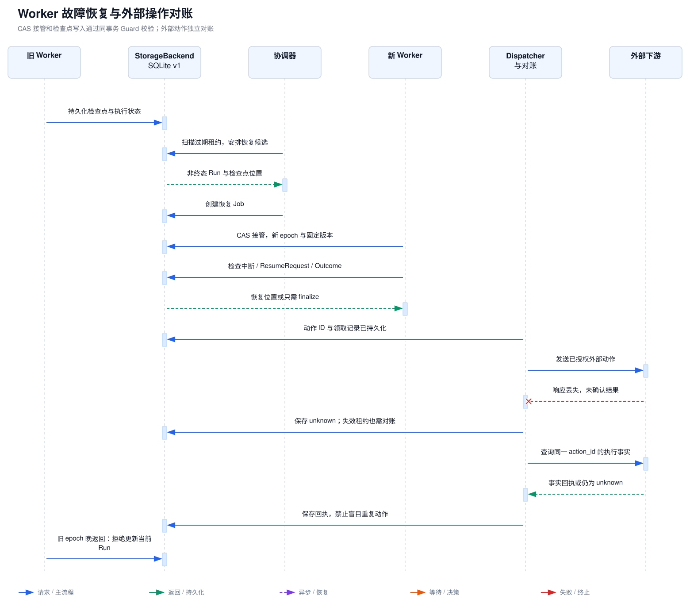

## 8 验收标准

**本章回答：怎样证明各项能力达标，完成的标准是什么。**

**各能力域的验证口径**

验收分四层，能力的"已实现"只按最弱一层标注：

| 层次 | 证明什么 | 不能证明什么 |
| --- | --- | --- |
| 源码 + 单元/契约测试 | 规则、状态转换、幂等、边界校验存在 | 真实依赖可用 |
| 本地合成验收（含真实 MCP 协议、合成上游、本机 MinIO、本机 Podman） | 协议与控制流闭环 | 企业数据源、真实容器平台、生产网络 |
| 真实服务验收（DeepSeek 等已单独验证的服务） | 该服务在目标凭据下可用 | 其他外部系统同样可用 |
| 端到端业务回归 | 用户场景可走通且失败路径正确 | 容量与恢复演练 |

当前多数能力停在第二层：M1 运行底座（SQLite、租约、恢复、备份恢复）与 M2 执行骨架（模型、MCP 协议、专家、预算）已有本地验收；M3 的告警、SOP、审批交付只在合成环境验证；真实监控/日志/Trace、Jira、SeaTalk、DoD 与生产 TLS 尚未验收。上述结论已并入 §4 能力状态与 §9 已知缺口，不再保留单独的验收记录清单。

### 8.1 需求覆盖

原文共 50 个验收用例（AT-01 至 AT-50），此处按能力域归并。

| 能力域 | 覆盖需求 | 通过条件概要 | 对应用例 |
| --- | --- | --- | --- |
| 受理与幂等 | FR-01、FR-10 | 同键重复提交只产生一个任务；断线后可查回 | AT-01 |
| 权限隔离 | FR-02、FR-08 | 跨团队读取、事件、恢复、取消与工具调用均被拒绝 | AT-03 |
| 知识问答 | FR-03、FR-06 | 真实检索产生可访问引用；检索失败不伪装未命中 | AT-04 |
| 告警诊断 | FR-04、FR-05 | 同一时间锚点查询监控/日志/Trace，按需分析代码 | AT-05、AT-06 |
| 专家协作 | FR-05、FR-08 | 权限取交集、共享预算、并发上限有效 | AT-07 |
| Skill 与 Runner | FR-06、FR-07 | Skill 按版本加载；脚本在 Runner 执行并产出产物；越界与超限受控 | AT-08、AT-09 |
| SOP 与巡检 | FR-09 | 必需步骤失败时结果为部分完成或失败；定时触发去重 | AT-10、AT-11 |
| 恢复与取消 | FR-10、FR-13 | 终止 Worker 后接管恢复；中断/恢复不重复；取消不被晚到结果覆盖 | AT-12 至 AT-16、AT-23、AT-27 |
| 业务交付 | FR-11 | Event、Jira、通知回执可关联同一任务；不盲目重发；未知结果可对账 | AT-17、AT-18、AT-24 |
| 运营评估 | FR-12 | 费用可汇总，未知计费不显示为零；反馈与基础统计可查 | AT-19、AT-20 |
| 存储与后端 | FR-13 | SQLite 重启、竞争、备份恢复通过；MySQL/PostgreSQL 契约后续 | AT-25 至 AT-32 |
| 模型配置 | FR-02、FR-03 | 种子不覆盖已发布配置；密钥不入库、不入日志；不可用时不静默换模型 | AT-33 至 AT-36、AT-41 |
| 工作台 | FR-01、FR-02、FR-03、FR-10 | 真实任务可查回并显示所属 Agent；发布提示词后仅新任务生效；多轮带入授权历史；0 轮不带历史；跨 Agent/会话/团队不混入 | AT-37 至 AT-40 |
| Agent 领域 | FR-02、FR-13 | 新库初始化通过；旧 Workspace 库安全拒绝并保持数据 | AT-42 |
| 共享 Skill | FR-02、FR-06、FR-12 | 创建/保存/发布分离；团队隔离；幂等；版本冲突；不可变历史；添加弹窗行为；固定 Skill 文本进入模型输入；损坏/撤权/缺失阻止模型调用 | AT-43 至 AT-46 |
| 可观测性 | FR-03、FR-05、FR-10、FR-12 | 日志与 Trace 统一关联；遥测故障不影响业务；模型用量可在 Langfuse 查回 | AT-47 至 AT-50 |

### 8.2 测试层次与业务门槛

| 层次 | 内容 |
| --- | --- |
| 单元 | 状态转换、参数校验、版本解析、预算、幂等 |
| 契约 | 模型网关、MCP、Runner、知识、监控、日志、Trace、Jira、SeaTalk |
| 集成 | 真实 SQLite 文件、检查点、任务领取、事件回放、人工恢复 |
| 故障 | 进程终止、数据库断连、租约失效、旧 Worker 晚写、丢响应、重复消息 |
| 业务回归 | 不少于 30 个人工标注案例，其中不少于 10 个已确认根因的告警案例 |

业务门槛（有限验收集上的发布门槛，非生产总体准确率）：

| 指标 | 目标值（非实测） |
| --- | --- |
| 证据引用正确率 | ≥ 95% |
| 人工认可的可用答复比例 | ≥ 80% |
| 已确认根因案例的主要根因匹配率 | ≥ 80% |
| "工具不可用却输出正常"漏检 | 0 |
| 越权访问漏检 | 0 |

### 8.3 完成标准

以下是完整 DoD P0 的完成标准，不是当前直接 LLM 工作台已全部完成的声明。

1. FR-01 至 FR-12，以及 FR-13 的 SQLite 范围，均有真实可演示路径和验收记录；MySQL/PostgreSQL 适配后续完成，不以 SQLite 验收冒充。
2. 完整跑通告警接入、Skill、真实证据采集、代码分析、人工补充、事件记录和跟进交付。
3. 重启、重复请求、事件重连、取消、超时、未知外部动作、权限隔离用例通过。
4. 接口文档、迁移、运行配置、启动命令和运维检查版本一致。
5. 管理界面能看到真实状态、工具证据、费用与外部回执，最终报告保留未完成项。
6. 容量、故障恢复与备份恢复已执行验收；不以"模型调用成功"替代。

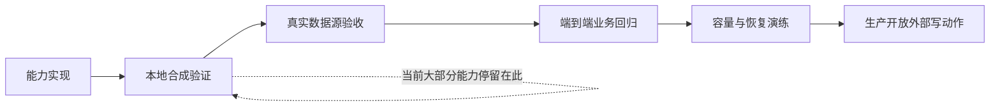

### 8.4 按场景的可观察验收

下表将“页面可见”“后端有接口”“真实外部服务已验收”分开。执行时应保留请求、Run 状态、最终 Outcome 和所引用的验收记录；一次正常返回不能覆盖失败路径。

| 场景 | 用户动作与期望观察 | 失败路径与边界 | 当前交付判断 |
| --- | --- | --- | --- |
| 直接单轮提问 | 选择已发布的直接问答 Agent，提交问题；得到 Run ID，稍后在任务详情看到回答和终态 | 无模型凭据、模型超时或预算耗尽时显示明确失败/部分结果；回答提示未经过外部知识源验证 | 本地与模型服务路径已有实现；按部署凭据验收 |
| 同一会话追问 | 在同 Agent Thread 内提第二个问题；回答可使用有界的已完成历史问答 | 跨 Agent 不共享历史；未完成 Run 不应作为已完成问答注入；超出历史窗口不承诺记忆 | v18 有界历史已实现，非长期记忆 |
| 知识问答 | 提交带业务范围的问题，v16 返回来源摘录；v19 可返回带引用结论 | 缺少证据、引用或支持检查失败时保持未完成 | 部分；需要真实模型与结论质量验收 |
| 告警诊断 | 绑定告警和查询范围，看到指标/日志/Trace 基线状态和未完成项 | 单一数据源缺失时不得输出“正常”或已验证根因；补充输入后可恢复 | 合成路径已验收，真实源待接入 |
| 代码分析 | 固定仓库快照后引用确定 commit、路径和行号 | 仓库未授权、快照过期或文件缺失时不得引用实时工作区伪装为固定证据 | 代码快照路径存在，真实仓库绑定需按部署验收 |
| Skill 发布 | 管理员编辑并发布 Skill，再把精确版本绑定到 Agent 并发布 Agent；新 Run 使用新指令 | 仅保存草稿、仅发布 Skill、旧 Run 恢复均不能自动换版；资源哈希不符时拒绝加载 | 共享库与绑定已实现，脚本/引用资源自动执行未交付 |
| SOP/巡检 | 发布流程、设定触发，查看 Run 与步骤结果 | 条件跳过需显式记录；步骤失败不得被当作全成功；并行执行不在当前实现内 | 串行与定时路径已实现，页面和真实源待验收 |
| 外部动作确认 | 查看动作目标与参数，按当前授权确认，追踪动作与投递状态 | 确认过期、参数变更或无法确认回执时拒绝或保留 unknown，不因 Run 成功就显示投递成功 | 本地模拟回执已实现，真实连接器待验收 |
| 离线恢复 | 断开浏览器后返回任务详情，仍能查到 Run；Worker 重启后状态可恢复 | 重复提交不应产生第二个 Run；旧 Worker 不得覆盖新结果 | 后端故障测试已有覆盖，生产运行需单独验收 |

**完成口径**：一个场景只有在页面交互、后端状态、权限与失败路径、目标环境的真实依赖均按要求通过时，才能标为完整交付。合成数据验证用于证明协议和控制流；对监控、日志、SeaTalk、Jira、DoD 的真实接入须保留独立验收记录。

## 9 已知缺口与风险

**本章回答：现在还不能做什么，哪些"看起来有"的东西其实没有，哪些结论不能对外承诺。**

### 9.1 用户可见的缺口

| 缺口 | 现状 | 影响 |
| --- | --- | --- |
| 真实 SeaTalk / 告警平台入口 | 只有 `synthetic-chat-v1` / `synthetic-alert-v1` 测试协议，生产启动时拒绝绑定 | 真实消息进不来；回调签名、challenge、事件 Schema 均未实现 |
| 管理端占位页面 | 工具、计划、事件、统计四个路由指向 `Placeholder.vue` | 路由存在不等于功能交付 |
| Web 交互不完整 | 详情页的取消、区域输入、Run 级审批和流式展示待人工验收；外部 Action 审批无页面 | 外部 Action 仍需通过接口处理 |
| 知识问答的质量验收 | v19 有引用校验和独立模型支持检查，v16 仍仅返回摘录与 `partial` | 检查通过不等于事实或业务质量已验证 |
| 真实监控 / 日志 / Trace 基线 | 图流程完整，数据来自合成上游 | RCA 结论不能用于真实故障定责 |
| 外部动作投递 | 只有本地模拟发送器，默认未配置真实发送器 | Run 成功不代表 Jira / SeaTalk / DoD 已收到 |
| Skill 的引用资料与脚本 | v18 只加载绑定的 `SKILL.md` 文本 | 引用资源与脚本不会自动加载或执行 |
| 产物下载 | API 的生产签名器尚未装配 | 部分环境下载不可用 |
| 长期记忆 | 仅 v18 有界加载同会话已完成历史（≤ 8 轮、16000 字节） | 跨会话记忆不存在，也不在 P0 计划内 |
| 并行调查 | 多专家顺序执行；SOP 按 DAG 串行 | 长任务耗时高于目标设计 |

### 9.2 技术与验收缺口

| 缺口 | 现状 |
| --- | --- |
| MySQL / PostgreSQL | 只有 `SQLiteBackend`；契约已定，适配器未实现，多主机部署未开放 |
| Prometheus / Grafana | 指标未接入，生产告警规则与 SLO 未交付 |
| 真实容器平台 | 本机 Podman 已验证隔离、限额、快照执行与清理；独立 Runner 服务的心跳、容量与镜像就绪未完成，生产 Docker 环境未验收 |
| 对象存储兼容性 | 本机 MinIO 已验证；其他 S3 兼容服务未验收 |
| MCP 上游协议 | `normalized-http-v1` 是自定义网关协议；真实知识库、Prometheus、日志平台需专用适配器 |
| MCP 权限时效 | 配置为启动时不可变快照，权限变更需受控重启，不能即时撤销在途调用 |
| 数据库约束 | Evidence/Scope 同 Run、Outbox 单例等约束目前由服务保证，数据库层缺 FK / 唯一约束 |
| 生产部署 | Compose 仅为样例；TLS 代理、容器编排与容量演练未做端到端验证 |

### 9.3 不能对外承诺的说法

- **不能**据 `doctor` 或 MCP `check` 成功推断外部系统可用：前者只查本地存储，后者输出 `business_query: not_checked`。
- **不能**把合成验收写成真实接入成功；合成数据只证明协议与控制流。
- **不能**用"模型调用成功"代替业务验收：回答未经外部知识源验证时会明确提示。
- **不能**把 `partial`、`empty`、`unavailable` 解释为业务正常；这几种状态都不构成"没有异常"的证据。
- **不能**把 Run 的 `succeeded` 当作外部动作已投递；投递是独立状态，`unknown` 需查证后对账。

### 9.4 主要风险

| 风险 | 后果 | 缓解 |
| --- | --- | --- |
| 唯一数据库后端是 SQLite | 单机、单 Worker、写竞争 | 短事务、租约与 fencing、显式备份恢复；第二后端验收后才开放多机 |
| 版本冻结与实时复核混用 | 恢复行为漂移或撤权后仍调用 | 发布新版本只影响新 Run；撤权在每次受保护操作复核 |
| 中断节点不可重入 | 恢复时重复执行副作用 | 副作用走 Action 协议，中断节点保持可重入 |
| 外部动作"已发送未确认" | 重复执行业务变更 | 发送前持久化 action_id 与参数哈希；`unknown` 只对账不重发 |
| 文档与实现漂移 | 状态被高估 | 每篇顶部标注 `verified_commit`；能力状态只在本文件维护 |

## 10 路线图

**本章回答：功能按什么顺序交付，目前到了哪一阶段，后续做什么。**

### 10.1 分阶段交付

| 阶段 | 产出 | 状态（据源码与验收记录） |
| --- | --- | --- |
| M1 运行底座 | 身份、Agent、Thread/Run、SQLite、任务领取与租约、事件流、恢复与取消 | 已完成并有验收记录 |
| M2 能力执行 | 模型配置、Skill、MCP、知识、仓库、Runner、专家、预算 | 代码已落地；真实容器、企业数据源待验收 |
| M3 DoD 链路 | RCA、SOP、巡检、人工参与、Event、DoD、Jira、通知 | 合成环境已验证；真实连接未验收 |
| M4 运营与发布 | 工作台、Agent 配置、任务记录、模型、会话、共享 Skills、日志与链路追踪；再扩展事件、统计、反馈、容量与备份 | 进行中：主要页面完成，4 个管理页占位 |
| M5 存储适配 | MySQL/PostgreSQL 与迁移工具 | 未开始 |

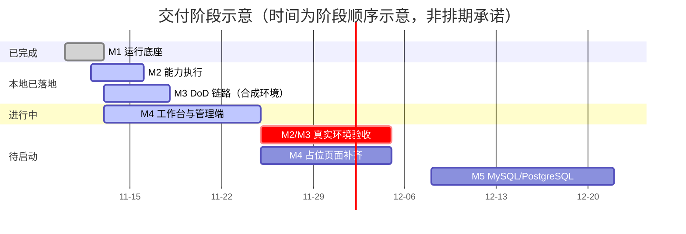

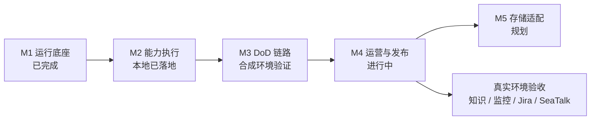

### 10.2 近期优先事项

| 优先级 | 事项 | 原因 |
| --- | --- | --- |
| 1 | 补齐任务详情的取消、补充输入、审批与流式展示 | 详情页实现已完成，需手工验收；外部 Action 审批另行实现 |
| 2 | 事件中心、定时任务、工具连接、数据统计页面 | 当前为占位 |
| 3 | 接通真实知识源、监控/日志源、代码仓库 | 完整 DoD P0 的前置条件 |
| 4 | 真实 SeaTalk、Jira、DoD 交付 | 当前仅本地模拟回执 |
| 5 | 生产登录、容器与发布验收 | 本地支持 Bearer Token，OIDC 已有实现，生产登录与部署仍需验收 |

### 10.3 后续扩展（不在 P0）

| 扩展 | 说明 |
| --- | --- |
| MySQL / PostgreSQL | 同一契约下的后端适配与跨后端迁移 |
| 历史周报页面 | 汇总历史任务与事件 |
| 自动 Skill 生成与优化 | 由评估结果驱动 |
| 复杂 TD 文档生成 | 复杂文档类任务 |
| 动态专家编队 | 任意专家组合 |
| 跨团队 NOC 父事件 | 多团队事件归并 |
| 自动变更处置 | 生产变更须通过明确注册的业务动作，不由通用 Shell 实施 |

## 11 术语表

| 术语 | 含义 |
| --- | --- |
| 我的工作台 | 产品名称；用户选择 Agent、提交任务、查看结果的统一入口 |
| Agent | 团队下独立可配置的工作对象 |
| DoD | 值班答疑、告警诊断与跟进场景；平台上的一种 Agent 业务配置 |
| Run | 一次任务执行，包括等待与恢复 |
| Thread | 会话，承载多条消息与多个 Run |
| Skill | 团队共享的能力说明，发布为不可变版本 |
| 工作流 | 决定任务如何执行的流程版本，如直接问答、知识问答、RCA、SOP |
| 发布 | 将草稿固化为不可变版本，新任务使用 |
| 草稿 | 可编辑、未生效的配置 |
| 模型配置 | 模型端点、参数与限制的版本化配置；密钥只存引用 |
| 预算 | 单个 Run 的耗时、调用次数、Token 上限 |
| 部分完成（partial） | 有结果但有未完成项，不等于成功 |
| QueryScope（查询范围） | 一次诊断的服务、环境、区域和时间窗 |
| Evidence（证据） | 工具或知识源返回、可核对的材料 |
| RCA | 告警根因分析 |
| SOP | 标准操作流程；版本化的固定步骤工作流 |
| 巡检 | 按计划触发的 SOP 检查 |
| Incident / Duty Event | 告警形成的事件记录 |
| Action / Approval | 外部动作提案 / 人工审批；动作结果独立跟踪 |
| Outbox | 待发送的外部动作队列 |
| MCP | Model Context Protocol，工具调用协议；本项目的 MCP Server 提供只读查询工具 |
| Runner | 受控的脚本与文件执行环境 |
| Worker | 领取并执行任务的后台进程 |
| Scheduler | 按计划触发任务的后台进程 |
| SSE | 服务端事件流，用于任务过程的实时推送与断点回放 |
| 幂等键 | 保证重复提交只生效一次的请求标识 |
| 租约 | Worker 对任务的临时所有权，过期后可被接管 |
| 固定版本 | 任务受理时锁定的配置、模型、Skill 版本 |
| 目标值 | 验收门槛数字，非实测 |

## 附录：核对记录

**以下为原文声称与源码实际不一致或需要澄清之处。**

| 编号 | 原文声称 | 源码/验收记录实际 | 影响 |
| --- | --- | --- | --- |
| C-01 | 第 20.2 节：任务详情"活动任务轮询刷新"，并列出会话页"关联 Run" | 详情页使用 SSE，连接失败后按 3 秒轮询；会话页 2 秒轮询 | 详情页支持草稿流，需完成真实浏览器验收 |
| C-02 | 第 1.2 节 FR-10 含"取消、等待输入/确认、恢复" | 网页已实现取消、输入和 Run 级审批，待手工验收 | FR-10 标为部分 |
| C-03 | 第 1.2 节 FR-01 含 SeaTalk 与告警 Webhook | 仅有 Synthetic 绑定类型的合成入口，且 M3 验收写明真实 SeaTalk 协议未接入 | 标为部分，勿视作已接入 |
| C-04 | 旧 QA 校验"成功收集后仍为 partial" | knowledge.scoped_excerpt 仍为 partial；knowledge.citation_review 增加引用与支持检查 | 真实模型和业务质量待验收 |
| C-05 | 第 9.1 节：Skill 完整加载目标含 scripts/references | 当前仅加载 SKILL.md（v18）；M2 验收文字曾写"Skill 分资源按需加载已实现"，与源码和原文 9.6 不一致 | 标为规划，并提示验收记录措辞存在冲突 |
| C-06 | 第 8.2 节：RCA"并行获取有限的知识与变更信息" | 实际顺序执行；M3 验收写明受控并行未完成 | 并行标为规划 |
| C-07 | 第 7.7 节：SOP "有限并行" 为 FR-09 目标 | 实现为拓扑序串行 | FR-09 并行标为规划 |
| C-08 | 第 20.2 节：工具连接、定时任务、事件中心、数据统计为 Placeholder | 与源码一致；占位页文案写"M3 接口完成后接入"，而原文称后端 API 已有 | 页面标为规划，后端另算部分 |
| C-09 | 第 1.2 节 FR-02 含"团队成员/角色" | 仅有成员读写接口，无管理页面；仓库、工具绑定同样仅接口 | 标为部分 |
| C-10 | 原文称 FR-12 含"知识缺口记录" | 评估与反馈模块和知识缺口页面存在；统计页为占位 | 标为部分/规划 |
| C-11 | 原文称"工作台提交支持直接问答与知识问答入口" | 页面提供"纯 LLM 问答/知识问答"单选，一致；知识问答依赖已配置的 MCP 知识源；内置知识库链路已实现，真实业务验收待完成 | 入口存在，能力部分 |
| C-12 | 原文第 2.3 节称 MCP 验收文档位于仓库独立目录 | 旧验收文本仍含 `workspace_id` 字样（旧契约残留）；结论已并入本节 §8 与 §9，原文件删除 | 残留差异已消除 |
| C-13 | 原文 9.2 节：知识缺口与评估 | evaluation 验收为离线命令，不调用模型 | 评估可用，但非在线功能 |
| C-14 | 原文状态：版本 1.9，描述中提到 HTML/ZIP 快照 | 属维护性说明，本文已去除 | 无产品影响 |

统计口径：细项状态已实现 16、部分 19、规划 8，合计 43 项；FR 总表 13 项均为部分。

## 内置知识库

维护者可在知识页面编辑或导入 Markdown，发布不可变版本、查看历史、归档或回滚；按团队和具体服务、环境、区域检索。知识缺口可转为草稿并重放原问题，解决或忽略须人工确认；原 Run 结果不被改写。新图 `knowledge.citation_review` 使用引用校验和另一次模型支持检查；检查不是事实真伪或回答质量的保证。仓库含真实 MCP 协议链路测试，但不代表真实模型或企业环境验收完成。

## 内置工作流目录

管理端列出并允许绑定八种工作流，详情页展示执行结构。对话（单轮）和对话（多轮）为推荐，其余为实验；新建 Agent 默认对话（多轮）和 QA 模式。实验工作流需在 Worker 配置中显式启用。

| 工作流 | 标识 | 运行入口与限制 |
| --- | --- | --- |
| 对话（单轮） | `conversation.single_turn` | 手动 QA；不使用历史或工具 |
| 对话（多轮） | `conversation.multi_turn` | 手动 QA；最多使用 8 轮历史 |
| 知识摘录 | `knowledge.scoped_excerpt` | 手动 QA；需要知识工具及查询范围，结果恒为部分完成 |
| SOP 巡检 | `sop.conditional` | 手动或定时；运行时需要已发布工作流 |
| 合成告警诊断 | `rca.synthetic` | 仅合成告警入口，当前适配器供本地集成测试 |
| 合成告警诊断（提案） | `rca.proposal` | 同上，生成单项操作提案 |
| 合成告警诊断（批量提案） | `rca.batch_proposal` | 同上，生成批量操作提案 |
| 知识问答（引用审查） | `knowledge.citation_review` | 手动 QA；真实知识源和范围隔离尚未验收 |

旧图 `dod.v1`–`dod.v11` 已退役；旧 ID 和数据不兼容，新协议切换前需清库重建。
