# 架构设计

> **读者**：架构师、技术评审人、新加入的核心开发。
> **回答**：为什么这样设计、契约与边界在哪、做了哪些取舍。
> **不写**：代码路径（见 [03 开发指南](03-development.md)）、字段字典与配置项（见 [06 参考](06-reference/)）、决策的完整论证（见 [05 决策记录](05-decisions.md)）。

**目录**

1. 设计目标
2. 总体架构
3. 领域模型
4. 工作流与 Agent
5. 运行时序
6. 状态机
7. 调度、并发与一致性
8. 容错与恢复
9. 存储设计
10. Skill、知识与 Runner
11. 工具、模型与预算
12. MCP Server 边界
13. 权限与操作确认
14. 可观测性
15. 迁移策略
16. 已知缺口与评审问题

---

## 1 设计目标

### 1.1 目标（G1–G7）

| 目标 | 说明 |
| --- | --- |
| G1 | 业务答疑、告警 RCA、代码分析、SOP 和定时巡检使用同一套任务与会话协议 |
| G2 | 在 Python 服务中实现 LangGraph 工作流及 LangChain Agent 循环，支持多模型与可替换工具 |
| G3 | 将现有 Skill、知识、仓库和工具资产接入新的运行时，具备运行脚本与管理产物的能力 |
| G4 | 任务在客户端断线、Worker 重启、重复请求和工具失败后仍保持可解释的状态 |
| G5 | 分析结论包含证据、影响和未完成项，可进入事件、DoD 跟进、Jira 及通知流程 |
| G6 | 团队、用户、独立 Agent、运行配置和工具权限可以管理，运行成本和效果可以追踪 |
| G7 | 业务逻辑、任务、事件与图检查点共同支持可替换的数据库后端；首版使用 SQLite，不依赖 PostgreSQL 专用特性 |

### 1.2 非目标（明确不做什么）

- 首版不实现 MySQL/PostgreSQL 适配器，但预留统一 `StorageBackend` 契约，确保后续可替换。
- 首版不实现 Prometheus 指标暴露和 Grafana 仪表板；结构化日志与 OpenTelemetry Trace 的核心链路已实现，真实服务待验收。
- 不提供通用 Shell 执行能力；生产变更通过明确注册的业务动作接入。
- 不自动生成跨会话长期记忆或 Agent 全局记忆。
- 不做 Agent 类型枚举或 Agent 市场；每个 Agent 是团队下独立可配置的对象。

### 1.3 关键决策索引

设计取舍的完整论证单独成文，见 [05 决策记录](05-decisions.md)。本章以下内容只保留结论与约束。

| 决策 | 一句话结论 |
| --- | --- |
| ADR-001 语言与服务框架 | Python 3.12 + FastAPI / Pydantic v2，单体进程组而非微服务 |
| ADR-002 外层图 + 内层专家 | LangGraph 管业务图状态，LangChain `create_agent` 管专家工具循环 |
| ADR-003 StorageBackend 抽象 | 所有持久化（含检查点）走同一后端与同一数据库事务 |
| ADR-004 持久化任务队列 | `run_jobs` 表即队列，条件更新领取，不引入外部消息队列 |
| ADR-005 四套状态机分离 | Run / Job / Action / Outbox 各自管理，互不代替 |
| ADR-006 版本冻结 + 实时复核 | 受理时冻结 VersionRef，执行时重新校验当前权限 |
| ADR-007 移除 Workspace | 领域直接是 Team → Agent → Thread → Run |
| ADR-008 独立 MCP Server | 只读取证能力独立进程、独立包、独立身份 |
| ADR-009 直接问答与知识问答分图 | 两张对话图使用模型回答；`knowledge.scoped_excerpt` 带检索且恒为 partial；`knowledge.citation_review` 校验引用并独立检查支持性 |
| ADR-010 SQLite 先行 | 单机、单 Worker、短写事务；WAL 不放网络文件系统 |

---

## 2 总体架构

### 2.1 部署进程

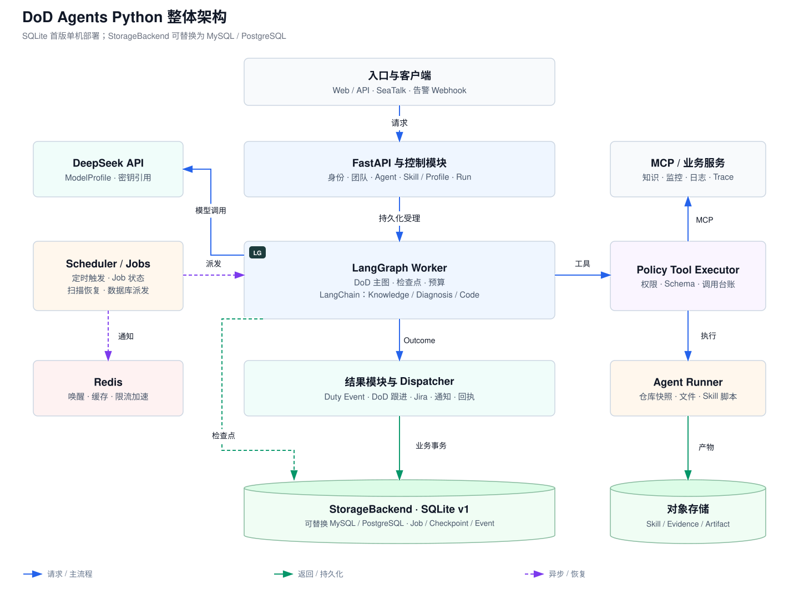

Agent 服务包含三个独立的常驻进程，使用同一配置和 SQLite 数据库：

| 进程 | 职责 | 部署约束 |
| --- | --- | --- |
| `api` | HTTP、SSE、Webhook、身份校验、配置和 Run 接口 | SQLite 首版部署在单机 |
| `worker` | 领取 Job、执行工作流、写入检查点和管理预算 | SQLite 首版一个实例、2 个 Run 并发 |
| `scheduler` | 扫描定时任务、超时和恢复工作 | 与其他进程同主机 |

以下不是常驻进程，而是维护命令或计划中的能力：

| 项目 | 运行方式 |
| --- | --- |
| Web 前端 | `npm run build` 生成静态资源，API 从 `/app/` 托管 |
| Dispatcher | 仓库中有实现，尚无独立服务启动命令 |
| Runner | Worker 按需调用；`workbench runner check` 仅检查运行环境 |
| `db migrate` / `bootstrap` | 一次性维护命令 |
| `doctor` | 一次性就绪检查 |

MCP Server 使用独立的 `workbench-mcp-server` 入口启动。

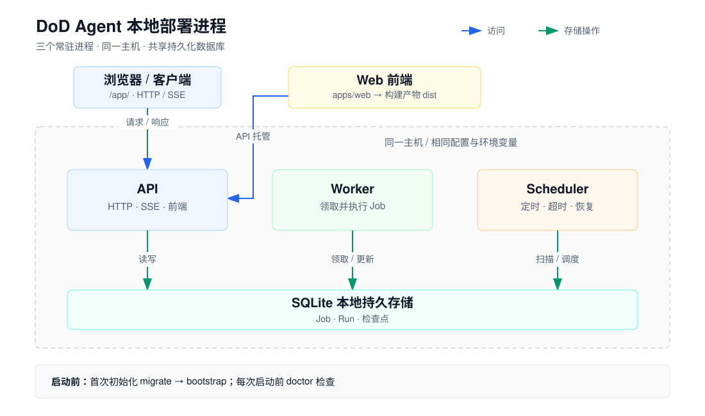

### 2.2 技术栈

| 层次 | 选择 | 理由 |
| --- | --- | --- |
| 语言 | Python 3.12 | 统一异步服务、Agent、数据处理与脚本生态 |
| API | FastAPI、Pydantic v2 | API、认证依赖、Schema、OpenAPI、SSE |
| 管理前端 | Vue 3、TypeScript、Vite、Element Plus | SPA 工作台，构建静态资源由 FastAPI 同源提供 |
| Agent | LangChain 1.x | 模型适配、create_agent、工具循环与结构化输出 |
| 工作流 | LangGraph 1.x | 节点、子图、状态、检查点及人工中断 |
| 首版模型 | DeepSeek + langchain-deepseek | ModelFactory 根据发布的 ModelProfile 构建，模型名与端点可配置 |
| 数据库 | P0 SQLite 3.51.3+；后续 MySQL 8.4 / PostgreSQL 16+ | 同一 StorageBackend 契约覆盖所有持久化 |
| 缓存 | Redis 7.2（可选） | 唤醒、缓存、速率限制；失效后可降级为纯轮询 |
| 文件 | S3 兼容对象存储 | Skill 包、仓库快照、原始证据、报告和脚本输出 |
| 数据访问 | SQLAlchemy 2 async、Alembic | 驱动和方言位于后端适配器，事务与检查点共用统一契约 |
| 可观测性 | 结构化 Logging、OpenTelemetry、Langfuse | 关联请求、Run、模型、工具和用量 |
| 依赖管理 | uv、uv.lock | 完整版本锁定；框架升级需经过恢复兼容验收 |

LangChain 的 Agent 是较高层执行抽象，LangGraph 提供有状态流程原语；二者不能代替完整的平台服务。

### 2.3 代码组织契约

项目为单体仓库，三个应用保持各自的依赖、构建与测试边界：

```text
workbench/
  apps/
    agent/                     Python 3.12，包名 workbench_agent
      src/workbench_agent/     api / application / domain / runtime / persistence /
                               skill_management / execution / tools / jobs / delivery /
                               connectors / incidents / evaluation / cli / runner
      tests/                   unit / contract / integration / fault / e2e
    mcp-server/                Python 3.12，包名 workbench_mcp_server
      src/workbench_mcp_server/  interfaces / application / domain / infrastructure
    web/                       Vue 3 + TypeScript + Vite + Element Plus
  config/
    local/agent.yaml
    workflows/                 工作流 YAML
  deploy/                      Dockerfile + compose
  docs/                        01-产品 / 02-架构 / 03-开发 / 04-运维 / 05-决策 / 06-参考
```

- Agent 与 MCP Server 不共享进程，也不共享 Python 包。
- Web 只通过 HTTP 访问 Agent API，由 Agent 的 `/app/` 路由托管构建产物。
- 运行时不得依赖工作目录猜测资源路径；`WORKBENCH_ASSET_ROOT`、`WORKBENCH_FRONTEND_DIST_ROOT` 等环境变量控制资源位置。

### 2.4 两层编排：LangGraph 与 LangChain

LangGraph 管理外层业务图的状态和推进；LangChain 提供模型、消息、工具及专家 Agent 工具循环。当前专家使用 `create_agent`，生成的 Agent 也基于 LangGraph 执行，因此是"外层业务图 + 内层专家图"两层编排。

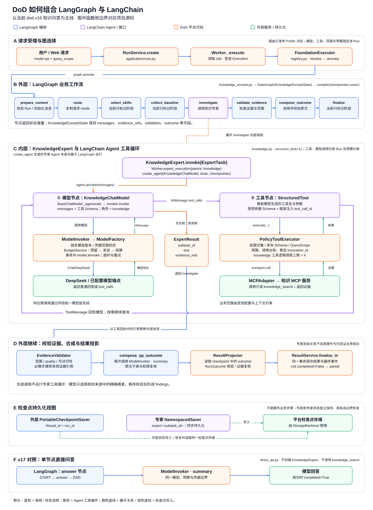

| 层次 | 使用接口 | 职责 |
| --- | --- | --- |
| 外层 LangGraph | StateGraph、add_node、add_edge、compile | 固定流程顺序、SOP 条件循环、图状态与检查点 |
| LangGraph 恢复 | interrupt、Command(resume=…)、aget_state、ainvoke | 等待用户、加载检查点、恢复可运行任务 |
| LangChain Agent | create_agent、BaseChatModel、StructuredTool、消息类型 | 在固定专家和工具集合内进行模型—工具循环 |
| 平台运行时 | Worker、Execution、PolicyToolExecutor、ResultProjector | 任务租约、取消和期限、当前授权、工具台账、证据与最终业务状态 |

### 2.5 管理模块

管理端以"Agent 管理、模型配置"为当前主线。每个 Agent 对应 `agents` 表中的独立身份，由 RuntimeProfile 管理草稿和不可变发布版本。同一工作台可配置多个 Agent，不增加独立 Agent 微服务。UI 展示业务 API 返回的数据，不直接读取 LangGraph 内部检查点表。

---

## 3 领域模型

### 3.1 身份与标识

**当前领域契约**：Team 下直接创建多个独立 Agent，每个 Agent 具有 `agents.agent_id` 和自己的 RuntimeProfile；Thread、Run、资源绑定、权限范围与幂等回执直接归属 Agent。不存在 Workspace 产品或领域实体。

**认证主体与授权上下文**

| 对象 | 内容与来源 | 边界 |
| --- | --- | --- |
| VerifiedIdentity | 验证器生成 subject、issuer，可带 team_hint、connector_id | 是认证结果，不是团队角色授权 |
| AuthContext | 解析后的 team_id、subject、roles、identity_kind、agent_scope | 请求级可信快照；不能把 Token 内角色作为最终权限 |
| RunContext | 接受 Run 时冻结的身份、配置与版本引用 | 保存在 runs.versions；不证明这些权限现在仍有效 |
| ExecutionGuard | team_id、thread_id、run_id、job_id、worker_id、run_epoch | 本次执行的所有权凭据；每次受保护写入必须在同事务核对 |

**关键标识语义**

| 标识 | 领域含义 | 关键约束 |
| --- | --- | --- |
| team_id / agent_id | 租户隔离边界 / 团队内独立 Agent 身份 | 所有关联校验团队与归属 |
| thread_id | 业务会话 | 承载多条 Message 和多个 Run |
| run_id | 一次业务执行（含等待和恢复） | 重试、接管和人工恢复均保留；新问题创建新 Run |
| job_id | 一个持久调度单元 | run_jobs 与 admin_jobs 不能混用 Guard |

业务 thread_id 与 LangGraph 的 configurable.thread_id SHALL 区分：图执行固定使用 run_id。同一 Thread 同时最多一个非排队活动 Run。

### 3.2 不可变 RunContext 与可修订 QueryScope

RunContext 是执行依据的接受快照，由 ContextResolver 与接受事务构造；用户正文、模型输出和工具返回不能提供或替换它。

| 字段 | 来源与不变量 |
| --- | --- |
| team_id、agent_id | 从认证与授权后的 Agent 解析，接受后不改 |
| subject、identity_kind | 发起者与身份类别快照；不保存 Token |
| agent_profile | 精确 runtime_profiles.profile_id、version、hash |
| graph_id | 固定已注册 Graph 实现；恢复不能换实现 |
| default_model | 指向 model_profile_versions.model_version_id 的发布引用 |
| skills、tools、repositories | VersionRef[] 固定版本集合 |
| conversation_history_turns | 多轮对话最大历史轮数；0–8，默认 8 |

VersionRef 是 `{resource_id, version, content_hash}` 值对象。排队/等待期间发布新配置不影响原 Run 的固定引用；权限撤销仍即时生效。

### 3.3 GraphState 与持久事实边界

GraphState 是图恢复所需的执行状态，物理存储为 graph_checkpoints 和 graph_pending_writes；它不替代 runs、evidence、usage 或 actions 的权威记录。

| 逻辑状态 | 权威边界 |
| --- | --- |
| 执行身份 | run_id 固定；授权和 Guard 不从模型消息还原 |
| messages | 图内消息按 stable message_id 更新；业务会话消息另在 messages 表 |
| 当前范围 | 只有可信上下文节点可变更，不接受专家直接覆盖 |
| 证据视图 | 正文和质量以 Evidence/当前 Scope 为准 |
| outcome | 候选先保存检查点，经验证后由最终投影事务落库 |

父图只合并专家结构化产出与证据引用；子图使用稳定 namespace 保留自身恢复历史。图状态默认上限 2 MiB。

### 3.4 Evidence 与 RunOutcome

Evidence 表达"在某个已授权 Scope、通过某次可追踪读取获得的观察"。由 evidence 元数据、evidence_payloads 有界正文或 Artifact、QueryScope 及工具回执共同组成。

RunOutcome 是值对象，经 Schema、证据、Scope、必要步骤和预算规则校验后保存。关键语义：

| 字段 | 含义 |
| --- | --- |
| schema_version / kind | foundation.recorded.v1 仅表示底座记录；analysis.v1 表示分析结果 |
| completed | false 必须列出 unresolved_items；模型不能靠填 true 绕过检查 |
| findings | 每项带证据；normal 需要当前有效 valid 证据及必需检查完成 |
| root_cause_hypotheses | unverified / supported / rejected；观察和根因分开 |
| unresolved_items | 缺证据、冲突、范围、权限、预算或未完成步骤的明确说明 |

completed=true 对应 succeeded，未完成但有效结果对应 partial。

### 3.5 版本、并发代数与恢复身份

| 维度 | 改变时机 | 不能替代的概念 |
| --- | --- | --- |
| 资源 version + content_hash | 发布新的模型/配置/Skill/工具/快照版本 | 不表示写锁或当前授权 |
| Agent/Run revision | 对应对象 CAS 变更 | 不表示执行所有权 |
| Job generation | 同 Run 创建新的续执行单元 | 不等于网络重试次数 |
| Run run_epoch | 原子获得/接管执行所有权 | 旧 epoch 的写入必须被拒绝 |
| QueryScope version | 显式创建新的业务范围修订 | 不刷新预算 |

### 3.6 外部动作、预算和对象可用性

- 只有可信业务服务能创建持久 Action，模型只提出建议。
- Action 固定 action_key、工具 VersionRef、QueryScope、目标和规范化参数摘要。
- BudgetReservation 表示一次实际调用的额度占用；UsageRecord 表示可信计量。
- Artifact 标记 available 前需通过对象存在、大小/摘要校验及当前范围证明。

### 3.7 领域关系与删除边界

下面的关系图只表达领域归属，精确外键、可空性与索引以 [02 数据字典](06-reference/02-data-dictionary.md) 及当前 Schema 为准。

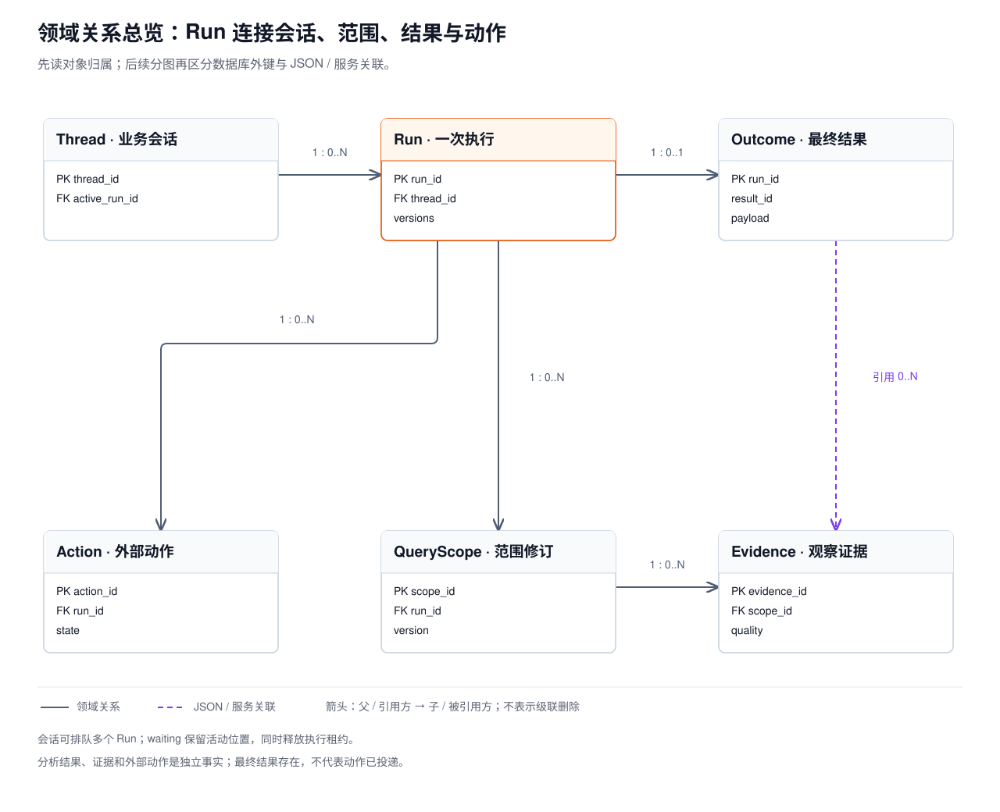

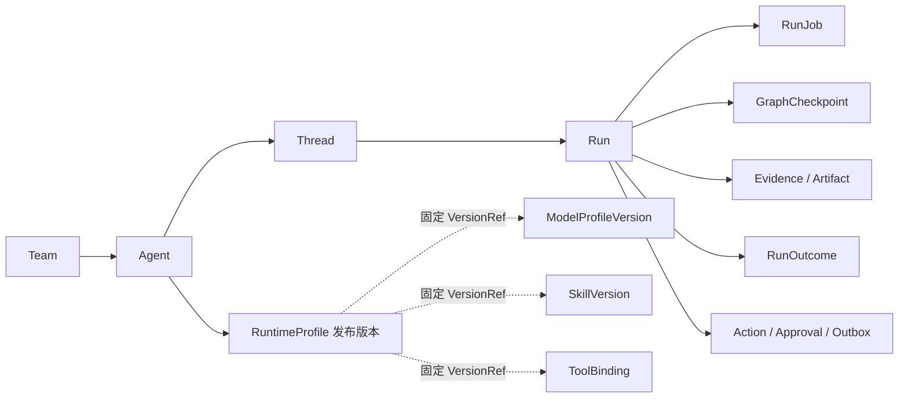

Run 是历史事实，删除或停用 Agent 不应改写历史 Run 的受理快照。业务 Thread 与 Run 的关联不能跨 Agent；同一 Run 的 Evidence、Artifact、Action 必须被同团队和同业务范围约束。允许为空的团队级 Skill/Model 归属不是"所有 Agent 自动有权"：Agent 发布绑定与当前授权仍需同时通过。后台清理 Checkpoint、Artifact 或 Skill 旧版本时，必须先确认没有可恢复 Run、历史审计或发布版本引用它们。

### 3.8 受理快照与当前授权的时间差

"固定版本"解决的是确定性，"实时复核"解决的是撤权。受理时把已发布的 Profile、图、模型、Skill、工具、仓库和 WorkflowVersion 固定到 RunContext；Worker 在实际读取资源、调用模型或工具时重新检查当前团队、Agent 与部署权限。若排队期间授权被撤销，不能因为旧快照仍包含某个 VersionRef 就继续调用。若只是发布新版本，旧 Run 仍用旧版本。两种变化的处理不同：

| 受理之后的变化 | 正在排队或等待的 Run | 新 Run |
| --- | --- | --- |
| 发布 Agent、模型或 Skill 新版本 | 继续固定旧版本 | 按新发布配置受理 |
| 停用或撤销 Agent/资源权限 | 下一次受保护操作复核并拒绝 | 受理阶段拒绝 |
| 修改未发布草稿 | 不受影响 | 不受影响，直到发布 |
| 删除旧资源对象或凭据 | 可能进入 capability blocked / partial；需要恢复或对账 | 仅能引用当前可用版本 |

此表是设计语义；具体错误码与状态映射按各应用服务实现核对。禁止通过"恢复时重新解析最新 Profile"掩盖旧版本资源缺失，否则同一 Run 在重启前后的行为会改变。

---

## 4 工作流与 Agent

### 4.1 工作流选择与版本固定

一次请求涉及以下独立配置：

| 配置 | 运行时来源 |
| --- | --- |
| graph_id | Agent 已发布 Profile；保存进 RunContext |
| Agent 行为与上下文策略 | Agent 草稿显式发布；受理时冻结，执行中不读取最新草稿 |
| 图状态 Schema 版本 | GraphRegistry 中与图实现关联，用于恢复时校验 |
| WorkflowVersion | SOP/巡检 请求指定的已发布工作流 |
| 模型、工具、Skill、仓库版本 | RunContext 中固定的版本引用；使用时仍检查当前权限 |

保存草稿不改变线上行为；发布后只有新 Run 使用新配置。

### 4.2 已注册的工作流拓扑

| 图 ID | 用途 | 节点链 |
| --- | --- | --- |
| knowledge.scoped_excerpt | 指定范围的知识摘录 | prepare_context → route → select_skills → collect_baseline → investigate → validate_evidence → compose_outcome → finalize |
| sop.conditional | SOP / 巡检 | prepare → step（按条件重复）→ compose |
| rca.synthetic | 合成告警 RCA | prepare → input → scope → bind_baseline → collect_baseline → compose |
| rca.proposal、rca.batch_proposal | 合成告警 RCA 与提案 | 合成告警 RCA 流程增加 propose |
| conversation.single_turn | 直接模型问答（单轮） | START → answer → END |
| conversation.multi_turn | 多轮直接问答 | START → answer → END（加载有界历史） |
| knowledge.citation_review | 知识问答与引用审查 | prepare → retrieve → draft_answer → validate_citations → review_support → record_gap → compose_outcome |
| conversation.tool_use | 实验工具对话 | prepare → model → tools → model → compose |

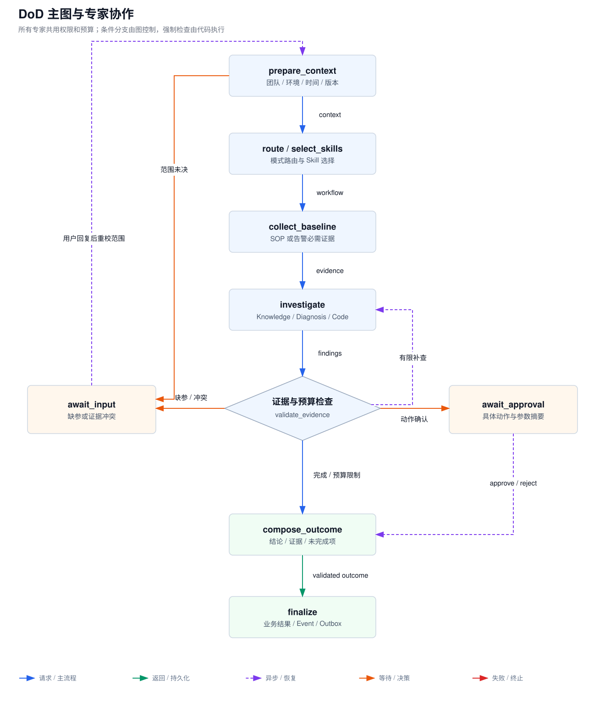

### 4.3 专家 Agent 协作

| 专家 | 模型角色 | 工具能力 | 结果用途 |
| --- | --- | --- | --- |
| Knowledge | knowledge | 经哈希校验的已发布 ToolBinding；知识摘录使用 knowledge_search | 提供检索引用 |
| Diagnosis | diagnosis | 受控诊断工具 | 提供诊断调查文本与引用 |
| Code | code | read_snapshot(path, start, end) | 固定 commit 文件行证据 |

专家任务数据结构：`ExpertTask(task_id, instruction)` → `ExpertResult(subtask_id, text, evidence_refs)`。专家递归限制为 12（图执行步数上限，不等同于工具调用次数）。

### 4.4 RCA 基线与提案

- v9 仅做范围确认，到 compose 直接输出"分析未完成"。
- v10/v13–v15 完整基线流程：bind_baseline（生成基线计划）→ collect_baseline（依次采集 metrics、logs、trace）。
- 每项工具调用使用稳定逻辑 ID；只有工具返回 ok 且本地证据通过范围、质量和时间窗口检查，基线状态才变为 valid。
- v14/v15 增加 propose 节点调用合成动作提案；完成 propose 不表示外部动作已执行。

### 4.5 SOP 与巡检执行

- WorkflowDefinition：1–32 个步骤，每步绑定一个只读工具；依赖关系必须构成 DAG。
- 当前实现是"DAG 定义 + 拓扑顺序串行执行"，没有并行分支合流。
- v12 支持条件跳过和 output_schema 校验。

### 4.6 直接问答的请求与响应边界

- v17：单轮直接 LLM 调用，不传历史消息、QueryScope 或工具列表。
- 多轮对话读取同 Agent 同 Thread 内已完成的单轮或多轮对话成功结果作为历史；最多 8 轮、正文上限 16000 字节。
- 系统提示由：平台基础约束 → Agent 系统提示词 → 回复偏好 → 固定 Skill 指令（多轮对话）组成。
- 模型返回后追加"以下内容由模型生成，未经外部知识源验证。"提示。

---

## 5 运行时序

### 5.1 业务答疑与异步交付

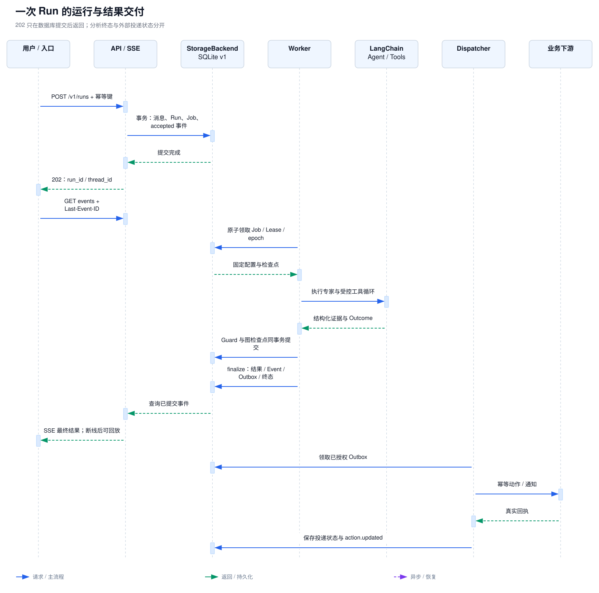

API 在数据库事务提交后返回 202，不等待模型结果。Worker 领取 Job 后加载固定配置，运行图和专家。图将 Outcome 写入检查点，Worker 调用 ResultProjector，ResultService 以幂等事务保存业务结果。

### 5.2 人工补充与恢复

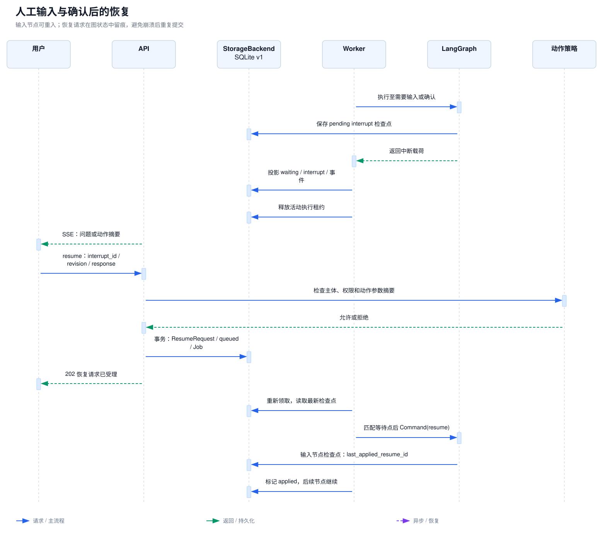

1. 中断节点调用 interrupt，持久化图状态后返回等待载荷。
2. Worker 投影中断为 interrupts 表、Run waiting 状态和 RunEvent，释放槽位与租约。
3. 用户提交回复；API 在事务中保存 ResumeRequest、创建新 generation Job。
4. Worker 读取检查点，使用 Command(resume=…) 恢复；输入节点只更新状态，完成检查点前不执行外部写操作。

LangGraph 中断恢复可能重新执行节点内代码，不能视作普通进程内暂停在下一行继续；中断节点必须保持可重入。

### 5.3 文件与脚本执行

Code Agent 或 Skill 工具提交结构化 Runner 请求，指定固定仓库快照、执行镜像、文件路径、脚本资源及参数。Runner 校验路径和资源绑定后执行，限制时间、输出和资源。结果包含退出码、stdout/stderr 摘要及 Artifact 引用。

### 5.4 受理、执行和投影的提交点

| 阶段 | 成功条件 | 客户端能观察到什么 | 失败后如何处理 |
| --- | --- | --- | --- |
| API 受理 | Run、用户消息、Job、初始事件在一个写事务提交 | 202 与稳定 `run_id`；重复幂等键返回同一受理结果 | 事务回滚则不返回已受理；不能制造"空 Run" |
| Worker 领取 | Job owner、Run epoch、租约与状态在短事务取得 | Run 从 queued 进入 running，后续可订阅事件 | 竞争失败重新挑选 Job，不执行图 |
| 图检查点 | 当前 Guard 校验与 checkpoint 原子提交 | 某些业务投影可能还未出现 | 协调器依据已提交 checkpoint 补投影 |
| 等待输入 | interrupt 描述与 waiting 业务投影落库，释放槽位 | 客户端可见待补充/待批准内容 | 中断已持久化但投影丢失时对账恢复 |
| 最终投影 | Outcome、消息、最终事件与终态提交 | 客户端看到 succeeded 或 partial | 摘要相同的重试幂等；摘要冲突需要显式故障 |
| 外部投递 | Outbox 消费并收到对端回执 | Action/投递状态独立更新 | unknown 对账，不把 Run 重新打开 |

API 的 202 只承诺持久受理；SSE 的一条 `assistant.delta` 是尝试中的草稿，不等于最终回复；Run 的 succeeded 不承诺 Jira/SeaTalk 等外部动作已经 delivered。前端应该显示这三种状态的不同来源。

### 5.5 中断节点可重入规则

LangGraph `interrupt` 后恢复时，节点中的代码可能从节点入口再次执行。因此节点内的外部写操作必须放在已持久化的恢复标记之后，或使用独立的 Action 协议。提交回复与执行回复之间可能发生崩溃；恢复协调器依赖 `resume_requests.status`、检查点中的 `last_applied_resume_id` 和 Interrupt 状态判断是否已经消费。不能仅凭 HTTP 请求已经返回 202 就假设图已应用输入，也不能仅凭请求还处于 `applying` 就重复执行外部动作。

---

## 6 状态机

### 6.1 Run 状态机

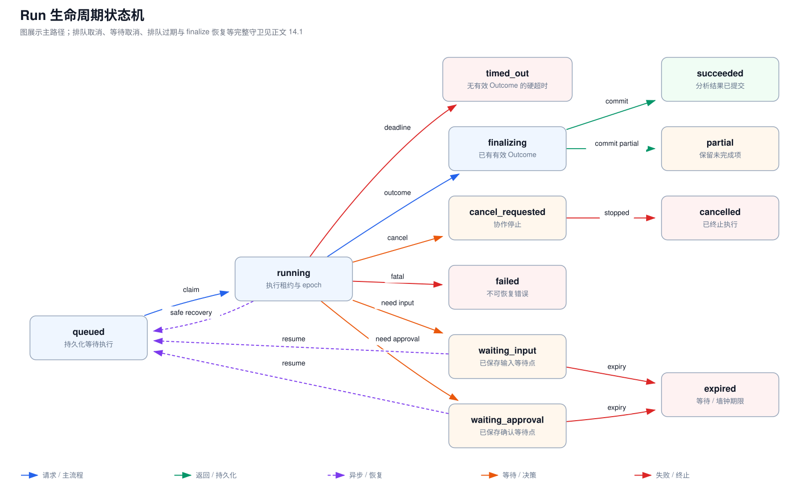

| 当前状态 | 事件 | 下一状态 |
| --- | --- | --- |
| queued | Worker 成功领取 | running |
| running | 图产生中断 | waiting_input / waiting_approval |
| waiting_input / waiting_approval | 有效恢复请求入库 | queued |
| running | 有效 Outcome 保存到检查点 | finalizing |
| finalizing | 业务结果事务提交 | succeeded / partial |
| running | 不可恢复错误 | failed |
| running | 活跃执行硬超时 | timed_out |

succeeded、partial、failed、cancelled、timed_out、expired 为终态。数据库更新使用状态条件、revision 和 run_epoch，禁止旧 Worker 把终态覆盖为运行中。

### 6.2 外部动作状态机

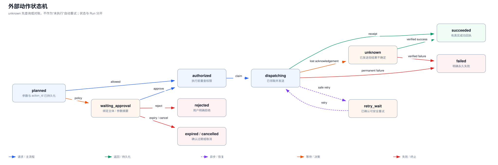

Action 状态：planned → waiting_approval / authorized → dispatching → retry_wait / succeeded / failed / unknown。

- planned 按策略直接进入 authorized，或进入 waiting_approval。
- 已发送但未能确认结果进入 unknown，执行结果查询或人工对账。
- unknown 不能自动当成 failed 盲目重发。

### 6.3 投递状态

Outbox 状态：pending → sending → retry_wait / delivered / dead / unknown。Run 终态与投递状态独立。

### 6.4 状态与所有权的组合约束

Run、Job、Lease 和 Outbox 的状态不是一条单一状态机。下面列出最易误判的组合：

| Run | Job/Lease | 含义 | 处理 |
| --- | --- | --- | --- |
| queued | ready、无有效 Lease | 等待领取 | Worker 可原子领取 |
| running | claimed、有效 Lease | 当前执行片段 | 只有当前 epoch 可写检查点和业务台账 |
| running | Lease 已过期 | 可能有失联 Worker | 协调/接管后新 epoch 执行；旧 owner 晚写必须失败 |
| waiting_input | 当前 Job 已释放 | 等待用户 | 不占 Worker 槽位；有效回复创建新 generation |
| finalizing | 有可投影 Outcome | 图已结束，业务结果待落库 | 投影结果；不可接受取消覆盖 |
| succeeded / partial | Outbox pending/unknown | 分析已终结，外发未完 | 独立继续投递或对账，不改 Run 结果 |

`cancel_requested` 是对活跃执行的意图，终态 `cancelled` 必须由当前有权的执行者或无活跃租约的协调路径完成。`expired` 与 `timed_out` 的区别在于是否在排队/等待期限与活跃执行硬期限上发生；对外 API 需保持语义一致。

---

## 7 调度、并发与一致性

### 7.1 原子 Job 领取

Worker 在短写事务内完成候选复核、团队额度、Thread 活动位置、ExecutionLease、Run epoch 和 Job owner 的更新；任一条件失败回滚。

多对象更新顺序固定为：团队额度 → Thread → ExecutionLease → Run → Job → Interrupt → Action/Outbox。

### 7.2 事务内租约与 fencing

Job/ExecutionLease 租约 45 秒，每 10 秒续期。每次检查点、预算结算及业务结果写入使用 LeaseGuard：

1. 条件更新 ExecutionLease（owner/run/job/epoch 相等且未过期）。
2. 校验当前 Run 状态。
3. 写入检查点或业务台账。
4. 同一事务提交。

接管以条件更新取得已过期租约，并在同一事务内增加 Run epoch。旧 Worker 不能再提交属于旧所有者的状态。

### 7.3 检查点与业务投影

Guard 校验和单次检查点写入原子提交，但图状态与后续业务投影可能处于两个事务。协调器使用图元数据、interrupt 和 outcome 幂等投影：

| 检查点状态 | 协调动作 |
| --- | --- |
| 有 pending interrupt | 补齐 Interrupt、waiting 状态和事件 |
| last_applied_resume_id 已存在 | 标记 applied |
| 有有效 Outcome | 切 finalizing，只执行 finalize |
| 有可继续 next 节点 | 创建 recover Job |
| 状态无法安全解释 | failed + STATE_RECONCILIATION_REQUIRED |

### 7.4 调度公平性

Job 优先级：恢复/人工回复 > 在线交互 > 告警 > 定时任务。同优先级按团队轮转。一个执行片段最多 3 次基础设施尝试，失败后退避 2 秒、10 秒并加抖动。

### 7.5 竞争场景与原子性

| 竞争 | 必须保持的不变量 | 预期胜方 |
| --- | --- | --- |
| 两个 Worker 领取同一 Job | 只有一个 owner 与 epoch 生效 | 条件更新成功者 |
| Worker 续租与接管并发 | Guard 的 owner、job、epoch、未过期条件同时满足 | 数据库提交顺序决定，失败方不能写业务结果 |
| 用户取消与最终结果提交并发 | 终态只提交一次；finalizing 后不回退 cancelled | 先取得有效状态转换者 |
| 同一回复重复提交 | 同一幂等键/等待点只有一份 ResumeRequest | 首个受理事务；后续返回原回执或冲突 |
| 旧模型回执与新 epoch 并发 | 旧执行不能结算新执行的预算或覆盖 Outcome | 当前 LeaseGuard；迟到用量隔离 |
| 外部动作响应丢失与重试 | 不凭超时判断操作未发生 | 先进入 unknown，再按 action_id 查询或人工对账 |

关键写操作不能使用"先读再写"的应用层预检查代替数据库条件更新与唯一约束。跨表写入以同一个 UnitOfWork 事务提交；模型、MCP 和对象存储调用不得持有数据库写锁。

---

## 8 容错与恢复

### 8.1 故障恢复时序

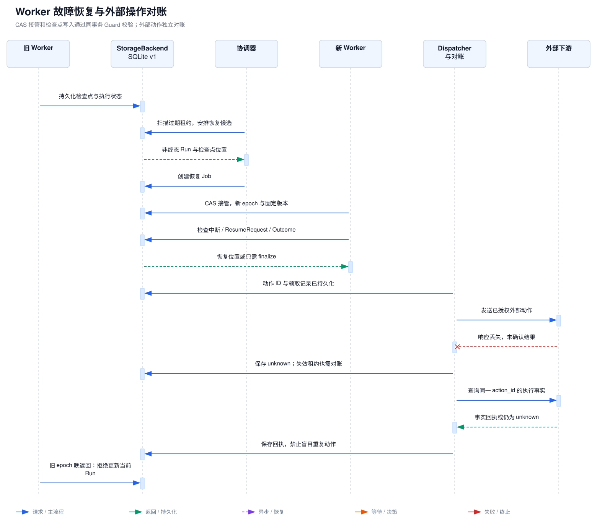

### 8.2 故障处理矩阵（核心条目）

| 故障 | 处理 |
| --- | --- |
| Worker 被终止 | 租约过期后协调，新 epoch 恢复 |
| 数据库连接断开 | 停止派发和当前尝试写入；后端恢复后按租约重新领取 |
| 旧 Worker 在接管后晚写 | LeaseGuard 所有者/epoch 不匹配 → 回滚 STALE_EXECUTION |
| 模型 429/瞬时 5xx | 遵循 Retry-After，最多 3 次总尝试 |
| 外部写入响应丢失 | Action unknown；查询结果或对账，不盲重试 |
| 中断已入检查点但投影丢失 | 协调器重建 waiting 投影 |
| 预算或硬期限到达 | partial 或 timed_out |

### 8.3 重试所有权

连接器负责网络级瞬时错误重试；Job 级重试处理基础设施故障。每次真实尝试记录 attempt 并消耗预算，避免乘法重试。

Outbox 最多 8 次投递，退避间隔：2 秒、10 秒、30 秒、2 分钟、10 分钟、30 分钟、2 小时。

### 8.4 已发送未确认的外部操作

动作的 action_id 和规范化参数哈希必须在请求发出前提交。对账无法确定时保留 unknown 并通知有权限的值班人。这提供可恢复、可去重及可对账的处理，不承诺跨外部系统的恰好一次执行。

### 8.5 故障注入与验收边界

恢复能力需要观察"崩溃发生在哪个提交点"，而不只观察正常路径是否成功。仓库现有 `tests/fault/` 覆盖 Worker 重启、接管竞态、中断投影、回复重放、取消竞态、SQLite 争用、备份恢复与 Redis 失效；这些测试是设计契约的本地证据。真实生产运行还需验证磁盘、容器生命周期、外部服务重试窗口和告警策略。

| 注入点 | 通过条件 |
| --- | --- |
| API 受理事务提交之前 | 无可见 Run、Job 或初始事件残留 |
| 检查点提交之后、waiting 投影之前 | 对账后出现同一 interrupt，不新增第二个等待点 |
| 回复标记写入之后、请求状态更新之前 | 重放不会再次应用同一回复 |
| Outcome 检查点之后、最终投影之前 | 结果被幂等补齐，不重复 assistant 消息 |
| 外部发送之后、回执保存之前 | Action 保持 unknown，直到对账确认 |

---

## 9 存储设计

### 9.1 存储端口与职责

调用路径固定为：业务服务 → Repository/Store 接口 → UnitOfWork → StorageBackend。LangGraph 通过 `PortableCheckpointSaver` 调用同一 `CheckpointStore`，不自带数据库连接。

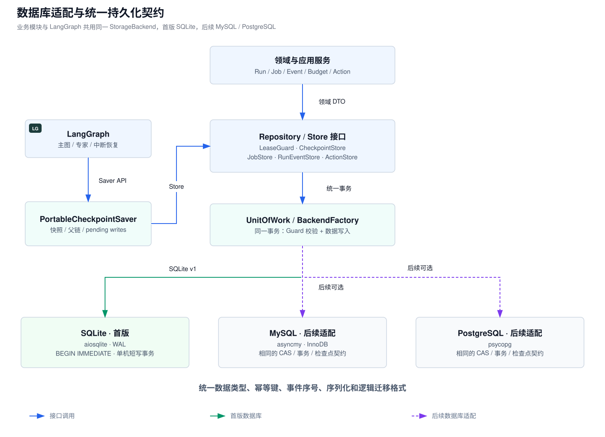

| 接口 | 统一契约 | 后端责任 |
| --- | --- | --- |
| StorageBackend | create_uow、capabilities、clock、health、migrate | 初始化驱动、连接设置和能力声明 |
| UnitOfWork | begin_read / begin_write、commit / rollback | 短事务边界，禁止跨模型/网络调用持有写事务 |
| RunStore / JobStore | CAS 状态修改、唯一受理、原子领取 | 返回明确成功/冲突，不能以预检查代替约束 |
| ExecutionLeaseStore | 领取、续约、回收、fence guard | 单调 epoch 和受控的执行所有权 |
| CheckpointStore | snapshot、pending writes、history、delete | 与 guard 共用同一事务 |
| ActionStore / OutboxStore | 稳定动作标识、幂等与回执 | 与业务结果在同一事务写入 |
| StorageTransfer | export / import / validate | 版本化逻辑导出，不把 SQL dump 视作跨引擎迁移 |

业务表、Job、执行租约、检查点、事件、预算和 Outbox **必须**使用同一后端与同一数据库。禁止把业务表放 SQLite、检查点另放 PostgreSQL 后仍宣称具备同一事务内的租约校验。

Redis 只承担 Job 唤醒信号：未部署或信号丢失时 Worker 仍从 JobStore 轮询领取，失效可降级。S3 兼容对象存储承载 Skill 包、仓库快照、原始证据、报告与脚本输出；Artifact 标记 `available` 前必须通过大小与摘要校验。

### 9.2 存储边界与可移植约束

- SQLite P0 部署在同一主机的本地持久磁盘；WAL 不用于跨主机共享文件系统。
- 后续 MySQL/PostgreSQL 适配器通过相同契约验收后，才开放多主机部署。
- SQLite 链接库版本由启动检查确认，运行镜像固定 3.51.3+。

### 9.3 事务与跨表不变量

- API 在单个写事务中完成 Run 创建、消息写入、Job 创建和事件记录。
- 最终结果提交（ResultService.finalize_in）在同一事务中保存 Outcome、assistant 消息、最终事件并释放 Job。
- 重复提交需匹配已保存摘要，避免产生第二份结果。

### 9.4 检查点契约

- 图检查点默认上限 2 MiB。
- 大原文和文件使用 Artifact/有界证据引用。
- 不得持久化客户端连接、数据库连接、实时凭据或可由用户指定的可执行反序列化对象。

### 9.5 JSON/引用契约

- VersionRef 是值对象，不是通用 versions 表的外键。
- secret_ref 只保存引用，真实凭据在当前授权的调用作用域解析，不进入 RunContext、GraphState 或事件。
- evidence_refs 和 outcome 中的引用必须属于当前 Run/Scope。

### 9.6 Schema 演进

- Workspace 链：schema_v1…schema_v20（21 个迁移）。
- Agent 链：schema_agent_v1…v4（4 个迁移）。
- agent_v1 在导入时遍历 v20，机械替换 workspace→agent 命名。仅在全新库上 create_all，已有库直接报错。
- 最终形态：63 张普通表、610 个字段，另有 FTS5 虚表。详细字段字典见 [02 数据字典](06-reference/02-data-dictionary.md)。

### 9.7 主要数据族及权威源

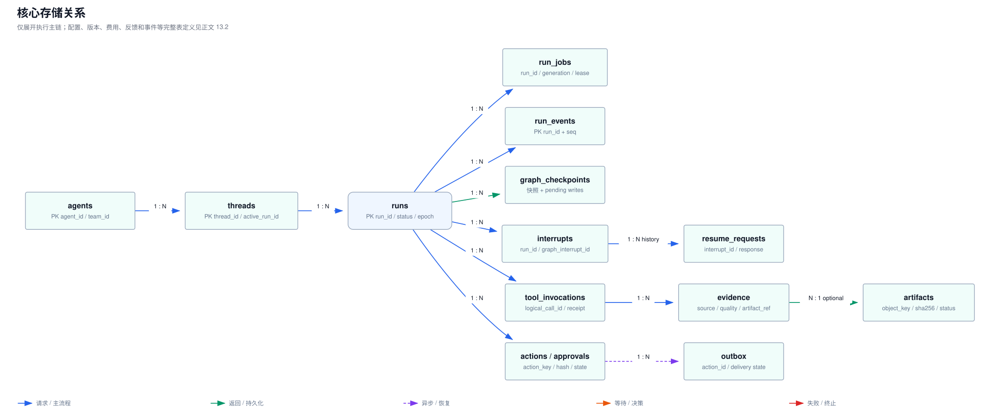

| 数据族 | 权威记录 | 衍生或缓存 | 一致性要求 |
| --- | --- | --- | --- |
| Agent 配置 | Agent、RuntimeProfile、发布的 Model/Skill/Tool 版本 | 运行时已解析对象 | Run 受理时固定版本与哈希 |
| 会话与任务 | `threads`、`messages`、`runs`、`run_jobs` | Web 列表与 SSE 视图 | 一个活动位置、幂等受理、终态不可回退 |
| 图执行 | `graph_checkpoints`、`graph_pending_writes` | 当前 GraphState 内存 | Guard 校验与单次保存同事务 |
| 证据与产物 | `evidence`、`evidence_payloads`、`artifacts` | 模型上下文摘录 | Scope、摘要、对象可用性都必须成立 |
| 业务结果 | `run_outcomes`、最终消息、RunEvent | Web 任务详情 | 投影幂等，同一结果摘要 |
| 外部动作 | `actions`、`approvals`、`outbox` | 投递器进程内队列 | 未确认不重发，独立对账 |
| 预算 | reservation、record、quarantine | 运行时余额计算 | 预留先于调用，迟到回执隔离 |

Redis 是可丢失的唤醒提示，不在上述权威记录中。S3/本地对象目录保存大内容，但数据库的 Artifact/Skill 清单与内容摘要决定它是否可引用。灾备时必须同时考虑数据库与对象目录，否则数据库恢复成功仍可能缺失 Skill 或产物。

### 9.8 数据迁移与兼容检查

`schema_agent_v1`、`v2`、`v3`、`v4` 反映 Agent 新库的阶段性结构；旧 Workspace 的 `schema_v1…v20` 是历史链，不是 Agent 库的升级路径。新库初始化与已受支持 Agent 库升级都走显式维护命令。维护前停写、备份，维护后检查 Alembic head、元数据、外键、WAL、关键资源引用和 doctor 就绪；若检查失败，保持服务不就绪并使用隔离备份恢复。跨数据库引擎迁移尚处设计层，不能以 SQLite 文件复制或 SQL dump 作为可移植合同。

---

## 10 Skill、知识与 Runner

### 10.1 Skill 包与版本

Skill 资源包结构：

```text
skills/skill-name/
  SKILL.md
  references/
  scripts/
  assets/
```

- 发布版本不可原地修改；回滚通过改变 Agent 的生效绑定并重新发布 Agent 实现。
- Run 固定版本，恢复时继续使用该版本；权限撤销仍即时生效。
- 多轮对话仅加载显式绑定的 `SKILL.md` 文本指令，不自动执行引用资源或脚本。

### 10.2 共享库发布流程

| 环节 | 约束 |
| --- | --- |
| 创建 | 名称：小写字母、数字和连字符，最长 128 字符 |
| 草稿 | 编辑后保存在 skill_drafts；CAS 并发控制 |
| 发布 | 生成 SKILL.md，写入不可变对象目录，新增 SkillVersion |
| 绑定 | Agent 草稿最多选择 16 个不同 Skill |
| 生效 | 添加或换版后须发布 Agent；已受理 Run 保留原引用 |

### 10.3 存储布局

| 存储位置 | 保存内容 |
| --- | --- |
| skills 表 | team_id、skill_id、name、description、状态和 revision |
| skill_drafts 表 | 当前可编辑的 description 和 Markdown content |
| skill_versions 表 | skill_version_id、version、content hash、bundle_ref 和状态 |
| skill-objects/ 目录 | 内容寻址的清单文件和 SKILL.md（SHA-256 十六进制文件名） |

### 10.4 运行时再验证

Skill 加载只接受当前有效 Worker `Execution` 对应的冻结 RunContext；读取前后分别校验租约、当前成员和版本哈希。发布已用内容寻址对象写一次、读多次：对象缺失或摘要不符时加载失败，不回退到最新版本。

### 10.5 Runner 边界

- 文件访问通过相对运行目录路径，禁止符号链接越界。
- 脚本只能引用已发布 Skill 资源或授权的运行资源。
- 默认资源上限：2 vCPU、2 GiB、单步骤 60 秒、单输出 20 MiB。
- 子进程使用独立进程组；取消/超时终止整个进程组。

运行配置与当前限制见 [04 运维](04-operations.md#4-runner-与产物)。

---

## 11 工具、模型与预算

### 11.1 ToolBinding

工具绑定将已发布的 MCP 工具与权限、速率限制、执行策略绑定。工具草稿（tool_binding_drafts）可编辑，发布后产生不可变的 tool_bindings。Agent 发布时固定工具版本，RunContext 中保存 VersionRef 引用。

### 11.2 模型调用与预算

模型包装类的 `_agenerate` 调用 `ModelInvoker.invoke`。流程：

1. ModelFactory 校验 team、agent、base_url 和 secret_ref 是否匹配部署凭据绑定。
2. ModelInvoker 在外部调用前预留预算并记录发送。
3. 在数据库事务外调用 `model.ainvoke`。
4. 之后结算用量。

可重试错误由统一调用层按配置处理（最多 3 次尝试）。结构化调用通过 `output_schema` 添加 JSON Schema 约束，必要时在剩余尝试额度内进行一次修复。

### 11.3 预算策略

- 专家、重试、汇总和评估共用父 Run 预算。
- summary_tokens 接受时固定。
- 待确认用量继续保守占额；未知费用保持 pending。
- 迟到回执走 usage_quarantine，不修改已结算记录。

预算的运行语义（预留、历史 Run 无策略的情况）见 [04 运维 §5](04-operations.md#5-预算策略)。

---

## 12 MCP Server 边界

### 12.1 定位与分层

MCP Server 是独立的只读取证服务：一个 Python 包、一个进程入口，不与 Agent 共享代码。首版只有"诊断取证"一个限界上下文，知识、指标、日志和 Trace 是其中四类查询能力。

| 层 | 职责 | 依赖 |
| --- | --- | --- |
| domain | 查询范围、授权交集、时间窗、证据来源与质量 | 标准库、frozen dataclass |
| application | 四个查询用例、deadline、结果分类、出站端口 | domain、Protocol |
| infrastructure | HTTP 查询、Schema 转换、token 校验、配置与密钥 | application 端口、httpx、Pydantic |
| interfaces | MCP 工具 Schema、DTO、认证接入、CLI | application、MCP SDK |

依赖方向 `interfaces → application → domain`；业务层不反向导入 `bootstrap`，也不导入 Agent 的内部包。Agent 的 PolicyToolExecutor 负责 Run 权限与预算，MCP Server 独立执行自身边界检查；任一端拒绝都不得查询下游。

### 12.2 两层身份与授权交集

- **入站身份**：识别调用者与允许范围；HTTP 首版用服务端配置的 Bearer token 映射 principal。
- **出站身份**：访问具体知识库、监控或日志系统的凭据；与入站凭据独立配置，禁止把入站 token 转发给下游。

授权按 `principal.tools`、`principal.scopes` 与 `source.scopes` 求交集，范围必须匹配完整资源元组 `(team, environment, region, service, source_id)`，不得把各维度独立集合做笛卡尔积。缺失或未知值返回 `invalid_input`，合法但越权返回 `denied`；禁止通配 service、`region=all`、自动回退 live 或跨团队重试。

### 12.3 四个只读工具与统一结果

四个工具均标记 `readOnlyHint=true`，并禁止动态注册未审核工具。

| 工具 | 专属输入 | 结果 data |
| --- | --- | --- |
| `knowledge_search` | query 1–4000 字符；scene=qa/alert；limit 1–10 | matches[]：source_id、title、content、source_uri、updated_at |
| `metrics_query` | template_id、受 Schema 限制的 parameters；start/end；step_seconds 15–3600 | series、单位、采样范围、source_id、缺失信息 |
| `logs_search` | start/end；levels[]；可选 keyword、trace_id；limit 1–200；cursor | entries、返回数量、next_cursor、truncated |
| `trace_get` | trace_id 1–128 字符；start/end | spans、调用关系、错误标记、truncated |

统一 `ToolResult`（`dod-tool-result-v1`）字段：`status`、`data`、`evidence_refs`、`artifacts`、`error`、`retryable`、`meta`。`status` 只能为 `ok/empty/unavailable/denied/invalid_input/timeout/unknown`。

关键语义：

- `ok` 不表示服务业务健康；`empty` 不表示没有异常；`unavailable` 不转换为正常。
- 无实际查询不得生成 `valid` evidence。
- 引用 URI 必须来自批准的数据源，去除 token 与敏感参数；无可访问链接时保留 `source_id`，禁止伪造链接。

接口清单与请求示例见 [01 接口参考 §5](06-reference/01-api.md)。

### 12.4 超时、重试与资源限制

- 查询 deadline 默认 20 秒、最大 30 秒；连接超时 3 秒。
- 首版连接器不自动重试，`retryable` 只作为 Agent 侧策略提示，由 Agent 控制最多 3 次总尝试。
- 每实例最多 4 个业务查询并发，每 principal 最多 2 个；无等待槽位返回 `unavailable/OVERLOADED`。
- 请求体 ≤ 64 KiB；下游响应在流式读取时限制 2 MiB；返回总上限 256 KiB UTF-8。
- 日志与知识内容是不可信数据，不得注册工具、修改策略或触发写操作。

### 12.5 当前边界

首版 `normalized-http-v1` 是明确的网关协议，不是现有监控/日志平台的通用兼容层。真实知识库、Prometheus 或日志平台必须实现专用适配器，或由已验证的受控网关提供规范化协议。`check` 只验证配置与启动条件，输出中 `business_query: not_checked`，不能证明上游业务查询已通过。

---

## 13 权限与操作确认

### 13.1 权限交集

有效工具权限 = 用户权限 ∩ 团队策略 ∩ Agent 绑定 ∩ 场景/Skill 允许范围 ∩ 专家允许范围。模型只提出操作，工具执行层与下游系统分别校验。

P0 角色：viewer < operator < maintainer < admin。

| 角色 | 权限 |
| --- | --- |
| viewer | 查看已授权团队的结果 |
| operator | 创建与恢复 Run |
| maintainer | 管理 Skill/Agent 草稿 |
| admin | 管理成员、连接和策略；发布共享 Skill |

### 13.2 确认契约

确认请求绑定 action_id、tool_version、目标、参数哈希、策略版本、允许确认的主体与 expires_at（默认 30 分钟）。批准后执行前重新检查当前拒绝规则。

### 13.3 数据与执行权限

API、SSE、产物下载、Resume、Cancel 使用同一资源授权边界。Runner 的文件与网络策略约束本地执行。Webhook 校验平台签名、时间戳和来源事件去重。

### 13.4 资源边界与失败关闭

授权不是单一"是否有 Token"的判断。API 先建立 VerifiedIdentity，再解析团队成员、角色与 Agent 作用域；Run 的用户历史访问、SSE、上传、下载和操作确认都须在同一资源边界内判断。模型工具请求的参数是待验证输入，不得把其中的 `team_id`、`agent_id` 或查询范围当作可信身份。MCP Server 在自己的边界再次验证 Principal、Scope、源隔离和上游凭据。任一层无法验证时按拒绝处理，不用宽泛默认源或公共凭据兜底。

---

## 14 可观测性

### 14.1 设计目标

| 维度 | 当前实现 | 待完成 |
| --- | --- | --- |
| 结构化日志 | 关联 request_id、run_id、team_id | 生产日志聚合与告警规则 |
| OpenTelemetry Trace | 核心链路 Span（API → Worker → 模型 → 工具） | 真实服务的导出与采样策略 |
| Langfuse | SDK 适配核心链路已实现 | 真实服务验收 |
| Prometheus 指标 | 未接入 | 设计及实施边界已明确 |

### 14.2 Trace/日志/Langfuse 契约

- 每个请求从 API 入口携带 trace context，Worker、Scheduler 的子任务继承同一 trace。
- 模型调用记录模型名、token 用量、延迟、状态；工具调用记录工具名、参数摘要、延迟、结果状态。
- Langfuse 用于 LLM 调用可观测性，不与业务 Trace 系统混用。

### 14.3 从一次 Run 追踪到外部依赖

排障时以 `request_id` 定位 API 受理，以 `run_id` 贯穿 Job、检查点、模型、工具、结果与事件，以 `job_id`/`run_epoch` 区分失败后的新执行片段，以 `action_id` 跟踪独立投递。日志和 Trace 记录 ID、版本、耗时、错误码与参数摘要；模型正文、原始 Token、凭据、完整上游响应不应默认进入日志。Langfuse 的 LLM 观测与业务 Trace 需能通过稳定 ID 关联，但二者的保留与脱敏配置分别管理。

启用步骤与配置样例见 [04 运维 §6](04-operations.md#6-可观测性)。

---

## 15 迁移策略

### 15.1 SQLite → MySQL/PostgreSQL

- 统一 StorageBackend 契约覆盖所有持久化；适配器按接口实现，业务代码不感知后端差异。
- StorageTransfer 提供版本化逻辑导出，不把 SQL dump 视作跨引擎迁移。
- 迁移保留 Run、检查点和幂等记录。

### 15.2 Workspace → Agent 重构

- Workspace 已从产品和领域层移除。数据库表名、列名从 `workspaces`→`agents`、`workspace_id`→`agent_id` 在 schema_agent_v1 中机械替换。
- Agent 域迁移（0001_agent_domain）仅允许在全新库上执行；已有 Workspace 数据的库不执行自动迁移。
- 不保留 Workspace→Agent 映射层。

### 15.3 旧系统切流原则

- 新运行时直接执行模型—工具循环；现有 Smart/Claude 服务可作为迁移期间的独立引擎，但不充当新系统实现完成的证明。
- 业务规则和连接器可按接口移植或作为 MCP 服务接入。

---

## 16 已知缺口与评审问题

### 16.1 当前实现与设计差距

| 范围 | 差距 |
| --- | --- |
| 真实企业数据源 | 监控/日志/Trace 的知识源接入仅在合成环境验证 |
| 真实业务连接器 | Jira/SeaTalk/DoD 连接器尚未真实连通验收 |
| 生产部署 | Docker/Compose、TLS 代理端到端验证未完成 |
| 数据库后端 | 仅 SQLite；MySQL/PostgreSQL 适配器待实现 |
| 动态 Skill 选择 | select_skills 节点尚未实现动态检索 |
| 并行调查 | v7/v8 顺序调用专家，无并行 fan-out |
| 完整假设调查 | 跨专家假设合并尚未完全接入 |
| 自动摘要/长期记忆 | 未实现；多轮对话仅加载有界历史 |

### 16.2 待决项

- Evidence/Scope 同 Run 等约束部分依赖服务检查，数据库层待新增 FK/唯一约束。
- GraphState 各版本图字段不同；新增统一结构需新 Graph/State 版本。
- 完整 RCA/SOP 等路径仍可能固定输出 partial；合成 Incident 不证明已完成真实根因诊断。
- Outbox 的 1:1 语义由服务保证，数据库层待迁移单例唯一约束。
- MCP Server 的配置在启动时加载为不可变快照；权限变更需受控重启，尚不支持对在途调用即时撤权。

### 16.3 设计评审时的判定问题

1. 新功能是否改变 RunContext 中固定的版本集合？如果改变，需要说明旧 Run 恢复的兼容策略。
2. 新节点是否可能在中断恢复或 Worker 接管后重复运行？若有副作用，必须证明幂等或走 Action 协议。
3. 新表或对象是否与 Run 终态、证据可用性或预算结算共享事务？若拆开，需要明确对账路径。
4. 新工具是否读取用户可见数据或执行外部动作？分别需要 Scope 验证或审批与 Outbox。
5. 新能力的"已实现"证据是源码入口、测试、合成验收还是真实服务验收？产品状态要按最弱一环标注。
6. 新页面是否调用业务 API？如果只是路由和占位组件，不应计入交付能力。

---

> 代码在哪里、怎么改：见 [03 开发指南](03-development.md)。运维动作：见 [04 运维](04-operations.md)。字段、接口、配置：见 [06 参考](06-reference/)。

## 内置知识库实现

Agent v4 迁移新增 `kb_entries`、`kb_entry_versions` 两张普通表，扩展 `knowledge_gaps`，并建立 SQLite FTS5 trigram 虚表 `kb_fts`。草稿和不可变发布版本分开保存，发布及索引更新在事务内进行；检索仅使用发布版本，回执和证据固定命中的版本。归档和回滚不改写已有版本。

管理与阅读走 `/v1/kb/*` 用户认证；MCP Server 经 `normalized-http-v1` 调用默认关闭的 `/internal/kb/query`，用独立服务令牌和具体范围授权。范围中条目未指定的维度表示适用范围，并不授予请求方通配权限。`knowledge.citation_review` 先校验引用，再独立调用模型检查每个声明是否受引用支持；仅检查通过且证据有效时完成。无命中、不可回答或引用无效可记录缺口，处理包括草稿、重放和人工确认。仓库的 MCP 链路测试不等于线上部署或模型质量验收。

## 知识问答的来源验证

`knowledge.citation_review` 将每条结论绑定到 evidence ID、source ID 和逐字引用，并在最终投影时重查授权、范围与来源更新时间。阈值缺失或证据不可验证时结果降级为 partial。引用匹配与独立模型支持检查不能证明结论的语义正确性；真实接入和业务评估仍是启用前置条件。
