# 开发指南

> **读者**：需要读代码、改代码、写测试的后端与全栈工程师。
> **回答**：代码在哪里、一次请求怎么走、加功能按什么顺序改。
> **不写**：为什么这样设计（见 [02 架构](02-architecture.md)）、部署与恢复操作（见 [04 运维](04-operations.md)）、字段与配置取值（见 [06 参考](06-reference/)）。
> 本文以源码为准；凡设计文档与源码不一致之处，差异汇总在文末「核对记录」。

**路径约定**

| 记号 | 含义 |
| --- | --- |
| `PKG/` | `apps/agent/src/workbench_agent/`（Agent 服务的 Python 包） |
| `MCP/` | `apps/mcp-server/src/workbench_mcp_server/` |
| `WEB/` | `apps/web/src/` |
| 仓库根 | 含 `apps/`、`config/`、`deploy/`、`docs/` 的目录 |

**目录**

1. 仓库与代码地图
2. 进程与入口
3. 一次请求的代码路径
4. 工作流与运行时实现
5. 持久化实现
6. Skill 实现
7. MCP Server 实现
8. Web 实现
9. 测试与验证
10. 开发指引
11. 核对记录

---

## 1 仓库与代码地图

> 读完本章，你能说出三个应用各自的目录职责、`PKG/` 下每个子包做什么，以及改动一处代码时应该沿着哪个方向找依赖。

### 1.1 仓库顶层

```text
workbench/                          仓库根
  README.md
  .github/workflows/ci.yml         离线持续集成
  scripts/                         安装、初始化、启动及测试
  apps/
    agent/                          Python 3.12，发行包 workbench-agents，包名 workbench_agent
      pyproject.toml  uv.lock  alembic.ini  .python-version
      src/workbench_agent/          生产代码（本文 PKG/）
      tests/                        unit / contract / integration / fault / e2e
    mcp-server/                     Python 3.12，发行包 workbench-mcp-server，包名 workbench_mcp_server
      src/workbench_mcp_server/     本文 MCP/
      tests/                        unit / contract / integration / acceptance
    web/                            Vue 3 + TypeScript + Vite + Element Plus
      src/                          本文 WEB/
      tests/                        vitest
  config/
    local/agent.example.yaml        Agent 配置模板
    local/mcp-server.example.yaml   MCP 本机配置模板
    local/mcp-server.compose.example.yaml  MCP 容器配置模板
    workflows/payment-check.yaml    工作流种子
  deploy/
    Dockerfile.agent  Dockerfile.mcp-server  compose.local.yml
  docs/
    README.md  01-product.md  02-architecture.md  03-development.md
    04-operations.md  05-decisions.md  06-reference/  assets/
```

三个应用保持各自的依赖、构建与测试边界：Agent 与 MCP Server 不共享进程，也不共享 Python 包；Web 只通过 HTTP 访问 Agent API，由 Agent 的 `/app/` 路由托管构建产物。

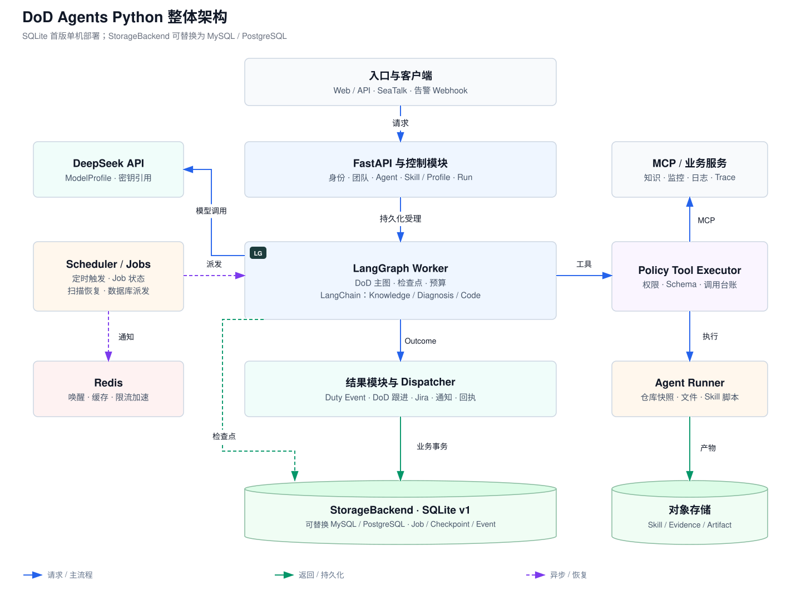

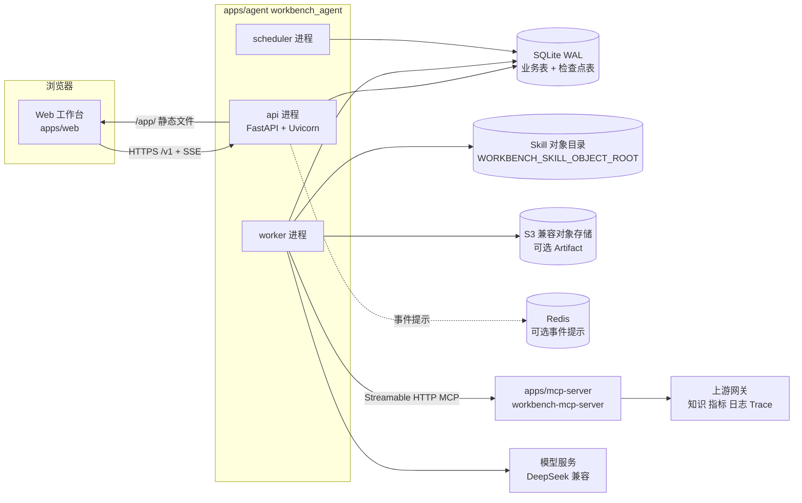

### 1.2 `PKG/` 子包职责表

下表以实际目录为准（`apps/agent/src/workbench_agent/`，另有 `settings.py` 与 `observability.py` 两个顶层模块）。

| 子包 / 模块 | 一句话职责 | 典型入口文件 |
| --- | --- | --- |
| `settings.py` | Pydantic 配置模型与 `load_settings`；所有进程唯一配置解析入口 | `Settings`、`load_settings` |
| `observability.py` | JSON 日志、OpenTelemetry/Langfuse 遥测、请求中间件 | `configure_logging`、`Telemetry`、`RequestObservabilityMiddleware` |
| `cli/` | `workbench` 命令行：API、Worker、Scheduler 与维护命令 | `main.py`、`parser.py` |
| `api/` | FastAPI 路由、Bearer 认证、错误映射、SSE、前端静态托管 | `app.py`、`runs.py`、`auth.py` |
| `application/` | 用例与应用服务：受理 Run、恢复、取消、版本发布、幂等、授权、结果落库 | `runs.py`、`resume.py`、`results.py`、`profiles.py` |
| `domain/` | 领域对象与规则（Pydantic/dataclass）：Run、Context、Outcome、Workflow、Guard | `runs.py`、`context.py`、`guards.py`、`workflows.py` |
| `jobs/` | Job 领取、租约、公平性、期限、对账、调度扫描、Worker | `worker.py`、`claim.py`、`reconciler.py`、`scheduler.py` |
| `runtime/` | LangGraph 图、专家 Agent、模型调用、预算、检查点适配、状态与流式事件 | `graphs/registry.py`、`models/invoker.py`、`budgets/service.py` |
| `persistence/` | StorageBackend 端口、SQLite 适配器、Schema 快照、迁移、检查点存储、对象存储 | `ports/backend.py`、`backends/sqlite.py`、`schema.py` |
| `skill_management/` | Skill 包校验、对象清单、导入 Worker、版本发布、运行时加载、共享技能库 | `validator.py`、`importer.py`、`loader.py`、`library.py` |
| `tools/` | 工具绑定注册、MCP 客户端适配、工具策略与执行器、权限交集、仓库快照读取 | `mcp.py`、`policy.py`、`registry.py`、`permissions.py` |
| `connectors/` | 只读连接器门面、密钥引用解析、托管模型密钥 | `read.py`、`secrets.py`、`managed_model_secrets.py` |
| `execution/` | 仓库同步、快照归档、上传暂存与受控管理任务 | `repositories.py`、`snapshots.py`、`uploads.py` |
| `runner/` | 容器 Runner：就绪检查、进程生命周期、资源清理 | `service.py`、`readiness.py`、`cleanup.py` |
| `delivery/` | 外发动作的 Dispatcher、对账与本地模拟器（默认不配置真实发送器） | `dispatcher.py`、`reconcile.py`、`local_simulator.py` |
| `incidents/` | 事件投影与访问边界（仅绑定的合成告警） | `service.py`、`synthetic.py` |
| `ingress/` | 合成聊天/告警接入协议（本地测试用，非真实 SeaTalk 协议） | `alerts.py`、`seatalk.py` |
| `evaluation/` | 用户反馈记录与人工评测数据集聚合 | `feedback.py`、`report.py` |

> 文档目录的职责见 [README](README.md)，不属于运行时代码。

### 1.3 依赖方向

原文设想的分层是 `api → application → domain`、`runtime/jobs/tools` 经端口访问 `persistence`。实际源码在 Agent 侧**没有**机器强制的分层测试（MCP Server 有，见 §7.2）。我用 `ast` 统计了 `PKG/` 各子包之间的 `workbench_agent.*` 导入次数（含函数体内的延迟导入），得到下图。边上的数字是导入语句条数，只列主要边。

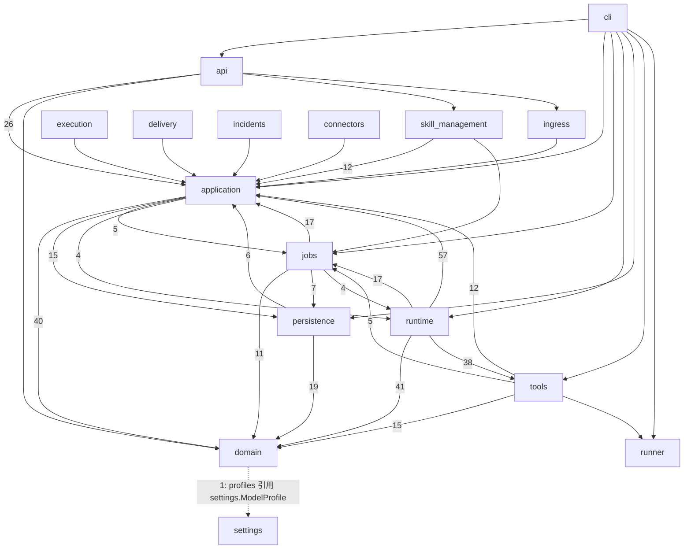

读图结论（均已用 `grep` 核对到具体文件）：

| 规则 | 实际情况 | 例外与落点 |
| --- | --- | --- |
| `domain` 是最内层，只依赖标准库、Pydantic 与自身 | 基本成立，唯一例外是 `domain/profiles.py` 导入 `workbench_agent.settings.ModelProfile` | 新增领域对象时不要再引入 `settings` |
| `api` 只做 HTTP 适配，业务放 `application` | 成立：`api/*.py` 绝大多数导入 `application` 与 `domain` | `api/skills.py`、`api/skill_library.py` 直接使用 `skill_management`；`api/app.py` 负责装配 |
| `application` 通过 Store 端口访问存储 | 大体成立，但服务内直接拼 SQLAlchemy 查询（如 `application/runs.py` 的 `schema.runs`） | 当前仅有 SQLite 后端，端口与 SQLAlchemy 表对象并未完全隔离 |
| `persistence` 不依赖上层 | **不成立**：`persistence/events.py`、`persistence/backends/controls.py` 导入 `application.*`（授权、`ResumeApplier`、`DomainError`） | `persistence/events.py` 为模块级导入，`controls.py` 的 `ResumeApplier`、`events.py` 的 `readable_evidence` 为函数内延迟导入；新代码不要再扩大 |
| `application` 不依赖 `runtime` | **不成立**：`application/disclosure.py`、`results.py`、`resume.py`、`actions.py` 导入 `runtime.graphs.*`、`runtime.budgets.*` | 证据授权、中断响应校验、预算服务是被应用层复用的纯函数/服务 |
| `runtime` 依赖 `jobs.worker` | 成立且不可避免：图节点收到的 `Execution` 对象定义在 `jobs/worker.py` | 这使 `runtime ↔ jobs` 互相依赖；`jobs/worker.py` 内用延迟导入避免循环 |
| `tools` 依赖 `runtime.budgets` | `tools/policy.py`、`execution_executor.py`、`snapshot_reader.py` 导入 `BudgetService` | 工具调用与模型调用共享同一套预算预留 |
| `cli` 是组合根 | 成立：`cli/worker.py`、`cli/scheduler.py` 负责把 backend、registry、modeler、MCP 适配器装配起来 | 新能力的装配点在此，而不是在模块 import 时 |

经验规则：**新增代码放对层，依赖只向 `domain` 与 `persistence.ports` 方向增加**；需要跨层复用时优先下沉到 `domain` 或在调用点做延迟导入，不要引入新的包级循环。

### 1.4 关键运行时对象

| 对象 | 定义位置 | 作用 |
| --- | --- | --- |
| `Settings` | `PKG/settings.py` | 进程配置，`load_settings(path)` 返回 |
| `SQLiteBackend` | `PKG/persistence/backends/sqlite.py` | 实现 `StorageBackend`，聚合所有 Store 与 `create_uow()` |
| `RunContext` | `PKG/domain/context.py` | 受理时冻结的版本引用集合（Profile、图、模型、Skill、工具、仓库、工作流） |
| `ExecutionGuard` | `PKG/domain/guards.py` | 所有权凭据：`team_id/thread_id/run_id/job_id/worker_id/run_epoch` |
| `ClaimedJob` | `PKG/domain/guards.py` | 领取结果：Guard + RunContext + attempt + `projection_only` |
| `Execution` | `PKG/jobs/worker.py` | 一次执行的上下文，图节点通过 `runtime.context` 取得；提供 `check_operation()` |
| `GraphRegistry` / `ExecutorRegistry` | `PKG/runtime/graphs/registry.py`、`PKG/jobs/worker.py` | 图版本到编译图、执行器、投影器的映射 |
| `PortableCheckpointSaver` | `PKG/runtime/checkpoints/portable.py` | LangGraph `BaseCheckpointSaver` 的存储无关实现 |

---

## 2 进程与入口

> 读完本章，你能用正确的子命令初始化、启动、检查、备份一个本地实例，并知道每个进程启动、就绪、关闭时代码做了什么。

### 2.1 `workbench` CLI

入口声明在 `apps/agent/pyproject.toml`：

```toml
[project.scripts]
workbench = "workbench_agent.cli.main:main"
workbench-synthetic-policy = "workbench_agent.cli.synthetic_source_policy:main"
workbench-synthetic-proposal-policy = "workbench_agent.cli.synthetic_proposal_policy:main"
workbench-synthetic-batch-policy = "workbench_agent.cli.synthetic_batch_policy:main"
workbench-local-dispatch = "workbench_agent.cli.local_dispatcher:main"
```

> 原文把命令写作 `dod`，实际可执行名是 `workbench`；历史运维文档中残留的 `dod bootstrap` 应读作 `workbench bootstrap`。

`PKG/cli/parser.py::build_parser` 用 `argparse` 声明全部子命令，`cli/main.py` 负责分发；`evaluate` 和 `eval` 独立处理，其他命令先 `load_settings(--config)`，失败时只打印 `{"ready": false, "errors": ["invalid or unreadable configuration"]}`，不回显配置内容（可能含凭据引用）。

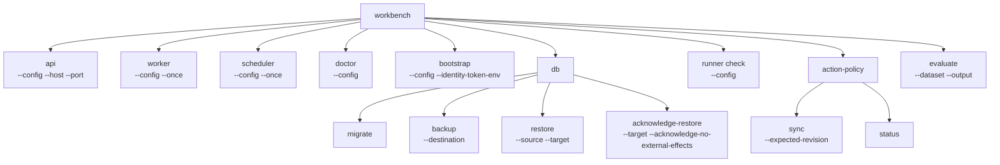

| 子命令 | 实现 | 常驻 | 行为要点 |
| --- | --- | --- | --- |
| `api` | `cli/api.py::run_api` | 是 | `uvicorn.run(create_app(settings), timeout_graceful_shutdown=15, access_log=False)` |
| `worker [--once]` | `cli/worker.py::run_worker` | 是 | 装配注册表与能力，`Worker.run()`；`--once` 只执行一轮后退出并打印 JSON |
| `scheduler [--once]` | `cli/scheduler.py::run_scheduler` | 是 | `Scheduler.run()`；`--once` 执行一次 `tick()` 并打印 `TickReport` |
| `doctor` | `cli/doctor.py::check_sqlite_runtime` | 否 | 只读检查 SQLite 版本、路径策略、PRAGMA、元数据行与必需表结构；不探测外部服务；失败退出码 1 |
| `db migrate` | `cli/db.py::migrate` | 否 | 显式维护窗口执行 Agent 迁移链，见 §5.4 |
| `bootstrap` | `application/bootstrap.py::BootstrapService.apply` | 否 | 幂等创建团队、模型、Agent、Profile 与工作流种子；production 需 `--identity-token-env` 指向已验证的 OIDC admin Token |
| `db backup` / `restore` / `acknowledge-restore` | `cli/backup.py`、`persistence/backends/sqlite_backup.py` | 否 | 在线一致备份；恢复到新的隔离路径；只放行干净副本，操作见 [04 运维 §3](04-operations.md#3-sqlite-备份与恢复) |
| `runner check` | `runner/readiness.py::runner_readiness` | 否 | 检查容器守护进程、容量和固定镜像 |
| `action-policy sync/status` | `cli/action_policy.py` | 否 | 将 `service.action_grants` 等作为整体同步到数据库，操作见 [04 运维 §7](04-operations.md#7-动作策略与人工重试) |
| `evaluate` | `cli/evaluate.py::run_evaluate` | 否 | 评测数据集聚合报告，不读取配置 |

另有四个独立脚本：`workbench-local-dispatch`（本地模拟投递，要求 development/test 环境和独立的模拟库）与三个 `workbench-synthetic-*-policy`（合成告警策略维护）。

对 `api`、`worker`、`scheduler` 三个常驻进程，`main.py` 在运行前调用 `observability.configure_logging(settings.observability, command, settings.environment)`。

**初始化与启动顺序**

安装、首次建库、日常启动和升级的完整命令见 [04 运维 §1–§2](04-operations.md#1-安装与首次初始化)，此处不重复。开发时只需记住三条：

- `db migrate` 与 `bootstrap` **只**由维护命令显式执行，常驻进程不会自动执行。
- `bootstrap` 从 `asset_root/config/workflows/*.yaml` 读取工作流种子（文件名须与 `name` 一致，单文件 ≤ 64 KiB，最多 32 个）；只创建缺失项。
- 三个常驻进程必须使用同一份配置、同一个数据库绝对路径和同一批环境变量。

### 2.2 启动流程

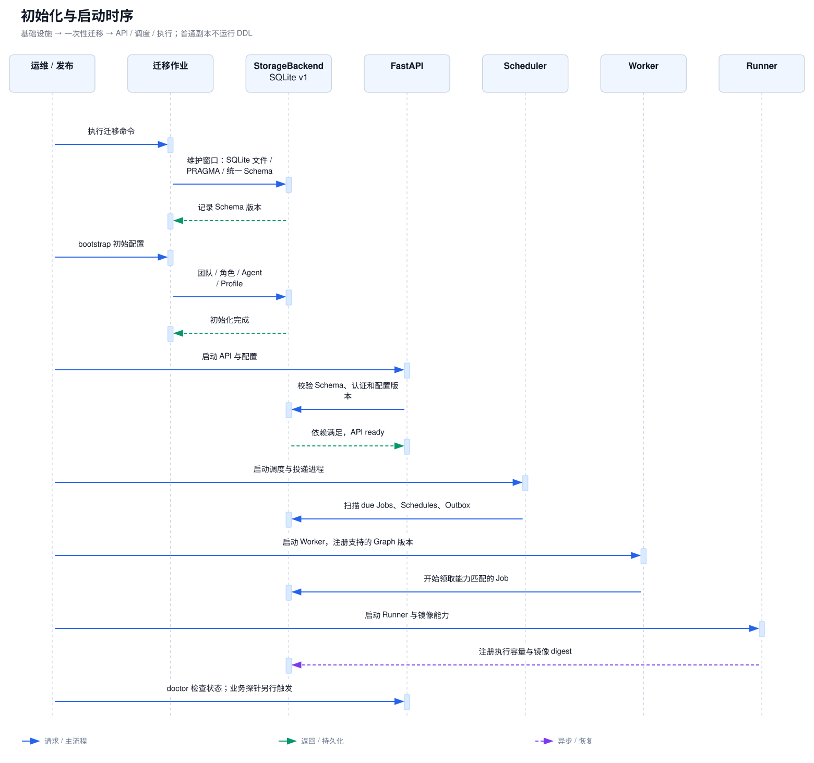

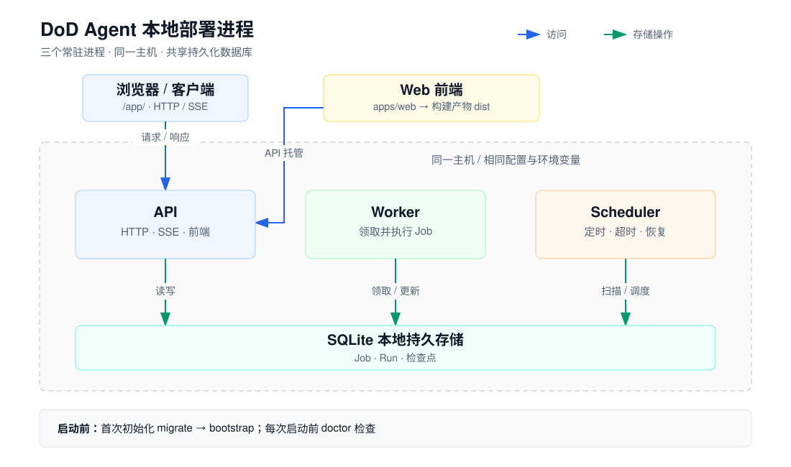

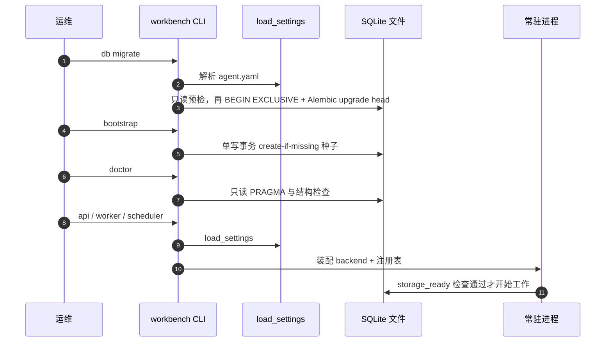

三个常驻进程的启动代码对照：

| 进程 | 装配点 | 就绪判定 | 就绪失败行为 |
| --- | --- | --- | --- |
| API | `api/app.py::create_app` 构造 `FastAPI(lifespan=...)`；`lifespan` 里 `app.state.storage_ready = await storage_ready(settings, backend)` | `persistence/readiness.py::storage_ready`：后端指向的库路径与配置一致、持久目录策略通过、`SQLiteBackend.health()`（只读检查 PRAGMA、`dod_storage_metadata`、表/列/索引/外键） | `/v1/*` 请求由 `StorageAdmissionMiddleware` 返回 `503 {"code":"STORAGE_UNAVAILABLE"}`；`/health/ready` 返回 503 |
| Worker | `cli/worker.py::run_worker`：构造 `SQLiteBackend`，`foundation_worker_registry(backend)` 注册所有图版本，再按配置追加管理任务与模型/MCP 工厂 | `storage_ready(...)` | 返回 `{"ready": false, "status": "storage_unavailable"}`，退出码 1 |
| Scheduler | `cli/scheduler.py::run_scheduler`：`Scheduler(backend, foundation_worker_registry(backend), ...)` | `storage_ready(...)` | 同上 |

`create_app` 在构造阶段还做了几项启动期硬校验，任一违反即抛 `ValueError` 使进程启动失败：

- `environment == "production"` 且配置了 `service.synthetic_ingress`；
- `production` 且 `auth_mode != "oidc"`，或 verifier 不是 `OIDCVerifier`；
- OIDC 的 issuer/audience 与配置不一致；
- 合成入口绑定的 subject 没有匹配的 `connector_identities`。

`Worker` 的 ID 在 `cli/worker.py` 中写死为 `'worker-1'`（SQLite 部署以单 Worker 实例为基线）。Worker 装配的可选能力：

| 配置条件 | 注册的能力 |
| --- | --- |
| `storage.skill_object_root` 非空 | 管理任务 `skill_import`、`repo_sync`；快照对象目录；可选的 Runner 绑定 |
| `storage.runner_daemon_id` 非空 | `ContainerRunner` 与 `RunnerCleanup`（周期恢复） |
| `storage.s3` 与 `storage.upload_staging_root` 同时非空 | 管理任务 `artifact_upload` 与暂存清理 |
| 始终 | 管理任务 `model_probe`、`tool_probe` |
| 存在 `service.model_credential_bindings` 或托管密钥 | `backend._code_factory`（直接问答模型调用） |
| 存在 `service.mcp_connections` | `backend._baseline_factory`（工具策略执行器）；与模型同时存在时再装配 `backend._diagnosis_factory` |

### 2.3 健康与就绪

```bash
curl -s http://127.0.0.1:8000/health/live    # {"live": true}
curl -s -o /dev/null -w '%{http_code}\n' http://127.0.0.1:8000/health/ready   # 200 或 503
```

| 检查 | 实现 | 说明 |
| --- | --- | --- |
| live | `api/app.py` 的 `/health/live` | 仅表示进程内事件循环可响应 |
| ready | `/health/ready` → `storage_ready()` | 每次请求重新检查存储，不缓存；不调用模型或外部系统 |
| API 准入 | `api/admission.py::StorageAdmissionMiddleware` | 纯 ASGI 中间件，对路径以 `/v1/` 开头的 HTTP 请求先判存储就绪 |
| Worker/Scheduler | 无 HTTP 探针 | 以进程存活和 `storage_ready` 启动判定为准；Worker 每轮 `run_once` 的 `StorageError` 被吞掉并在下一轮重试 |
| SQLite 路径策略 | `persistence/readiness.py::persistent_path_errors` | 必须位于声明的 `persistent_root` 内、本地文件系统（拒绝 nfs/cifs/tmpfs 等）、production 禁止放临时目录、库文件存在且可读写、不在 quarantine 状态 |

> 原文 §6.2 列出了 Worker ready 的"Graph/Codec 可加载、存在可用执行槽位"、Redis 降级、Runner 心跳等条件。源码中这些并没有统一的就绪端点；Redis 仅是 SSE 的可选"事件提示"（`runtime/streaming.py::RedisHints.configured`），缺失时回退为数据库轮询，没有 degraded 状态上报。

### 2.4 优雅关闭

| 进程 | 机制 | 超时 |
| --- | --- | --- |
| API | Uvicorn 收到信号后停止受理；`create_app` 的 `lifespan` 在 `yield` 之后关闭 Redis 提示、后端连接与遥测 | `timeout_graceful_shutdown=15`（秒） |
| Worker | `loop.add_signal_handler(SIGTERM/SIGINT, worker.stop)` 置位 `stopping`；`Worker.run()` 等待各 slot 最多 30 秒，超时则取消 slot 任务；`finally` 中停止清理协程、关闭后端与遥测 | 30 秒 |
| Scheduler | 同样的信号处理器调用 `scheduler.stop`；当前 `tick()` 完成后退出循环 | 取决于一次 tick |

`deploy/compose.local.yml` 的 `stop_grace_period` 与此对齐：api 20s、worker 35s、scheduler 15s。

取消执行协程时 `Worker._run_claim` 的 `except asyncio.CancelledError` 分支会在仍持有所有权的前提下释放租约并写入 `retry_wait`，留下可恢复的 Job（见 §3.4）；关闭不会把未完成的 Run 标为 `succeeded`。

---

## 3 一次请求的代码路径

> 读完本章，你能从 `POST /v1/runs` 出发，逐个文件、逐个函数追踪到 Job 被 Worker 领取、图执行、结果投影、等待输入与恢复，并能定位每个状态变化发生在哪个事务里。

整体视图（现有图）：

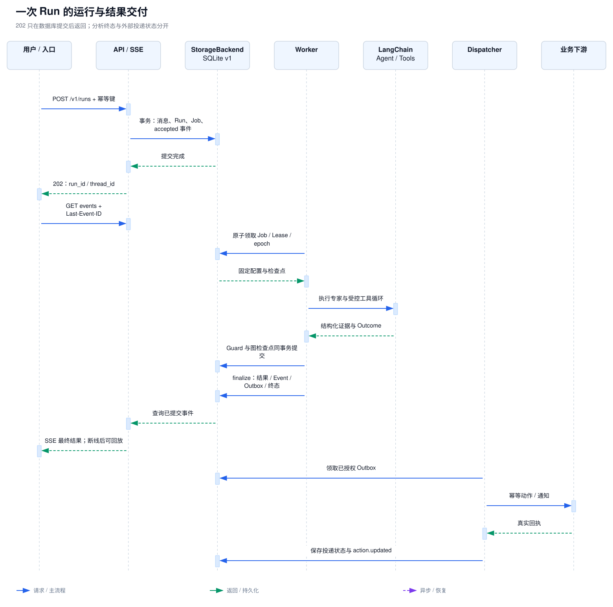

### 3.1 API 受理：`POST /v1/runs`

阅读顺序：

1. `PKG/cli/api.py::run_api` → `uvicorn.run(create_app(settings), ...)`
2. `PKG/api/app.py::create_app`：装配 `IdentityResolver`、`ProfileService`、`ContextResolver`、`RunService`，`include_router` 注册各路由，添加 `StorageAdmissionMiddleware` 与 `RequestObservabilityMiddleware`
3. `PKG/api/runs.py::create_run`：FastAPI 以 `CreateRun`（`domain/runs.py`）校验请求体，`Depends(authenticate)`（`api/auth.py`）验证 Bearer，读取必填头 `Idempotency-Key`
4. `PKG/application/runs.py::RunService.create`

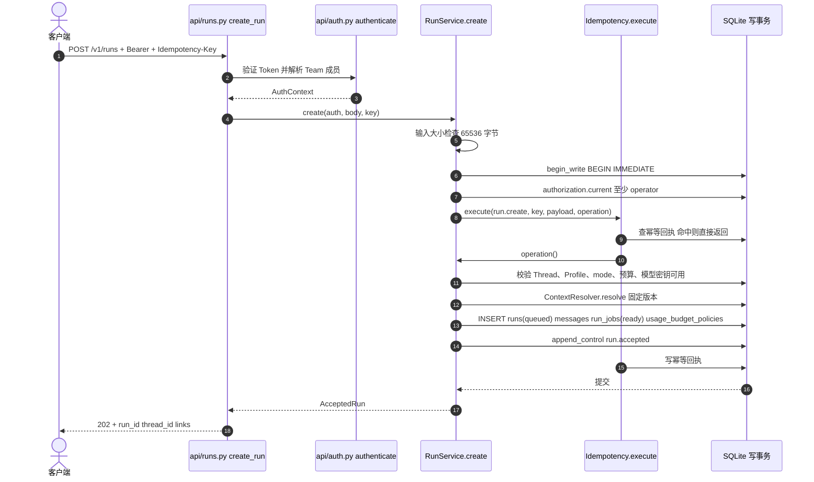

`RunService.create` 先执行第 1–2 步的请求校验，再在**同一个写事务**内完成后续授权、幂等、版本冻结和写入；`create_in` 由调用方持有该事务。图请求校验和预算计算由同模块的纯函数完成，仍按原顺序调用：

| 顺序 | 检查/写入 | 失败错误码（HTTP） |
| --- | --- | --- |
| 1 | `source_connector` 仅允许 connector 身份；`source_thread` 与 `thread_id` 互斥 | `OPERATION_DENIED`（403）、`INVALID_REQUEST`（422） |
| 2 | 文本 UTF-8 字节 ≤ 65536；除 `input` 外的元数据规范化 JSON ≤ 65536 | `INPUT_TOO_LARGE`（413） |
| 3 | `Authorization.current(uow, auth, agent_id, 'operator')` | 403/404 |
| 4 | 指定 `thread_id` 时校验 Thread 归属于该 Agent | 404 |
| 5 | `client_message_id`：命中且未过期的 `source_events` 回放原结果，不同请求体则冲突 | `SOURCE_CONFLICT`（409） |
| 6 | `expected_revision` 与 Thread 当前 revision 比较 | `REVISION_CONFLICT`（409） |
| 7 | 读取已发布 Profile；`business_context.conversation=true` 要求多轮或工具对话图 | `CONVERSATION_WORKFLOW_REQUIRED`（409） |
| 8 | 多轮及工具对话要求 `mode=qa`；多轮图不得带 `query_scope`，工具对话要求合法范围及会话标志；会话中不得有未结束 Run，历史成功 Run 必须来自对话图 | `INVALID_SCOPE`（422）、`WORKFLOW_UNAVAILABLE`、`THREAD_BUSY`、`CONVERSATION_HISTORY_INCOMPATIBLE`（409） |
| 9 | 三张 RCA 图仅允许合成告警受信通道调用 | `WORKFLOW_UNAVAILABLE`（409） |
| 10 | 知识摘录、引用审查和工具对话仅允许 `qa`，并校验 `query_scope`；单轮对话仅允许 `qa` 且不得带 `query_scope` | `INVALID_SCOPE`（422）、`WORKFLOW_UNAVAILABLE`（409） |
| 11 | `request.mode` 必须在 Profile 的 `allowed_modes` 中 | `MODE_NOT_ALLOWED`（422） |
| 12 | `sop`/`inspection` 必须使用 `sop.conditional` 且提供 `workflow_version_id`；其他模式不得提供 | `WORKFLOW_UNAVAILABLE`（409） |
| 13 | 不接受非空 `input.artifact_ids` | `ARTIFACT_UNAVAILABLE`（409） |
| 14 | 预算：`DEFAULT_BUDGETS[mode]` → 与 Profile 限制取 min → 请求值只能更小 | `BUDGET_EXCEEDED`（422） |
| 15 | `ContextResolver.resolve` 固定 Profile/模型/Skill/工具/仓库引用；工作流按固定版本读取并校验哈希 | `WORKFLOW_UNAVAILABLE`（409） |
| 16 | 各模型引用的 `secret_ref` 必须可解析；`summary_token_reserve` ≤ 汇总模型上下文 | `MODEL_PROFILE_UNAVAILABLE`（409）、`SUMMARY_RESERVE_INVALID`（422） |
| 17 | 写入 `runs`（`status='queued'`，`revision=1`，`wall_deadline_at = now + 48h`）、可选 `run_trace_contexts`、`query_scope`、`usage_budget_policies`、`messages`（user）、`run_jobs`（`generation=1, kind='run', status='ready'`）、事件 `run.accepted` | — |

新 Thread、来源去重记录及幂等回执同样归属该事务；范围、Job 或事件写入失败时整笔回滚，不留下部分受理记录。

默认预算（`application/runs.py::DEFAULT_BUDGETS`，字段顺序 `wall_seconds, model_calls, tool_calls, tokens`）：

| mode | wall_seconds | model_calls | tool_calls | tokens |
| --- | --- | --- | --- | --- |
| `auto`、`qa` | 180 | 8 | 20 | 80000 |
| `rca` | 300 | 12 | 30 | 120000 |
| `code` | 600 | 12 | 30 | 120000 |
| `sop`、`inspection` | 600 | 12 | 40 | 120000 |

`wall_seconds` 限制**活跃执行**时间；总生命周期由 `runs.wall_deadline_at`（48 小时）另行限制。

幂等由 `application/idempotency.py::Idempotency.execute` 统一提供（回执保存、72 小时窗口、不同请求体返回 `IDEMPOTENCY_CONFLICT`）；`client_message_id` 是另一层来源消息去重，作用域保存在 `source_events` 表（90 天）。两者不可混淆。

其他任务来源：

| 来源 | 代码路径 | 说明 |
| --- | --- | --- |
| 合成聊天/告警 | `api/ingress.py::accept` → `ingress/seatalk.py`、`ingress/alerts.py` | 需 HMAC 头 `x-dod-timestamp`、`x-dod-signature`，最大 64 KiB；production 直接返回 404 |
| 定时巡检 | `jobs/schedules.py::ScheduleScanner._fire_one` | 到期后用 `RunService.create(..., _uow=uow)` 在同一事务内创建 `inspection` Run，幂等键 `schedule:<id>:<due_at>` |
| 恢复回复 | `application/resume.py::ResumeService.resume` | 见 §3.5 |

### 3.2 Worker 领取与租约

阅读顺序：`cli/worker.py::run_worker` → `jobs/worker.py::Worker.run/run_once` → `jobs/claim.py::JobService.claim` → `persistence/backends/jobs.py::SQLiteJobStore.candidates/claim/_candidate` → `jobs/fairness.py::Fairness`。

`Worker.run()` 启动 **3 个 slot**：2 个业务 slot（`run_once`）与 1 个管理 slot（`run_admin_once`）。每个 slot 执行一轮后 `wait_for(stopping, scan_interval=5)`，即默认每 5 秒扫描一次。管理 slot 在领取管理任务前会调用 `jobs.has_priority_work(...)`，有可执行的业务任务时返回 `run_priority`，让位于业务 Run。

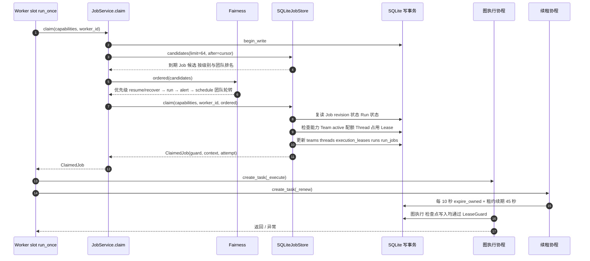

领取规则逐项对照代码：

| 规则 | 代码 | 细节 |
| --- | --- | --- |
| 候选 | `SQLiteJobStore.candidates` | `available_at <= now` 且 Job 状态为 `ready/retry_wait/capability_blocked`，或为 `leased` 且 `lease_until <= now`；每页最多 64 条，用 `row_number()` 按（团队、级别）分区，游标 `(_level, _team_rank, created_at, job_id)` |
| 优先级 | `Fairness.level` | `resume/recover`=0，`run`（其余默认）=1，`alert`=2，`schedule`=3；同级别团队轮转，记录上次领取的团队 |
| 能力匹配 | `_supports` | 普通执行需 `graph_ids` 含该图（已注册执行器**且**有投影器）；纯投影需 `can_reconcile` 且在 `projection_graph_ids` 内；Job 的 `capabilities` 必须是 Worker `features` 的子集。不满足且 Job 未被租出时标记 `capability_blocked` |
| 等待态 | `_candidate` | Run 处于 `waiting_input/waiting_approval` 时只能被 `kind='resume'` 的 Job 领取 |
| Thread 占用 | `_candidate` | `threads.active_run_id` 非空且不是当前 Run 时，把候选 `available_at` 推迟 1 秒 |
| 配额 | `_candidate` | Team 须 `active`，Team 有效租约数 `< execution_limit`；**全局**有效租约数 `< 2`（硬编码） |
| 写顺序 | `_candidate` | quota（teams）→ Thread → Lease → Run → Job |
| 租约 | `_candidate` | 租约与 Job 租约均为 `now + 45000` ms；`run_epoch + 1`；Job 变 `leased`；普通执行 `attempt + 1` 并写 `run.started` 事件；纯投影不递增 attempt |
| 纯投影判定 | `SQLiteJobStore._projection_only` | Job 本身为 `leased`（即接管过期租约）、Run 为 `cancel_requested/finalizing`、`recovery_phase` 为 `projection/finalizing`、或本片段累计 attempt ≥ 3 |

> 原文称"Scheduler 可以领取恢复工作"。准确说法：Scheduler 调用 `Reconciler.recover(run_id)`，后者以 `projection=True` 调用同一个 `jobs.claim`，Worker 在 `_execute` 中遇到 `claim.projection_only` 则只运行 `reconciler.reconcile`，**不运行图**。

**LeaseGuard 与 fencing**（`persistence/lease_guard.py::LeaseGuard.require`）：所有受保护写入在同一事务内执行一条 `UPDATE execution_leases SET guard_revision = guard_revision + 1 WHERE ...`，条件同时包含：租约行的 `team/thread/owner_run/owner_job/worker/run_epoch` 完全匹配且未过期；`runs` 行 `run_epoch` 与状态在允许集合内；`run_jobs` 行为 `leased`、`lease_owner` 一致且 `lease_until > now`；`threads.active_run_id` 等于该 Run。受影响行数不为 1 则 `rollback` 并抛 `StaleExecution`。`ExecutionGuard` 本身只是不可变的数据，只有在事务内通过 `require` 才构成"所有权证据"。

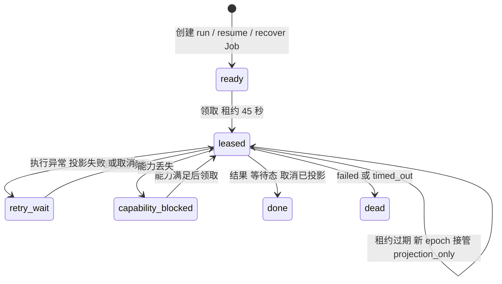

### 3.3 Worker 执行与投影

`Worker._run_claim` 并发运行两个任务并等待首个完成：

- `attempt = create_task(self._execute(execution))`：真正的执行；
- `renewal = create_task(self._renew(execution))`：每 `renew_interval=10` 秒调用 `_renew_cycle`——`DeadlineService.expire_owned(guard)`、读取 `controls.status`，若不是 `cancel_requested` 且 `LeaseService.renew(guard)` 成功则继续，否则置 `execution.cancelled` 并结束。

`_execute` 分两条分支：

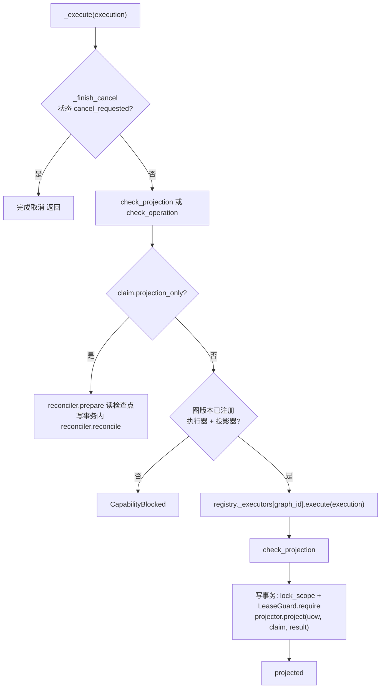

执行器与投影器由 `runtime/graphs/registry.py::foundation_worker_registry` 注册，按 `RunContext.graph_id` 选择：

- `FoundationExecutor.execute`：以 `run_id` 为 LangGraph `thread_id`，`recursion_limit=128`；首次执行从 `messages` 表读取受理时的输入构造初始状态，已有检查点则以 `ainvoke(None, ...)` 继续；检查点上有未消费中断时不自行编造回复，直接返回。v10–v15、`conversation.single_turn`、`conversation.multi_turn` 使用 `durability='sync'`。
- `InterruptExecutor(FoundationExecutor)`：用于 v2、v3、v9、v10、v13–v15。先 `apply_resume`（见 §3.5），再继续执行。
- 投影器：`runtime/results.py::ResultProjector` 包装一个"等待态投影器"（`FoundationProgressProjector` 或 `InterruptProgressProjector`）。`ResultProjector.project` 先读检查点，`saved_outcome` 有 Outcome 则经 `application/results.py::ResultService.finalize_in` 在同一事务保存 `succeeded/partial`；否则交给等待态投影器（把中断写成 `interrupts` 行、事件 `input.required/approval.required`，并 `jobs.release(..., status='waiting_input'|'waiting_approval')`）。

异常归类与释放（`Worker._run_claim`）：

| 异常 | 释放方式 | 返回状态 |
| --- | --- | --- |
| 续租协程先结束 | 置 `cancelled`、取消执行；若处于取消则完成取消 | `lease_lost` / `cancelled` |
| `StaleExecution` | 不释放（已失去所有权）；若取消则完成取消 | `stale_execution` / `cancelled` |
| `CapabilityBlocked` | 执行器已启动或投影：`queued` + `retry_wait` + `recovery_phase=projection`；否则 `capability_blocked` | `recovery_scheduled` / `capability_blocked` |
| `ProjectionFailure` | `retry_wait` + `projection` + `PROJECTION_FAILED` | `recovery_scheduled` |
| `InfrastructureFailure` | `segment_attempt ≥ 3`：`RETRY_EXHAUSTED`；否则延迟 `2s`（第 1 次）或 `10s`，另加 0–0.5s 抖动 | `retry_wait` |
| `CancelledError` | 取消执行协程，写 `retry_wait`（执行已启动则标记 `PROJECTION_CANCELLED`），再抛出 | — |
| 其他异常 | 执行器启动后：`retry_wait` + `EXECUTOR_FAILED`；启动前：`capability_blocked` + `EXECUTION_UNAVAILABLE` | `recovery_scheduled` / `capability_blocked` |

`Execution.check_operation()`（`jobs/worker.py`）是图节点在每个新外部操作前必须调用的"闸门"：`LeaseGuard.require(..., {'running'})`、`ContextResolver.revalidate`（当前成员与权限）、合成图的来源策略、connector 当前部署策略，并核对 Run 状态/epoch/取消标志/`wall_deadline_at`/`deadline_at`，不满足抛 `StaleExecution`。

Run 状态机（实现取自 `persistence/backends/jobs.py`、`controls.py`、`application/resume.py`）：

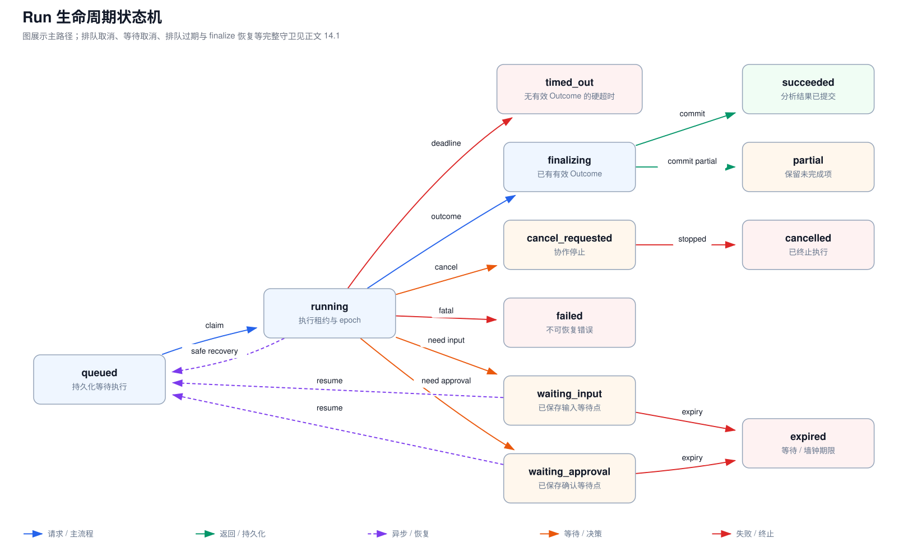

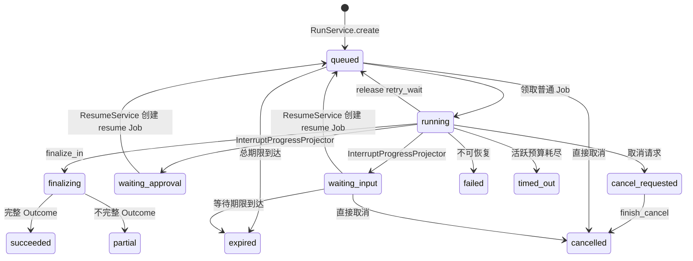

> 注意：运行中取消的内部状态是 `cancel_requested`（`SQLiteControlStore.request_cancel`），而 `GET /v1/runs` 的 `status` 过滤枚举写的是 `cancelling`，Web 的 `isRunActive` 也用 `cancelling`。两者并不一致，见「核对记录」。

### 3.4 失败恢复

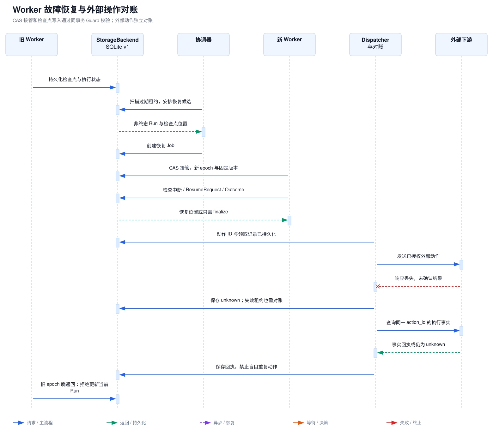

入口有两个：Worker 领取到 `projection_only` 的 Job，或 Scheduler 每 5 秒的 `tick()` 触发 `Reconciler.recover(run_id)`。

`Scheduler._tick()`（`jobs/scheduler.py`）依次：`DeadlineService.scan()` 处理期限 → 读取候选 Job → 仅对"租约已过期、`recovery_phase` 为 `projection/finalizing`、或 `attempt ≥ 3`"的 Job 调 `Reconciler.recover` → `ScheduleScanner.tick()` 触发到期巡检，最后汇总成 `TickReport`。普通新 `ready` Job 留给 Worker。

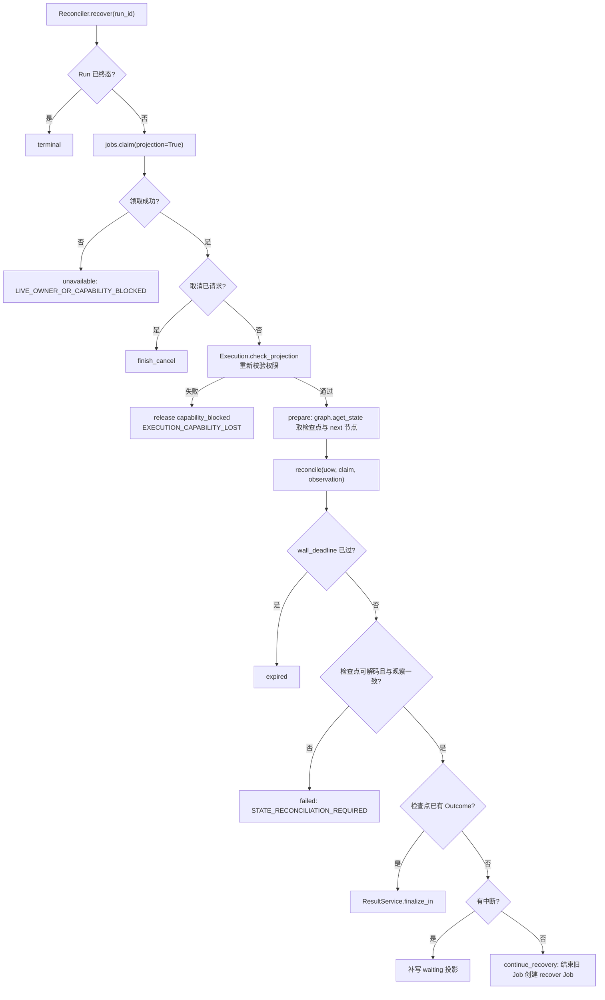

`reconcile`（`jobs/reconciler.py`）要点：检查点解码失败或观察到的 `checkpoint_id` 不一致，记 `STATE_RECONCILIATION_REQUIRED`；已有 `RecordedFoundation`/`RunOutcome` 时走 `finalize_in`；若 `last_applied_resume_id` 已出现在检查点中，补记 `resume_requests.status='applied'` 与 `interrupts.status='consumed'`，防止回复被重复应用；可继续的节点由 `SQLiteJobStore.continue_recovery` 在同一事务里结束旧 Job 并插入新的 `kind='recover'`、`status='ready'` 的 Job（本片段 attempt ≥ 3 则拒绝）。

### 3.5 等待输入与恢复

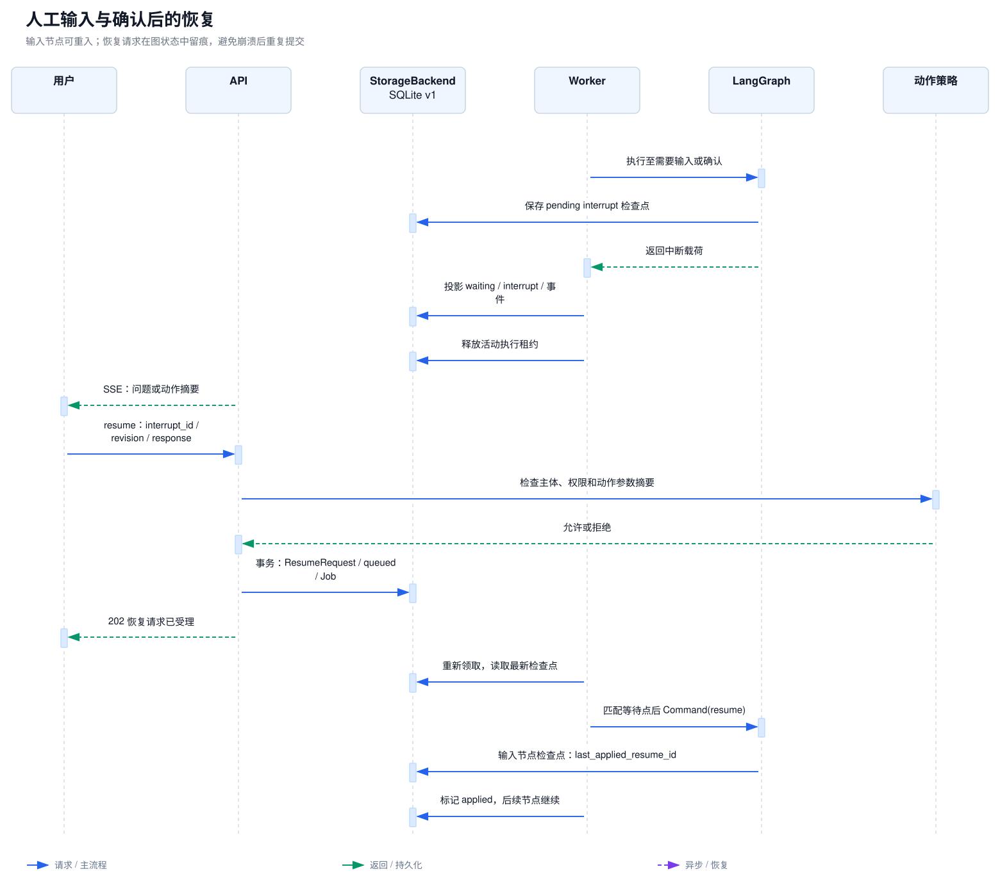

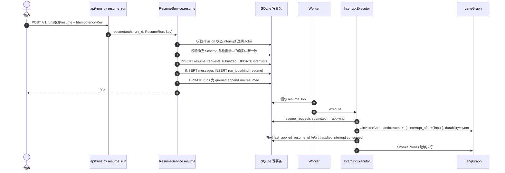

关键代码点：`application/resume.py::ResumeApplier.apply` 复核"检查点中的真实中断值与持久化的描述符一致""审批类的 `args_hash` 未变化"；`InterruptExecutor.apply_resume` 先停在 `input` 节点（`interrupt_after=['input']`），读回持久化检查点确认 `last_applied_resume_id` 已写入，再把请求置 `applied`——这样即使进程在两步之间崩溃，重放也不会重复应用回复（`Reconciler.reconcile` 对此兜底）。

### 3.6 取消与期限

| 动作 | 代码 | 行为 |
| --- | --- | --- |
| 取消 | `application/cancel.py::CancelService.cancel` → `persistence/backends/controls.py::request_cancel` | `finalizing` 或 `recovery_phase=finalizing` 时 `FINALIZATION_STARTED`（409）；已终态直接返回；`running` 置 `cancel_requested` 并写事件；其他状态直接 `finish(..., 'cancelled')` |
| 完成取消 | `Worker._finish_cancel` / `controls.finish_cancel` | 在 `cancel_requested` 允许集合内通过 LeaseGuard 后终结 |
| 期限 | `jobs/deadlines.py::DeadlineService.scan/expire_owned` | Scheduler 终结无活动租约的排队/等待 Run；运行中的 Run 需要先持有有效租约（Worker 续租协程调用 `expire_owned`） |

SSE 事件（`api/events.py`、`runtime/streaming.py`）与前端消费见 §8.4。

---


## 4 工作流与运行时实现

> 本章把“图版本、图状态、执行器、投影器”四件事分开。阅读顺序是 `runtime/graphs/registry.py` → 选定版本的 `build_*` → `jobs/worker.py` → `runtime/results.py`。

### 4.1 图版本注册与选择

`runtime/graphs/registry.py::foundation_worker_registry` 注册九个语义化图 ID；`runtime/graphs/catalog.py` 维护展示元数据并从编译图提取结构。`GraphRegistry.resolve(graph_id, state_schema_version)` 同时核对图 ID 和状态 Schema，恢复时使用受理快照固定的图。新增图须登记唯一 ID、目录元数据和节点及边说明，补充受理、结构、权限和执行测试；不兼容行为应使用新 ID。默认 Worker 仅启用两张对话图，其他图需在 `worker.supported_graph_ids` 中配置。旧 `dod.v1`–`dod.v11` 已退役，切换前须清库重建。

| 入口 | 责任 | 不能省略的检查 |
| --- | --- | --- |
| `GraphRegistry.resolve` | 从固定版本找到编译图 | 不支持的版本直接拒绝，不能回退最新版 |
| `FoundationExecutor.execute` | 装配 `configurable.thread_id=run_id`，从已受理消息建立首个状态或读取检查点 | 已有 interrupt 的图不可自动构造回复 |
| `InterruptExecutor.apply_resume` | 以 `Command(resume=...)` 恢复等待点 | 先持久化 `last_applied_resume_id`，再标记请求已应用 |
| `PortableCheckpointSaver` | 把 LangGraph 检查点映射到统一存储 | 每次受保护写入绑定当前 `InvocationGuard` |
| `ResultProjector` | 将检查点进度变成业务状态 | 只能投影已持久化的图事实 |

源码：`runtime/graphs/registry.py`、`runtime/checkpoints/portable.py`、`runtime/results.py`。图定义分别位于 `runtime/graphs/{knowledge_excerpt,rca_synthetic,rca_proposal,rca_batch,sop_graph,direct_qa,conversation_qa,knowledge_qa}.py`。图的输入/输出结构和 reducer 位于 `runtime/state/`。

### 4.2 图状态与业务状态的两次落盘

图执行产生检查点；检查点描述“节点执行到哪”。`runs`、`run_events`、`interrupts`、`run_outcomes` 描述“用户和系统能看到什么”。两者可能在进程崩溃时短暂错开，`jobs/reconciler.py` 依据检查点补齐投影。定位异常时按此顺序查看：

1. 读 `runs.status`、`recovery_phase` 与 `run_jobs` 的当前 generation，确认任务是否仍有领取资格。
2. 读 `execution_leases` 的 owner、epoch 与过期时间，确认当前 Worker 是否有写权限。
3. 读 `graph_checkpoints` 和 `graph_pending_writes`，找最后可解码的 checkpoint、`__interrupt__` 与 outcome。
4. 对照 `interrupts`、`resume_requests`、`run_outcomes`、`run_events`。若检查点含最终结果但业务投影没有，交由协调器补齐；不要直接手工改 Run 状态。

图检查点使用 `run_id` 作为 LangGraph 的 `thread_id`；业务 Thread 的 `thread_id` 是另一层标识。`runtime/checkpoints/namespaced.py` 处理子图命名空间，`persistence/checkpoints/store.py` 负责检查点表读写。

### 4.3 模型与预算执行链

`runtime/models/factory.py::ModelFactory` 从固定的 ModelProfile 版本构建模型，核对地址与凭据授权。`runtime/models/deepseek.py` 是适配层；`runtime/models/invoker.py::ModelInvoker` 负责模型调用的预算预留、尝试、结果和用量结算。`runtime/models/json_output.py` 处理结构化输出约束。调用发生在数据库事务之外；先保存必要的预留与追踪信息，收到回执后再结算。

预算入口在 `runtime/budgets/service.py` 与 `runtime/budgets/limits.py`。专家、汇总、修复尝试都消耗父 Run 的预算。遇到超时或未知回执时，不把尚未确认的消耗当作零；迟到回执归入隔离记录，避免覆盖已终结的 Run。实现判断以 `usage_reservations`、`usage_records`、`usage_quarantine` 为准，字段见[02 数据字典](06-reference/02-data-dictionary.md)。

### 4.4 工作流文件与版本的关系

`config/workflows/payment-check.yaml` 是 SOP/巡检定义样例，不是所有 Agent 图的配置文件。图版本由 Python 注册表固定；SOP 的 WorkflowDefinition 另有独立发布版本。修改 YAML 不能改变已受理 Run 的图实现，也不能让未发布的流程定义生效。新增或调整步骤时，先验证依赖 DAG、工具的只读属性与输入/输出 Schema，再发布新 WorkflowVersion。

## 5 持久化实现

### 5.1 后端、事务与 Store

`persistence/ports/backend.py::StorageBackend` 声明统一入口，`persistence/backends/sqlite.py::SQLiteBackend` 是当前实现。业务调用经 `create_uow().begin_read()` 或 `begin_write()` 进入短事务。`persistence/backends/{runs,jobs,controls,results,configuration,actions,schedules,model_profiles}.py` 实现各领域 Store；`persistence/lease_guard.py` 在受保护写入时核对执行所有权。

当前代码仍有应用服务直接引用 SQLAlchemy `schema` 表对象，以及 `persistence` 反向导入 `application` 的局部例外；所以“更换数据库只改驱动”不是现状承诺。新增持久化能力时先明确 Store 接口，再验证 SQLite 方言之外的语义，不在业务用例里增加新的 SQLite 专用 SQL。

### 5.2 Schema 与显式迁移

当前业务 Schema 在 `persistence/schema_agent_v7.py`，迁移 head 为 `0007_review_indexes`；Agent 独立迁移链在 `persistence/agent_migrations/versions/`。历史 Workspace 迁移在 `persistence/migrations/versions/`，供旧规格和历史理解使用，不能对旧 Workspace 数据库运行 Agent 初始化。`cli/db.py::_preflight` 在写入之前检查版本元数据、revision、WAL 和必需结构；未知旧库安全拒绝。`workbench db migrate` 是维护命令，API/Worker/Scheduler 启动不自动迁移。

| 情形 | 预期行为 | 核对点 |
| --- | --- | --- |
| 新的空路径 | 显式 `db migrate` 建立 Agent Schema | `cli/db.py::migrate`、`agent_migrations/versions/0001_agent_domain.py` |
| 已在当前 revision 的 Agent 库 | 迁移命令可重复运行，不重建业务数据 | `cli/db.py::_preflight` |
| 受支持的早期 Agent revision | 在维护窗口升级到 head，并做外键检查 | `0002_shared_skills.py` 至 `0007_review_indexes.py` |
| 旧 Workspace 或结构不兼容的库 | 拒绝并保留原库 | `FreshAgentDatabaseRequired` |

版本与表字段的快照见[02 数据字典](06-reference/02-data-dictionary.md)。安装与迁移、备份恢复的步骤见 [04 运维](04-operations.md)。

### 5.3 检查点与对象存储

`runtime/checkpoints/portable.py` 实现 LangGraph 的检查点适配，`persistence/checkpoints/store.py` 映射快照和 pending writes。检查点写入与 LeaseGuard 在同一事务中验证；大证据和文件通过 Artifact 引用，避免无限增长的图状态。Skill 对象采用内容寻址清单与资源校验；运行产物由 Artifact 元数据和对象实际可用性共同决定。对象已上传但元数据未提交时不能报告 available；元数据存在但对象校验失败时也不能交付。

### 5.4 数据定位与恢复原则

按 `team_id`、`agent_id`、`thread_id`、`run_id` 逐层缩小范围。排查“重复任务”先看幂等记录和 Job generation；排查“旧 Worker 晚写”先看 `run_epoch` 和租约；排查“回复重复应用”先看 `last_applied_resume_id`。备份必须通过 SQLite 在线一致备份入口，恢复到隔离路径并显式确认外部影响，不能只复制正在运行的 `.sqlite3` 主文件。具体命令由 runbook 维护。

## 6 Skill 实现

### 6.1 导入、校验、发布和加载

| 步骤 | 代码入口 | 持久结果 |
| --- | --- | --- |
| 从种子、Git 或 Artifact 发起导入 | `api/skills.py`、`skill_management/importer.py::SkillImporter` | 管理 Job 与导入回执 |
| 校验包名、路径、内容和 `SKILL.md` | `skill_management/validator.py::validate_bundle` | 可发布的受校验包 |
| 发布团队共享草稿 | `skill_management/library.py::SharedSkillLibrary` | `skills`、`skill_drafts`、不可变 `skill_versions` |
| 保存不可变资源 | `skill_management/manifest.py`、`objects.py` | 内容寻址的清单和资源 |
| 运行时读取指定版本资源 | `skill_management/loader.py::SkillLoader.load` | `VerifiedResource`，附 SHA-256 与 VersionRef |

导入来源和团队共享编辑是两条不同路径；对外接口分别见[01 接口参考](06-reference/01-api.md)。导入失败不应生成可运行的发布版本。发布 Agent 后，新 Run 固定 Skill VersionRef；仅保存 Skill 草稿或仅发布 Skill 版本不会改动现有 Agent 的已发布绑定。

### 6.2 运行时再验证

`SkillLoader` 要求真实的当前 Worker `Execution`，核对其 owner、RunContext、有效租约以及当前权限。加载版本必须在 RunContext 固定集合中，数据库中的版本仍为 published，资源哈希与清单一致。其前后各检查一次执行有效性，防止读取期间授权撤销或租约失效。错误归为资源不可用，不把损坏内容交给模型。

### 6.3 维护与故障定位

创建失败查 bundle 路径和元数据校验；发布失败查草稿 revision 冲突；运行时找不到资源查 Agent 是否已重新发布、Run 固定的版本、Skill 对象目录和文件摘要。不要通过修改已发布目录修复内容；修复应创建新版本并重新发布 Agent。导入与发布的运维步骤见 [04 运维 §2.3](04-operations.md#23-升级步骤)。

## 7 MCP Server 实现

### 7.1 进程与依赖方向

`apps/mcp-server` 是独立 Python 包。`interfaces/cli.py` 提供 `check` 与 `serve`；`serve` 支持 stdio 和 Streamable HTTP。装配根在 `bootstrap.py::Runtime`；MCP 协议映射在 `interfaces/mcp/`；查询与用例在 `application/`；范围、主体和证据契约在 `domain/`；HTTP 源、Bearer 鉴权、密钥引用与审计在 `infrastructure/`。Agent 侧的 MCP 客户端位于 `apps/agent/src/workbench_agent/tools/mcp.py`，二者通过协议交互。

### 7.2 一次只读查询

MCP 入口把工具参数映射为 `application/queries.py::QueryRequest`，用例核对 Principal、QueryScope、时间窗和授权源，再调用相应 Gateway。Gateway 把上游结果规范化成 `application/results.py::QueryOutcome`，最终返回有限正文及证据元数据。源认证信息在 MCP 进程的环境引用中解析；模型和 Agent 的公共输出不能获得原始 Token。接口清单与示例见 [01 接口参考 §5](06-reference/01-api.md)。

`check` 只验证配置、密钥引用和基础启动条件，输出中的 `discovery` 与 `business_query` 仍为 `not_checked`；它不能证明上游业务查询已经通过。真实接入须再运行合同、集成和验收测试，并核对实际数据源权限。

### 7.3 修改指引

新增只读源时，先扩展 `application/ports.py` 的 Gateway 契约及 `domain` 规则，再实现 `infrastructure/connectors/` 适配，最后在 `bootstrap.py` 装配并增加 MCP 映射。避免将上游返回的任意字段直接透传给模型。兼容声明式映射的上游工具可以不改 Agent 的 Python 工具名白名单，但部署连接必须同时配置 `read_tools`、`tool_conversation_allowed_tools` 与钉住 `mapping_hash`/`schema_hash` 的 `mapping_policies`。改变工具 Schema 需同步 Agent 的绑定和端到端合同测试，检查权限、范围和结果截断。

## 8 Web 实现

### 8.1 页面与路由

`apps/web/src/router.ts` 使用 `/app/` 作为 history base。实际路由：工作台 `/`、任务 `/runs`、任务详情 `/runs/:id`、Agent `/agents`、模型 `/models`、会话 `/threads`、Skill `/skills`、知识库 `/knowledge`、工具连接 `/tools`、数据统计 `/statistics`、审核中心 `/reviews`。`/incidents` 重定向 `/reviews`；仅 `schedules` 仍映射 `views/Placeholder.vue`。页面路由存在不代表业务功能已通过真实浏览器和外部连接器验收。`/demo/runs/:id` 是演示页，不能作为真实任务详情验收依据。

任务详情支持取消、区域补充输入和 Run 级审批；外部 Action 审批不在该页面处理。

### 8.2 API、会话与事件

`api.ts::ApiClient` 统一附加 Bearer Token，并显式处理 HTTP 错误；`session.ts` 管理前端会话输入。资源 API 分布在 `agents-api.ts`、`models-api.ts`、`skills-api.ts`、`threads-api.ts`、`runs-api.ts`。提问入口 `api.ts::createQaSubmission` 对同一未完成提交复用幂等键，成功后清空。SSE 解析和重连见 `sse.ts`，Run 事件投影见 `run-stream.ts::applyEvent`。客户端以递增 `seq` 去重；模型文字的 `attempt` 和 `message_id` 用于标记旧草稿被新尝试覆盖。

### 8.3 页面调试路径

页面报 401 先检查 Token 是否在请求中注入；页面报 503 先检查构建产物与 `WORKBENCH_FRONTEND_DIST_ROOT`。列表为空先核对 Agent 选择和团队权限，再查看网络响应。任务详情状态滞后时比较 `GET /v1/runs/{id}` 与 SSE `seq`，确认是服务端投影还是浏览器事件处理问题。前端不会直接读数据库或 LangGraph 检查点。

## 9 测试与验证

详情页以 `GET /v1/runs/{id}` 为状态权威；SSE 事件触发防抖刷新，delta 仅作为未验证草稿展示，失效后退回三秒轮询。目前 `DeltaMerger` 没有生产调用方，模型调用使用 `ainvoke`，因此已有草稿消费链尚未接入生产模型输出；能力状态见 [01 产品 FR-10.5](01-product.md#42-细项状态与依据)。取消与 resume 使用幂等键，同一请求在网络失败后复用，内容、Run revision 或等待版本变化后换新；恢复请求的 `expected_revision` 使用 Run 的 revision，而非 waiting 的 revision；未知等待 schema 禁止提交。路由或身份变化会中止旧连接。

### 9.1 测试层次与命令

| 层 | 目录和用途 | 常用命令 |
| --- | --- | --- |
| Agent unit | 纯规则、配置、模型适配和局部状态 | `cd apps/agent && uv run python -m pytest tests/unit` |
| Agent contract | Store、HTTP、MCP、租约等边界契约 | `cd apps/agent && uv run python -m pytest tests/contract` |
| Agent integration | 真实用例串联和本地依赖 | `cd apps/agent && uv run python -m pytest tests/integration` |
| Agent fault | 重启、竞态、超时、备份、恢复 | `cd apps/agent && uv run python -m pytest tests/fault` |
| Agent e2e | 合成业务旅程；真实外部服务需单独配置 | `cd apps/agent && uv run python -m pytest tests/e2e` |
| MCP Server | 只读范围、协议与源适配 | `cd apps/mcp-server && uv run ruff check src tests && uv run ruff format --check src tests && uv run python -m pytest -q -ra` |
| Web | API/视图/SSE/路由组件 | `cd apps/web && npm test && npm run typecheck && npm run build` |
| 文档门禁 | 元信息、链接与图文件 | `python3 scripts/check_docs.py --base origin/main` |
| 安装脚本 | 安装、初始化、启动的本地合同 | `python3 -m unittest discover -s scripts/tests -v` |

### 9.2 变更到测试的对应关系

| 改动 | 至少核对 |
| --- | --- |
| Run 接受或幂等 | `test_run_admission.py`、`test_team_receipt_scope.py`、对应 HTTP 合同 |
| 租约或恢复 | `test_guard_takeover_race.py`、`test_resume_replay.py`、`test_interrupt_projection.py` |
| 存储 Schema | `contract/storage/test_agent_boundary.py`、迁移与备份故障测试 |
| 模型或预算 | `test_model_binding.py`、`test_usage.py`、专家预算集成测试 |
| Skill 版本 | `test_shared_skills.py`、`test_skill_versions.py`、包校验测试 |
| MCP Schema/映射 | `contract/test_scoped_mcp_mapping.py`、`test_declarative_mcp_mapping.py`、`test_scope_mapping_policy.py`、`test_configured_mapped_tool.py` 与 MCP Server acceptance 测试 |
| Web 事件 | `tests/run-stream.test.ts`、`tests/sse.test.ts`、页面测试 |

测试通过只能证明相应范围内的合同；合成数据源与本地模拟投递不等同于真实监控、SeaTalk、Jira 或 DoD 的业务验收。

### 9.3 持续集成与本地等价命令

`.github/workflows/ci.yml` 在 PR 和推送到 main 时运行五个独立检查：`agent`、`mcp-server`、`web`、`scripts` 和 `docs`，`ci-ok` 要求全部成功。完整本地命令见[文档入口的测试步骤](README.md#快速开始)。脚本测试调用 agent 虚拟环境中的 Python，因此先执行 agent 的 `uv sync --frozen`。

Agent 检查使用 uv 管理的 Python 3.12，先运行 `uv run ruff check src tests` 和 `uv run ruff format --check src tests`，再输出并断言 SQLite ≥ 3.51.3，运行离线测试（不启用 `--run-live`）。Ruff 固定为 0.17.5，使用 100 字符行宽、单引号；历史迁移目录不检查或格式化。当前启用 E4、E7、E9、F 规则（包括 F401）；历史 schema 的兼容导出及表注册使用显式导出，星号导入与少数延迟导入按文件豁免。CI 不需要模型密钥。Agent job 暂设 60 分钟超时并输出最慢的 25 个测试；首次 GitHub Actions 运行后根据实际耗时评估并行拆分。Web 使用 Node 22；GitHub Actions 的运行时使用 Node 24，与 Web 的构建 Node 版本独立。`docs` 检查链接、图、元信息和代码关联文档；代码关联文档缺同步仅警告，文档拆分按主题、职责与阅读成本判断，不设机械行数阈值。纯错别字 PR 的 `docs-typo` 标签仅跳过版本更新检查。分支保护只需要求 `ci-ok`，新增检查时必须加入其 `needs`。见 [ADR-011](05-decisions.md#adr-011-ci-的-sqlite-版本由断言守住)。GitHub runner 上的解释器版本与测试结果以实际运行记录为准。

复杂度另由 `python3 scripts/check_python_complexity.py --base <基准提交>` 检查 Agent 的 `src/`（历史迁移除外，测试代码不计入），使用锁定 Ruff 的 C901 > 12 和 PLR0915 > 50 诊断。基线按仓库相对路径、完整函数限定名和规则记录上限；新增超限、存量恶化及指向已删除函数的条目会失败。消除超限后应删除对应基线条目；降低但仍超限时可下调数值。迁移超限函数时在基线的 `moves` 中记录旧、新的路径及限定名和人工核对原因，并同时迁移条目；CI 对比 PR 基准或推送前提交，只允许基线删除、下调或经映射且数值不增加的迁移。不得用扫描结果覆盖基线。Ruff 执行失败或输出损坏时门禁失败关闭。

## 10 开发指引

### 10.1 新增图版本

1. 在 `runtime/graphs/` 新建或扩展图构造函数，明确输入、状态 Schema、节点副作用和输出。
2. 在 `foundation_worker_registry` 注册新的图版本及对应 executor/projector，保留旧版本映射。
3. 定义新版本的受理条件和 RunContext 固定项；更新配置发布入口，不让旧 Run 隐式切换。
4. 加入图状态恢复、重复投影、取消/期限、预算耗尽的验证。涉及 interrupt 时覆盖重复 `Command(resume=...)` 与崩溃后恢复。
5. 更新 [02 架构](02-architecture.md) 的拓扑和[产品文档](01-product.md)的能力状态。

### 10.2 新增工具或 MCP 源

1. 明确工具是只读查询还是外部写动作；写动作必须走 Action/Approval/Outbox。
2. 为参数、结果、范围、角色、速率和预算定义合同，在 ToolBinding 草稿中配置并发布。新增工具若不在 legacy 四工具映射中，还需在部署连接中配置钉住映射与输入 schema 的 `mapping_policies`，并加入 `tool_conversation_allowed_tools`。
3. MCP 查询先在 MCP Server 的 domain/application 实现范围与格式约束，再接入基础设施 Gateway。
4. 在 Agent `tools/` 中接入调用适配，并验证绑定、权限交集、幂等台账及拒绝路径。
5. 用合同测试覆盖不允许的团队、过期凭据、越界 Scope 和超大响应；真实源另做验收。

### 10.3 新增 Skill、数据库字段或 API

| 变更 | 操作顺序 |
| --- | --- |
| Skill | 校验包格式 → 发布不可变版本 → 绑定 Agent 草稿 → 发布 Agent → 以新 Run 验证加载与撤权 |
| 数据库字段 | 修改 Agent Schema 与 Store → 新增 Agent migration → 验证旧 Agent 库升级及新库初始化 → 更新 [数据字典](06-reference/02-data-dictionary.md) |
| API | 添加 Pydantic 请求/响应及授权用例 → 路由映射 → HTTP 合同和错误路径测试 → 更新 [接口参考](06-reference/01-api.md) |
| 配置项 | 更新 `settings.py` / MCP Settings → 样例与校验 → 敏感值脱敏 → 更新 [配置参考](06-reference/03-configuration.md) |
| Web 页面 | 确认后端接口与权限 → API 模块 → 路由/页面 → 视图与事件测试 → 产品状态表 |

### 10.4 启用问答 Agent

**直接问答（`conversation.single_turn` 单轮 / `conversation.multi_turn` 多轮）**

1. 先在团队级准备好已发布的模型版本；新建 Agent 用它初始化，不继承其他 Agent 的提示词、预算或资源绑定。
2. 在 `/app/agents` 选择 Agent，检查现有草稿（不要覆盖他人的草稿），把 `graph_id` 设为 `conversation.single_turn` 或 `conversation.multi_turn`，`allowed_modes` 设为 `["qa"]`，保存并发布。
3. 部署侧还需在 `service.model_credential_bindings` 中按 `agent_ids` 授权模型端点与凭据引用，并重启 Worker。
4. 发布只影响之后创建的 Run；历史 Run 保持原工作流。缺少团队级模型时返回 `MODEL_PROFILE_UNAVAILABLE`。

等价的 API 调用顺序：

```sh
export WORKBENCH_API=http://127.0.0.1:8000
export WORKBENCH_AGENT_ID='<Agent UUID>'
export WORKBENCH_BEARER='<管理员 Bearer Token>'
qa_tmp=$(mktemp -d)
curl -fsS "$WORKBENCH_API/v1/agents/$WORKBENCH_AGENT_ID" -H "Authorization: Bearer $WORKBENCH_BEARER" > "$qa_tmp/agent.json"
jq '.draft | .graph_id="conversation.multi_turn" | .allowed_modes=["qa"]' "$qa_tmp/agent.json" > "$qa_tmp/draft.json"
curl -fsS -X PATCH "$WORKBENCH_API/v1/agents/$WORKBENCH_AGENT_ID" \
  -H "Authorization: Bearer $WORKBENCH_BEARER" -H 'Content-Type: application/json' \
  -H "If-Match: $(jq -r .revision "$qa_tmp/agent.json")" \
  -H "Idempotency-Key: $(uuidgen)" --data-binary @"$qa_tmp/draft.json" > "$qa_tmp/saved.json"
curl -fsS -X POST "$WORKBENCH_API/v1/agents/$WORKBENCH_AGENT_ID/profiles/publish" \
  -H "Authorization: Bearer $WORKBENCH_BEARER" -H "If-Match: $(jq -r .revision "$qa_tmp/saved.json")" \
  -H "Idempotency-Key: $(uuidgen)"
```

**知识问答（`knowledge.scoped_excerpt`）**

需要额外三件事：已发布的 `knowledge_search` 工具绑定、`mcp_connections`（含同一个业务范围的 `scope_grants`）、`tool_permissions` 中用户/团队/Agent/Skill/专家五层授权取交集。工具 Schema 必须从配置的 MCP Server 发现，不能手写：

```python
from workbench_agent.connectors.secrets import SecretProvider
from workbench_agent.settings import load_settings
from workbench_agent.tools.mcp import configured_adapter

adapter = configured_adapter(load_settings(config).service.mcp_connections, SecretProvider())
catalog = await adapter.discover(server, credential_scope, team_id=team, agent_id=agent)
schema = catalog.tools[catalog.names.index("knowledge_search")].inputSchema
```

然后 `PUT /v1/agents/{agent_id}/tool-bindings/{alias}`（`If-Match: 0`）→ `/publish`（`If-Match: 1`）→ 在 Agent 草稿中追加该工具引用并把 `graph_id` 设为 `knowledge.scoped_excerpt` → 发布 Agent。可选探测：`POST .../tool-bindings/{alias}/probe`，再用 `GET .../admin-jobs/{job_id}` 轮询；只有部署侧存在 `probe_requests` 时才会真正发起业务查询。

调用 `POST /v1/runs` 时必须带五个 Scope 键且不能多余，时间窗最大 1 小时：

```json
{"agent_id":"<agent UUID>","mode":"qa","input":{"text":"What should I do?"},
 "business_context":{"query_scope":{"service":"checkout","environment":"test","region":"id",
 "start_at":"2026-11-13T00:00:00Z","end_at":"2026-11-13T00:10:00Z"}}}
```

结果恒为 `partial`，正文只含经过校验的来源摘录，不把模型自由文本当作事实。受理（202）不等于授权：Worker 使用工具与披露证据时会重新检查部署范围与当前权限。

**隔离浏览器测试**

```bash
cd apps/agent
.venv/bin/python tests/support/qa_browser_harness.py --mode direct --port 8766   # 直接问答
.venv/bin/python tests/support/qa_browser_harness.py --port 8765                 # 知识问答
```

两者都使用临时数据库、随机合成凭据、模拟模型（知识问答另有合成 MCP 源）与独立 Worker，打印本地 `/app` 地址和测试令牌；退出后删除临时库，不接触真实模型或数据源。

### 10.5 任务详情手工验收

在隔离开发环境中验证保留图的任务详情、取消和恢复；等待输入场景使用本地合成告警入口。复核并发操作、无权限、网络中断及等待过期，并确认合成适配器不能代表生产告警接入。

### 10.6 提交前文档核对

运行 `python3 scripts/check_docs.py`，并更新改动文档的 `verified_commit`。

核对三个层次：产品能力状态是否与真实入口一致；设计不变量是否仍成立；实现路径、接口、Schema 和配置是否在源码中存在。若修改当前实现而设计未改变，只更新实现文档和附录。若打破设计契约，先明确版本和迁移策略，再同步技术设计。不要通过在旧规格上继续堆字段字典来维护新文档。

## 11 核对记录与已知偏差

| 原规格或拆分草稿中的表述 | 当前源码证据 | 文档处理 |
| --- | --- | --- |
| 命令写作 `dod` | `apps/agent/pyproject.toml` 中入口是 `workbench` | 所有可执行命令统一为 `workbench`；历史文档中的残留已随旧目录删除 |
| Workspace 是产品容器 | Agent Schema、路由、Web 以 Agent 为主 | Workspace 仅作为历史迁移名或 Runner 内技术目录出现 |
| 管理端所有页面已可用 | `apps/web/src/router.ts` 的定时任务路由仍指向 `Placeholder.vue`；审核中心仍需人工旅程验收 | 产品文档只将未完成页面标记为占位 |
| MySQL/PostgreSQL 可直接切换 | 只有 `SQLiteBackend` 实现 | [02 架构](02-architecture.md) 保留目标契约，实施状态标为待实现 |
| 外部业务通知已交付 | `delivery/local_simulator.py` 为本地模拟，真实发送器默认未配置 | 合成验收与真实接入分开 |
| MCP `check` 证明业务数据源可用 | `interfaces/cli.py` 输出 `business_query: not_checked` | 真实业务源需要独立验收 |
| 旧草稿只覆盖到一次请求路径 | 本次补齐工作流、存储、Skill、MCP、Web、测试与开发指引 | 章节目录见文首 |

字段、接口和配置的逐项核对以 [06 参考](06-reference/) 与源文件为准。

## 内置知识库开发与测试

知识模块位于 `apps/agent/src/workbench_agent/knowledge/`，管理与内部查询路由分别在 `api/knowledge.py`、`api/kb_internal.py`，SQLite 实现在 `persistence/backends/knowledge.py`。新问答图为 `runtime/graphs/knowledge_qa.py`（`knowledge.citation_review`），不改变旧 `knowledge.scoped_excerpt` 的 partial 语义。配置 Agent 时须选择对应图、配置已发布工具绑定和授权，并确保 Worker 支持该图版本。

知识工具的模型参数投影须保留已发现 Schema 中的 `scene` 枚举，避免模型把服务名误填为查询场景。`knowledge.citation_review` 的专家工具反馈会把上游截断或本机字节上限截断的结果转换为无正文、无引用的 `KNOWLEDGE_RESULTS_TRUNCATED` 不可用反馈；原始回执仍保留供审计，模型可缩小查询并使用后续完整证据。当前权限、范围、引用与新鲜度校验继续执行，不能通过接受截断证据来绕过。

SQLite 知识检索在存在内容关键词时，会从查询分词中移除与当前 service/environment/region 完全相同的范围词及独立中文问句词，避免 OR 检索把主题查询扩展为整个服务的知识列表。只有范围词的查询仍保留原行为；SQL 的团队、发布版本与范围过滤继续执行。知识引用专家会优先使用具体主题词，遇到截断时缩小查询或将 limit 提高至 10；截断结果本身不能作为完整证据使用。

`tests/integration/test_kb_mcp_chain.py` 覆盖真实 MCP 协议链路，相关迁移、检索、缺口、恢复、问答和 UI 测试分别位于 `test_kb_*` 与 `apps/web/tests/knowledge-*`。测试使用受控数据和模型替身，不能据此宣称真实模型表现或业务质量已验证。

## 知识问答离线评估（`knowledge.citation_review`）

`knowledge.citation_review` 需要在目标 Worker 的 `supported_graph_ids` 中显式加入，且发布的 Agent profile 必须显式设置正整数 `knowledge_max_age_seconds`；该值在 Run 受理时冻结。无阈值或来源时间无法判断时不得完成。真实知识源和范围隔离尚待确认，不应仅根据合成测试启用。切回知识摘录图应发布新的 profile，只影响新 Run。

使用 `workbench evaluate --dataset <文件> --dataset-type knowledge --output <报告>` 运行独立知识评估，原 RCA 命令默认行为不变。真实验收需要至少 30 条独立业务标注和人工审核，覆盖可答（含多来源）、无答案、冲突和过期；引用正确率至少 95%，可答可用率至少 80%，不可答误答、无引用结论和越权均为零。`apps/agent/tests/fixtures/knowledge-eval-synthetic.json` 仅用于测试，不构成业务验收。

## 专项实现地图与历史执行记录

原 `docs/superpowers/` 的 26 份设计、实施计划及交付记录按主题归入本节和 01/02/04/05。它们写于 2026-11-18 至 11-23，部分以旧提交、旧图名和“尚未实现”为前提。下表保留任务目标、覆盖关系和真实验收缺口，**不是待办勾选状态**；代码现状以本篇、[01 产品](01-product.md) 与当前源码为准。旧计划的逐文件操作步骤和预期失败没有作为现行指南保留，后续改动应重新核对路径和迁移 head。

| 原专题 | 归入位置 | 关键交付与核对点 |
| --- | --- | --- |
| 11-18 内部知识库总计划；PR-1 数据 | 本篇 §5、§10、02 知识细化、04 升级 | 草稿/版本/FTS 同事务；显式迁移、权限、备份、索引检查 |
| 11-18 内部知识库 PR-2 检索 | 本篇 §7、02 MCP 查询 | trigram 与短词回退、五维具体 Scope、`normalized-query-v1`、真实协议链 |
| 11-18 内部知识库 PR-3 Web | 本篇 §8、01 知识流程 | 条目编辑/导入/发布/历史、检索调试、精确版本引用与冲突保留 |
| 11-18 内部知识库 PR-4 闭环 | 本篇知识问答、02 缺口 | 引用支持校验、Guard 去重、缺口转草稿、新 Run 重放、人工确认 |
| 11-18 CI 与 Run 详情 | 本篇 §9/§10、04 日常操作 | 离线门禁、文档门禁、SSE/GET 权威、取消/输入/审批与故障回归 |
| 11-19 图目录计划、目录 UI 设计/计划 | 本篇 §4/§8、01 工作流目录 | 语义 graph_id、目录元数据、详情图、旧图恢复兼容和路由手工验收 |
| 11-20 下一阶段总计划与交付说明 | 本篇评测与工具、01 演进顺序、04 真实验收 | A 真实基线、B 重复评测、C 反馈/统计、D1 工具管理、D2 对话、D3 映射；离线交付与真实验收分开 |
| 11-20 A 真实基线 | 本篇评测、04 采集 | 本机隔离配置、20–30 条知识种子、30+ dev 问题、来源对照、采集与人工评审 |
| 11-20 B 评测 | 本篇评测、04 夜间运行 | 数据集/实验版本、可恢复 runner、确定性评分、重复统计、留出与默认关闭的 CI |
| 11-20 C 产品闭环 | 本篇 §8、01 用户流程 | 点踩形成 low_quality 缺口、费用未知态、授权统计、固定版本引用 |
| 11-20 D1 工具管理 | 本篇 §8、02 工具边界 | 连接发现、草稿/探针/发布、Profile 精确绑定；管理写入仍要求 admin |
| 11-20 D2 工具对话 | 本篇工具对话、02 工具边界 | 独立图、只读四调用上限、恢复与证据、同范围历史、独立评估 |
| 11-20 D3 范围映射 | 本篇工具对话、05 ADR-015 | 模型标量参数映射、服务端注入受信字段、部署钉住 hash、legacy 兼容 |
| 11-23 多文件 Skill 设计、计划和验证 | 本篇 §6、04 Skill 升级 | `files_json`、整包 CAS、旧 content 兼容、文本/脚本/图片、版本对象与历史读取；脚本只保存不执行 |
| 11-23 下一阶段总计划与执行报告 | 本篇本节、01 未完成条件、04 验收 | P0/Q/R/E/W 工作包、离线测试证据、环境限制和真实上游待验收 |
| 11-23 Q1–Q3 可靠性 | 本篇知识问答与评测、02 预算 | 摘要预留、截断诊断、一次 JSON 修复、范围词检索、合成/业务隔离 |
| 11-23 R1–R4 审核 | 本篇审核中心、02 状态权威 | 五类审核投影、授权游标、v7 索引、只读对账及 Web 列表/详情 |
| 11-23 E1–E3 评测 | 本篇评测、04 夜间运行 | 工具 runner、真实 A4 与人工报告合并、脱敏制品、CI 比较和三日启用验证 |
| 11-23 W1–W3 `web_search` | 本篇工具对话、02 网页来源 | 声明映射、结果校验/安全展示、真实 MCP 域名策略及双工具验收 |

### 开发时沿用的任务边界

知识管理代码位于 `PKG/knowledge/`；管理和内部查询路由分别在 `api/knowledge.py`、`api/kb_internal.py`，SQLite SQL 在 `persistence/backends/knowledge.py`。草稿及发布版本的权威记录与 FTS 索引分开；新增迁移只能追加，不能编辑旧快照。新图的来源校验与缺口写入必须使用冻结 Run 身份和当前 Guard，恢复时不能重复执行副作用。内部端点只有服务身份与短读事务；不从 MCP 请求体伪造终端用户或 Run context。HTTP 路由、数据表、配置的逐项说明以 [06 参考](06-reference/) 为准。

共享 Skill 草稿以 `files_json` 保存一个完整资源包，主文件 `SKILL.md` 必需。附加文本/脚本为 UTF-8，图片为 PNG/JPEG/GIF/WebP；草稿最多 64 文件、单附件文本 256 KiB、单图片 2 MiB、解码总量 8 MiB。路径必须相对且不可逃逸，文件与目录前缀不能冲突。旧 `content` 保存只替换主文件并保留附件；发布把完整资源包写入现有本地对象目录，历史版本按 manifest 只读。脚本资源不自动执行，发布对象不因草稿编辑而改变。

审核中心不新建第二套审批状态机：`application/review_eligibility.py` 基于同一只读快照判定可见、过期与允许操作；`application/reviews.py` 和 `api/reviews.py` 聚合五类待处理项。列表在授权后分页，游标绑定团队、主体、角色、团队修订与过滤；`0007_review_indexes` 支持来源查询。动作对账只调用发送器 lookup，不重发未知投递。前端入口是 `/reviews`，`/incidents` 重定向；任务详情和审核页操作均以现有受理、审批、恢复、Action 服务为权威。

`web_search` 的示例合同在 `config/examples/web-search-binding.json`、`config/examples/web-search-deployment.yaml` 和 `evaluation/tool-conversation/web-search-contract.json`。模型只提交有界 query；服务端按受信配置注入 limit、domain policy 和 context。不要把网页来源混入内置知识库版本引文，也不要将搜索摘要当成全文或事实确认。无经批准的外部 MCP、服务端域名执行、凭据和可外发公开问题时，W3 不算完成。

### 评测与真实验收执行顺序

工程合成集可检验控制流、范围和报告格式，但 `quality_status=unavailable`、`release_passed=false`；业务评测需真实来源、人工标签和冻结版本。先预检本机模型/知识服务、导入受控种子，按来源 ID 核对 1–3 题冒烟，再采集完整 dev 集、人工逐题评审并合并报告。业务报告缺评审、重复输出、数据集 hash 不匹配或合成来源时不得通过。工具对话另用至少六类真实/故障注入案例核对正常、空、不可用、截断、越权和调用上限，故障注入要明确标记。留出集至少 12 题，由独立保管人持有，不进入调优配置。

每次实验记录 dataset kind/hash、split、repeats、graph_id、Profile/模型/工具指纹、来源快照、预算、评分版本与代码提交。报告同时展示首次成功、`pass@k`、`pass^k`、失败原因、p95 和成功成本；未知费用不能写零，多币种不直接相加。仅有规则评分时可报告回归状态，业务质量仍为 unavailable。CI 只接收白名单字段的脱敏 `eval-summary-v1` 制品，校验来源 workflow、仓库、分支、完成状态、时间、新鲜度、checksum 和路径；不能上传问题正文、答案、证据、完整 URL 查询、评审正文或密钥。

知识与工具对话 runner 在创建用例 Run 前重放实验 journal、预留单用例金额上界，并在终态后重新读取用量。可确认拒绝时释放预留，已发送但回执未知或费用待确认时保留；预算不足、超出预留或无法核对旧预留时停止新派发。恢复已知 Run 仍可继续读取和对账。

实施现况：E1 工具 runner、Q1–Q3、R1–R4 离线代码及 W1/W2 合同已在 `008f681` 合入；Q1 完整构造后 16 KiB 上界、Q3 首次成功聚合、E1 成本结算/未知保留、E2 离线报告合并器、E3 夜间采集/CI 仍需继续。R2 的 10,000 行容量用例已经通过，但目标部署查询计划尚未记录；R4 五类真实浏览器旅程未验收。真实 A4、真实工具和三日调度验证依赖目标环境及人工资料，不能用此处历史测试数字代替。

### 历史验证快照

| 记录日期 | 范围与证据 | 限制 |
| --- | --- | --- |
| 2026-11-20 | 下一阶段 A/B/C/D 离线交付：Agent 1,405 passed、Web 150、Scripts 28；受沙箱限制的 Agent 用例单独复跑通过 | A4、真实工具、nightly 与 holdout 未运行 |
| 2026-11-23 | 多文件 Skill：后端定向 106 passed、Web 159；本地浏览器创建、编辑、发布 v1/v2 和历史附件核对通过 | 浏览器使用本地开发配置，非生产部署或 S3 验收 |
| 2026-11-23 | Q/R/E/W 交付：Agent 定向 215 passed；全量 1,560 passed、18 skipped，12 项沙箱受限用例在沙箱外重跑通过；Scripts 28、Web 166、类型检查与构建通过 | 真实 A4、`web_search`、目标部署查询计划和人工审核中心旅程未由这些测试证明 |

这些数字是原执行记录的时间点证据，不是本次文档整合重新运行的测试结果。完整 CI 应在目标 runner 独立通过；离线夹具、合成数据和真实业务签收分别标注。
