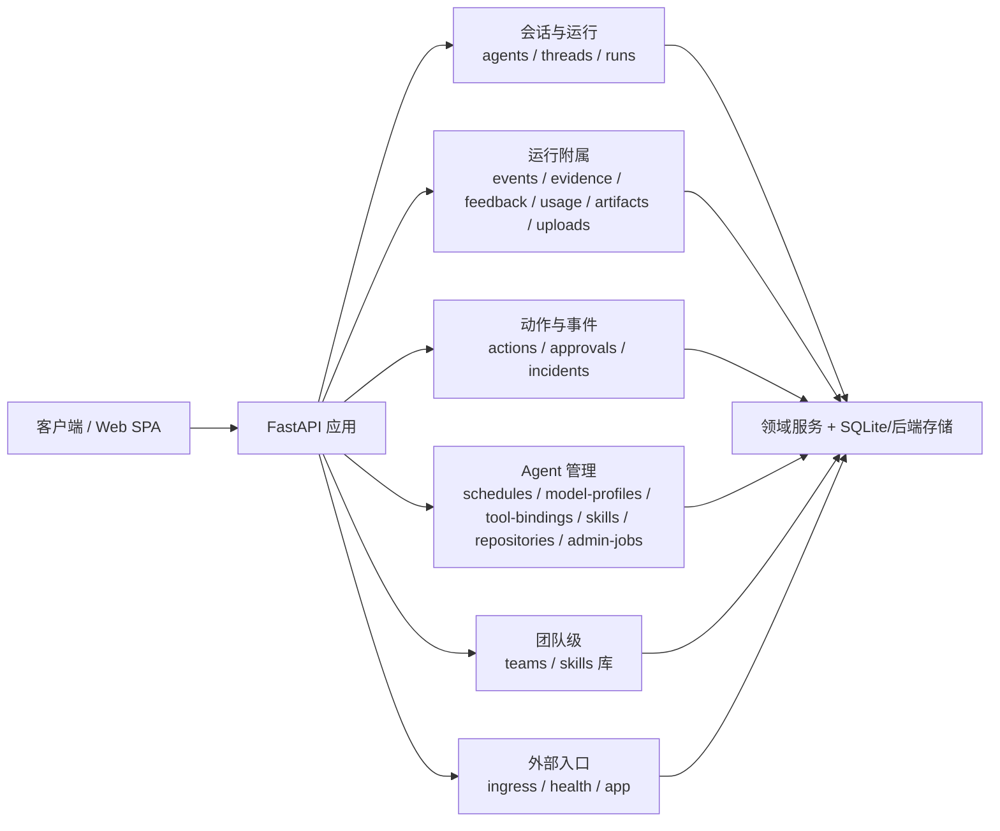
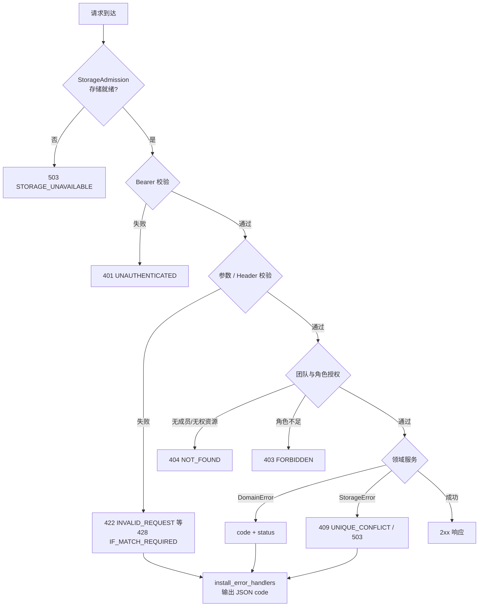
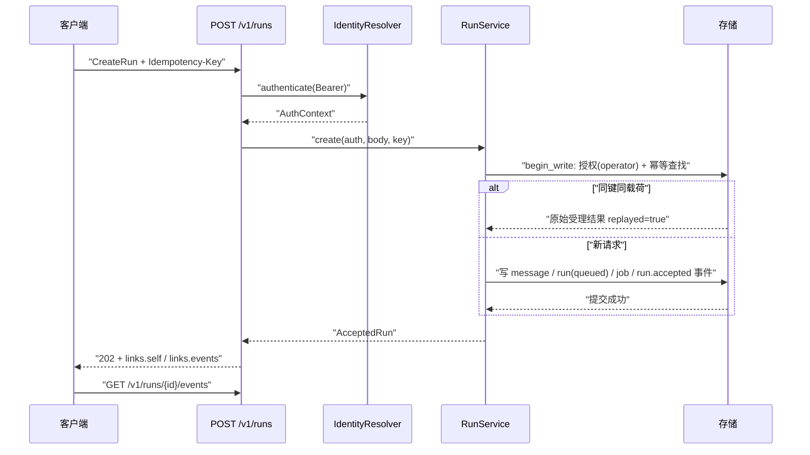
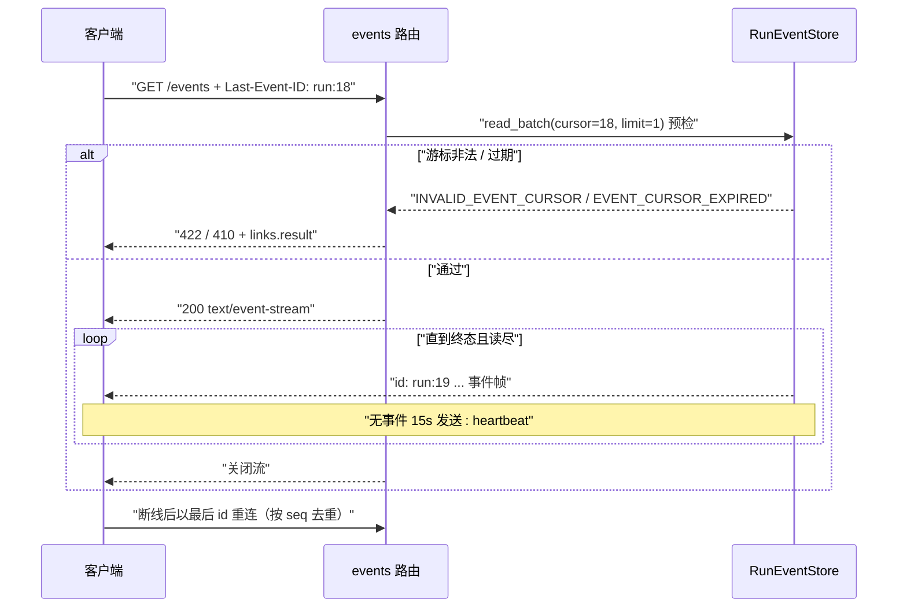
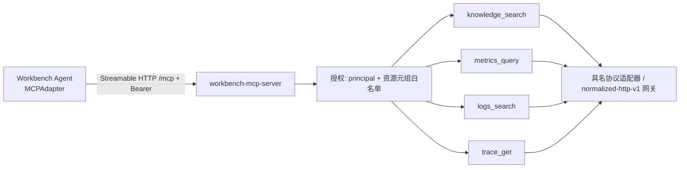

# 接口参考（HTTP API 与 MCP Server 工具）

> **读者**：需要按接口对接或排障的人。**以代码为准**；与旧规格不一致处见 [§6 核对记录](#6-核对记录原文-vs-源码)。
> 字段定义见 [数据字典](02-data-dictionary.md)，配置项见 [配置参考](03-configuration.md)，设计边界见 [02 架构 §12](../02-architecture.md#12-mcp-server-边界)。

本文给出 Workbench Agent HTTP API 与 MCP Server 的接口参考，**以代码为准**（`apps/agent/src/workbench_agent/api/` 下的实际路由与 `apps/mcp-server`）；与原文（第 11、12.2、12.3 节）不一致处见文末「核对记录」。标注「待核」的内容表示未能从路由层直接确认。

## 1. 接口总览

路由清单包含原有业务接口及文末内置知识库接口；实际注册路由以当前源码和 OpenAPI 为准。

| 分组 | 数量 | 路径前缀 |
| --- | --- | --- |
| 图目录 | 2 | `/v1/graphs` |
| Agent | 5 | `/v1/agents` |
| Thread | 4 | `/v1/threads` |
| Run | 5 | `/v1/runs` |
| 事件流 / 证据 / 反馈 / 用量 / 产物 / 上传 | 8 | `/v1/runs/{id}/events` 等 |
| Action / Approval | 4 | `/v1/actions`、`/v1/approvals` |
| Incident | 2 | `/v1/incidents` |
| Schedule | 5 | `/v1/agents/{agent_id}/schedules` |
| Model Profile | 7 | `/v1/agents/{agent_id}/model-profiles` |
| Tool Binding | 3 | `/v1/agents/{agent_id}/tool-bindings` |
| Repository / Admin Job | 2 | `/v1/agents/{agent_id}/repositories`、`admin-jobs` |
| Skill（Agent 级导入发布） | 4 | `/v1/agents/{agent_id}/skills` |
| Skill 库（团队级） | 7 | `/v1/skills` |
| Team | 4 | `/v1/teams` |
| Ingress | 1 | `/v1/ingress/{connector_id}` |
| 前端静态 | 2 | `/app`、`/app/{path}` |
| 健康检查（app.py） | 2 | `/health/live`、`/health/ready` |



## 2. 统一约定

### 2.1 鉴权与权限

| 项 | 说明（代码依据 `auth.py`、`application/authorization.py`、`domain/identity.py`） |
| --- | --- |
| 凭据 | `Authorization: Bearer <token>`；缺失/格式错误/含空格 → 401 `UNAUTHENTICATED` |
| 生产 | 仅 OIDC（RS256，校验 iss/aud/exp/sub，token 最长 16384 字符）；`development:<subject>` 令牌仅非生产，生产启动即拒绝 |
| 团队解析 | 不读取请求头里的团队/角色；team 由 token 的 team_id 提示 + `team_members` 单行唯一解析，歧义或无成员 → 404 `NOT_FOUND` |
| 角色序 | `viewer(0) < operator(1) < maintainer(2) < admin(3)`；不足 → 403 `FORBIDDEN` |
| 连接器身份 | `identity_kind=connector`，带 `agent_scope`；对 maintainer/admin 级操作一律 403；越出 agent_scope 的 Agent → 404 |
| 无权资源 | 不存在与无权访问统一 404（不泄露存在性） |
| 免 Bearer | `/v1/ingress/*`（HMAC 头）、`/app*`、`/health/*` |

### 2.2 请求约定

| 约定 | 内容 |
| --- | --- |
| 幂等键 | 请求头 `Idempotency-Key`（缺失 → 422 `INVALID_REQUEST`；长度需 1–128，否则 422 `INVALID_IDEMPOTENCY_KEY`）。按 team/subject/agent/route/key 保存请求哈希与原响应 **72 小时**；同键同载荷返回原响应并带 `Idempotency-Replayed: true`；同键异载荷 409 `IDEMPOTENCY_CONFLICT`。载荷规范化后超 64 KiB → 413 `INPUT_TOO_LARGE`（创建 Run 不设此上限） |
| 乐观并发 | 配置类变更需 `If-Match: "<revision>"`（引号可选，纯数字且 ≤18 位）；缺失 428 `IF_MATCH_REQUIRED`；格式错 422 `INVALID_REVISION`；过期 409 `REVISION_CONFLICT`。Run 恢复用请求体 `expected_revision` |
| 分页 | 游标式：`limit`（默认 20，1–100）+ `after`（上一页最后一项的 UUID）；响应形态因资源而异（见 2.3）。非法游标 422 `INVALID_CURSOR` |
| 标识 | 资源 ID 为 UUID（路径参数为 UUID 类型，非法 → 422 `INVALID_REQUEST`）；Model Profile、Tool Binding、Skill 以名称/别名定位 |
| 请求体 | Pydantic 模型多为 `extra='forbid'`，未知字段 → 422 `INVALID_REQUEST` |
| 时间 | RFC 3339 UTC（如 `2026-11-12T08:00:01.000Z`） |

### 2.3 分页响应形态

| 接口 | 形态 |
| --- | --- |
| `GET /v1/agents` | `{items, next_cursor}`（满页时 `next_cursor`=末项 agent_id，否则 null） |
| `GET /v1/skills/{id}/versions` | `{items, next_cursor:null}`（不分页） |
| `GET /v1/teams` | `{items}`（无游标） |
| 其余列表（runs/threads/messages/incidents/schedules/model-profiles/skills/feedback） | 由对应服务层返回，具体包装字段待核；入参统一 `limit`/`after` |
| `GET .../schedules/{id}/fires` | `limit` 默认 100（1–100），`after` 为字符串游标（≤1024） |

### 2.4 错误格式

错误体由 `api/errors.py` 统一生成，**仅含 `code`（及可选 `links`）**，不含 message/request_id：

```json
{"code": "EVENT_CURSOR_EXPIRED", "links": {"result": "/v1/runs/<run_id>"}}
```

| 来源 | HTTP | code |
| --- | --- | --- |
| `DomainError(code, status)` | 自带 | 业务码 |
| `StorageError` | 409 或 503 | `UNIQUE_CONFLICT`(409)；其余 503 |
| `RequestValidationError` | 422 | `INVALID_REQUEST` |
| `StorageAdmissionMiddleware`（`/v1/*` 存储未就绪） | 503 | `STORAGE_UNAVAILABLE` |

常见错误码（节选，按状态码）：

| HTTP | code |
| --- | --- |
| 401 | `UNAUTHENTICATED`、`INGRESS_AUTH_FAILED` |
| 403 | `FORBIDDEN`、`OPERATION_DENIED`、`INTERRUPT_ACTOR_MISMATCH`、`INGRESS_ACTOR_DENIED` |
| 404 | `NOT_FOUND` |
| 409 | `IDEMPOTENCY_CONFLICT`、`REVISION_CONFLICT`、`STALE_EXECUTION`、`ACTION_CONFLICT`、`APPROVAL_CONFLICT`、`APPROVAL_EXPIRED`、`INTERRUPT_CONFLICT`、`INTERRUPT_EXPIRED`、`THREAD_BUSY`、`FINALIZATION_STARTED`、`RUN_EXPIRED`、`BUDGET_EXCEEDED`、`WORKFLOW_UNAVAILABLE`、`MODEL_PROFILE_UNAVAILABLE`、`MODEL_CREDENTIAL_UNAVAILABLE`、`ARTIFACT_CHANGED`、`ARTIFACT_UNAVAILABLE`、`SCHEDULE_OVERLAP`、`AGENT_NAME_CONFLICT`、`SKILL_NAME_CONFLICT`、`DRAFT_REQUIRED` 等 |
| 410 | `EVENT_CURSOR_EXPIRED`（带 `links.result`） |
| 413 | `INPUT_TOO_LARGE`、`UPLOAD_TOO_LARGE`、`INVALID_INGRESS`(体>64KiB) |
| 422 | `INVALID_REQUEST`、`INVALID_REVISION`、`INVALID_CURSOR`、`INVALID_EVENT_CURSOR`、`INVALID_IDEMPOTENCY_KEY`、`INVALID_SCOPE`、`MODE_NOT_ALLOWED`、`UPLOAD_DIGEST_MISMATCH` 等 |
| 428 | `IF_MATCH_REQUIRED` |
| 503 | `STORAGE_UNAVAILABLE`、`OBJECT_STORAGE_UNAVAILABLE`、`UPLOAD_STAGING_UNAVAILABLE/FULL/BUSY`、`INGRESS_UNAVAILABLE`、`SNAPSHOT_UNAVAILABLE` |

（全集包含约 140 个 `DomainError` 码，未逐一列出；每个接口的错误列仅列代表性码。）



### 2.5 创建 Run 时序



## 3. SSE 与 RunEvent 协议

### 3.1 订阅接口

`GET /v1/runs/{run_id}/events`，`Content-Type: text/event-stream`，响应头 `Cache-Control: no-cache`、`X-Accel-Buffering: no`。

| 参数 | 位置 | 说明 |
| --- | --- | --- |
| `after_seq` | Query，int ≥0 | 从该 seq 之后回放，缺省 0 |
| `Last-Event-ID` | Header | 形如 `<run_id>:<seq>`；run_id 不匹配或非十进制 → 422 `INVALID_EVENT_CURSOR`；与 `after_seq` 同给且不相等 → 422 |

响应头发出前完成全量预检（授权 viewer、游标范围 `≤ last_event_seq`、保留期）：游标越界 422 `INVALID_EVENT_CURSOR`；超保留期 410 `EVENT_CURSOR_EXPIRED`（体含 `links.result`）。

### 3.2 事件帧

```text
id: <run_id>:<seq>
event: <type>
data: {"attempt":0,"message_id":null,"occurred_at":"...","payload":{...},"run_id":"...","schema_version":"1","seq":18,"type":"input.required"}

```

`data` 为键排序的紧凑 JSON；心跳为 `: heartbeat` 注释帧（15 秒无事件时发送，不占 seq）。

| 字段 | 说明 |
| --- | --- |
| schema_version | 固定 `"1"` |
| run_id / seq | seq 在单个 Run 内严格递增（≥1） |
| type | 见下表（共 20 种，`domain/events.py`） |
| occurred_at / attempt / message_id | 时间、执行尝试号、消息标识（可空） |
| payload | 随 type 而定；`run.status_changed` 带 status/revision |

| 类别 | type |
| --- | --- |
| 生命周期 | `run.accepted`、`run.started`、`run.status_changed`、`run.resumed`、`run.recovery_scheduled`、`run.completed`、`run.failed`、`run.cancelled`、`run.expired` |
| 过程 | `phase.changed`、`skill.loaded`、`tool.started`、`tool.completed`、`evidence.added` |
| 文本 | `assistant.delta`、`assistant.message_superseded` |
| 等待 | `input.required`、`approval.required` |
| 外部动作 | `action.updated`、`delivery.updated` |

存储层对旧事件做线上投影：`run.waiting` 内部别名按新词表输出，`run.cancel_requested` 以 `run.status_changed`(status=cancel_requested) 输出，`run.resume_accepted` 输出为 `run.resumed`。调用者无权读取全部证据时，`assistant.delta` 被替换为 `[Content unavailable]`，`tool.*`/`evidence.added` 载荷为 `{"redacted":true}`。

### 3.3 传输行为

| 项 | 代码行为 |
| --- | --- |
| 读取 | 每批 ≤100 条从存储顺序读取；Redis 提示仅用于唤醒，最多 1 秒轮询兜底 |
| 背压 | 有界队列 99 + 1 在途；客户端过慢（积压且仍有新事件）则中止连接，客户端可凭 Last-Event-ID 续传 |
| 终止 | Run 终态且事件读尽后正常关闭；流内授权撤销/保留期/存储错误则直接关闭（重连时由预检返回 HTTP 状态） |
| 保留 | `RETENTION_MS` = 7 天 |



## 4. 接口明细

表中「角色」为授权最低角色（服务层 `Authorization.current(..., minimum)`）；「幂」=需要 `Idempotency-Key`；「版」=需要 `If-Match`。

### 4.1 Agent（`/v1/agents`）

| 方法路径 | 角色 | 幂/版 | 请求 | 响应 | 典型错误 |
| --- | --- | --- | --- | --- | --- |
| `GET /v1/agents` | viewer | - | `limit`、`after` | 200 `{items,next_cursor}` | 404 |
| `POST /v1/agents` | maintainer（且非 agent_scope） | 幂 | `{name: 1–128}` | 200（receipt 原状态码；非 201，待核） | 409 `AGENT_NAME_CONFLICT`、403 |
| `GET /v1/agents/{agent_id}` | viewer | - | - | 200 Agent + `draft` | 404 |
| `PATCH /v1/agents/{agent_id}` | maintainer | 幂+版 | `ProfileDraft`：default_model、description≤1000、system_prompt≤12000、response_language(auto/zh/en)、response_format(default/markdown/json)、conversation_history_turns 0–8、allowed_modes、budget_limits、role_models、graph_id、skills/tools/repositories(VersionRef) | 200 草稿 | 409 `REVISION_CONFLICT`、422 |
| `POST /v1/agents/{agent_id}/profiles/publish` | maintainer | 幂+版 | 无体 | 发布版本（状态码由服务回执决定，待核是否 201） | 409 `DRAFT_REQUIRED`、`REVISION_CONFLICT` |

### 4.2 Thread（`/v1/threads`）

| 方法路径 | 角色 | 请求 | 响应 | 错误 |
| --- | --- | --- | --- | --- |
| `GET /v1/threads` | viewer | Query 必填 `agent_id`，`limit`、`after` | 200 列表 | 404、422 |
| `POST /v1/threads`（幂） | operator | `{agent_id}` | **201** ThreadView：thread_id、agent_id、active_run_id、revision、created_at | 404、409 |
| `GET /v1/threads/{thread_id}` | viewer | - | 200 ThreadView | 404 |
| `GET /v1/threads/{thread_id}/messages` | viewer | `limit`、`after` | 200 消息分页（MessageView：message_id、thread_id、run_id、role、input、outcome、created_at） | 404 |

### 4.3 Run（`/v1/runs`）

| 方法路径 | 角色 | 请求 | 响应 | 错误 |
| --- | --- | --- | --- | --- |
| `GET /v1/runs` | viewer | Query 必填 `agent_id`；`limit`、`after`、`status`（queued/running/finalizing/cancelling/waiting_input/waiting_approval/succeeded/partial/failed/cancelled/timed_out/expired）、`q`≤200 | 200 列表 | 422 |
| `POST /v1/runs`（幂） | operator | `CreateRun`：agent_id、thread_id?、mode(auto/qa/rca/code/sop/inspection，默认 auto)、input{type:text,text,artifact_ids[]}、business_context{}、response_language(默认 zh-CN)、client_message_id?(≤128)、workflow_version_id?、budgets、summary_token_reserve?、expected_revision? | **202** AcceptedRun：run_id、thread_id、status=queued、revision、accepted_at、links{self,events}；重放带 `Idempotency-Replayed` | 409 `THREAD_BUSY`、`WORKFLOW_UNAVAILABLE`、`MODEL_PROFILE_UNAVAILABLE`、`BUDGET_EXCEEDED`；422 `MODE_NOT_ALLOWED`；413 |
| `GET /v1/runs/{run_id}` | viewer | - | 200 RunView：run_id、thread_id、agent_id、status、revision、phase、attempt、created_at、started_at、active_elapsed_ms、waiting、outcome、usage、delivery_summary、links | 404 |
| `POST /v1/runs/{run_id}/resume`（幂） | operator | `ResumeRun`：interrupt_id、expected_revision(≥0)、response（`kind=user_input`{values,text} 或 `kind=approval`{approval_id,decision,expected_args_hash}） | **202**（带重放头） | 409 `INTERRUPT_CONFLICT`/`INTERRUPT_EXPIRED`/`REVISION_CONFLICT`；403 `INTERRUPT_ACTOR_MISMATCH`；422 `INVALID_RESPONSE` |
| `POST /v1/runs/{run_id}/cancel`（幂） | operator | 无体 | **200** RunView（路由未设 202） | 409 `FINALIZATION_STARTED` |

### 4.4 Run 附属（事件、证据、反馈、用量、产物、上传）

| 方法路径 | 角色 | 请求 | 响应 | 错误 |
| --- | --- | --- | --- | --- |
| `GET /v1/runs/{run_id}/events` | viewer | 见第 3 章 | SSE | 422/410 |
| `GET /v1/runs/{run_id}/evidence/{evidence_id}` | viewer + 披露校验 | - | 200 证据内容 | 404、409 `EVIDENCE_UNAVAILABLE` |
| `POST /v1/runs/{run_id}/feedback`（幂） | viewer | `{rating: -1 或 1(严格 int), reason?: irrelevant/citation_error/stale/other, comment?≤4000}`；负反馈可创建知识缺口，正反馈不能带 reason | **201** | 422 |
| `GET /v1/runs/{run_id}/feedback` | viewer | `limit`、`after` | 200 | 404 |
| `GET /v1/usage` | operator | Query 必填 `run_id` | 200 预算/用量快照 | 404 |
| `GET /v1/stats/summary` | maintainer | `start_at`、`end_at`（带时区，窗口 >0 且 ≤90 天）、可选 `agent_id` | 200 stats-v1 汇总；只统计当前可见 Agent | 403/404/422 |
| `GET /v1/agents/{agent_id}/tool-connections` | admin | - | 200 授权连接列表，不含 endpoint/secret | 403/404 |
| `POST /v1/agents/{agent_id}/tool-connections/{server}/discover`（幂） | admin | `{credential_scope}` | 202 `tool_discovery` AdminJob | 403/404/409/422 |
| `GET /v1/agents/{agent_id}/tool-bindings` | admin | `limit`、`after` | 200 分页工具绑定摘要 | 403/404 |
| `GET /v1/agents/{agent_id}/tool-bindings/{alias}` | admin | - | 200 草稿、revision、版本摘要 | 403/404 |
| `GET /v1/agents/{agent_id}/tool-bindings/{alias}/versions/{version}` | admin | - | 200 精确 binding 与 VersionRef | 403/404 |
| `conversation.tool_use` Run | operator | 需 `mode=qa`、`business_context.conversation=true` 和完整 `query_scope`；Profile 引用 1–4 个已发布只读 `knowledge_search` binding | 202/409/422 | 工具回答固定标注“未经独立校验” |
| `GET /v1/artifacts/{artifact_id}/url` | viewer | - | 200 `{url,expires_in:60,sha256,size}` | 409 `ARTIFACT_CHANGED`/`ARTIFACT_UNAVAILABLE`；503 `OBJECT_STORAGE_UNAVAILABLE` |
| `POST /v1/runs/{run_id}/uploads` | operator | `{kind, sha256, size(0..MAX_BYTES, 严格 int)}` | **201** `{artifact_id,status,sha256,size}`（无需幂等键） | 422 `INVALID_UPLOAD` |
| `POST /v1/uploads/{artifact_id}/complete`（幂） | operator | 请求体为原始文件字节（流式）；可选 Header `Upload-Replay: true`（体必须为空，仅重放回执） | **202** 上传任务回执 | 413 `UPLOAD_TOO_LARGE`；409 `IDEMPOTENCY_CONFLICT`/`UPLOAD_REPLAY_NOT_FOUND`；422 `UPLOAD_DIGEST_MISMATCH`/`UPLOAD_REPLAY_BODY_FORBIDDEN`；503 `UPLOAD_STAGING_*` |

### 4.5 Action / Approval / Incident

| 方法路径 | 角色 | 请求 | 响应 | 错误 |
| --- | --- | --- | --- | --- |
| `GET /v1/actions/{action_id}` | operator，且仅当前审批人本人（连接器身份→404） | - | 200 动作与回执 | 404 |
| `POST /v1/approvals/{approval_id}/decision` | operator，且须为审批指定 subject；connector 身份不可操作 | `{decision: approve/reject, expected_args_hash: 64 位十六进制}` | 200 | 409 `APPROVAL_CONFLICT`/`APPROVAL_EXPIRED`/`APPROVAL_INVALIDATED`/`ACTION_CONFLICT` |
| `POST /v1/actions/{action_id}/retry`（幂） | operator | 无体 | 回执状态码 | 409 `ACTION_RETRY_UNAVAILABLE`/`ACTION_NOT_UNKNOWN` |
| `POST /v1/actions/{action_id}/reapproval`（幂） | operator | `{expected_args_hash}` | 回执状态码 | 409 `REAPPROVAL_UNAVAILABLE` |
| `GET /v1/incidents` | viewer | Query 必填 `agent_id`；`limit`、`after` | 200 | 404 |
| `GET /v1/incidents/{incident_id}` | viewer | - | 200 | 404 |

### 4.6 Schedule（`/v1/agents/{agent_id}/schedules`）

| 方法路径 | 角色 | 请求 | 响应 | 错误 |
| --- | --- | --- | --- | --- |
| `GET ` | viewer | `limit`、`after` | 200 | 404 |
| `POST ` | maintainer，幂 | `ScheduleSpec`：cron(≤128)、timezone、workflow_version_id、input_text(≤4096)、overlap_policy(仅 `forbid`)、query_scope? | 回执 | 422、409 |
| `PATCH /{schedule_id}` | maintainer，幂+版 | `{status: active/paused}` | 回执 | 409 `REVISION_CONFLICT` |
| `POST /{schedule_id}/trigger` | operator，幂 | 无体 | **202**（统一 Run 受理结果） | 409 `SCHEDULE_OVERLAP` |
| `GET /{schedule_id}/fires` | viewer | `limit`(默认 100)、`after`(字符串) | 200 | 422 `INVALID_CURSOR` |

### 4.7 Model Profile（`/v1/agents/{agent_id}/model-profiles`，全部 admin）

| 方法路径 | 幂/版 | 请求 | 响应 | 错误 |
| --- | --- | --- | --- | --- |
| `GET ` | - | `limit`、`after` | 200 | - |
| `POST ` | 幂 | `ModelProfile`：name、provider/adapter=deepseek、protocol=openai_chat_completions、base_url、model_id、secret_ref(`env://` 引用)、temperature、request_timeout_seconds、max_output_tokens、max_context_tokens、streaming、invocation_max_attempts 1–3 等 | 回执 | 409 `MODEL_PROFILE_CONFLICT`、422 |
| `GET /{name}` | - | - | 200 | 404 |
| `PATCH /{name}` | 幂+版 | 任意 dict（部分字段） | 回执 | 409 `REVISION_CONFLICT` |
| `PUT /{name}/credential` | 版（无幂等键） | `{api_key: 1–4096}`（SecretStr，写入受管密钥存储，响应不回显） | 200，`Cache-Control: no-store` | 503 `MODEL_CREDENTIAL_STORE_UNAVAILABLE` |
| `POST /{name}/publish` | 幂+版 | 无体 | 回执 | 409 `MODEL_CREDENTIAL_UNAVAILABLE`、`DRAFT_REQUIRED` |
| `POST /{name}/probe` | 幂 | 无体 | **202** 探针 Job | 409 |

### 4.8 Tool Binding / Repository / Admin Job / Skill（均 admin）

| 方法路径 | 幂/版 | 请求 | 响应 | 错误 |
| --- | --- | --- | --- | --- |
| `PUT /v1/agents/{agent_id}/tool-bindings/{alias}` | 幂+版 | `ToolBinding`：alias（须等于路径，否则 422）、provider、tool_name、server、credential_scope、permission、input_schema、output_schema?、read_only、timeout_seconds(0,60]、max_output_bytes 64–1048576 | 200 草稿 | 422 `INVALID_TOOL_SCHEMA` |
| `POST .../tool-bindings/{alias}/publish` | 幂+版 | 无体 | **201** 版本引用 | 409 `DRAFT_REQUIRED` |
| `POST .../tool-bindings/{alias}/probe` | 幂 | 无体 | **202** | - |
| `POST /v1/agents/{agent_id}/repositories/{repo_id}/sync` | 幂 | `{commit}` | **202** 后台 Job | 422 `INVALID_REPOSITORY`/`INVALID_GIT_REF` |
| `GET /v1/agents/{agent_id}/admin-jobs/{job_id}` | - | - | 200 Job（dataclass） | 404 |
| `POST /v1/agents/{agent_id}/skills/{name}/import` | 幂 | 无体（导入种子） | **202** Job | 409 `SKILL_IMPORT_UNAVAILABLE` |
| `POST .../skills/{name}/import/git` | 幂 | `{repository, commit}` | **202** | 422 `INVALID_GIT_REF` |
| `POST .../skills/{name}/import/artifact` | 幂 | `{artifact_id: UUID}` | **202** | 409 `ARTIFACT_UNAVAILABLE` |
| `POST .../skills/{name}/publish` | 幂+版 | `{job_id: UUID}` | **201** 版本引用 | 503 `OBJECT_STORAGE_UNAVAILABLE`、409 |

### 4.9 Skill 库（`/v1/skills`，团队级，agent_scope/连接器身份一律 404）

| 方法路径 | 角色 | 幂/版 | 请求 | 响应 |
| --- | --- | --- | --- | --- |
| `GET /v1/skills` | viewer | - | `limit`(默认 100)、`after`、`q`≤128 | 200 |
| `POST /v1/skills` | maintainer | 幂 | `{name 1–128, description 1–1000, files}`；兼容 `content` | 回执（409 `SKILL_NAME_CONFLICT`） |
| `GET /v1/skills/{skill_id}` | viewer | - | - | 200（含 versions） |
| `PATCH /v1/skills/{skill_id}` | maintainer | 幂+版 | `{description, files}`；兼容 `content` | 回执 |
| `POST /v1/skills/{skill_id}/publish` | admin | 幂+版 | 无体 | 回执 |
| `GET /v1/skills/{skill_id}/versions` | viewer | - | - | 200 `{items,next_cursor:null}` |
| `GET /v1/skills/{skill_id}/versions/{version}` | viewer | - | `version` int | 200 |

`files` 是相对路径到 `{encoding: "utf-8" | "base64", content: string}` 的映射，字符串值可作为 UTF-8 简写。必须包含非空 UTF-8 `SKILL.md` 正文，发布时自动生成 name/description 的 YAML 元信息。脚本作为文本资源保存；Base64 资源仅支持扩展名与文件签名一致的 PNG/JPEG/GIF/WebP 图片。

最多 64 个文件，路径最多 256 字符，主正文最多 32000 UTF-8 字节，文本附件最多 256 KiB，图片最多 2 MiB，解码后的总大小最多 8 MiB。创建/保存的规范化幂等请求上限为 12 MiB。禁止绝对路径、越界路径、文件/目录前缀冲突、NUL 文本和 `.claude` 资源。

完整 `files` 保存会替换文件集合；旧请求只传 `content` 时，仅更新主正文并保留附件。两个字段同时传入必须表达相同主正文。草稿响应包含 `description`、规范化 `files` 以及主正文的兼容别名 `content`。历史版本响应增加 `files`，其中 `SKILL.md` 是已生成元信息的完整文件；原 `content` 字段继续返回该完整主文件。列表响应不携带草稿文件。脚本资源不会隐式执行，图片也不会自动送入模型。

### 4.10 Team（`/v1/teams`）

| 方法路径 | 角色 | 幂/版 | 请求 | 响应 | 错误 |
| --- | --- | --- | --- | --- | --- |
| `GET /v1/teams` | viewer | - | - | 200 `{items}`（仅当前团队） | - |
| `POST /v1/teams` | admin | 幂 | `{name 1–128}` | 回执 | 409 |
| `GET /v1/teams/{team_id}/members/{subject:path}` | admin | - | team_id 须等于当前团队，否则 404 | 200 | 404 |
| `PUT /v1/teams/{team_id}/members/{subject:path}` | admin | 幂+版 | `{role: viewer/operator/maintainer/admin, status: active/revoked(默认 active)}` | 回执 | 422 `INVALID_MEMBER`、409 |

### 4.11 Ingress、前端与健康检查

| 方法路径 | 鉴权 | 说明 |
| --- | --- | --- |
| `POST /v1/ingress/{connector_id}` | 无 Bearer；头 `x-dod-timestamp`、`x-dod-signature` 各恰好一个，HMAC 密钥来自 `secret_ref` | 仅非生产环境的合成入口：生产一律 404；协议 `synthetic-chat-v1`、`synthetic-alert-v2`，其余按 `synthetic-alert`；体 ≤64 KiB(413)；成功 **202**，重放带 `Idempotency-Replayed`；错误 401 `INGRESS_AUTH_FAILED`、422 `INVALID_INGRESS`、503 `INGRESS_UNAVAILABLE` |
| `GET /app`、`GET /app/{path}` | 无 | SPA 静态资源；带后缀/`assets/` 路径或非 `text/html` 请求缺失文件 → 404；构建缺失 → 503 |
| `GET /health/live` | 无 | 200 `{"live":true}` |
| `GET /health/ready` | 无 | 200/503 `{"ready":bool}` |

## 5. MCP Server（只读工具）

依据 `apps/mcp-server/src/workbench_mcp_server/interfaces/mcp/server.py`、`schemas.py` 与 README。

| 项 | 内容 |
| --- | --- |
| 名称/传输 | `workbench-mcp-server`；stdio 或 Streamable HTTP（端点 `/mcp`，无状态，`json_response`），请求体 ≤64 KiB(413) |
| 鉴权 | HTTP 必须 `Authorization: Bearer`，失败 401；stdio 使用配置的固定 principal；仅服务身份，无 OAuth |
| 通用输入 | `scope{team,environment,region,service,source_id}` 与 `context{run_id,invocation_id,query_scope_ref}`（各 1–128，extra 禁止） |
| 工具注解 | readOnlyHint=true、destructiveHint=false、openWorldHint=true |
| 返回 | `dod-tool-result-v1`：status(ok/empty/unavailable/denied/invalid_input/timeout/unknown)、data、evidence_refs、artifacts、error、retryable、meta |

| 工具 | 额外参数 | 数据 |
| --- | --- | --- |
| `knowledge_search` | query、scene(qa/alert)、limit(默认 3，1..10) | matches、guidance、hypotheses、release_id |
| `metrics_query` | template_id、start、end、parameters?、step_seconds(默认 60，15..3600) | series、missing |
| `logs_search` | start、end、levels(默认 ["ERROR"])、keyword?、trace_id?、limit(默认 50，1..200)、cursor? | entries、next_cursor、truncated |
| `trace_get` | trace_id、start、end | trace_id、spans、omitted_spans、truncated |

另有只读 Resource `dod://guides/incident-diagnosis`（text/markdown）与 Prompt `investigate_incident(service, environment, start, end)`。时间窗须带时区且 ≤1 小时；单调用 deadline 20 秒，实例并发 4、每主体 2；MCP 序列化结果合计 ≤256 KiB。



相关图：运行时与中断恢复见 [中断与恢复](../assets/05-interrupt-resume.svg)、[Run 状态机](../assets/07-run-state.svg)。

## 6. 核对记录（原文 vs 源码）

| # | 原文 | 源码实际 | 处理 |
| --- | --- | --- | --- |
| 1 | `/v1/model-profiles`、`/v1/tool-bindings`、`/v1/schedules` 为顶层资源 | 均挂在 `/v1/agents/{agent_id}/...` 之下 | 以代码为准 |
| 2 | `/v1/artifact-uploads`、`.../{upload_id}/complete` | `POST /v1/runs/{run_id}/uploads` 与 `POST /v1/uploads/{artifact_id}/complete`；complete 返回 202，body 为原始字节 | 以代码为准 |
| 3 | 仓库同步 `POST /agents/{id}/repositories/sync` | `.../repositories/{repo_id}/sync`，体 `{commit}` | 以代码为准 |
| 4 | 列出 `GET /v1/runs/{id}/artifacts`、`POST /v1/actions/{id}/reconcile`、`POST /v1/incidents/{id}/actions`、`/v1/ingress/seatalk|alerts/{id}` | 代码中无前三者；产物为 `GET /v1/artifacts/{id}/url`；入口统一为 `/v1/ingress/{connector_id}` 且仅非生产；另有 retry/reapproval/approvals decision | 以代码为准 |
| 5 | 创建 Thread 201；取消 202 或终态 | Thread 201 一致；取消路由返回 200 RunView | 差异 |
| 6 | 错误体 `{error:{code,message,request_id,retryable,details}}` | 仅 `{code[,links]}`；无 message/request_id | 差异 |
| 7 | 错误码如 `AUTHENTICATION_REQUIRED`、`RESOURCE_NOT_FOUND`、`INVALID_INPUT`、`PAYLOAD_TOO_LARGE`、`QUOTA_EXCEEDED`、`RUN_NOT_WAITING`、`INTERRUPT_ALREADY_RESOLVED`、`INTERRUPT_REVISION_CONFLICT`；有 429 | 对应为 `UNAUTHENTICATED`、`NOT_FOUND`、`INVALID_REQUEST`、`INPUT_TOO_LARGE`、`INTERRUPT_CONFLICT`、`REVISION_CONFLICT`；未发现 429 路径（`BUDGET_EXCEEDED` 为 409/422） | 差异 |
| 8 | 缺失 Idempotency-Key 的行为未写 | 缺失由 FastAPI 校验返回 422 `INVALID_REQUEST`；长度错 `INVALID_IDEMPOTENCY_KEY`；缺 If-Match 为 428 | 补充 |
| 9 | 幂等键适用于创建/恢复/取消/配置变更 | 与代码一致，但 `POST /runs/{id}/uploads` 与 `PUT .../credential` 不要求；上传 complete 另有重放头 | 补充 |
| 10 | 410 含 INTERRUPT_EXPIRED | 代码中 `INTERRUPT_EXPIRED` 为 409，仅 `EVENT_CURSOR_EXPIRED` 为 410 | 差异 |
| 11 | SSE：Last-Event-ID/after_seq、心跳 15s、100 条缓冲、7 天保留 | 一致；另有 422 `INVALID_EVENT_CURSOR` 规则与线上投影/脱敏（原文未述） | 补充 |
| 12 | 事件类型表 | 20 种与原文逻辑一致，`domain/events.py` 为权威列表 | 一致 |
| 13 | 路由总数 | api/ 下 63 条装饰器 + 2 条健康检查 | 本文统计 |
| 14 | 团队角色接口 `GET/PUT /v1/teams/{id}/members/{subject}` | 一致，subject 使用 `:path`（可含斜杠/冒号） | 补充 |
| 15 | `POST /v1/agents`、`publish` 等回执状态码 | 由服务回执决定，路由层未固定 | 待核 |
| 16 | 各列表分页响应包装字段 | 仅 agents 路由层可见，余者在服务层 | 待核 |
| 17 | MCP Server | 原文第 11 章未列 | 本文新增第 5 章 |

## 内置知识库 API

以下 `/v1/kb` 接口使用用户认证与团队权限；修改操作带 `Idempotency-Key`，除新建条目外还带 `If-Match` revision。实际错误码和响应结构以 OpenAPI 与源码为准。

| 方法与路径 | 用途 |
| --- | --- |
| `GET/POST /v1/kb/entries` | 列表及创建草稿；列表支持游标、过滤，limit 1–100 |
| `GET/PATCH /v1/kb/entries/{entry_id}` | 读取及保存草稿 |
| `POST /v1/kb/entries/{entry_id}/publish`、`/archive` | 发布或归档 |
| `GET /v1/kb/entries/{entry_id}/versions`、`/versions/{version}` | 历史列表及不可变版本 |
| `POST /v1/kb/entries/{entry_id}/versions/{version}/rollback` | 从历史版本回滚 |
| `POST /v1/kb/entries/{entry_id}/import` | 导入 `text/markdown` 或 `text/plain`，`X-Filename` 指定文件名；非 ASCII 文件名使用 UTF-8 百分号编码 |
| `POST /v1/kb/search` | 按 query、具体 service/environment/region 检索，limit 1–10 |
| `GET /v1/kb/gaps`、`GET /v1/kb/gaps/{gap_id}` | 缺口列表与详情 |
| `POST /v1/kb/gaps/{gap_id}/draft`、`/replay` | 关联草稿或创建重放 Run |
| `PATCH /v1/kb/gaps/{gap_id}` | 人工标记 resolved 或 dismissed，附说明 |

`POST /internal/kb/query` 是服务间只读接口，使用独立 Bearer 令牌及具体范围授权，默认关闭；它接收 normalized-query-v1 并返回 KnowledgeData，不能用普通用户身份替代服务授权。

## 图目录接口

`GET /v1/graphs` 返回本团队可见的八张内置图，包含 `graph_id`、中文标题、摘要、推荐或实验状态、能力和当前团队正在使用的 Agent 数。`GET /v1/graphs/{graph_id}` 返回适用场景、执行步骤、备注，以及从编译图提取的节点和条件边。需当前团队 viewer 或以上权限；连接器的使用量按其 Agent 范围统计。未知或退役 ID 返回 404。

Agent 草稿的 `graph_id` 在保存和发布时校验，未知或退役 ID 返回 422 `GRAPH_UNAVAILABLE`。Run 快照和 `run.started` 事件使用 `graph_id`。
