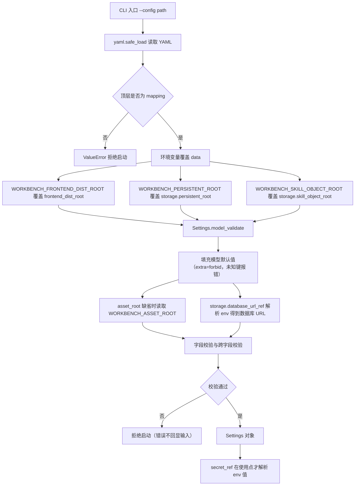
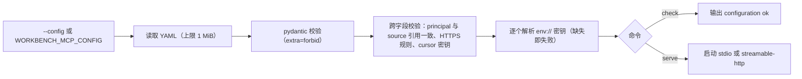

# 配置参考（Agent 与 MCP Server）

> **读者**：部署与配置的人。**以代码为准**：Agent 取 `settings.py`，MCP Server 取 `infrastructure/config/settings.py`，样例取 `config/local/*.example.yaml`。
> 部署步骤见 [04 运维](../04-operations.md)，接口见 [01 接口参考](01-api.md)。

本文是 Workbench 部署配置的逐项参考，**以代码为准**：Agent 以 `apps/agent/src/workbench_agent/settings.py` 的 pydantic 模型为准，MCP Server 以 `apps/mcp-server/.../infrastructure/config/settings.py` 为准，样例以 `config/local/*.example.yaml` 为准；与原文 18.1 不一致处见文末「核对记录」。文中所有密钥均为占位符。

## 1. 配置层次与加载优先级

### 1.1 四层配置（原文 18.1 的概念分层）

| 层 | 管理内容 | 存放位置 | 变更生效方式 |
| --- | --- | --- | --- |
| 部署配置 | 依赖、身份、凭据授权、进程参数 | YAML（`--config`）+ 环境变量 | 重启相关进程 |
| ModelProfile | 端点、模型、温度、上下文/输出上限、超时 | `llm` 段仅为首次种子，运行期在数据库中版本化 | 在 Agent 中重新选择并发布 |
| Agent RuntimeProfile | 工作流、行为、上下文策略、预算、资源版本引用 | 数据库 | 发布后新 Run 生效，无需重启 |
| Run 快照 | 受理时实际生效的版本与限制 | 数据库 | 不可变 |

本文只覆盖第一层「部署配置」（以及 `llm` 种子与 `config/workflows/*.yaml`）。

### 1.2 Agent 进程加载流程（`load_settings`）

所有进程入口（`api` / `worker` / `scheduler` / `doctor` / `db` / `bootstrap` / `runner check` / `action-policy`）都必须带 `--config <path>`，并统一调用 `load_settings()`；代码注明“不做 cwd 资源发现”。



优先级（从高到低）：

| 顺序 | 来源 | 作用范围 |
| --- | --- | --- |
| 1 | 三个覆盖型环境变量 | 仅 `frontend_dist_root`、`storage.persistent_root`、`storage.skill_object_root`；**覆盖 YAML 同名键** |
| 2 | YAML 文件 | 所有字段 |
| 3 | 例外：`asset_root` 的 default_factory | YAML 未写时读取 `WORKBENCH_ASSET_ROOT`；两者都缺失则启动失败 |
| 4 | 模型默认值 | 其余字段 |

其它环境变量不是“覆盖”，而是通过 `env://NAME` 引用被**按需解析**（见 1.3）。没有命令行参数覆盖单个配置项（`--host`/`--port` 仅用于 `api` 进程监听）。

### 1.3 密钥引用 `*_ref` 的注入方式

| 形式 | 校验规则 | 解析 |
| --- | --- | --- |
| `env://NAME` | scheme 为 env，netloc 非空，无 query/fragment | 读取进程环境变量 `NAME`；缺失则报错 |
| `secret://name` | 允许通过格式校验 | 由受控秘密后端解析；**具体后端待核**（`connectors/secrets.py` 只对 `env` 返回值） |
| 数据库 URL | `database_url_ref` 必须是 `env://NAME`（不可带 path） | 在 `StorageSettings` 校验时立即解析，因此启动时环境变量必须已设置 |

`storage.database_url`（明文）与 `database_url_ref` 互斥，且 `database_url` 标记为 `exclude=True`、不会被序列化；生产应使用 ref。

## 2. 配置文件一览

| 文件 | 使用者 | 说明 |
| --- | --- | --- |
| `config/local/agent.example.yaml` | api / worker / scheduler | 复制为 `config/local/agent.yaml`；compose 以只读方式挂载到 `/config/agent.yaml` |
| `config/local/mcp-server.example.yaml` | mcp-server（本机进程） | 监听 `127.0.0.1:8000` |
| `config/local/mcp-server.compose.example.yaml` | mcp-server（compose） | 与上者仅差：监听 `0.0.0.0:8001`、`allowed_hosts: [mcp-server:8001]` |
| `config/workflows/payment-check.yaml` | 工作流定义 | 见第 8 节 |
| `deploy/compose.local.yml` | 本地 compose | 向 api/worker/scheduler 透传 4 个环境变量，向 mcp-server 透传 6 个 |

## 3. Agent 配置项参考

图例：必填「是」指代码中无默认值且校验要求；「固定」表示该字段是 `Literal[单值]`，**只接受表中值，写其它值会校验失败**（并非可调参数）。类型中的 `?` 表示可空。

### 3.1 顶层（`Settings`）

| 路径 | 类型 | 默认值 | 必填 | 环境变量注入 | 说明 |
| --- | --- | --- | --- | --- | --- |
| `environment` | `development\|test\|production` | `development` | 否 | 无 | 为 `production` 时强制 `service.auth_mode=oidc` 且设置 `oidc_issuer_ref` |
| `asset_root` | 绝对路径（须为已存在目录） | 读取 `WORKBENCH_ASSET_ROOT` | 是（YAML 或环境变量二选一） | `WORKBENCH_ASSET_ROOT` | 部署资源根目录（位于 wheel 之外）；相对路径或非目录报错 |
| `frontend_dist_root` | 绝对路径? | `null` | 否 | `WORKBENCH_FRONTEND_DIST_ROOT`（覆盖 YAML） | 前端构建产物目录 |
| `storage` | `StorageSettings` | 无 | 是 | 见 3.4 | 唯一没有默认的段 |
| `bootstrap` `service` `llm` `redis` `jobs` `worker` `stream` `runner` `observability` | 各子模型 | 各自默认 | 否 | 见各节 | 子段整体可省略 |

### 3.2 `bootstrap`（本地种子身份，`bootstrap` 命令使用）

| 路径 | 类型 | 默认值 | 必填 | 说明 |
| --- | --- | --- | --- | --- |
| `bootstrap.team_id` | 小写规范 UUID | `9d1e3b8a-8450-5a34-a806-c5732a34a161` | 否 | 种子团队 ID |
| `bootstrap.agent_id` | 小写规范 UUID | `1626b294-3417-55c6-a2a1-01bdb6047800` | 否 | 种子 Agent ID |
| `bootstrap.team_name` | str | `development` | 否 | 团队名 |
| `bootstrap.agent_name` | str | `default` | 否 | Agent 名 |
| `bootstrap.admin_subject` | str(1..128) | `development-admin` | 否 | 本地管理员 subject；生产另需已验证的 OIDC token（`bootstrap --identity-token-env VAR`） |

### 3.3 `service`（身份、授权、接入）

| 路径 | 类型 | 默认值 | 必填 | 环境变量 | 说明 |
| --- | --- | --- | --- | --- | --- |
| `service.name` | str | `workbench-agents` | 否 | - | 服务名 |
| `service.default_timezone` | IANA 时区 str | `Asia/Shanghai` | 否 | - | 非法时区报错 |
| `service.auth_mode` | `development\|oidc` | `development` | 否 | - | 生产必须 `oidc` |
| `service.oidc_issuer_ref` | `env://`/`secret://` ref? | `null` | 生产必填 | 如 `WORKBENCH_OIDC_ISSUER` | OIDC issuer 引用 |
| `service.oidc_audience` | str | `workbench-agents` | 否 | - | token audience |
| `service.oidc_jwks_url` | str? | `null` | 否 | - | JWKS 地址；格式校验未见，待核 |
| `service.connector_identities` | `dict[name, {subject, team_id, agent_ids}]` | `{}` | 否 | - | 连接器身份白名单；键 1..128；binding 键集合必须恰为 `subject/team_id/agent_ids`；`agent_ids` 非空；ID 为规范 UUID |
| `service.synthetic_ingress` | `dict[str, SyntheticIngressBinding]` | `{}` | 否 | - | 仅本地测试协议，非生产 SeaTalk/告警适配器 |
| `service.model_credential_bindings` | `tuple[ModelCredentialBinding]` | `()` | 使用模型时是 | - | 部署授权：哪些 Agent 可用哪个模型端点与密钥 |
| `service.managed_model_endpoints` | `tuple[https URL]` | `('https://api.deepseek.com',)` | 否 | - | 管理页面可录入密钥的端点白名单；须无凭据/query/fragment 的 HTTPS |
| `service.mcp_connections` | `tuple[MCPConnectionBinding]` | `()` | 否 | - | Agent 到 MCP Server 的连接绑定 |
| `service.tool_permissions` | dict | `{}` | 否 | - | 工具权限；内部结构代码中无 schema，待核 |
| `service.action_grants` | `tuple[ActionDeploymentGrant]` | `()` | 否 | - | 动作部署授权，用 `action-policy sync` 原子应用 |
| `service.rca_metric_template` | str(1..128)? | `null` | 否 | - | RCA 使用的指标模板名 |

`service.model_credential_bindings[]`（`ModelCredentialBinding`，全部必填）：

| 子路径 | 类型 | 说明 |
| --- | --- | --- |
| `team_id` | 规范 UUID | 团队 |
| `agent_ids` | `tuple[UUID]`，至少 1 个 | 被授权的 Agent；**注意是复数** |
| `base_url` | HTTPS URL（无凭据/query/fragment） | 授权的模型端点 |
| `secret_ref` | env/secret ref | 环境变量密钥须与此处匹配 |

`service.mcp_connections[]`（`MCPConnectionBinding`）：

| 子路径 | 类型 | 默认 | 必填 | 说明 |
| --- | --- | --- | --- | --- |
| `server` | str(1..128) | - | 是 | MCP 服务标识 |
| `credential_scope` | str(1..128) | - | 是 | 凭据作用域 |
| `team_id` / `agent_id` | 规范 UUID | - | 是 | 单数 `agent_id` |
| `endpoint` | URL | - | 是 | https，或 http 且 `allow_loopback_http=true` 且主机为数字回环地址 |
| `secret_ref` | env/secret ref | - | 是 | Bearer 令牌引用 |
| `read_tools` | `tuple[str]`，至少 1 个 | - | 是 | 授权的只读工具 |
| `probe_requests` | `dict[tool, dict]` | `{}` | 否 | 探测请求；键必须属于 `read_tools` |
| `scope_grants` | `tuple[dict]` | `()` | 否 | 范围授权，结构待核 |
| `mapping_policies` | `tuple[MappingPolicyBinding]` | `()` | 否 | 声明式参数映射策略；按 `tool_name` 唯一，`mapping_hash` 固定批准版本，可再用 `schema_hash` 固定上游输入 |
| `tool_conversation_allowed_tools` | `tuple[str]` | `()` | 否 | 工具对话可用工具；必须同时出现在 `read_tools` 且有 mapping policy |

`service.mcp_connections[].mapping_policies[]`：

| 路径 | 类型 | 必填 | 说明 |
| --- | --- | --- | --- |
| `tool_name` | str 1..128 | 是 | 上游 MCP 工具名 |
| `mapping_hash` | 64 位 hex | 是 | ToolBinding 中 `argument_mapping` 的 canonical SHA-256 |
| `schema_hash` | 64 位 hex | 否 | ToolBinding 中完整 `input_schema` 的 canonical SHA-256；配置后 schema 漂移会拒绝发布、发送和证据读取 |
| `model_input_fields` | `tuple[str]` | 否 | 允许模型填写的闭合标量字段 |
| `query_scope_fields` | `tuple[str]` | 否 | 可由 QueryScope 注入的字段 |
| `grant_fields` | `tuple[str]` | 否 | 可由部署 grant 注入的字段，如 `team`、`sources.tool_name` |
| `context_fields` | `tuple[str]` | 否 | 可由服务端运行上下文注入的字段 |
| `protected_targets` | `tuple[tuple[str]]` | 否 | 禁止模型写入的 scope、身份和 context 目标路径 |

映射声明只描述数据流向，不执行表达式。模型输入必须匹配
`argument_mapping.model_input_schema`，完整上游参数还必须匹配绑定
`input_schema`。`schema_hash` 的 hash 计算对象为 `input_schema`，计算方式与
`mapping_hash` 一样：对 JSON 使用 `sort_keys=true`、紧凑分隔符、UTF-8 编码后取
SHA-256。生产导入的新声明式绑定建议设置该字段；省略时，绑定自身的发布 hash 和
上游调用前的 schema 对比仍生效，但部署配置不能独立固定字段集合。
`mapping_hash`、`schema_hash`、部署 `read_tools`、当前 grant 和 Profile
引用任一变化都会拒绝新发送；旧绑定若没有 `argument_mapping`，继续使用冻结的
legacy 四工具映射。

配置片段示例：

```yaml
mapping_policies:
  - tool_name: counter_read
    mapping_hash: "<ToolBinding.argument_mapping 的 canonical SHA-256>"
    schema_hash: "<ToolBinding.input_schema 的 canonical SHA-256>"
    model_input_fields: [query]
    query_scope_fields: [service, environment, region]
    grant_fields: [team, sources.counter_read]
    context_fields: [run_id, invocation_id, query_scope_ref]
    protected_targets:
      - [scope, team]
      - [scope, service]
      - [scope, environment]
      - [scope, region]
      - [scope, source_id]
tool_conversation_allowed_tools: [counter_read]
```
| `allow_loopback_http` | bool | `false` | 否 | 仅本地开发 |

`service.synthetic_ingress.<name>`（`SyntheticIngressBinding`）：`protocol`（`synthetic-chat-v1|synthetic-alert-v1|synthetic-alert-v2`，必填）、`team_id`、`agent_id`（规范 UUID，必填）、`secret_ref`（**仅 `env://NAME`**，必填）、`actors`（dict，chat 必填且非空）、`actor_subject`（alert 必填，chat 禁止）、`identity_id`（仅 v2，必填）、`allowed_scopes`（四元字符串元组列表，仅 v2，必填）。

`service.action_grants[]`（`ActionDeploymentGrant`）：`team_id`、`agent_id`（规范 UUID）、`binding{resource_id(1..128), version(1..128), content_hash(64 位小写 hex)}`、`approver`（具名人员，首尾无空白）、`arguments`（非空 dict，JSON 序列化后 ≤ 65536 字节），均必填。

### 3.4 `llm`（ModelProfile 初始化种子）

| 路径 | 类型 | 默认值 | 必填 | 说明 |
| --- | --- | --- | --- | --- |
| `llm.bootstrap_policy` | 固定 `create_if_missing` | 同左 | 否 | 仅缺失时创建 |
| `llm.default_profile` | str | `deepseek-dod-default` | 否 | 必须出现在 `profiles[].name` 中，名称须唯一 |
| `llm.profiles` | `list[ModelProfile]` | 含一个默认 Profile | 否 | 见下 |

`llm.profiles[]`（`ModelProfile`，字段 16 个，均有默认）：

| 子路径 | 类型 | 默认值 | 说明 |
| --- | --- | --- | --- |
| `name` | str | `deepseek-dod-default` | 首次发布为 `<name>@1` |
| `provider` / `adapter` | 固定 `deepseek` | `deepseek` | 当前仅支持 deepseek |
| `protocol` | 固定 `openai_chat_completions` | 同左 | - |
| `base_url` | HTTPS URL | `https://api.deepseek.com` | 无凭据/query/fragment |
| `model_id` | str | `deepseek-flash` | - |
| `secret_ref` | env/secret ref | `env://DEEPSEEK_API_KEY` | 密钥注入点 |
| `temperature` | float | `0` | - |
| `request_timeout_seconds` | int > 0 | `60` | - |
| `max_output_tokens` | int > 0 | `4096` | - |
| `max_context_tokens` | int > 0 | `64000` | - |
| `streaming` | bool | `true` | - |
| `sdk_max_retries` | 固定 `0` | `0` | - |
| `invocation_max_attempts` | int 1..3 | `3` | - |
| `structured_output_strategy` | 固定 `json_mode` | 同左 | - |
| `provider_options` | dict | `{thinking: {type: disabled}}` | **只能等于默认值**，否则校验失败 |

### 3.5 `storage`

| 路径 | 类型 | 默认值 | 必填 | 环境变量 | 说明 |
| --- | --- | --- | --- | --- | --- |
| `storage.backend` | 固定 `sqlite` | 同左 | 否 | - | 目前仅 SQLite |
| `storage.database_url_ref` | `env://NAME` | `null` | 与 `database_url` 二选一，**必填其一** | `WORKBENCH_DATABASE_URL`（样例） | 值须为 `sqlite+aiosqlite:////绝对路径`，不允许 `:memory:`、host、用户名、query |
| `storage.database_url` | SecretStr? | `null` | 同上 | - | 明文，不序列化，不得与 ref 同时设置 |
| `storage.persistent_root` | 绝对路径? | `null` | 否 | `WORKBENCH_PERSISTENT_ROOT`（覆盖 YAML） | 本地持久目录声明 |
| `storage.schema_version` | 固定 `dod-storage-agent-v1` | 同左 | 否 | - | - |
| `storage.checkpoint_store` | 固定 `portable` | 同左 | 否 | - | - |
| `storage.checkpoint_codec_version` | 固定 `dod-checkpoint-v1` | 同左 | 否 | - | - |
| `storage.operation_timeout_seconds` | 固定 `5` | `5` | 否 | - | - |
| `storage.sqlite` | `SQLiteSettings` | 见下 | 否 | - | 全部为固定值 |
| `storage.object_endpoint_ref` | env/secret ref | `env://WORKBENCH_S3_ENDPOINT` | 否 | `WORKBENCH_S3_ENDPOINT` | 对象存储端点 |
| `storage.object_bucket` | str | `dod-artifacts` | 否 | - | 与 `s3.bucket` 的关系待核 |
| `storage.object_auth_ref` | env/secret ref | `secret://dod/object-storage` | 否 | - | 对象存储鉴权引用 |
| `storage.skill_object_root` | 绝对路径? | `null` | 否（启用 Skill 须设置） | `WORKBENCH_SKILL_OBJECT_ROOT`（覆盖 YAML） | 共享持久目录 |
| `storage.upload_staging_root` | 绝对路径? | `null` | 否 | - | 上传暂存目录 |
| `storage.s3` | `S3Deployment`? | `null` | 否 | - | 见下 |
| `storage.repository_sources` | `list[RepositorySource]` | `[]` | 否 | - | 本地 Git 仓库源，见下 |
| `storage.skill_git_repositories` | `dict[name, 绝对路径]` | `{}` | 否 | - | 键须匹配 `[a-z0-9]+(-[a-z0-9]+)*` |
| `storage.runner_bindings` | `list[RunnerDeploymentBinding]` | `[]` | 否 | - | 需同时配置 `runner_daemon_id` 与 `skill_object_root` |
| `storage.docker_binary` | 绝对路径? | `null` | 否 | - | docker/podman 可执行文件 |
| `storage.docker_host` | str | `unix:///var/run/docker.sock` | 否 | - | 仅允许本地 socket（`validate_docker_host`） |
| `storage.runner_daemon_id` | `^[a-zA-Z0-9_.:-]{1,128}$`? | `null` | 有 runner_bindings 时是 | - | podman 模式须形如 `podman:<32 hex>` |
| `storage.runner_identity_mode` | `docker_engine\|podman_volume` | `docker_engine` | 否 | - | podman_volume 须预先配置身份卷 |

`storage.sqlite`（均为固定值，样例即默认）：`journal_mode=WAL`、`synchronous=FULL`、`foreign_keys=true`、`busy_timeout_ms=5000`、`wal_autocheckpoint_pages=1000`。

`storage.s3`（`S3Deployment`）：`endpoint_ref`、`access_key_ref`、`secret_key_ref`（均为 ref，必填）、`bucket`（小写 DNS 风格，必填）、`region`（默认 `us-east-1`）、`allow_http`（默认 `false`）。

`storage.repository_sources[]`：`team_id`、`agent_id`（1..128）、`repo_id`（`^[a-z0-9][a-z0-9_-]{0,127}$`）、`path`（绝对路径），均必填。

`storage.runner_bindings[]`（全部必填，除 `interpreter`）：`alias`、`team_id`、`agent_id`、`snapshot_id`、`commit`（40/64 位 hex）、`snapshot_hash`（64 hex）、`image`（`sha256:<64 hex>`）、`snapshot_volume`（`dod-snapshot-<32 hex>`）、`script`（1..512）、`script_sha256`（64 hex）、`interpreter`（`python|python3`，默认 `python3`）。

### 3.6 `redis` / `jobs` / `worker` / `stream` / `runner`

这五段在当前代码中几乎全部是 `Literal` 固定值：它们是**契约声明**而非可调参数。

| 路径 | 类型 | 默认/固定值 | 说明 |
| --- | --- | --- | --- |
| `redis.url_ref` | env/secret ref | `env://WORKBENCH_REDIS_URL` | 注入 `WORKBENCH_REDIS_URL` |
| `redis.required_for_admission` | 固定 `false` | `false` | Redis 不是受理必需 |
| `jobs.backend` | 固定 `database` | `database` | - |
| `jobs.poll_interval_ms` | 固定 | `1000` | - |
| `jobs.lease_seconds` | 固定 | `45` | - |
| `jobs.heartbeat_seconds` | 固定 | `10` | - |
| `jobs.lease_scan_seconds` | 固定 | `5` | 原文样例未列 |
| `jobs.max_segment_attempts` | 固定 | `3` | - |
| `worker.concurrency` | 固定 | `2` | - |
| `worker.supported_graph_ids` | `list[str]` | `["conversation.single_turn","conversation.multi_turn"]` | **唯一可调项**；样例同默认 |
| `worker.expert_concurrency_per_run` | 固定 | `2` | - |
| `worker.tool_concurrency_per_run` | 固定 | `4` | - |
| `stream.flush_interval_ms` | 固定 | `250` | - |
| `stream.flush_max_chars` | 固定 | `256` | - |
| `stream.heartbeat_seconds` | 固定 | `15` | - |
| `stream.event_retention_days` | 固定 | `7` | - |
| `stream.client_buffer_events` | 固定 | `100` | - |
| `runner.image_profile` | str | `python312-tools-v1` | **唯一可调项**；由管理员映射到已发布镜像 digest |
| `runner.script_timeout_seconds` | 固定 | `60` | - |
| `runner.cpu_limit` | 固定 | `2` | - |
| `runner.memory_mib` | 固定 | `2048` | - |
| `runner.max_artifact_mib` | 固定 | `20` | - |

### 3.7 `observability`

| 路径 | 类型 | 默认值 | 说明 |
| --- | --- | --- | --- |
| `observability.logging.level` | `DEBUG\|INFO\|WARNING\|ERROR` | `INFO` | - |
| `observability.logging.format` | 固定 `json` | `json` | - |
| `observability.tracing.enabled` | bool | `false` | - |
| `observability.tracing.sample_ratio` | float 0..1 | `1.0` | - |
| `observability.langfuse.enabled` | bool | `false` | 为 true 时必须 `tracing.enabled=true` |
| `observability.langfuse.base_url_ref` | `env://NAME` | `env://LANGFUSE_BASE_URL` | 仅允许 env 引用 |
| `observability.langfuse.public_key_ref` | `env://NAME` | `env://LANGFUSE_PUBLIC_KEY` | 同上 |
| `observability.langfuse.secret_key_ref` | `env://NAME` | `env://LANGFUSE_SECRET_KEY` | 同上 |
| `observability.langfuse.content_mode` | `metadata_only\|redacted_content` | `metadata_only` | 默认不上送正文 |
| `observability.langfuse.max_input_bytes` | int 1..65536 | `65536` | - |
| `observability.langfuse.max_output_bytes` | int 1..65536 | `65536` | - |

### 3.8 其它环境变量（不在 YAML 中）

| 变量 | 使用位置 | 说明 |
| --- | --- | --- |
| `WORKBENCH_MODEL_SECRET_MASTER_KEY` | `connectors/managed_model_secrets.py` | 管理页面加密录入模型密钥的主密钥；格式要求待核 |
| `<identity-token-env>` | `bootstrap --identity-token-env` | 命令行指定变量名，值为生产管理员 Bearer token |
| `DEEPSEEK_API_KEY` 等 | `*_ref` 引用 | 由 compose `environment:` 透传 |

## 4. 部署授权要点

新建 Agent 不等于获得模型使用授权：必须在 `service.model_credential_bindings[].agent_ids` 授权，且环境变量密钥与绑定的 `secret_ref` 匹配。命名约定：连接器身份白名单 `agent_ids`，资源绑定（MCP/Runner/仓库）单数 `agent_id`，身份限制 `agent_scope`（后者不在 settings.py 中，待核）。

## 5. MCP Server 配置项参考

加载入口 `load_settings(path)`：文件大小上限 1 MiB；`yaml.safe_load`；所有模型 `extra=forbid` 且不可变。配置文件路径由 `--config` 或环境变量 `WORKBENCH_MCP_CONFIG` 提供（缺一报错）；命令 `check`（只校验配置与密钥，输出 `configuration: ok`）与 `serve`（`--transport stdio|streamable-http`，默认 stdio）。密钥只支持 `env://NAME`，值须非空、无首尾空白、≤ 8192 字符。



| 路径 | 类型 | 默认值 | 必填 | 说明 |
| --- | --- | --- | --- | --- |
| `version` | str | `v1` | 否 | 策略版本 |
| `server.host` | str | `127.0.0.1` | 否 | compose 样例为 `0.0.0.0` |
| `server.port` | int 1..65535 | `8000` | 否 | compose 样例为 `8001` |
| `server.local_development` | bool | `false` | 否 | 为 true 时才允许回环 http 数据源 |
| `server.stdio_principal` | str? | `null` | 否 | 必须是已定义 principal |
| `server.allowed_hosts` | `list[str]` | `["127.0.0.1:*","localhost:*"]` | 否 | Host 白名单；compose 样例 `mcp-server:8001` |
| `principals[].id` | str 1..128 | - | 是 | 唯一 |
| `principals[].token_secret_ref` | `env://NAME` | - | 是 | 样例 `WORKBENCH_MCP_AGENT_TOKEN` |
| `principals[].tools` | 枚举列表，至少 1 | - | 是 | `knowledge_search`/`metrics_query`/`logs_search`/`trace_get` |
| `principals[].scopes[]` | `ScopeConfig`，至少 1 | - | 是 | 五元组 `team/environment/region/service/source_id`，均必填；`source_id` 必须存在于 `sources` |
| `sources[].id` | str 1..128 | - | 是 | 唯一 |
| `sources[].kind` | `knowledge\|metrics\|logs\|trace` | - | 是 | - |
| `sources[].adapter` | `normalized-http-v1\|knowledge-v2` | - | 是 | v2 仅限 knowledge 且 `isolation=exclusive-source` |
| `sources[].endpoint` | URL | - | 是 | 无凭据/query/fragment；http 仅限回环且 `server.local_development=true` |
| `sources[].auth_secret_ref` | `env://NAME` | - | 是 | 样例 `WORKBENCH_{KNOWLEDGE,METRICS,LOGS,TRACE}_TOKEN` |
| `sources[].binding_id` | str 1..128 | - | 是 | 样例 `demo-source@1` |
| `sources[].scopes[]` | `ScopeConfig`，至少 1 | - | 是 | `source_id` 必须等于本 source 的 `id` |
| `sources[].timeout_seconds` | float (0,30] | `20` | 否 | - |
| `sources[].templates` | `dict[name, {parameters}]` | `{}` | metrics 必填 | 参数 `{type: string\|integer, allowed: [..] 至少 1}` |
| `sources[].scope_enforced` | bool | `false` | **实际必须为 true** | 为 false 校验失败 |
| `sources[].isolation` | `upstream-enforced\|exclusive-source` | `upstream-enforced` | 否 | exclusive 时 scopes 恰为 1 个 |
| `sources[].allowed_source_hosts` | `list[str]` | `[]` | 否 | 上游返回来源主机白名单 |
| `limits.deadline_seconds` | float (0,30] | `20` | 否 | - |
| `limits.global_concurrency` | int 1..4 | `4` | 否 | - |
| `limits.principal_concurrency` | int 1..2 | `2` | 否 | - |
| `limits.response_bytes` | int 4096..262144 | `262144` | 否 | - |
| `limits.upstream_bytes` | int 1024..2097152 | `2097152` | 否 | - |
| `limits.window_seconds` | int 1..3600 | `3600` | 否 | - |
| `audit.redact_fields` | `list[str]` | `[password, token, authorization, cookie, secret]` | 否 | 样例写为 `[customer_id, email]`，**会替换而非追加默认值**（default 非合并），建议同时保留默认项 |
| `cursor_secret_ref` | `env://NAME`? | `null` | 有 logs 源时是 | 样例 `WORKBENCH_MCP_CURSOR_KEY`，日志分页游标签名 |

## 6. 最小可运行示例

### 6.1 Agent（本地开发）

```bash
export WORKBENCH_ASSET_ROOT="$PWD"                       # 必须：绝对路径目录
export WORKBENCH_DATABASE_URL="sqlite+aiosqlite:////abs/path/var/workbench.db"
export DEEPSEEK_API_KEY="<占位符：由受控环境注入>"
```

```yaml
# config/local/agent.yaml（最小：仅 storage 必填，其余走默认）
storage:
  database_url_ref: env://WORKBENCH_DATABASE_URL
```

注意：默认 `auth_mode=development`、`model_credential_bindings` 为空；要让指定 Agent 调用模型，需补充：

```yaml
service:
  model_credential_bindings:
    - team_id: "<team-uuid>"
      agent_ids: ["<agent-uuid>"]
      base_url: https://api.deepseek.com
      secret_ref: env://DEEPSEEK_API_KEY
```

### 6.2 MCP Server

```yaml
version: v1
principals:
  - id: workbench-agent
    token_secret_ref: env://WORKBENCH_MCP_AGENT_TOKEN
    tools: [knowledge_search]
    scopes: [{team: ExampleTeam, environment: test, region: id, service: checkout, source_id: demo-knowledge}]
sources:
  - id: demo-knowledge
    kind: knowledge
    adapter: normalized-http-v1
    endpoint: https://knowledge-gateway.example.invalid/query
    auth_secret_ref: env://WORKBENCH_KNOWLEDGE_TOKEN
    binding_id: demo-knowledge@1
    scopes: [{team: ExampleTeam, environment: test, region: id, service: checkout, source_id: demo-knowledge}]
    scope_enforced: true   # 必须在核实上游隔离后设置
```

```bash
export WORKBENCH_MCP_AGENT_TOKEN="<占位符>" WORKBENCH_KNOWLEDGE_TOKEN="<占位符>"
mcp-server check --config config/local/mcp-server.yaml   # 命令名以 pyproject 入口为准，待核
```

## 7. 生产建议

| 项 | 建议 |
| --- | --- |
| 身份 | `environment: production` + `auth_mode: oidc` + `oidc_issuer_ref`（代码强制） |
| 密钥 | 全部使用 `env://`/`secret://` 引用，禁用 `storage.database_url` 明文；不要提交 `config/local/*.yaml` |
| 数据库 | URL 须为绝对本地路径的 `sqlite+aiosqlite`；api/worker/scheduler 共享同一持久卷；先显式 `db migrate`/`bootstrap`，普通进程不建库不改 `journal_mode` |
| 授权 | `model_credential_bindings` 逐 Agent 授权；`managed_model_endpoints` 保持最小 |
| Runner | 用 `runner_bindings` 固定 image digest 与脚本哈希；docker socket 仅本地 |
| MCP | `scope_enforced: true` 前先验证上游隔离；日志源配置 `cursor_secret_ref`；`allowed_hosts` 按代理 Host 填写；compose 仅经受信 TLS 代理暴露 |
| 观测 | 开启 Langfuse 须先开 tracing；保持 `content_mode: metadata_only`，需要正文时用 `redacted_content` |
| 变更 | 改 Python/环境密钥/部署授权需重启对应进程；Profile 发布无需重启 |
| 预检 | 上线前运行 `doctor`、`runner check` |

## 8. 工作流定义 `config/workflows/payment-check.yaml`

模型：`domain/workflows.py` 的 `WorkflowDefinition`（`extra=forbid`，不可变）。文件加载入口与导入命令未在 settings.py 中出现，**待核**。

顶层：

| 字段 | 类型 | 约束 | 样例值 |
| --- | --- | --- | --- |
| `name` | str | `^[a-zA-Z][a-zA-Z0-9_-]{0,127}$` | `payment-check` |
| `steps` | list[WorkflowStep] | 1..32 个；`step_id` 唯一；依赖无环 | 2 个步骤 |

`steps[]`：

| 字段 | 类型 | 默认 | 说明 |
| --- | --- | --- | --- |
| `step_id` | str | 必填，`^[a-zA-Z][a-zA-Z0-9_-]{0,63}$` | 步骤 ID |
| `tool` | str 1..128 | 必填 | 工具名（样例为 `metrics_query`、`logs_search`，对应 MCP principal 的 tools） |
| `required` | bool | `true` | 是否必需 |
| `depends_on` | `tuple[str]` | `()` | 必须是已存在的 step_id，且不重复 |
| `inputs` | `dict[var, "step.field"]` | `{}` | 变量名为标识符；来源必须是**直接依赖**的输出 |
| `arguments` | dict | `{}` | 字面参数；键不得与 `inputs` 重叠 |
| `condition` | `{source, equals, negate}`? | 无 | `source` 形如 `dep.field` 且 dep 在 `depends_on` 内；`equals` 为有限 JSON 标量；`negate` 默认 false |
| `output_schema` | JSON Schema? | 无 | 须通过 Draft 2020-12 检查，并有深度限制 |
| `timeout_seconds` | int 1..60 | `20` | 样例均为 20 |
| `failure_policy` | `stop\|continue` | `stop` | 样例均为 `stop` |

样例语义：先执行 `metrics`（`metrics_query`，`template_id: error_rate`），成功后执行依赖它的 `logs`（`logs_search`）；任一步失败即停止。注：MCP 样例的 `error_rate` 模板声明了 `route` 参数（`purchase|refund`），而该工作流未传 `route`，是否必需待核。

## 9. 配置项数量统计（v4 前快照）

以下是加入 `knowledge` 配置之前的历史统计，不包含下述知识库模型。

| 范围 | 模型数 | 字段数 |
| --- | --- | --- |
| Agent `settings.py` | 24 个 pydantic 模型（不含基类） | 165（含子模型容器字段与绑定类字段） |
| MCP Server `settings.py` | 9 个模型 | 43 |
| 合计 | 33 | 208 |

## 核对记录（与原文 18.1 的差异）

| # | 原文 | 代码/样例实际 | 处理 |
| --- | --- | --- | --- |
| 1 | 旧配置使用编号图 | 默认与样例为 `[conversation.single_turn, conversation.multi_turn]` | 以代码为准 |
| 2 | 样例 `service.auth_mode: oidc` | `agent.example.yaml` 为 `development`，并含 `environment: development`、`model_credential_bindings: []`；`oidc` 是生产强制值 | 以样例为准并说明 |
| 3 | 未列 `environment`、`asset_root`、`frontend_dist_root`、`bootstrap`、`observability`、`jobs.lease_scan_seconds`、`storage` 下 S3/Runner/仓库/Docker 等字段 | 代码均存在 | 本文补全 |
| 4 | 暗示 jobs/stream/runner/worker 数值可调 | 除 `supported_graph_ids`、`image_profile` 外均为 `Literal` 固定值，改值即校验失败 | 已标「固定」 |
| 5 | 未说明加载/覆盖机制 | 三个环境变量覆盖 YAML；`asset_root` 回落到 `WORKBENCH_ASSET_ROOT`；`*_ref` 按需解析 | 本文第 1 节 |
| 6 | 未涉及 MCP Server 配置 | 样例 `scope_enforced: false` 无法通过校验（要求为 true）；`audit.redact_fields` 样例会替换默认 | 本文第 5 节，建议修正样例注释 |
| 7 | 原文称 `agent_scope` 用于身份限制 | settings.py 中未出现 `agent_scope` | 待核 |
| 8 | 未列的待核项 | `secret://` 后端、`tool_permissions`/`scope_grants` 结构、工作流加载入口、MCP 命令名、`WORKBENCH_MODEL_SECRET_MASTER_KEY` 格式 | 已逐处标「待核」；D3 的 `mapping_policies` 已有代码 schema |

## 内置知识库服务身份配置

`config/local/agent.example.yaml` 的顶层 `knowledge` 默认 `enabled: false`，内部端点默认拒绝请求；启用时至少配置一条 grant，名称须唯一。每条 grant 包含 `name`、Workbench `team_id`（UUID）、`business_team`、`source_id`、`token_secret_ref`（仅 `env://NAME`）和非空 `allowed_scopes`（每项具体的 `service`、`environment`、`region`，不允许通配符）。令牌由部署环境注入，MCP Server 的源出站认证引用与之对应，且应与 MCP 入站令牌分开。

`public_base_url` 默认 null；可配置无凭据、query、fragment 的 HTTP(S) URL，用于生成来源地址。部署时还需设置 MCP 的 `allowed_source_hosts` 和匹配的 source/principal 范围。示例配置里的 UUID、范围和令牌引用均需按实际环境替换；启用配置本身不证明业务查询或模型质量通过验收。

启用 `knowledge.citation_review` 时，还需将它加入 worker 支持的图版本，在 Agent 的 `service.mcp_connections` 配置 MCP 连接与对应工具权限和范围，并配置可用的模型凭据。MCP Server 的 knowledge source 指向 Agent 内部查询端点，source ID、业务团队和具体范围须与 Agent grant 及 MCP principal 的授权一致；源出站令牌须匹配 grant，MCP 入站令牌使用独立凭据。配置文件变更后需重启相关进程，当前不支持在线重载。

### `web_search` 部署声明

`web_search` 是外部 MCP 工具，不属于内置 DoD MCP 的四类查询工具。部署连接需要
同时配置 `read_tools`、`tool_conversation_allowed_tools` 和钉住 mapping/schema
哈希的 `mapping_policies`；一个 Agent 只能匹配一个网页 grant。模型只生成
`query`，`limit`、`domain_policy_id` 和三个 context ID 由部署配置注入。
示例见 `config/examples/web-search-deployment.yaml`，其 endpoint 与凭据引用均为
占位值。未提供兼容上游时不能启用或声称真实网页搜索可用。

## 知识问答引用审查配置

发布 Agent profile 时可配置 `knowledge_max_age_seconds`，必须是正整数，单位为秒，受理时冻结到 Run；缺省无阈值，不能判定来源新鲜。部署需要显式将 `knowledge.citation_review` 加入 `worker.supported_graph_ids` 并设置知识工具及完整范围授权。真实上游的协议、范围隔离、允许域名与阈值必须先经确认，不应直接启用示例来源。

实验图须显式加入 `worker.supported_graph_ids` 并重启 Worker 与 Scheduler。三张 RCA 图仅通过合成告警入口运行，当前适配器供本地集成测试；真实知识源启用前须完成来源和范围隔离验收。
