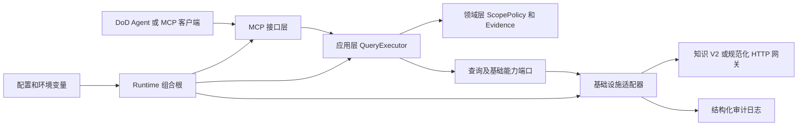
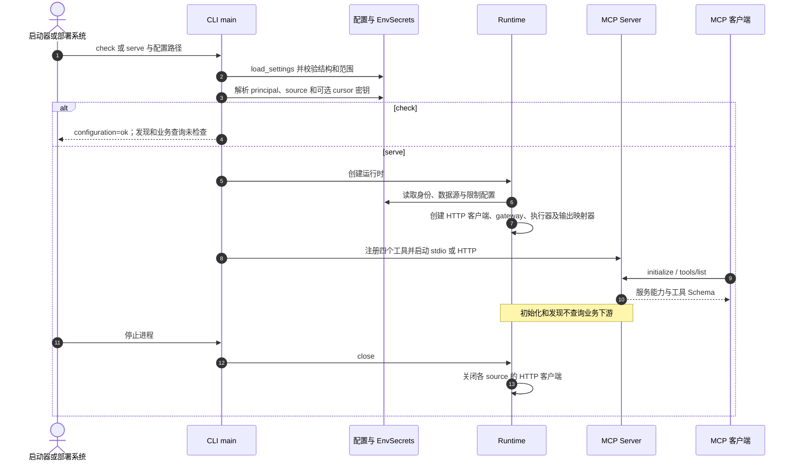
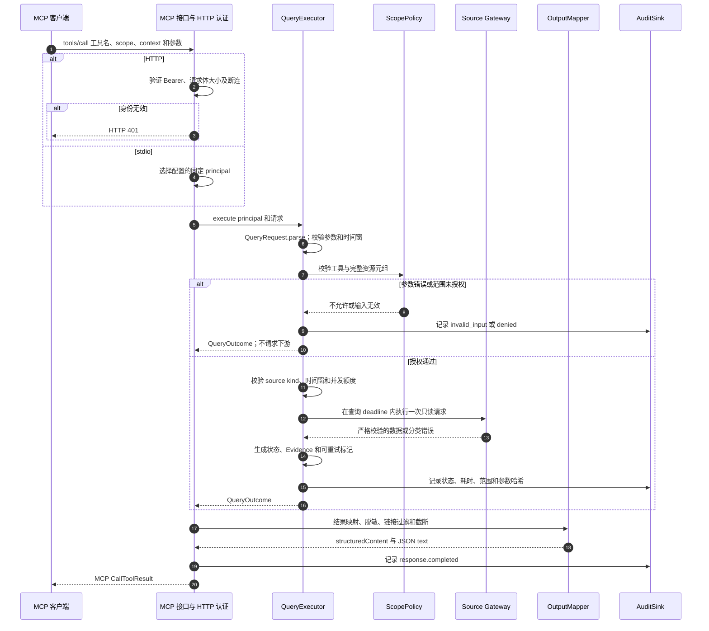
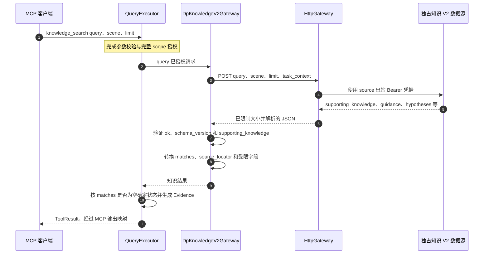
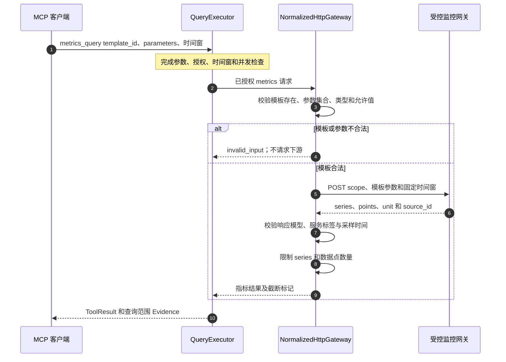
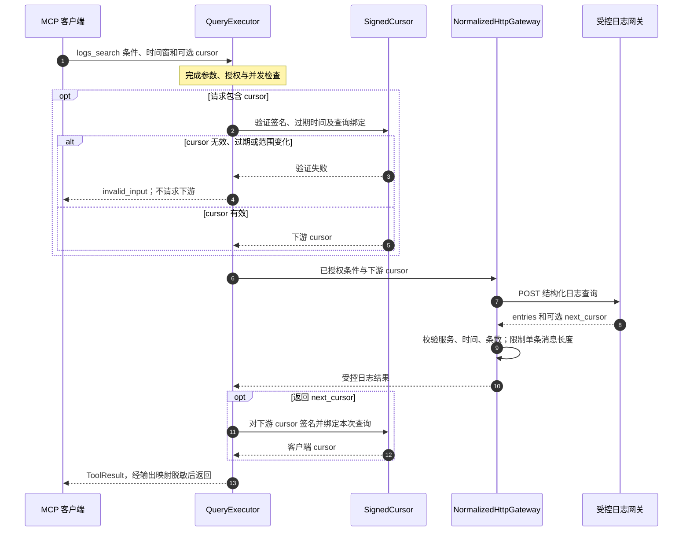
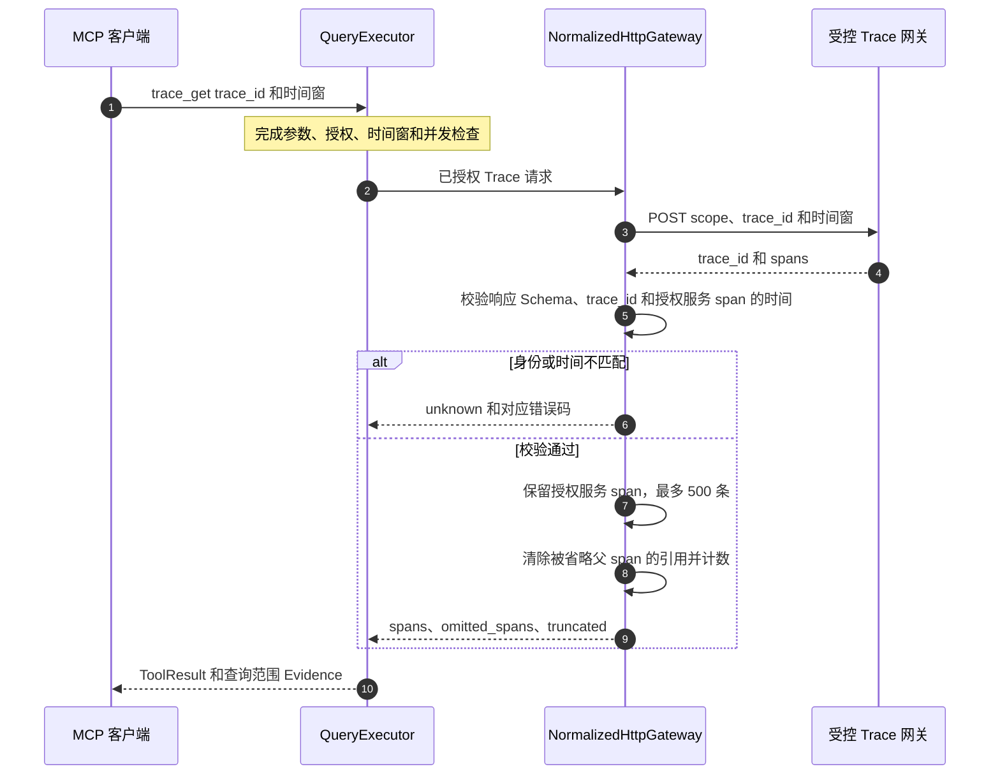

## 目标与交付范围

在 `projects/workbench-mcp-server` 实现独立 Python MCP Server，使独立运行的 DoD Agent 能查询知识、监控、日志和 Trace，并返回可核对的证据。服务不依赖当前聊天的工具连接、Cookie 或登录状态。

首版交付可安装的服务、配置校验、四个查询工具、HTTP 下游连接器、身份与范围校验、审计、自动化测试、Agent 接入示例与真实连接验收步骤。真实部署地址和凭据由部署环境注入；缺少连接时明确返回 unavailable，不以模拟结果冒充真实查询。

建议试点为 DP / test / ID，但这只是待确认的部署配置，不是已经获得的下游访问授权。服务白名单、知识集合与数据源必须显式配置。

本项目不负责 LLM 推理、Run 调度、知识索引建设、任意代码执行、数据库 SQL、Jira 写入、SeaTalk 通知、发布或自动处置。代码查询由 DoD Agent 既有 RepoSnapshot/Runner 方向承接，本首版不新增代码分析工具。

## 现状依据

| 事实 | 本地依据 | 设计影响 |
| --- | --- | --- |
| workbench-mcp-server 在设计时为空目录 | 2026-11-13 初始本地目录检查 | 实现从独立项目开始，不复制 Agent 运行时；当前已有源码和测试 |
| DoD Agent 使用 Python 3.12、Pydantic 2、httpx | `../dod-agent/pyproject.toml` | 本服务沿用这些基础技术，独立安装与部署 |
| Agent 已定义 ToolBinding、PolicyToolExecutor、QueryScopeRevision、Evidence 和工具状态 | `../dod-agent/2026-11-12-workbench-python-spec.md` 第 5、10、16 节 | 服务契约对齐；不能声称对应模块已实现 |
| Agent 当前未指定 MCP 连接，发现与业务调用均未验收 | `../dod-agent/docs/acceptance/connector-readiness.md` | 把配置、协议发现、业务查询分开验收 |
| AI Planner 已有知识、监控和 Trace 实现 | ai-planner `internal/mcp/knowledge_retrieve_v2.go`、`common_monitor_query.go`、`sre_log_trace_query.go` | 可参考协议，不能假定远端接口已可直接调用 |
| 旧 Trace 默认 live，部分路径发送 SeaTalk 文件；旧监控允许直接传 datasource URL | 上述 Trace/监控源文件 | 新服务强制范围、禁止任意 URL，隔离通知副作用 |

本次仅阅读本地代码，未访问业务数据，未验证远端地址、认证及权限。

## 方案选择

| 方案 | 优点 | 代价与限制 |
| --- | --- | --- |
| 独立 Python MCP 服务，使用规范化 HTTP 连接器（推荐） | 契约和权限清晰，易测试，独立于 Smart 会话 | 需逐个适配现有下游；未适配的数据源不能宣称可用 |
| 将 AI Planner MCP 整体代理给 Agent | 复用工具数量多 | 会话依赖、live 默认值与通知副作用难以隔离 |
| 在 dod-agent 内直接实现全部查询 | 少一层网络服务 | 查询能力和 Agent 生命周期耦合，难以独立使用 |

采用推荐方案。首版不实现通用 MCP 到 MCP 动态转发；现有平台复用通过明确的只读 HTTP 接口适配，接口不兼容时新增具名适配器，不自动猜测协议。

## 架构与边界

采用轻量 DDD 与端口适配器架构。首版只有“诊断取证”一个限界上下文，知识、指标、日志和 Trace 是其中的四类查询能力。身份认证是外围能力，授权范围和证据有效性是领域规则。

调用链：DoD Agent MCPAdapter → interfaces/mcp → infrastructure/auth 认证 → application 查询用例 → domain 授权规则 → application 定义的查询端口 → infrastructure 下游适配器 → 领域证据校验 → application 查询结果 → MCP DTO。

| 层 | 职责 | 依赖 |
| --- | --- | --- |
| domain | 查询范围、授权交集、时间窗、证据来源与质量等不变量 | Python 标准库，不依赖 SDK、HTTP、配置格式或 Pydantic |
| application | 四个查询用例、deadline/并发协调、结果分类、审计协调及出站端口 | domain、标准库 Protocol |
| infrastructure | HTTP 查询、外部 Schema 转换、token 校验、配置/密钥读取、时钟与日志 | 实现 application 端口，可使用 httpx、Pydantic、PyYAML |
| interfaces | MCP 工具 Schema、输入输出 DTO、HTTP 认证接入、CLI 参数与错误映射 | application、domain、MCP SDK；不直接调用下游 |
| bootstrap | 组合根：创建并注入端口实现、管理进程资源和 transport 生命周期 | 各层；业务层禁止反向导入 bootstrap |

### 领域模型与统一语言

- `QueryScope`：不可变值对象，包含完整资源元组；不得省略维度或在执行时隐式扩大范围。
- `TimeWindow`：不可变值对象，负责 UTC 规范化、起止顺序及最大窗口约束。
- `Principal`：已认证主体的领域表示，仅包含主体标识与策略引用，不包含 token 或请求 header。
- `AccessPolicy`：发布的不可变授权规则快照；`ScopePolicy` 是无 I/O 的领域服务，判定工具、绑定、数据源和请求范围的交集。
- `Evidence` / `EvidenceQuality`：不可变证据及质量；来源、范围、观察时间必须一致，不把不可用转换为正常。
- `QueryOutcome`：应用层的一次查询执行结果，保存状态、数据和证据；MCP 的 isError、JSON Schema 与 HTTP 状态不进入领域层。

首版没有需要事务维护的持久化聚合，不强行引入 Repository、UnitOfWork、领域事件总线或 CQRS。策略版本与 invocation_id 是不可变引用，不因存在 ID 就构建实体生命周期。将来出现策略发布或证据持久化用例时再设计相应聚合。

### 依赖与转换规则

依赖方向为 interfaces → application → domain；infrastructure 实现 application 的出站端口并依赖 domain，只有 bootstrap 同时知道接口层和具体基础设施。领域层禁止导入 MCP SDK、httpx、Pydantic、环境变量或配置读取代码。

Pydantic 用于接口 DTO、配置和下游响应校验；领域值对象使用 frozen dataclass 与显式构造校验。DTO 到领域对象只在边界转换，业务不变量以领域校验为准，避免多套冲突规则。规范化错误映射到应用层结果，外部 SDK 异常不得穿透到领域层。

应用层分别定义 KnowledgeGateway、MetricsGateway、LogsGateway、TraceGateway，以及必要的 Authenticator、SecretProvider、Clock、AuditSink 端口。端口按用例所需行为设计，不为每个类创建接口。查询模板的转义、下游认证和协议字段映射属于基础设施适配器。

权限拒绝必须发生在访问查询端口之前。证据范围和质量由领域模型校验，序列化大小、脱敏与协议编码由外围适配器处理。共享的执行流程仅在多个用例出现实际重复后提取，避免形成一个包含所有分支的 QueryService。

服务不导入 dod-agent 的内部包。Agent 的 PolicyToolExecutor 继续负责 Run 权限与预算，MCP Server 独立执行自身边界检查；两端任何一端拒绝均不得查询下游。

## 技术与进程

- Python `>=3.12,<3.13`，Pydantic 2、httpx、PyYAML、官方 Python MCP SDK；实现时锁定并验证 SDK 版本与 transport API。
- 提供 stdio 与 Streamable HTTP 两种启动方式；统一工具实现，HTTP 默认仅监听回环地址。远程部署经 TLS 入口暴露 `/mcp`。
- stdio 用于本机开发与 Agent 子进程接入；固定部署身份由启动配置选定，不能从工具参数指定。stdout 专用于协议，日志写 stderr。
- HTTP 首版使用服务端配置的 Bearer token 映射 principal。仅支持可信 Agent 后端服务调用，不宣称实现交互式用户 OAuth。
- HTTP 请求每次验证凭据，MCP session ID 不作为认证凭据；拒绝不同主体复用同一 session。优先采用无状态 HTTP 模式以减少跨请求身份混用。
- 不需要业务数据库或 Redis；审计由部署日志系统持久化。首版不缓存业务查询结果。
- 连接器 HTTP 客户端按认证绑定复用，禁止修改共享客户端默认 headers 注入当前用户身份。

## 身份、权限和查询范围

### 两层身份

入站身份用于识别调用者与允许范围；出站身份用于访问具体知识库、监控或日志系统。两类凭据独立配置，禁止直接把入站 token 转发给下游。

首版 Agent 使用一个受限服务身份；`run_id`、`invocation_id` 等字段只用于关联，不视为用户身份或授权依据。若以后需要用户级授权，必须增加可验证的用户委托令牌，不能只添加 `user_id` header。

配置文件仅保存 `env://变量名` secret_ref，首版实现 env 解析。`secret://` 为后续 SecretProvider 扩展，当前遇到即校验失败。不得把凭据写进工具参数、返回值、异常、审计或产物。

### 授权交集

服务当前按 `principal.tools`、`principal.scopes` 与 `source.scopes` 校验本次请求，范围必须匹配完整资源元组 `(team, environment, region, service, source_id)`，不得把各维度独立集合做笛卡尔积授权。`source.binding_id` 用于证据溯源，服务内没有单独的 ToolBinding 授权表；Agent 侧的工具绑定和权限校验属于独立接入边界，尚未在本项目实现。

每次调用必须提供 team、environment、region、service 和 source_id；知识工具也使用该范围，知识集合通过 source_id 解析。共享知识需明确配置可共享的范围。

缺失或未知值返回 invalid_input，合法但越权返回 denied。首版禁止通配 service、region=all、自动回退 live 或跨团队重试。凭据映射失败在 HTTP 层返回 401，不进入工具处理。

配置在启动时加载为不可变快照；权限变更通过受控重启生效。撤权时必须轮换/撤销入站 token 并完成实例重启，入口同步阻断旧主体。在支持热更新之前，不宣称可对在途调用即时撤权；Agent 每次调用仍需执行自身即时拒绝规则。

source_id 解析为受信配置中的 URL、凭据与集合。模型不得提交 endpoint、header、文件路径或 secret_ref。禁用自动 HTTP 重定向，验证部署配置的协议与目标主机，限制出站网络。

## 工具接口 v1

工具均标记 `readOnlyHint=true`、`destructiveHint=false`；这些提示不替代执行授权。只注册以下四个具名工具，禁止动态注册未审核工具。

公共参数 `scope` 包含 `team/environment/region/service/source_id`；`context` 包含 `run_id/invocation_id/query_scope_ref`，均为长度受限的非空字符串，不承载凭据。

时间参数使用显式带时区 RFC 3339，服务统一转换 UTC；时间窗为 `[start,end)`，不接受无时区字符串。运行证据工具必须显式给出时间，不在重试时重新计算 now。知识检索无运行时间窗，返回文档更新时间和 observed_at。

| 工具 | 专属输入 | 结果 data |
| --- | --- | --- |
| `knowledge_search` | `query` 1–4000 字符；`scene=qa/alert`；`limit` 1–10，默认 3 | `matches[]`：source_id、title、content、source_uri、updated_at；可选 guidance/hypotheses，不能当成实时结论 |
| `metrics_query` | `template_id`、受 Schema 限制的 `parameters`；`start/end`；`step_seconds` 15–3600 | series、单位、采样范围、source_id、缺失信息 |
| `logs_search` | `start/end`；`levels[]`；可选 keyword（≤256 字符）和 trace_id；`limit` 1–200，默认 50；可选 cursor | entries（时间、服务、级别、脱敏消息）、返回数量、next_cursor、truncated |
| `trace_get` | `trace_id` 1–128 字符；`start/end` | spans、调用关系、错误标记、范围外依赖省略数量、truncated |

metrics_query 首版只接受管理员定义的查询模板，不暴露任意 PromQL。模板声明参数类型与允许值，使用安全编码与结构化标签生成方式注入范围，不进行未经转义的字符串拼接。日志使用结构化过滤，不接受原始 PQL 或任意查询脚本。

首版运行时间窗最大 1 小时；metrics 最多 100 个 series、合计 10000 个数据点；Trace 最多 500 个 span。限制可由管理员调低；提高需版本化配置和容量验收。

cursor 由服务生成并验证，绑定主体、规范化 scope、查询哈希与固定时间窗，5 分钟过期；拒绝跨范围复用。采用 HMAC 签名不透明游标，签名密钥独立配置；启用日志源必须配置至少 32 字节密钥。下游原始 cursor 不直接交给模型。

Trace 返回前逐 span 校验服务范围，移除越权 attributes 与依赖详情；下游如果无法实施查询隔离且禁止跨服务读取，则该 connector 不允许启用，不能靠响应过滤宣称满足隔离。

## 统一 ToolResult 与证据

MCP `structuredContent` 返回以下对象；`content` 同步提供相同对象的 JSON 文本兼容客户端，输出上限按两份序列化后的实际总字节计算。SDK 版本必须验证对 outputSchema 的支持。

```json
{
  "schema_version": "dod-tool-result-v1",
  "status": "ok",
  "data": {},
  "evidence_refs": [],
  "artifacts": [],
  "error": null,
  "retryable": false,
  "meta": {"invocation_id": "call-01", "truncated": false}
}
```

`status` 只能为 `ok/empty/unavailable/denied/invalid_input/timeout/unknown`，与 Agent spec 对齐。成功读到数据为 ok；真实查询成功且零命中为 empty；未配置或连接失败为 unavailable；超时为 timeout；非法下游响应为 unknown。ok 不表示服务业务健康，empty 不表示没有异常。

`error` 非空时包含 `code/message`，不包含原始异常或响应体。业务执行错误设置 MCP isError=true；empty 不设置。MCP 协议/Schema 错误由 SDK 返回协议错误，Agent adapter 负责统一映射；认证失败由 HTTP 层返回。

每条 evidence_ref 包含：evidence_id、source_type、tool_binding_id、invocation_id、query_scope_ref、scope、time_window（知识工具可为 null）、observed_at、summary、source_uri（可为 null）、quality_status。tool_binding_id 由服务配置提供；Agent 接入时维护其与自身 ToolBinding 的对应关系。

quality_status 使用 Agent 已定义的 valid/empty/unavailable/conflicting/stale。没有原生 timeout/denied 状态时，由 ToolResult.status 保留精确错误，质量标记 unavailable；无实际查询不得生成 valid evidence。

引用 URI 必须来自批准的数据源，去除 token 和敏感 query 参数；无可访问源链接时保留 source_id 和受控来源定位信息，禁止伪造链接。每条返回记录的来源必须能追溯到实际下游记录。

首版 artifacts 恒为空，超量结果截断并明确标记；不自动上传文件、写对象存储或发送消息。总返回上限为 256 KiB UTF-8，单日志摘要最大 2048 字符；超限按完整记录截断，禁止生成非法 JSON。输出清洗后再交给模型与审计系统。

## 下游连接器契约

每个 source 明确声明 kind、adapter、endpoint、auth_secret_ref、scope 规则、timeout 和可选 template 集合。四类连接器使用明确版本的 HTTP JSON 协议，不以“任何 HTTP 200 都可解析”作为适配。

实现时提供 `normalized-http-v1` 适配器：POST 到配置的精确 endpoint，入参为已验证的 scope 与该工具专属参数，认证由服务附加；出参为各工具 data 的严格 Schema，并提供记录来源。README 给出输入输出示例，测试服务器覆盖四类协议。

该适配器要求真实下游提供相同协议或经过独立的具名转换。知识库 V2、Prometheus 与日志平台不能仅填写 URL 就宣称兼容 normalized-http-v1。接入真实系统前必须实现并验收其专用适配器，或由已验证的受控网关提供规范化协议。

优先具名知识适配器 `dp-knowledge-v2`：参考本地 KnowledgeRetrieveV2 结构，映射 query/scene/limit/task_context，保留 supporting_knowledge、source_id、source_path、release_id 与检索状态；source_path 非公开 URL 时作为 locator，不伪造 URI。接口认证、scope_filter 实际行为必须通过部署验收确认。不能强制团队/环境隔离的共享上游不允许以多租户 source 发布。

监控、日志、Trace 首版可使用 normalized-http-v1 对接受控网关；若没有这样的网关，真实连通验收保持未通过，并根据实际 API 增加连接器。不得实现返回固定正常值的生产 fallback。

## 配置契约

配置包含 `version/server/principals/sources/limits/audit`，授权策略归属 principals，日志分页另配置 cursor_secret_ref。未知字段、重复 source_id、未定义 source、空授权范围和不可解析的 secret_ref 会导致配置检查失败。配置至少需要一个 source；示例中的 `scope_enforced: false` 会被拒绝，需要在确认下游隔离后显式设为 true。测试使用本地受控 HTTP 数据源，不提供无需 source 的独立离线运行模式。

环境变量建议采用：`WORKBENCH_MCP_CONFIG`（配置文件路径）、`WORKBENCH_MCP_AGENT_TOKEN`（入站）、各 source 独立的 `WORKBENCH_KNOWLEDGE_TOKEN/WORKBENCH_METRICS_TOKEN/WORKBENCH_LOGS_TOKEN/WORKBENCH_TRACE_TOKEN`（出站）。配置示例只记录这些变量名，不包含实际值。

配置检查不发业务请求；协议发现通过 MCP 客户端执行 initialize/tools/list；真实业务验证由客户端显式调用固定范围的只读工具。当前 CLI 没有独立的业务 probe 命令。三项结果分别记录，不能以发现成功标记所有连接器已验收。

首版不复用 SmartThreadID、SmartUserID 或 session_key 作为可信团队上下文。旧平台必须依赖这些字段的接口，需明确适配身份与映射，不能伪造会话。

## 超时、重试与资源限制

- 默认查询 deadline 为 20 秒，最大 30 秒，当前由 `asyncio.timeout` 包围网关调用；连接超时为 3 秒。参数校验、鉴权、游标处理及结果映射不在该超时上下文内。
- 首版连接器不自动重试，`retryable` 仅作为 Agent 策略提示；由 Agent 记录 attempt 并控制最多 3 次总尝试，避免叠加重试。
- 身份和范围拒绝、Schema 错误不建议重试；429、502、503 与瞬时网络错误可重试，遵守剩余预算及受限 Retry-After。
- 默认每实例最多 4 个业务查询并发、每 principal 最多 2 个；无等待槽位返回 unavailable/OVERLOADED。当前入口没有独立的 HTTP 速率限制器。
- 取消或断连向下传播，停止轮询和后续 HTTP 请求；只读查询可能在下游继续执行，审计保留取消事实，不声称远端已终止。
- 请求体最大 64 KiB；下游响应在流式读取时限制 2 MiB，解析前限制；禁止先无限读取再检查长度。

## 安全与审计

日志与知识内容均为不可信数据，不能注册工具、修改策略或触发后续写操作。脱敏规则至少覆盖认证头、token、Cookie、密码及配置指定的业务敏感字段；未允许字段不透传。

查询审计字段包括 UTC 时间、principal_id、run_id、invocation_id、query_scope_ref、tool、source_id、范围、参数哈希、status、error_code、elapsed_ms、record_count、truncated、配置版本；结果映射后另记 `response.completed`。当前没有独立 request_id 字段。默认不记录原始用户问题、日志正文、下游响应与请求 header。

普通日志查询不得自动通知值班人、发送 SeaTalk、上传文件或创建 Jira。若复用旧接口，必须证明其不会触发这些动作，否则不能启用为只读 connector。

## 项目结构与交付

```text
workbench-mcp-server/
  pyproject.toml
  README.md
  config/example.yaml
  src/workbench_mcp_server/
    bootstrap.py                    # 依赖装配与资源生命周期
    domain/
      scope.py                      # QueryScope、TimeWindow
      identity.py                   # 无凭据的 Principal
      policy.py                     # AccessPolicy、ScopePolicy
      evidence.py                   # Evidence、质量与一致性约束
      errors.py                     # 领域错误
    application/
      queries.py                    # 具名查询请求与查询条件
      results.py                    # QueryOutcome 与错误分类
      ports.py                      # 查询、认证、密钥、时钟、审计端口
      use_cases/
        executor.py                 # 四类查询共用的执行与授权边界
    infrastructure/
      config/
        settings.py                 # 配置 Schema 与策略快照转换
        secrets.py                  # env:// SecretProvider
      auth/
        bearer.py                   # Bearer token 到 Principal
      connectors/
        normalized_http.py
        dp_knowledge_v2.py          # 外部模型转换，隔离上游语义
        http_base.py                # 受限 HTTP POST 与错误转换
        schemas.py                  # 各类数据源严格响应模型
      audit.py                      # 结构化日志 AuditSink
      clock.py
      cursor.py                     # 日志分页签名与验证
    interfaces/
      cli.py
      mcp/
        server.py                   # 工具注册、transport 与认证接入
        schemas.py                  # MCP 输入输出 DTO
        mapping.py                  # DTO/领域对象与错误映射
  tests/
    unit/                           # 领域规则、用例、游标与输出行为
    contract/                       # 各适配器遵守同一查询端口契约
    integration/
      test_config.py
      test_http_connectors.py       # 本地 HTTP 服务验证真实编解码
      test_mcp_stdio.py             # 官方 MCP client + 子进程
      test_mcp_http.py              # 官方 MCP client + 本地 HTTP
      test_architecture.py          # AST 导入检查，约束分层依赖
    acceptance/
      test_readonly_diagnosis.py    # 端到端已知证据、拒绝与故障
    support/                        # fake、样例与测试 HTTP 服务
  docs/acceptance.md
  docs/superpowers/specs/2026-11-13-workbench-mcp-server-design.md
```

CLI 已提供 `workbench-mcp-server check --config PATH` 与 `workbench-mcp-server serve --config PATH --transport stdio|streamable-http`，本地实现与验证记录见 `docs/acceptance.md`。

Agent 接入文档提供子进程启动配置和远程 HTTP endpoint/Bearer secret_ref 两种示例，映射四个 tool alias、Schema、范围和 timeout；不修改 Agent 未实现的运行时模块。

目录反映当前主要文件；各 Python 包包含 `__init__.py`。模块变大时按领域概念或独立用例拆分。

## TDD 开发约定

采用行为驱动的 Red → Green → Refactor：每个行为先写最小测试，运行确认它因该能力缺失而失败；再写最小实现使其通过；最后在测试保护下重构。语法错误、导入拼写错误或环境缺失不算有效 Red。缺陷修复先补能够复现问题的失败测试。

测试围绕业务规则与可观察结果，不绑定私有方法、类数量或目录细节。领域测试使用真实值对象和策略；应用测试使用简单的内存 fake gateway、固定 Clock 与收集式 AuditSink，断言返回证据、拒绝结果和必要的外部效果。对“拒绝时零下游查询”等安全边界允许断言查询端口没有被调用，不以一长串 mock 调用顺序替代行为验证。

### 测试分层

| 测试 | 关注行为 | 依赖与执行方式 |
| --- | --- | --- |
| 领域单元 | 完整资源元组、时间窗口、授权交集、证据不变量 | 无网络、无 SDK、无环境变量 |
| 应用单元 | 拒绝先于查询、状态分类、证据生成、固定时间、deadline 与审计 | 真实领域模型 + 最小 fake 端口 |
| 适配器契约 | normalized-http 与知识 V2 对公共端口的成功、空、错误、范围行为一致 | 对各适配器运行相同语义案例，补充其专属协议案例 |
| 集成 | HTTP 真实请求与流式上限、认证、配置解析、取消、MCP 编解码 | 本地受控 HTTP 服务、官方 MCP client；不依赖公司网络 |
| 验收 | Agent 等价客户端获取已知证据、越权被拒、下游故障被区分 | 离线固定场景默认运行；真实业务场景显式启用并单独记录 |
| 架构约束 | 领域层无外围依赖、内部不导入 bootstrap、接口不直连 connector | AST 导入依赖检查；覆盖绝对和相对导入 |

实现顺序按可交付行为推进：先完成“越权查询被拒且不访问下游”，再完成知识检索的真实 MCP 垂直切片，然后扩展空结果/故障/证据约束与其余三类查询，最后补齐第二种 transport、资源限制及安装验收。每个切片都走一次或多次 Red/Green/Refactor，而不是先写完全部层再补测试。

测试命令随项目脚本在实现阶段确定并写入 README；交付时记录关键规则的预期失败原因与最终通过命令，不在仓库保存凭据或未经脱敏的业务测试输出。覆盖率作为缺口提示，不以行覆盖率或测试数量替代行为验收。

## 验收标准

| 类别 | 必须通过的检查 |
| --- | --- |
| 配置 | 凭据缺失、未知字段、无范围、重复 source、非法 endpoint 均被拒绝，诊断无密钥 |
| DDD 分层 | 领域不依赖外围库，应用只经端口访问下游；架构导入检查通过 |
| TDD | 关键行为有先失败后实现的验证记录；单元、契约、集成与验收层各验证其对应规则 |
| 协议 | 真正 MCP client 执行 initialize、tools/list、四个 tools/call；stdio stdout 无日志；HTTP 错误 token 被拒绝 |
| 隔离 | 跨团队/环境/区域/服务/source 与伪造 context 被拒绝且零下游请求；并发主体不能互相使用凭据 |
| 过滤 | 模板参数注入、任意 URL、未签名 cursor、跨范围 cursor、越权 Trace span 不泄漏 |
| 证据 | 非空/空/不可用/超时/错误响应均有正确状态，引用对应真实记录；超限明确截断 |
| 可靠性 | 取消、响应超限、429、deadline、并发超限有确定结果；不产生叠加重试 |
| 无副作用 | 测试捕获出站请求，只允许已配置的查询端点，无通知、文件发送和 Jira 请求 |
| 安装 | 从 wheel 安装后在源码目录外启动并完成 MCP 查询 |
| 真实业务 | 用明确授权的真实资源完成知识、监控、日志、Trace 查询并记录证据；模拟测试不能代替此项 |

真实验收题由数据负责人填写已知答案或可核对来源，首版至少覆盖：

1. “某个已知告警通常如何排查？”——引用明确知识 source_id，指导与运行结论分开。
2. “固定 10 分钟窗口内某 test/ID 服务的错误指标是什么？”——对照同一数据源、模板及时间窗。
3. “同一窗口有哪些已知 ERROR 日志？”——对照日志记录标识并核验服务范围。
4. “给定已知 trace_id，哪个已授权 span 失败？”——对照追踪系统；缺少 span 时明确完整性限制。
5. “查询未授权 live 或其他团队服务。”——返回 denied，未发生下游调用。

缺少真实问题和标注不阻塞实现或离线验证，但真实业务验收不得标记通过。

## 实施阶段与决策

1. 领域与拒绝切片：从失败测试建立 QueryScope、TimeWindow 与授权交集，通过用例验证越权时零下游查询；加入必要配置与 CLI check。
2. 知识查询切片：驱动查询端口、HTTP/知识 V2 适配器、证据与状态、stdio MCP 工具，形成首个端到端只读查询。
3. 扩展与约束：分别以失败测试驱动指标、日志和 Trace 用例，补齐 HTTP transport、认证、deadline、并发、脱敏、截断和审计。
4. 交付与接入：完成全量测试与架构检查、wheel 安装验证、README、Agent 接入示例和真实部署验收清单。

设计采用独立 Python、只读工具、显式完整范围、服务身份、具名数据源与模板查询。后续如需任意查询语言、OAuth 用户委托、远端写入或 MCP 上游代理，应单独扩展权限与接口规格。

部署前需要管理员提供：入口地址与 TLS 方式、入站服务身份、四类实际下游协议/地址与凭据引用、资源元组白名单、指标模板、脱敏规则、知识隔离行为、验收问题和已知结果。这些是部署输入，不是让用户在聊天中粘贴密钥。


## 实现说明与审查修正

以下是实现过程中经测试与审查确定的细节，优先于上文目录示意中的建议文件拆分：

- 四个具名查询共用 `application/use_cases/executor.py` 的授权与执行边界，不创建只有转发作用的四个用例类；专属参数规则位于 queries，外部协议映射位于 connectors。
- 基础设施新增 `cursor.py`、`connectors/http_base.py`、`connectors/schemas.py`；测试实际按 unit/contract/integration/acceptance 组织，不再给少量领域单元测试预建子包。
- 规范化 Trace 响应必须提供 trace_id 以及每个 span 的 start/end，并校验匹配请求。
- 本地截断日志记录时清除 next_cursor，避免上游游标跳过丢弃记录；调用方应缩小查询范围重新读取。
- mandatory 认证字段脱敏与额外业务字段取并集；覆盖引号包裹的 JSON 日志和完整认证/Cookie 头。
- HTTP 中间件显式监听断连并终止在途请求，已通过真实 MCP SDK transport 的取消测试。
- 现有 DP 知识 V2 confirmed_scope 仅识别 product/domain/provider/market，不执行本项目完整资源元组隔离。该 adapter 仅允许 exclusive-source 且绑定一个元组，需部署方验证独占 collection/endpoint/credential 后显式声明 scope_enforced=true；所有 source 的该声明默认 false。共享源必须经过强制隔离网关。
- 当前状态表示实现与离线验收完成，不表示真实知识、监控、日志、Trace 数据源已经接通，也不表示 dod-agent 的运行时接入已经完成。

## 当前功能与实现边界

本节和后续时序图根据当前源码整理，描述已实现行为；上文中面向后续 Agent 集成的能力以本节及实际代码为准。DoD Agent 或其他 MCP 客户端通过 stdio 子进程或 Streamable HTTP 调用四个工具。服务使用配置的身份和数据源，在查询前检查授权，并返回受控结果和可追溯证据。

| 功能 | 当前实现 | 关键限制 |
| --- | --- | --- |
| 知识查询 | `knowledge_search` 检索知识记录、指导和假设；支持 `normalized-http-v1` 与 `dp-knowledge-v2` | 知识 V2 直连必须是部署方验证的独占数据源；摘要不是实时诊断结论 |
| 监控查询 | `metrics_query` 使用配置的模板名及参数白名单请求指标 | 不接受客户端提交任意 PromQL，真实监控需兼容的受控网关 |
| 日志查询 | `logs_search` 按时间、级别和可选关键词或 Trace ID 过滤，支持签名分页 | 不接受任意 PQL；下游隔离由数据源负责，服务校验返回记录的服务和时间 |
| Trace 查询 | `trace_get` 按 Trace ID 与时间窗查询调用链，过滤范围外 span | 外部读取隔离仍需下游保证；返回范围外 span 被省略并计数 |
| 身份和范围 | HTTP Bearer 映射 principal；stdio 使用配置的固定 principal；每次查询校验工具与完整资源元组 | `run_id` 等 context 字段用于关联，不是授权身份；不提供用户级 OAuth |
| 结果、审计与限制 | 返回统一状态、data、Evidence；脱敏、限制输出、记录审计并控制并发 | `artifacts` 当前为空；连接器不自动重试；没有独立业务 probe CLI |

接入状态与源码参考：[README](../../../README.md)、[真实业务验收记录](../../acceptance.md)、[工具注册及 HTTP 入口](../../../src/workbench_mcp_server/interfaces/mcp/server.py)、[查询执行器](../../../src/workbench_mcp_server/application/use_cases/executor.py)。

## 代码组成与运行协作



| 组成 | 核心文件 | 职责 |
| --- | --- | --- |
| 进程入口 | [interfaces/cli.py](../../../src/workbench_mcp_server/interfaces/cli.py) | 解析 `check`／`serve`、加载配置与密钥，选择 transport |
| 组合根 | [bootstrap.py](../../../src/workbench_mcp_server/bootstrap.py) | 按 source 创建 HTTP 客户端和 gateway，装配执行器、游标、审计和输出映射器，退出时关闭客户端 |
| MCP 接口 | [server.py](../../../src/workbench_mcp_server/interfaces/mcp/server.py)、[schemas.py](../../../src/workbench_mcp_server/interfaces/mcp/schemas.py) | 注册四个工具，校验输入 DTO，处理 HTTP 身份和断连 |
| 应用层 | [queries.py](../../../src/workbench_mcp_server/application/queries.py)、[executor.py](../../../src/workbench_mcp_server/application/use_cases/executor.py)、[ports.py](../../../src/workbench_mcp_server/application/ports.py) | 解析查询、组织鉴权、限流、gateway 调用、证据、状态及审计 |
| 领域层 | [scope.py](../../../src/workbench_mcp_server/domain/scope.py)、[policy.py](../../../src/workbench_mcp_server/domain/policy.py)、[evidence.py](../../../src/workbench_mcp_server/domain/evidence.py) | 保持查询范围、时间窗、授权与证据不变量 |
| 基础设施 | [settings.py](../../../src/workbench_mcp_server/infrastructure/config/settings.py)、[normalized_http.py](../../../src/workbench_mcp_server/infrastructure/connectors/normalized_http.py)、[dp_knowledge_v2.py](../../../src/workbench_mcp_server/infrastructure/connectors/dp_knowledge_v2.py)、[cursor.py](../../../src/workbench_mcp_server/infrastructure/cursor.py) | 读取受信配置，适配下游 HTTP 协议，执行日志分页签名 |
| 输出适配 | [mapping.py](../../../src/workbench_mcp_server/interfaces/mcp/mapping.py) | 将领域／应用结果转换为 MCP 结果，脱敏、控制链接与响应大小 |

`QueryExecutor` 是四个工具共享的用例边界，不存在四个单独的用例实现类。配置中的 `binding_id` 被写入 Evidence 的 `tool_binding_id`，它不代表服务内部存在可独立授权的 ToolBinding 实体。

## 启动与配置

### 启动准备

在项目根目录安装依赖并准备配置：

```bash
uv sync --frozen --python 3.12
cp config/example.yaml config/local.yaml
```

编辑 `config/local.yaml`：将示例 `.invalid` 地址替换为真实受控下游地址；配置 principal 的工具、完整 scope，source 的 adapter、endpoint、binding_id 和同样完整的授权 scope；为 metrics 配置模板和参数白名单。日志 source 还要求提供 `cursor_secret_ref`，其解析后的值至少为 32 字节。对应的环境变量由部署环境注入，不写入配置文件或命令示例。

示例文件中的 `scope_enforced` 刻意为 `false`，当前配置校验会拒绝它。部署方验证下游能够隔离数据后，才将其设为 `true`。`dp-knowledge-v2` 还必须设置 `isolation: exclusive-source` 并只配置一个资源元组。这个声明本身不创建隔离；既有知识 V2 的 `task_context` 不能保证团队／环境／服务隔离。

```bash
uv run workbench-mcp-server check --config config/local.yaml
uv run workbench-mcp-server serve --config config/local.yaml --transport stdio
uv run workbench-mcp-server serve --config config/local.yaml --transport streamable-http
```

`--config` 也可由 `WORKBENCH_MCP_CONFIG` 指定。`check` 验证配置、principal token、source token 和游标签名密钥，可输出 `configuration: ok`，但不初始化 MCP 会话或访问下游；stdio 适合由 Agent 启动子进程，stdout 留给 MCP 协议；HTTP 默认监听 `127.0.0.1:8000/mcp`，每次请求都验证 Bearer token，跨主机访问需要部署受信 TLS 入口。HTTP 为 stateless 模式，session ID 不是身份凭据。

### 启动时序



对应源码：[CLI main／serve](../../../src/workbench_mcp_server/interfaces/cli.py)、[Runtime](../../../src/workbench_mcp_server/bootstrap.py)、[配置验证](../../../src/workbench_mcp_server/infrastructure/config/settings.py)。

## 关键接口调用时序

四个公开工具的共同输入包括 `scope` 和 `context`。`scope` 必填 `team/environment/region/service/source_id`，`context` 必填 `run_id/invocation_id/query_scope_ref`。后三个字段用于审计和证据关联，不能扩大权限。除知识查询外，所有查询均要求显式、带时区的 `start/end`，时间窗最大一小时。

### 通用工具调用与授权



认证失败由 HTTP 返回 401；已经进入工具的 `denied/invalid_input/timeout/unavailable/unknown` 通过 `CallToolResult` 返回并设置 `isError`。`empty` 表示成功查询到零条对应记录，`ok` 仅表示有结果，二者都不能单独证明业务健康。记录的 status 在映射前产生，输出截断状态另由 `response.completed` 记录。

### 知识检索：knowledge_search

输入为 `query`、`scene=qa/alert`、`limit=1..10`，默认 3。除通用授权流程外，下图展示已配置为 `dp-knowledge-v2` 时的适配过程；使用 `normalized-http-v1` 时则按规范化协议发送 scope 和 parameters。



`source_path` 被放到知识记录的 `source_locator`，适配器不会将它伪造成 URL。对于知识查询，当前 Evidence 的 `source_locator` 优先取记录的 `source_id`；记录中的 `source_locator` 保留原路径。`guidance/hypotheses` 使用受限模型校验，且不会自动执行处置。知识来源需由数据源或受控网关保证隔离，不能依赖 `task_context` 实现本服务的资源元组授权。

### 监控查询：metrics_query

输入为 `template_id`、`parameters`、`start/end` 和 `step_seconds`；step 默认 60 秒，可配置范围为 15～3600 秒。当前 metrics 使用 `normalized-http-v1`，由受控网关解释模板并执行实际指标查询。



单次最多返回 100 条 series、合计 10000 个点；采样点使用 `[start,end)`。代码会拒绝明确不匹配服务的 `service` 标签；若上游没有提供该标签，不能据此推断上游已执行服务隔离。上游网关必须根据传入 scope 和管理员模板执行访问控制和安全查询。

### 日志查询与分页：logs_search

输入为 `start/end`、`levels`、可选 `keyword/trace_id/cursor` 和 `limit=1..200`；默认级别为 ERROR，默认 limit 为 50。分页游标签名覆盖 principal、scope 与除 cursor 外的查询参数，包含固定时间窗，5 分钟后失效。



若下游返回的记录超过请求 limit，或输出字节限制导致本地丢弃日志记录，服务清除 `next_cursor`，避免继续分页时跳过被丢弃的记录；调用方应缩小时间窗或调整 limit 后重查。单条消息超过 2048 字符会截断并标记；输出映射器再处理认证信息与配置的敏感字段。cursor 是签名和 Base64 编码的载荷，不应当视为加密或用于承载秘密。

### Trace 查询：trace_get

输入为 `trace_id` 和 `start/end`。上游响应必须包含同一 `trace_id`，每个 span 提供 `span_id/parent_id/service/name/error/start/end`。



已授权服务的 span 满足 `start <= span.start <= span.end <= end`；范围外服务的 span 在输出前被移除，发生省略时 `truncated=true`。若数据源不允许服务读取跨服务数据，必须由上游在返回前隔离；本服务的响应过滤不等于上游读取隔离。

### 统一下游请求与故障处理

`normalized-http-v1` 的 HTTP body 固定为 `schema_version=normalized-query-v1`、`tool`、`scope`、`parameters`；不传客户端 context。`HttpGateway.post` 向配置的精确 endpoint 发起 POST，附加 source 的 Bearer 凭据，禁用重定向并限制流式响应大小。连接器不重试。默认 gateway 查询 deadline 20 秒，HTTP 连接超时 3 秒；HTTP 429、502、503、504 和网络瞬时错误标记为可重试，实际重试由客户端或上层 Agent 决定。

结果统一为 `schema_version/status/data/evidence_refs/artifacts/error/retryable/meta`。MCP 同时返回 `structuredContent` 和相同 JSON 的文本内容。Evidence 包含 source 类型、binding_id、调用标识、scope 版本引用、范围、可选时间窗、观察时间、来源定位和质量；当前没有对象存储上传，`artifacts` 为空。输出映射可能丢弃部分记录以满足字节上限，并标记 `meta.truncated`。
