# 附录 A　数据字典（schema_agent_v3 最终形态）

> 本文用途：给出 Workbench Agent 持久层在 `schema_v1…schema_v20`（Workspace 历史链）叠加、再经 `schema_agent_v1…v3`（Agent 链）演进后的最终物理结构（表、字段、约束、索引与演进）。**一切以代码为准**：结构信息由脚本从 `apps/agent/src/workbench_agent/persistence/` 下的 SQLAlchemy 元数据实际导入后抽取并人工整理，原文 13.2 仅用作分组与业务语义参考，其差异见文末「核对记录」。

## A.0 概览与约定

### A.0.1 版本链与口径

| 项 | 取值（来源） |
| --- | --- |
| 最终 Schema | `schema_agent_v3.metadata`（`persistence/schema.py` 导出） |
| Agent 迁移头 | `0003_run_trace_contexts`（`agent_migrations/versions/`，链：0001_agent_domain → 0002_shared_skills → 0003_run_trace_contexts） |
| 存储协议 / Codec | `dod-storage-agent-v1` / `dod-checkpoint-v1`（`schema_agent_v1.py` 常量；写入 `dod_storage_metadata`） |
| 历史 Workspace 链 | `schema_v1…schema_v20`，对应 `migrations/versions/0001_core…0021_synthetic_batch_policy`（共 21 个迁移，其中 `0005_resume_protocol` 仅数据规整，无 Schema 变化，所以 `schema_vN` 与迁移编号自 v5 起错位 1） |
| Agent 基线生成方式 | `schema_agent_v1` 在导入时遍历 `schema_v20`，把表名 `workspaces→agents`、列名 `workspace_id→agent_id` 机械替换，约束/索引名同步替换；`0001_agent_domain` 仅允许在**全新库**上 `create_all`，已有库直接报错，不迁移 Workspace 数据 |
| 表 / 字段 | 61 张表 / 586 个字段；显式外键 105 条、UNIQUE 82 条、CHECK 7 条、显式二级索引 13 个（均由元数据统计） |

### A.0.2 通用约定（均已在 DDL 中核实）

- 类型仅出现 `VARCHAR(n)`、`TEXT`、`BIGINT`、`BLOB`；无原生 Enum、无 JSON 类型、无自增主键。状态/角色等取值由领域服务约束，DDL 未声明 CHECK（除 A.0.2 所列 7 个 CHECK）。
- 时间戳与 0/1 标志均为 `BIGINT`（UTC 毫秒或布尔值），由应用层写入。
- 所有外键均为 `ON DELETE RESTRICT`；绝大多数外键为 `(team_id, xxx_id)` 复合形式，指向父表的 `UNIQUE(team_id, xxx_id)`，以在 DB 层固化租户隔离。
- 复合主键仅 4 张表：`run_events`、`graph_checkpoints`、`graph_pending_writes`、`admin_job_events`；`dod_storage_metadata` 无主键。
- CHECK 共 7 个：`teams.active_executions >= 0`、`artifacts.size >= 0`、`usage_reservations.tokens >= 0`，以及 4 张部署策略单例表（`action_policy_state`、`synthetic_source_policy`、`synthetic_proposal_policy`、`synthetic_batch_policy`）的 `policy_id = 'deployment'`。
- 迁移文件中未发现触发器（trigger）与手写索引 DDL；所有结构变化均来自 `schema_vN` 元数据（`create`/`add_column`）。
- 字段表“引入”列：`vN` = `schema_vN`（Workspace 链）首次出现；`agent_vN` = Agent 链新增；Agent 基线中 `workspace_id` 已改名为 `agent_id`，其“引入”仍按历史列首次出现计。
- 每节“语义说明”及字段“说明”列的业务含义取自原文 13.2 并经 DDL 复核，其中出现的「第 13.x / 14 节」均指原文（`doc-src/original.md`）章节；类型、可空、默认、约束与索引则全部来自 DDL。

### A.0.3 分组一览

| 分组 | 表数 | 字段数 | 表 | ER 图 |
| --- | --- | --- | --- | --- |
| A.1 Agent 配置与版本 | 10 | 101 | `teams`、`team_members`、`agents`、`runtime_profiles`、`model_profiles`、`model_profile_versions`、`tool_binding_drafts`、`tool_bindings`、`repo_snapshots`、`workflow_versions` | 图 12（PNG）+ Mermaid |
| A.2 Thread、Run 与 Job | 9 | 99 | `threads`、`messages`、`runs`、`run_jobs`、`execution_leases`、`run_events`、`interrupts`、`resume_requests`、`run_trace_contexts` | 图 13（PNG）+ Mermaid |
| A.3 检查点 | 2 | 24 | `graph_checkpoints`、`graph_pending_writes` | 图 13（PNG）+ Mermaid |
| A.4 Evidence 与 Outcome | 6 | 50 | `query_scope_revisions`、`evidence`、`evidence_payloads`、`artifacts`、`artifact_upload_scopes`、`run_outcomes` | 图 14（PNG）+ Mermaid |
| A.5 工具调用与预算 | 6 | 75 | `tool_invocations`、`runner_cleanup_obligations`、`usage_budget_policies`、`usage_reservations`、`usage_records`、`usage_quarantine` | 图 15（PNG）+ Mermaid |
| A.6 外部动作与投递 | 7 | 67 | `actions`、`approvals`、`outbox`、`action_policy_state`、`incidents`、`incident_links`、`incident_action_links` | 图 16（PNG）+ Mermaid |
| A.7 调度与巡检 | 3 | 26 | `schedules`、`schedule_fires`、`schedule_manual_fires` | 图 17（PNG）+ Mermaid |
| A.8 Skill 与共享库 | 3 | 25 | `skills`、`skill_versions`、`skill_drafts` | 仅 Mermaid |
| A.9 其它：反馈、幂等、审计、管理任务、合成验证与协议元数据 | 15 | 119 | `feedback`、`knowledge_gaps`、`idempotency_records`、`team_idempotency_records`、`source_events`、`audit_logs`、`admin_jobs`、`admin_job_events`、`synthetic_alert_sources`、`synthetic_result_bindings`、`synthetic_source_policy`、`synthetic_proposal_policy`、`synthetic_batch_policy`、`synthetic_action_policy_bindings`、`dod_storage_metadata` | 仅 Mermaid |
| 合计 | 61 | 586 | | |

现有 ER 图总览（11 号为域概览，非物理 ER）：

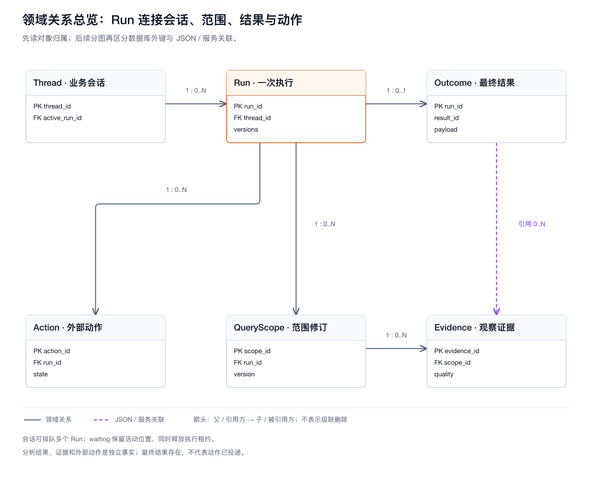

> 现有 11–17 号图是“重构前快照”：12、17 号图仍使用 `workspaces`/`workspace_id` 命名，13–16 号图为 flowchart 手绘关系，字段列表不完整；各分组下的 Mermaid erDiagram 才是按 schema_agent_v3 重新生成的当前关系。

---

### A.1 Agent 配置与版本

本组 10 张表：`teams`、`team_members`、`agents`、`runtime_profiles`、`model_profiles`、`model_profile_versions`、`tool_binding_drafts`、`tool_bindings`、`repo_snapshots`、`workflow_versions`。

现有 ER 图（历史快照，命名可能仍为 workspace，见核对记录）：

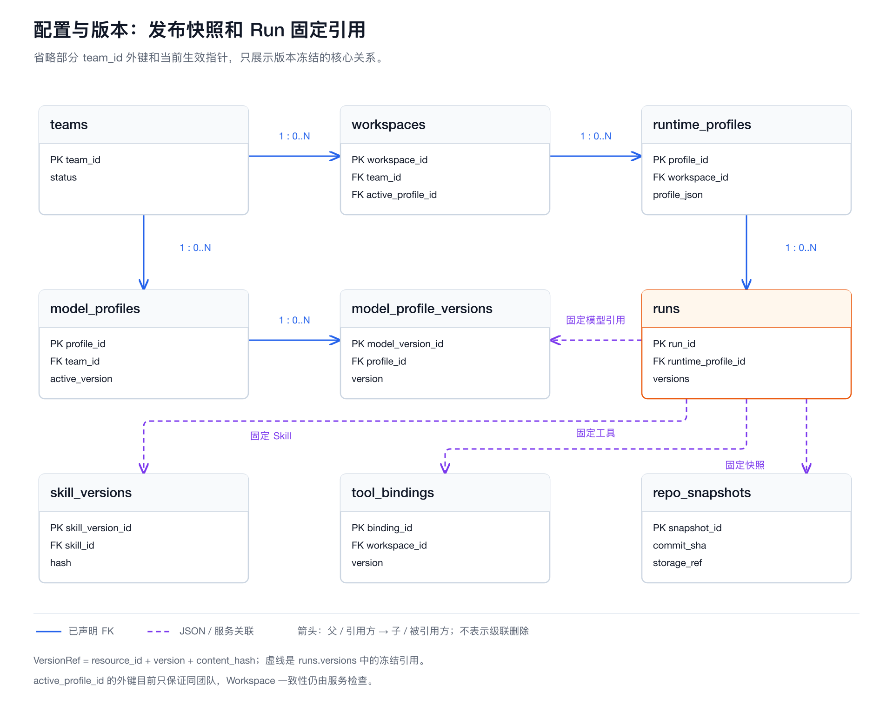

按当前 schema_agent_v3 重新生成的 Mermaid ER 图（仅列 PK/FK 列；省略所有指向 `teams` 的外键，且除 `teams` 自身外不列 team_id 列；来自其它分组的被引用表只列主键）：

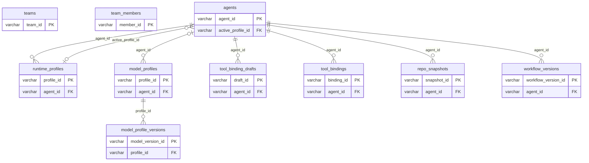

#### A.1.1 `teams`：团队与并发额度

- 用途：团队与并发额度。
- 语义说明（来自原文，已按 DDL 复核，业务规则以服务层为准）：领取/释放执行租约时同事务调整 active_executions。CHECK 仅保证非负，execution_limit 上限由领取事务保证；name 当前没有唯一约束。
- 引入/演进：首次出现于 schema_v1（0001_core）。

| 字段 | 类型 | 可空 | 默认 | 引入 | 说明 |
| --- | --- | --- | --- | --- | --- |
| `team_id` | `VARCHAR(36)` | 否 | — | v1 | 所属团队 UUID；租户隔离边界，不由模型或工具输出改写。 |
| `name` | `VARCHAR(128)` | 否 | — | v1 | 资源名称；唯一性只以本表实际 UK 为准。 |
| `status` | `VARCHAR(32)` | 否 | — | v1 | 状态字段；取值由领域服务约束，DDL 未声明 Enum/CHECK |
| `active_executions` | `BIGINT` | 否 | `0` | v1 | 团队当前占用执行槽位数；与租约领取/释放同事务调整。 |
| `execution_limit` | `BIGINT` | 否 | `2` | v1 | 团队活动执行上限，默认 2，不是排队任务数上限。 |
| `revision` | `BIGINT` | 否 | `0` | v1 | 乐观并发版本，CAS 成功后递增；不等于内容发布序号。 |
| `created_at` | `BIGINT` | 否 | `0` | v1 | 创建时间，UTC 毫秒；DDL 默认 0，不代表有效时间 |
| `updated_at` | `BIGINT` | 否 | `0` | v1 | 最后变更时间，UTC 毫秒；DDL 默认 0，不代表有效时间 |

- 主键：`(team_id)`
- 唯一约束：无
- 外键：无
- CHECK：`active_executions >= 0`（ck_teams_active_executions_nonnegative）
- 显式索引：无（不含 PK/UNIQUE 隐式索引）

#### A.1.2 `team_members`：团队成员

- 用途：团队成员。
- 语义说明（来自原文，已按 DDL 复核，业务规则以服务层为准）：每主体一行，role 为 viewer/operator/maintainer/admin 单值，status=active 时可授权；当前无独立 users/roles 表。
- 引入/演进：首次出现于 schema_v1（0001_core）。

| 字段 | 类型 | 可空 | 默认 | 引入 | 说明 |
| --- | --- | --- | --- | --- | --- |
| `team_id` | `VARCHAR(36)` | 否 | — | v1 | 所属团队 UUID；租户隔离边界，不由模型或工具输出改写。 |
| `member_id` | `VARCHAR(36)` | 否 | — | v1 | 团队成员记录 UUID。 |
| `subject` | `VARCHAR(128)` | 否 | — | v1 | 身份系统主体字符串，不要求为 UUID，不存认证 Token。 |
| `role` | `VARCHAR(32)` | 否 | — | v1 | 团队角色或消息角色，允许值见本表说明。 |
| `status` | `VARCHAR(32)` | 否 | — | v1 | 状态字段；取值由领域服务约束，DDL 未声明 Enum/CHECK |
| `created_at` | `BIGINT` | 否 | `0` | v1 | 创建时间，UTC 毫秒；DDL 默认 0，不代表有效时间 |
| `updated_at` | `BIGINT` | 否 | `0` | v1 | 最后变更时间，UTC 毫秒；DDL 默认 0，不代表有效时间 |

- 主键：`(member_id)`
- 唯一约束：`(team_id, member_id)`；`(team_id, subject)`
- 外键：`(team_id) → (teams.team_id)`，ON DELETE RESTRICT
- 显式索引：无（不含 PK/UNIQUE 隐式索引）

#### A.1.3 `agents`：Agent

- 用途：Agent。
- 语义说明（来自原文，已按 DDL 复核，业务规则以服务层为准）：先以 active_profile_id=NULL 插入，再插入 Profile 并更新指针，避免循环 FK；发布使用 Agent revision CAS。
- 引入/演进：首次出现于 schema_v1（0001_core）；Agent 基线 schema_agent_v1 将 `workspaces` 重命名为 `agents`，`workspace_id` 列同步改为 `agent_id`。

| 字段 | 类型 | 可空 | 默认 | 引入 | 说明 |
| --- | --- | --- | --- | --- | --- |
| `team_id` | `VARCHAR(36)` | 否 | — | v1 | 所属团队 UUID；租户隔离边界，不由模型或工具输出改写。 |
| `agent_id` | `VARCHAR(36)` | 否 | — | v1 | 所属 Agent UUID；关联须同时校验团队和资源作用域。 |
| `name` | `VARCHAR(128)` | 否 | — | v1 | 资源名称；唯一性只以本表实际 UK 为准。 |
| `active_profile_id` | `VARCHAR(36)` | 是 | — | v1 | 当前生效 runtime_profiles.profile_id；未发布时为空。 |
| `status` | `VARCHAR(32)` | 否 | `'active'` | v1 | 状态字段；取值由领域服务约束，DDL 未声明 Enum/CHECK |
| `revision` | `BIGINT` | 否 | `0` | v1 | 乐观并发版本，CAS 成功后递增；不等于内容发布序号。 |
| `created_at` | `BIGINT` | 否 | `0` | v1 | 创建时间，UTC 毫秒；DDL 默认 0，不代表有效时间 |
| `updated_at` | `BIGINT` | 否 | `0` | v1 | 最后变更时间，UTC 毫秒；DDL 默认 0，不代表有效时间 |

- 主键：`(agent_id)`
- 唯一约束：`(team_id, agent_id)`；`(team_id, name)`
- 外键：`(team_id) → (teams.team_id)`，ON DELETE RESTRICT；`(team_id, active_profile_id) → (runtime_profiles.team_id, runtime_profiles.profile_id)`，ON DELETE RESTRICT
- 显式索引：无（不含 PK/UNIQUE 隐式索引）

#### A.1.4 `runtime_profiles`：运行配置草稿与发布版本

- 用途：运行配置草稿与发布版本。
- 语义说明（来自原文，已按 DDL 复核，业务规则以服务层为准）：草稿 version=0/status=draft，发布新增正版本/status=published 并切换指针。profile_id 是该行独立 UUID。profile_json 是完整配置，*_versions 是一致投影；发布内容不原地修改。
- 引入/演进：首次出现于 schema_v1（0001_core）。
- Agent 基线重命名：历史快照中的 `workspace_id` 列在 schema_agent_v1 中为 `agent_id`。

| 字段 | 类型 | 可空 | 默认 | 引入 | 说明 |
| --- | --- | --- | --- | --- | --- |
| `team_id` | `VARCHAR(36)` | 否 | — | v1 | 所属团队 UUID；租户隔离边界，不由模型或工具输出改写。 |
| `profile_id` | `VARCHAR(36)` | 否 | — | v1 | 配置身份或版本 UUID，精确含义见本表说明。 |
| `agent_id` | `VARCHAR(36)` | 否 | — | v1 | 所属 Agent UUID；关联须同时校验团队和资源作用域。 |
| `version` | `BIGINT` | 否 | — | v1 | 资源内不可变内容发布序号；不与 CAS revision 混用。 |
| `graph_version` | `VARCHAR(128)` | 否 | — | v1 | 精确 Graph 实现版本，如 dod.v15。 |
| `model_versions` | `TEXT` | 是 | — | v1 | 默认和角色模型的 VersionRef 数组 JSON，草稿可空。 |
| `skill_versions` | `TEXT` | 是 | — | v1 | 已绑定 Skill 的 VersionRef 数组 JSON，草稿可空。 |
| `tool_versions` | `TEXT` | 是 | — | v1 | 已绑定工具 VersionRef 数组 JSON，草稿可空。 |
| `repo_versions` | `TEXT` | 是 | — | v1 | 不可变仓库快照的 VersionRef 数组 JSON，草稿可空。 |
| `profile_json` | `TEXT` | 否 | — | v1 | 完整 ProfileDraft 规范化 JSON，见 13.8。 |
| `hash` | `VARCHAR(64)` | 否 | — | v1 | 规范化版本内容的 SHA-256，小写十六进制；使用时核对内容。 |
| `status` | `VARCHAR(32)` | 否 | — | v1 | 状态字段；取值由领域服务约束，DDL 未声明 Enum/CHECK |
| `created_at` | `BIGINT` | 否 | `0` | v1 | 创建时间，UTC 毫秒；DDL 默认 0，不代表有效时间 |
| `updated_at` | `BIGINT` | 否 | `0` | v1 | 最后变更时间，UTC 毫秒；DDL 默认 0，不代表有效时间 |

- 主键：`(profile_id)`
- 唯一约束：`(agent_id, version)`；`(team_id, profile_id)`
- 外键：`(team_id) → (teams.team_id)`，ON DELETE RESTRICT；`(team_id, agent_id) → (agents.team_id, agents.agent_id)`，ON DELETE RESTRICT
- 显式索引：无（不含 PK/UNIQUE 隐式索引）

#### A.1.5 `model_profiles`：模型管理身份与草稿

- 用途：模型管理身份与草稿。
- 语义说明（来自原文，已按 DDL 复核，业务规则以服务层为准）：profile_id 为模型身份；agent_id=NULL 时 scope=team，非空时 scope=agent，资源归属必须匹配。active_version 只有逻辑关联；当前未声明模型名唯一性。
- 引入/演进：首次出现于 schema_v1（0001_core）。
- Agent 基线重命名：历史快照中的 `workspace_id` 列在 schema_agent_v1 中为 `agent_id`。

| 字段 | 类型 | 可空 | 默认 | 引入 | 说明 |
| --- | --- | --- | --- | --- | --- |
| `team_id` | `VARCHAR(36)` | 否 | — | v1 | 所属团队 UUID；租户隔离边界，不由模型或工具输出改写。 |
| `profile_id` | `VARCHAR(36)` | 否 | — | v1 | 配置身份或版本 UUID，精确含义见本表说明。 |
| `agent_id` | `VARCHAR(36)` | 是 | — | v1 | 所属 Agent UUID；关联须同时校验团队和资源作用域。 |
| `name` | `VARCHAR(128)` | 否 | — | v1 | 资源名称；唯一性只以本表实际 UK 为准。 |
| `scope` | `VARCHAR(32)` | 否 | — | v1 | 模型范围/工具范围/动作 Scope，三者物理语义见本表说明。 |
| `draft` | `TEXT` | 否 | — | v1 | 完整 ModelProfile 可编辑草稿 JSON，见 13.8。 |
| `active_version` | `BIGINT` | 是 | — | v1 | 同模型 profile_id 的当前发布序号；当前只有逻辑关联。 |
| `revision` | `BIGINT` | 否 | `0` | v1 | 乐观并发版本，CAS 成功后递增；不等于内容发布序号。 |
| `created_at` | `BIGINT` | 否 | `0` | v1 | 创建时间，UTC 毫秒；DDL 默认 0，不代表有效时间 |
| `updated_at` | `BIGINT` | 否 | `0` | v1 | 最后变更时间，UTC 毫秒；DDL 默认 0，不代表有效时间 |

- 主键：`(profile_id)`
- 唯一约束：`(team_id, profile_id)`
- 外键：`(team_id, agent_id) → (agents.team_id, agents.agent_id)`，ON DELETE RESTRICT；`(team_id) → (teams.team_id)`，ON DELETE RESTRICT
- 显式索引：无（不含 PK/UNIQUE 隐式索引）

#### A.1.6 `model_profile_versions`：不可变模型版本

- 用途：不可变模型版本。
- 语义说明（来自原文，已按 DDL 复核，业务规则以服务层为准）：model_version_id 是 VersionRef.resource_id；标量 provider/adapter/base_url/model_id 等必须与 limits 中完整 ModelProfile 一致。capabilities 保存能力记录，未探测不伪造支持全部能力。
- 引入/演进：首次出现于 schema_v1（0001_core）。

| 字段 | 类型 | 可空 | 默认 | 引入 | 说明 |
| --- | --- | --- | --- | --- | --- |
| `team_id` | `VARCHAR(36)` | 否 | — | v1 | 所属团队 UUID；租户隔离边界，不由模型或工具输出改写。 |
| `model_version_id` | `VARCHAR(36)` | 否 | — | v1 | 不可变模型发布版本 UUID，模型 VersionRef.resource_id 使用此值。 |
| `profile_id` | `VARCHAR(36)` | 否 | — | v1 | 配置身份或版本 UUID，精确含义见本表说明。 |
| `version` | `BIGINT` | 否 | — | v1 | 资源内不可变内容发布序号；不与 CAS revision 混用。 |
| `provider` | `VARCHAR(128)` | 否 | — | v1 | 模型/工具提供者标识，按本表配置校验。 |
| `adapter` | `VARCHAR(128)` | 否 | — | v1 | 模型适配器标识，首版 deepseek。 |
| `protocol` | `VARCHAR(128)` | 否 | — | v1 | 模型调用协议，首版 openai_chat_completions。 |
| `base_url` | `TEXT` | 否 | — | v1 | 不含认证信息的 HTTPS 模型地址。 |
| `model_id` | `VARCHAR(128)` | 否 | — | v1 | 供应商请求模型名/别名，不表示底层权重可复现。 |
| `secret_ref` | `TEXT` | 否 | — | v1 | env:// 或 secret:// 凭据引用；绝不存 Token 明文。 |
| `limits` | `TEXT` | 否 | — | v1 | 完整 ModelProfile JSON，含端点、参数和重试限制，不是只有额度，见 13.8。 |
| `capabilities` | `TEXT` | 否 | — | v1 | 版本化能力/执行要求 JSON；具体内容见本表说明。 |
| `hash` | `VARCHAR(64)` | 否 | — | v1 | 规范化版本内容的 SHA-256，小写十六进制；使用时核对内容。 |
| `created_at` | `BIGINT` | 否 | `0` | v1 | 创建时间，UTC 毫秒；DDL 默认 0，不代表有效时间 |
| `updated_at` | `BIGINT` | 否 | `0` | v1 | 最后变更时间，UTC 毫秒；DDL 默认 0，不代表有效时间 |

- 主键：`(model_version_id)`
- 唯一约束：`(profile_id, version)`；`(team_id, model_version_id)`
- 外键：`(team_id, profile_id) → (model_profiles.team_id, model_profiles.profile_id)`，ON DELETE RESTRICT；`(team_id) → (teams.team_id)`，ON DELETE RESTRICT
- 显式索引：无（不含 PK/UNIQUE 隐式索引）

#### A.1.7 `tool_binding_drafts`：工具配置草稿

- 用途：工具配置草稿。
- 语义说明（来自原文，已按 DDL 复核，业务规则以服务层为准）：一 Agent 一 alias 一行；payload 是完整 ToolBinding JSON。发布新增 tool_bindings 行，不修改旧版本。
- 引入/演进：首次出现于 schema_v6（0007_tool_drafts）。
- Agent 基线重命名：历史快照中的 `workspace_id` 列在 schema_agent_v1 中为 `agent_id`。

| 字段 | 类型 | 可空 | 默认 | 引入 | 说明 |
| --- | --- | --- | --- | --- | --- |
| `team_id` | `VARCHAR(36)` | 否 | — | v6 | 所属团队 UUID；租户隔离边界，不由模型或工具输出改写。 |
| `draft_id` | `VARCHAR(36)` | 否 | — | v6 | 工具配置草稿 UUID。 |
| `agent_id` | `VARCHAR(36)` | 否 | — | v6 | 所属 Agent UUID；关联须同时校验团队和资源作用域。 |
| `alias` | `VARCHAR(128)` | 否 | — | v6 | Agent 内稳定工具别名；发布后通过精确版本引用。 |
| `payload` | `TEXT` | 否 | — | v6 | 版本化正文；具体格式和可信边界见本表说明及 13.8。 |
| `revision` | `BIGINT` | 否 | — | v6 | 乐观并发版本，CAS 成功后递增；不等于内容发布序号。 |
| `created_at` | `BIGINT` | 否 | — | v6 | 创建时间，UTC 毫秒 |
| `updated_at` | `BIGINT` | 否 | — | v6 | 最后变更时间，UTC 毫秒 |

- 主键：`(draft_id)`
- 唯一约束：`(team_id, agent_id, alias)`；`(team_id, draft_id)`
- 外键：`(team_id, agent_id) → (agents.team_id, agents.agent_id)`，ON DELETE RESTRICT
- 显式索引：无（不含 PK/UNIQUE 隐式索引）

#### A.1.8 `tool_bindings`：不可变工具绑定

- 用途：不可变工具绑定。
- 语义说明（来自原文，已按 DDL 复核，业务规则以服务层为准）：schema 实际存完整 ToolBinding JSON，scope 是范围投影，auth_ref 只保存作用域/引用；每次执行仍检查当前部署权限及 QueryScope。
- 引入/演进：首次出现于 schema_v1（0001_core）。
- Agent 基线重命名：历史快照中的 `workspace_id` 列在 schema_agent_v1 中为 `agent_id`。

| 字段 | 类型 | 可空 | 默认 | 引入 | 说明 |
| --- | --- | --- | --- | --- | --- |
| `team_id` | `VARCHAR(36)` | 否 | — | v1 | 所属团队 UUID；租户隔离边界，不由模型或工具输出改写。 |
| `binding_id` | `VARCHAR(36)` | 否 | — | v1 | 某个不可变工具绑定版本 UUID。 |
| `agent_id` | `VARCHAR(36)` | 否 | — | v1 | 所属 Agent UUID；关联须同时校验团队和资源作用域。 |
| `alias` | `VARCHAR(128)` | 否 | — | v1 | Agent 内稳定工具别名；发布后通过精确版本引用。 |
| `provider` | `VARCHAR(128)` | 否 | — | v1 | 模型/工具提供者标识，按本表配置校验。 |
| `schema` | `TEXT` | 否 | — | v1 | 工具完整配置或中断描述 JSON，不是必然只有输入 JSON Schema。 |
| `scope` | `TEXT` | 否 | — | v1 | 模型范围/工具范围/动作 Scope，三者物理语义见本表说明。 |
| `auth_ref` | `TEXT` | 是 | — | v1 | 凭据作用域或引用投影，不是明文凭据。 |
| `version` | `BIGINT` | 否 | — | v1 | 资源内不可变内容发布序号；不与 CAS revision 混用。 |
| `hash` | `VARCHAR(64)` | 否 | — | v1 | 规范化版本内容的 SHA-256，小写十六进制；使用时核对内容。 |
| `created_at` | `BIGINT` | 否 | `0` | v1 | 创建时间，UTC 毫秒；DDL 默认 0，不代表有效时间 |
| `updated_at` | `BIGINT` | 否 | `0` | v1 | 最后变更时间，UTC 毫秒；DDL 默认 0，不代表有效时间 |

- 主键：`(binding_id)`
- 唯一约束：`(agent_id, alias, version)`；`(team_id, binding_id)`
- 外键：`(team_id, agent_id) → (agents.team_id, agents.agent_id)`，ON DELETE RESTRICT；`(team_id) → (teams.team_id)`，ON DELETE RESTRICT
- 显式索引：无（不含 PK/UNIQUE 隐式索引）

#### A.1.9 `repo_snapshots`：不可变 Git 快照

- 用途：不可变 Git 快照。
- 语义说明（来自原文，已按 DDL 复核，业务规则以服务层为准）：运行仅使用 ready 快照。repo_id 为逻辑仓库键，当前 VARCHAR(36) 与部署配置最大 128 存在长度差异，见 13.10。归档哈希通过 storage_ref 和 VersionRef 保留。
- 引入/演进：首次出现于 schema_v1（0001_core）。
- Agent 基线重命名：历史快照中的 `workspace_id` 列在 schema_agent_v1 中为 `agent_id`。

| 字段 | 类型 | 可空 | 默认 | 引入 | 说明 |
| --- | --- | --- | --- | --- | --- |
| `team_id` | `VARCHAR(36)` | 否 | — | v1 | 所属团队 UUID；租户隔离边界，不由模型或工具输出改写。 |
| `snapshot_id` | `VARCHAR(36)` | 否 | — | v1 | 不可变仓库快照 UUID。 |
| `agent_id` | `VARCHAR(36)` | 否 | — | v1 | 所属 Agent UUID；关联须同时校验团队和资源作用域。 |
| `repo_id` | `VARCHAR(36)` | 否 | — | v1 | 部署映射的逻辑仓库键，不保证为 UUID；当前列长度仅 36，见 13.10。 |
| `commit_sha` | `VARCHAR(64)` | 否 | — | v1 | 完整 40/64 位 Git commit，不能用可移动 branch/tag 代替。 |
| `format_version` | `VARCHAR(128)` | 否 | — | v1 | 仓库归档格式版本。 |
| `storage_ref` | `TEXT` | 否 | — | v1 | 内容寻址仓库归档引用，不能指向临时工作目录。 |
| `status` | `VARCHAR(32)` | 否 | — | v1 | 状态字段；取值由领域服务约束，DDL 未声明 Enum/CHECK |
| `created_at` | `BIGINT` | 否 | `0` | v1 | 创建时间，UTC 毫秒；DDL 默认 0，不代表有效时间 |
| `updated_at` | `BIGINT` | 否 | `0` | v1 | 最后变更时间，UTC 毫秒；DDL 默认 0，不代表有效时间 |

- 主键：`(snapshot_id)`
- 唯一约束：`(repo_id, commit_sha, format_version)`；`(team_id, snapshot_id)`
- 外键：`(team_id, agent_id) → (agents.team_id, agents.agent_id)`，ON DELETE RESTRICT；`(team_id) → (teams.team_id)`，ON DELETE RESTRICT
- 显式索引：无（不含 PK/UNIQUE 隐式索引）

#### A.1.10 `workflow_versions`：不可变 SOP 定义

- 用途：不可变 SOP 定义。
- 语义说明（来自原文，已按 DDL 复核，业务规则以服务层为准）：definition_json 发布前校验有限 DAG、变量来源、条件、输出 Schema 和失败策略；一个 Run 固定版本及 hash。
- 引入/演进：首次出现于 schema_v10（0011_workflow_versions）。
- Agent 基线重命名：历史快照中的 `workspace_id` 列在 schema_agent_v1 中为 `agent_id`。

| 字段 | 类型 | 可空 | 默认 | 引入 | 说明 |
| --- | --- | --- | --- | --- | --- |
| `team_id` | `VARCHAR(36)` | 否 | — | v10 | 所属团队 UUID；租户隔离边界，不由模型或工具输出改写。 |
| `workflow_version_id` | `VARCHAR(36)` | 否 | — | v10 | 不可变 SOP 发布版本 UUID。 |
| `agent_id` | `VARCHAR(36)` | 否 | — | v10 | 所属 Agent UUID；关联须同时校验团队和资源作用域。 |
| `name` | `VARCHAR(128)` | 否 | — | v10 | 资源名称；唯一性只以本表实际 UK 为准。 |
| `version` | `BIGINT` | 否 | — | v10 | 资源内不可变内容发布序号；不与 CAS revision 混用。 |
| `definition_json` | `TEXT` | 否 | — | v10 | 不可变 WorkflowDefinition JSON，包含有限 DAG 步骤，见 13.8。 |
| `hash` | `VARCHAR(64)` | 否 | — | v10 | 规范化版本内容的 SHA-256，小写十六进制；使用时核对内容。 |
| `created_at` | `BIGINT` | 否 | — | v10 | 创建时间，UTC 毫秒 |
| `updated_at` | `BIGINT` | 否 | — | v10 | 最后变更时间，UTC 毫秒 |

- 主键：`(workflow_version_id)`
- 唯一约束：`(team_id, agent_id, name, version)`；`(team_id, workflow_version_id)`
- 外键：`(team_id, agent_id) → (agents.team_id, agents.agent_id)`，ON DELETE RESTRICT
- 显式索引：无（不含 PK/UNIQUE 隐式索引）

### A.2 Thread、Run 与 Job

本组 9 张表：`threads`、`messages`、`runs`、`run_jobs`、`execution_leases`、`run_events`、`interrupts`、`resume_requests`、`run_trace_contexts`。

现有 ER 图（历史快照，命名可能仍为 workspace，见核对记录）：

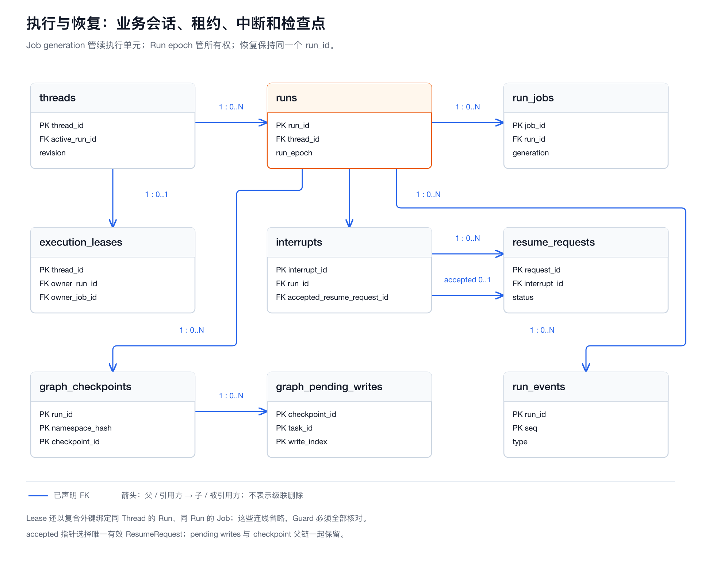

按当前 schema_agent_v3 重新生成的 Mermaid ER 图（仅列 PK/FK 列；省略所有指向 `teams` 的外键，且除 `teams` 自身外不列 team_id 列；来自其它分组的被引用表只列主键）：

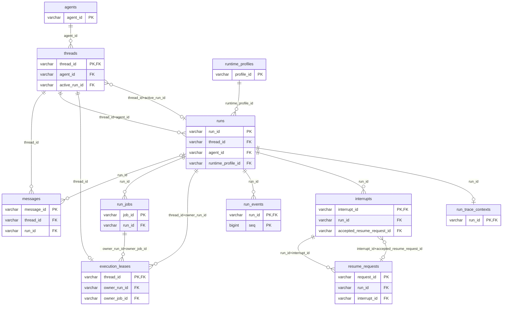

#### A.2.1 `threads`：业务会话

- 用途：业务会话。
- 语义说明（来自原文，已按 DDL 复核，业务规则以服务层为准）：active_run_id 约束同 Thread 逻辑串行位置；waiting 保留位置但释放执行租约。summary_ref 为预留，当前主图未完整消费历史摘要。
- 引入/演进：首次出现于 schema_v1（0001_core）。
- Agent 基线重命名：历史快照中的 `workspace_id` 列在 schema_agent_v1 中为 `agent_id`。

| 字段 | 类型 | 可空 | 默认 | 引入 | 说明 |
| --- | --- | --- | --- | --- | --- |
| `team_id` | `VARCHAR(36)` | 否 | — | v1 | 所属团队 UUID；租户隔离边界，不由模型或工具输出改写。 |
| `thread_id` | `VARCHAR(36)` | 否 | — | v1 | 业务会话 UUID；图执行的 configurable.thread_id 则固定使用 run_id。 |
| `agent_id` | `VARCHAR(36)` | 否 | — | v1 | 所属 Agent UUID；关联须同时校验团队和资源作用域。 |
| `active_run_id` | `VARCHAR(36)` | 是 | — | v1 | 同 Thread 的逻辑活动 Run；waiting 仍占此位置，queued 不抢占。 |
| `summary_ref` | `TEXT` | 是 | — | v1 | 会话摘要预留引用；字段存在不代表多轮摘要已接入。 |
| `revision` | `BIGINT` | 否 | `0` | v1 | 乐观并发版本，CAS 成功后递增；不等于内容发布序号。 |
| `created_at` | `BIGINT` | 否 | `0` | v1 | 创建时间，UTC 毫秒；DDL 默认 0，不代表有效时间 |
| `updated_at` | `BIGINT` | 否 | `0` | v1 | 最后变更时间，UTC 毫秒；DDL 默认 0，不代表有效时间 |

- 主键：`(thread_id)`
- 唯一约束：`(team_id, thread_id)`；`(team_id, thread_id, agent_id)`
- 外键：`(team_id) → (teams.team_id)`，ON DELETE RESTRICT；`(team_id, agent_id) → (agents.team_id, agents.agent_id)`，ON DELETE RESTRICT；`(team_id, thread_id, active_run_id) → (runs.team_id, runs.thread_id, runs.run_id)`，ON DELETE RESTRICT
- 显式索引：无（不含 PK/UNIQUE 隐式索引）

#### A.2.2 `messages`：会话消息

- 用途：会话消息。
- 语义说明（来自原文，已按 DDL 复核，业务规则以服务层为准）：role 为 user/assistant 等消息角色；content_ref 当前直接保存 JSON。source_id 可空，非空时团队内唯一；服务还须核对 run_id 与 thread_id 同属。
- 引入/演进：首次出现于 schema_v1（0001_core）。

| 字段 | 类型 | 可空 | 默认 | 引入 | 说明 |
| --- | --- | --- | --- | --- | --- |
| `team_id` | `VARCHAR(36)` | 否 | — | v1 | 所属团队 UUID；租户隔离边界，不由模型或工具输出改写。 |
| `message_id` | `VARCHAR(36)` | 否 | — | v1 | 关联消息标识；run_events 可为尚未落成 messages 行的草稿标识。 |
| `thread_id` | `VARCHAR(36)` | 否 | — | v1 | 业务会话 UUID；图执行的 configurable.thread_id 则固定使用 run_id。 |
| `run_id` | `VARCHAR(36)` | 是 | — | v1 | 关联 Run UUID；所有读写同时限定 team_id 并检查业务归属。 |
| `role` | `VARCHAR(32)` | 否 | — | v1 | 团队角色或消息角色，允许值见本表说明。 |
| `content_ref` | `TEXT` | 否 | — | v1 | 当前消息输入请求或 outcome 包装 JSON；不是必然为外部文件地址。 |
| `source_id` | `VARCHAR(128)` | 是 | — | v1 | 来源消息去重键；非空时在团队内唯一。 |
| `created_at` | `BIGINT` | 否 | `0` | v1 | 创建时间，UTC 毫秒；DDL 默认 0，不代表有效时间 |
| `updated_at` | `BIGINT` | 否 | `0` | v1 | 最后变更时间，UTC 毫秒；DDL 默认 0，不代表有效时间 |

- 主键：`(message_id)`
- 唯一约束：`(team_id, message_id)`；`(team_id, source_id)`
- 外键：`(team_id, thread_id) → (threads.team_id, threads.thread_id)`，ON DELETE RESTRICT；`(team_id, run_id) → (runs.team_id, runs.run_id)`，ON DELETE RESTRICT；`(team_id) → (teams.team_id)`，ON DELETE RESTRICT
- 显式索引：`ix_messages_thread_time`(thread_id, created_at)

#### A.2.3 `runs`：运行实例与状态

- 用途：运行实例与状态。
- 语义说明（来自原文，已按 DDL 复核，业务规则以服务层为准）：versions/budgets 接受后固定；状态转换见第 14 节。run_epoch 是所有权代数，revision 是公开 CAS 版本。活跃预算、总存活和等待期限独立，终态不回退。
- 引入/演进：首次出现于 schema_v1（0001_core）。
- 列级演进：`started_at` 于 schema_v3（0003_run_timing）追加；`active_elapsed_ms` 于 schema_v3（0003_run_timing）追加；`active_since` 于 schema_v3（0003_run_timing）追加；`event_floor` 于 schema_v4（0004_outcomes_events）追加。
- Agent 基线重命名：历史快照中的 `workspace_id` 列在 schema_agent_v1 中为 `agent_id`。

| 字段 | 类型 | 可空 | 默认 | 引入 | 说明 |
| --- | --- | --- | --- | --- | --- |
| `team_id` | `VARCHAR(36)` | 否 | — | v1 | 所属团队 UUID；租户隔离边界，不由模型或工具输出改写。 |
| `run_id` | `VARCHAR(36)` | 否 | — | v1 | 关联 Run UUID；所有读写同时限定 team_id 并检查业务归属。 |
| `thread_id` | `VARCHAR(36)` | 否 | — | v1 | 业务会话 UUID；图执行的 configurable.thread_id 则固定使用 run_id。 |
| `agent_id` | `VARCHAR(36)` | 否 | — | v1 | 所属 Agent UUID；关联须同时校验团队和资源作用域。 |
| `status` | `VARCHAR(32)` | 否 | — | v1 | 状态字段；取值由领域服务约束，DDL 未声明 Enum/CHECK |
| `phase` | `VARCHAR(32)` | 是 | — | v1 | 当前执行阶段，不是按秒数推算的完成百分比。 |
| `runtime_profile_id` | `VARCHAR(36)` | 否 | — | v1 | 接受 Run 时固定的 runtime_profiles.profile_id。 |
| `versions` | `TEXT` | 否 | — | v1 | 完整冻结 RunContext JSON，包括身份、版本和工作流引用，见 13.8。 |
| `budgets` | `TEXT` | 否 | — | v1 | 接受时固定的最终预算 JSON，见 13.8。 |
| `run_epoch` | `BIGINT` | 否 | `0` | v1 | Run 执行所有权代数，接管后单调递增以拒绝旧执行写入。 |
| `revision` | `BIGINT` | 否 | `0` | v1 | 乐观并发版本，CAS 成功后递增；不等于内容发布序号。 |
| `last_event_seq` | `BIGINT` | 否 | `0` | v1 | 该 Run/管理任务已分配的最高持久事件序号。 |
| `deadline_at` | `BIGINT` | 是 | — | v1 | 当前活跃执行片段的预算截止 UTC 毫秒时间；不等于总存活期限。 |
| `wall_deadline_at` | `BIGINT` | 否 | — | v1 | Run 总存活硬截止 UTC 毫秒时间，等待和恢复不刷新。 |
| `waiting_deadline_at` | `BIGINT` | 是 | — | v1 | 当前等待输入/审批截止 UTC 毫秒时间；非等待可空。 |
| `outcome_ref` | `TEXT` | 是 | — | v1 | run_outcomes.result_id 的逻辑引用，当前无物理 FK。 |
| `recovery_phase` | `VARCHAR(32)` | 是 | — | v1 | 持久恢复意图，如 projection/finalizing。 |
| `error_code` | `VARCHAR(128)` | 是 | — | v1 | 固定可公开错误代码，不存原始敏感异常。 |
| `created_at` | `BIGINT` | 否 | `0` | v1 | 创建时间，UTC 毫秒；DDL 默认 0，不代表有效时间 |
| `updated_at` | `BIGINT` | 否 | `0` | v1 | 最后变更时间，UTC 毫秒；DDL 默认 0，不代表有效时间 |
| `started_at` | `BIGINT` | 是 | — | v3 | 首次实际开始执行的 UTC 毫秒时间；未开始为空。 |
| `active_elapsed_ms` | `BIGINT` | 否 | `0` | v3 | 已关闭的活跃执行片段累计毫秒，不包含等待用户的时间。 |
| `active_since` | `BIGINT` | 是 | — | v3 | 当前活跃执行片段开始的 UTC 毫秒时间，无活跃片段时为空。 |
| `event_floor` | `BIGINT` | 否 | `0` | v4 | 已清理/过期事件的持久高水位，不随物理删除回退。 |

- 主键：`(run_id)`
- 唯一约束：`(team_id, run_id)`；`(team_id, thread_id, run_id)`
- 外键：`(team_id, thread_id, agent_id) → (threads.team_id, threads.thread_id, threads.agent_id)`，ON DELETE RESTRICT；`(team_id) → (teams.team_id)`，ON DELETE RESTRICT；`(team_id, runtime_profile_id) → (runtime_profiles.team_id, runtime_profiles.profile_id)`，ON DELETE RESTRICT
- 显式索引：`ix_runs_status_created`(status, created_at)

#### A.2.4 `run_jobs`：持久执行 Job

- 用途：持久执行 Job。
- 语义说明（来自原文，已按 DDL 复核，业务规则以服务层为准）：同 Run/generation/kind 唯一。调度状态为 ready/retry_wait/capability_blocked，领取为 leased，结束为 done/dead；不要与 Run 的 queued 混用。capabilities 保存所需 Graph/Codec 等能力 JSON。
- 引入/演进：首次出现于 schema_v1（0001_core）。

| 字段 | 类型 | 可空 | 默认 | 引入 | 说明 |
| --- | --- | --- | --- | --- | --- |
| `team_id` | `VARCHAR(36)` | 否 | — | v1 | 所属团队 UUID；租户隔离边界，不由模型或工具输出改写。 |
| `job_id` | `VARCHAR(36)` | 否 | — | v1 | 本表所属或关联的 Job UUID；管理任务与 Run Job 使用不同表。 |
| `run_id` | `VARCHAR(36)` | 否 | — | v1 | 关联 Run UUID；所有读写同时限定 team_id 并检查业务归属。 |
| `generation` | `BIGINT` | 否 | — | v1 | 同 Run 的执行 Job 代数，与 attempt 和 run_epoch 分别解释。 |
| `kind` | `VARCHAR(32)` | 否 | — | v1 | 类型分辨字段，按本表对应领域 DTO 校验。 |
| `status` | `VARCHAR(32)` | 否 | — | v1 | 状态字段；取值由领域服务约束，DDL 未声明 Enum/CHECK |
| `available_at` | `BIGINT` | 否 | — | v1 | 允许领取或重试的最早 UTC 毫秒时间。 |
| `priority` | `BIGINT` | 否 | `0` | v1 | 调度优先级，结合团队公平轮转解释。 |
| `lease_owner` | `VARCHAR(128)` | 是 | — | v1 | 当前领取者身份，非持有期为空。 |
| `lease_until` | `BIGINT` | 是 | — | v1 | 领取到期 UTC 毫秒时间；与所有者和代数同时检查。 |
| `attempt` | `BIGINT` | 否 | `0` | v1 | 实际执行/发送尝试计数；纯查询、幂等重放和投影修复不能凭空增加。 |
| `capabilities` | `TEXT` | 否 | — | v1 | 版本化能力/执行要求 JSON；具体内容见本表说明。 |
| `revision` | `BIGINT` | 否 | `0` | v1 | 乐观并发版本，CAS 成功后递增；不等于内容发布序号。 |
| `created_at` | `BIGINT` | 否 | `0` | v1 | 创建时间，UTC 毫秒；DDL 默认 0，不代表有效时间 |
| `updated_at` | `BIGINT` | 否 | `0` | v1 | 最后变更时间，UTC 毫秒；DDL 默认 0，不代表有效时间 |

- 主键：`(job_id)`
- 唯一约束：`(run_id, generation, kind)`；`(team_id, job_id)`；`(team_id, run_id, job_id)`
- 外键：`(team_id, run_id) → (runs.team_id, runs.run_id)`，ON DELETE RESTRICT；`(team_id) → (teams.team_id)`，ON DELETE RESTRICT
- 显式索引：`ix_claimable_jobs`(status, available_at, priority, created_at)

#### A.2.5 `execution_leases`：Thread 执行租约

- 用途：Thread 执行租约。
- 语义说明（来自原文，已按 DDL 复核，业务规则以服务层为准）：thread_id 为 PK，每 Thread 一条执行租约。Guard 同事务核对 team/Thread/Run/Job/Worker/epoch/有效期及允许状态；guard_revision 为租约内部 CAS 代数。
- 引入/演进：首次出现于 schema_v1（0001_core）。

| 字段 | 类型 | 可空 | 默认 | 引入 | 说明 |
| --- | --- | --- | --- | --- | --- |
| `team_id` | `VARCHAR(36)` | 否 | — | v1 | 所属团队 UUID；租户隔离边界，不由模型或工具输出改写。 |
| `thread_id` | `VARCHAR(36)` | 否 | — | v1 | 业务会话 UUID；图执行的 configurable.thread_id 则固定使用 run_id。 |
| `owner_run_id` | `VARCHAR(36)` | 否 | — | v1 | 执行租约所绑定的 Run。 |
| `owner_job_id` | `VARCHAR(36)` | 否 | — | v1 | 执行租约所绑定的 Run Job。 |
| `worker_id` | `VARCHAR(128)` | 否 | — | v1 | 本次执行 Worker 身份，必须与有效租约匹配。 |
| `run_epoch` | `BIGINT` | 否 | — | v1 | Run 执行所有权代数，接管后单调递增以拒绝旧执行写入。 |
| `expires_at` | `BIGINT` | 否 | — | v1 | 到期 UTC 毫秒时间；到期不代表已经物理删除。 |
| `guard_revision` | `BIGINT` | 否 | `0` | v1 | 租约或管理任务领取的内部 CAS 版本，不是公开 Run revision。 |

- 主键：`(thread_id)`
- 唯一约束：无
- 外键：`(team_id, owner_run_id, owner_job_id) → (run_jobs.team_id, run_jobs.run_id, run_jobs.job_id)`，ON DELETE RESTRICT；`(team_id, thread_id) → (threads.team_id, threads.thread_id)`，ON DELETE RESTRICT；`(team_id, thread_id, owner_run_id) → (runs.team_id, runs.thread_id, runs.run_id)`，ON DELETE RESTRICT
- 显式索引：`ix_expired_leases`(expires_at, owner_run_id)

#### A.2.6 `run_events`：持久事件与 SSE

- 用途：持久事件与 SSE。
- 语义说明（来自原文，已按 DDL 复核，业务规则以服务层为准）：PK(run_id,seq)；事件分配与 Run.last_event_seq 更新同事务，提交后再推送。schema_version 当前字符串 1；message_id 无物理 FK，可关联草稿身份。
- 引入/演进：首次出现于 schema_v1（0001_core）。
- 列级演进：`schema_version` 于 schema_v4（0004_outcomes_events）追加；`message_id` 于 schema_v4（0004_outcomes_events）追加。

| 字段 | 类型 | 可空 | 默认 | 引入 | 说明 |
| --- | --- | --- | --- | --- | --- |
| `team_id` | `VARCHAR(36)` | 否 | — | v1 | 所属团队 UUID；租户隔离边界，不由模型或工具输出改写。 |
| `run_id` | `VARCHAR(36)` | 否 | — | v1 | 关联 Run UUID；所有读写同时限定 team_id 并检查业务归属。 |
| `seq` | `BIGINT` | 否 | — | v1 | 当前 Run 或管理任务内部从 1 开始的单调事件序号。 |
| `type` | `VARCHAR(128)` | 否 | — | v1 | 公开版本化事件类型，Run 事件见第 12.2 节。 |
| `attempt` | `BIGINT` | 否 | `0` | v1 | 实际执行/发送尝试计数；纯查询、幂等重放和投影修复不能凭空增加。 |
| `payload` | `TEXT` | 否 | — | v1 | 版本化正文；具体格式和可信边界见本表说明及 13.8。 |
| `occurred_at` | `BIGINT` | 否 | — | v1 | 持久事件所用 UTC 毫秒时间。 |
| `schema_version` | `VARCHAR(16)` | 否 | `'1'` | v4 | 版本标记；事件信封为字符串 1，与存储协议 dod-storage-agent-v1 分开。 |
| `message_id` | `VARCHAR(36)` | 是 | — | v4 | 关联消息标识；run_events 可为尚未落成 messages 行的草稿标识。 |

- 主键：`(run_id, seq)`
- 唯一约束：无
- 外键：`(team_id, run_id) → (runs.team_id, runs.run_id)`，ON DELETE RESTRICT
- 显式索引：`ix_run_events_time`(occurred_at)

#### A.2.7 `interrupts`：具名中断等待点

- 用途：具名中断等待点。
- 语义说明（来自原文，已按 DDL 复核，业务规则以服务层为准）：kind 为 user_input/approval 等，schema 为含 name/kind/actor/响应 Schema 的描述。accepted 指针是唯一有效恢复请求权威，不能用条件唯一索引替代 CAS。
- 引入/演进：首次出现于 schema_v1（0001_core）。

| 字段 | 类型 | 可空 | 默认 | 引入 | 说明 |
| --- | --- | --- | --- | --- | --- |
| `team_id` | `VARCHAR(36)` | 否 | — | v1 | 所属团队 UUID；租户隔离边界，不由模型或工具输出改写。 |
| `interrupt_id` | `VARCHAR(36)` | 否 | — | v1 | 公开具名等待点 UUID。 |
| `run_id` | `VARCHAR(36)` | 否 | — | v1 | 关联 Run UUID；所有读写同时限定 team_id 并检查业务归属。 |
| `graph_interrupt_id` | `VARCHAR(128)` | 否 | — | v1 | 框架中断标识；同 Run 内唯一。 |
| `kind` | `VARCHAR(32)` | 否 | — | v1 | 类型分辨字段，按本表对应领域 DTO 校验。 |
| `status` | `VARCHAR(32)` | 否 | — | v1 | 状态字段；取值由领域服务约束，DDL 未声明 Enum/CHECK |
| `schema` | `TEXT` | 否 | — | v1 | 工具完整配置或中断描述 JSON，不是必然只有输入 JSON Schema。 |
| `expires_at` | `BIGINT` | 否 | — | v1 | 到期 UTC 毫秒时间；到期不代表已经物理删除。 |
| `args_hash` | `VARCHAR(64)` | 是 | — | v1 | 规范化参数摘要；审批表中严格等于 Action.payload_hash。 |
| `accepted_resume_request_id` | `VARCHAR(36)` | 是 | — | v1 | 唯一有效恢复请求指针，指向同 interrupt 的 request_id；仅通过 CAS 从 NULL 赋值。 |
| `revision` | `BIGINT` | 否 | `0` | v1 | 乐观并发版本，CAS 成功后递增；不等于内容发布序号。 |
| `created_at` | `BIGINT` | 否 | `0` | v1 | 创建时间，UTC 毫秒；DDL 默认 0，不代表有效时间 |
| `updated_at` | `BIGINT` | 否 | `0` | v1 | 最后变更时间，UTC 毫秒；DDL 默认 0，不代表有效时间 |

- 主键：`(interrupt_id)`
- 唯一约束：`(run_id, graph_interrupt_id)`；`(team_id, interrupt_id)`；`(team_id, run_id, interrupt_id)`
- 外键：`(team_id) → (teams.team_id)`，ON DELETE RESTRICT；`(team_id, interrupt_id, accepted_resume_request_id) → (resume_requests.team_id, resume_requests.interrupt_id, resume_requests.request_id)`，ON DELETE RESTRICT；`(team_id, run_id) → (runs.team_id, runs.run_id)`，ON DELETE RESTRICT
- 显式索引：无（不含 PK/UNIQUE 隐式索引）

#### A.2.8 `resume_requests`：持久恢复输入

- 用途：持久恢复输入。
- 语义说明（来自原文，已按 DDL 复核，业务规则以服务层为准）：response 为类型化 user_input/approval；status 经 submitted→applying→applied。图内 last_applied_resume_id 是 Command 已应用的持久证据，不能因投影滞后重复投递。
- 引入/演进：首次出现于 schema_v1（0001_core）。

| 字段 | 类型 | 可空 | 默认 | 引入 | 说明 |
| --- | --- | --- | --- | --- | --- |
| `team_id` | `VARCHAR(36)` | 否 | — | v1 | 所属团队 UUID；租户隔离边界，不由模型或工具输出改写。 |
| `request_id` | `VARCHAR(36)` | 否 | — | v1 | 恢复输入提交 UUID。 |
| `run_id` | `VARCHAR(36)` | 否 | — | v1 | 关联 Run UUID；所有读写同时限定 team_id 并检查业务归属。 |
| `interrupt_id` | `VARCHAR(36)` | 否 | — | v1 | 公开具名等待点 UUID。 |
| `response` | `TEXT` | 否 | — | v1 | 类型化恢复输入或最终返回视图 JSON，见本表说明。 |
| `status` | `VARCHAR(32)` | 否 | — | v1 | 状态字段；取值由领域服务约束，DDL 未声明 Enum/CHECK |
| `idempotency_key` | `VARCHAR(128)` | 否 | — | v1 | 调用方幂等键，仅在本表规定作用域内解释。 |
| `created_at` | `BIGINT` | 否 | `0` | v1 | 创建时间，UTC 毫秒；DDL 默认 0，不代表有效时间 |
| `updated_at` | `BIGINT` | 否 | `0` | v1 | 最后变更时间，UTC 毫秒；DDL 默认 0，不代表有效时间 |

- 主键：`(request_id)`
- 唯一约束：`(interrupt_id, idempotency_key)`；`(team_id, interrupt_id, request_id)`；`(team_id, request_id)`
- 外键：`(team_id, run_id, interrupt_id) → (interrupts.team_id, interrupts.run_id, interrupts.interrupt_id)`，ON DELETE RESTRICT；`(team_id) → (teams.team_id)`，ON DELETE RESTRICT
- 显式索引：无（不含 PK/UNIQUE 隐式索引）

#### A.2.9 `run_trace_contexts`：异步 Trace 上下文

- 用途：异步 Trace 上下文。
- 语义说明（来自原文，已按 DDL 复核，业务规则以服务层为准）：由 `0003_run_trace_contexts` 新增，只保存内部签发的 W3C traceparent，不保存正文或凭据。 PK 为 `run_id`；复合外键 `(team_id, run_id)` 指向 runs，删除 RESTRICT。
- 引入/演进：Agent 库新增（schema_agent_v3 / 0003_run_trace_contexts）。

| 字段 | 类型 | 可空 | 默认 | 引入 | 说明 |
| --- | --- | --- | --- | --- | --- |
| `run_id` | `VARCHAR(36)` | 否 | — | agent_v3 | Run 主键。 |
| `team_id` | `VARCHAR(36)` | 否 | — | agent_v3 | 所属团队。 |
| `traceparent` | `VARCHAR(55)` | 否 | — | agent_v3 | Run 受理时固定的追踪上下文。 |
| `created_at` | `BIGINT` | 否 | — | agent_v3 | 创建时间，UTC 毫秒 |

- 主键：`(run_id)`
- 唯一约束：无
- 外键：`(team_id, run_id) → (runs.team_id, runs.run_id)`，ON DELETE RESTRICT
- 显式索引：无（不含 PK/UNIQUE 隐式索引）

### A.3 检查点

本组 2 张表：`graph_checkpoints`、`graph_pending_writes`。

现有 ER 图（历史快照，命名可能仍为 workspace，见核对记录）：

按当前 schema_agent_v3 重新生成的 Mermaid ER 图（仅列 PK/FK 列；省略所有指向 `teams` 的外键，且除 `teams` 自身外不列 team_id 列；来自其它分组的被引用表只列主键）：

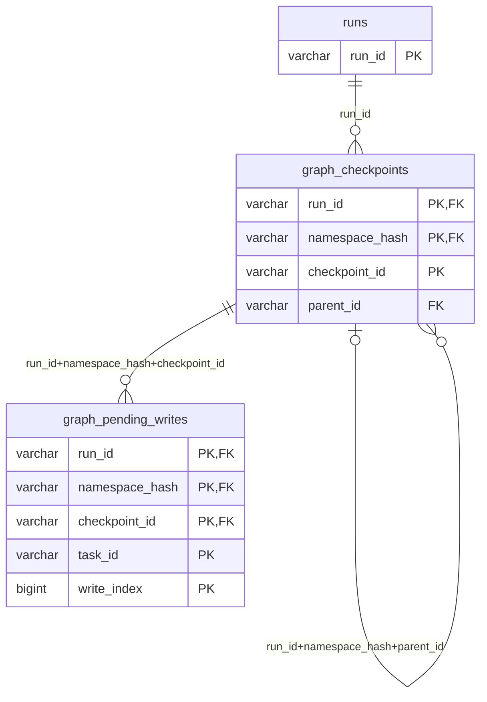

#### A.3.1 `graph_checkpoints`：图检查点快照

- 用途：图检查点快照。
- 语义说明（来自原文，已按 DDL 复核，业务规则以服务层为准）：namespace 原文与摘要同时保存；parent 必须同 Run/namespace。payload 保存完整 typed checkpoint bytes，含 channel_versions/versions_seen；metadata 也保留 Codec 字节。
- 引入/演进：首次出现于 schema_v1（0001_core）。

| 字段 | 类型 | 可空 | 默认 | 引入 | 说明 |
| --- | --- | --- | --- | --- | --- |
| `team_id` | `VARCHAR(36)` | 否 | — | v1 | 所属团队 UUID；租户隔离边界，不由模型或工具输出改写。 |
| `run_id` | `VARCHAR(36)` | 否 | — | v1 | 关联 Run UUID；所有读写同时限定 team_id 并检查业务归属。 |
| `namespace_hash` | `VARCHAR(64)` | 否 | — | v1 | namespace UTF-8 的 SHA-256；仍须比较原文并拒绝哈希碰撞。 |
| `namespace` | `TEXT` | 否 | — | v1 | 完整检查点命名空间；主图可为空字符串，专家使用稳定子命名空间。 |
| `checkpoint_id` | `VARCHAR(128)` | 否 | — | v1 | 框架生成的可排序检查点标识，不使用数据库自增键。 |
| `parent_id` | `VARCHAR(128)` | 是 | — | v1 | 同 Run/namespace 的父 checkpoint_id；链首为空。 |
| `payload_type` | `VARCHAR(128)` | 否 | — | v1 | 检查点 Codec 类型标签，与 payload 原始字节配对。 |
| `payload` | `BLOB` | 否 | — | v1 | 版本化正文；具体格式和可信边界见本表说明及 13.8。 |
| `metadata_type` | `VARCHAR(128)` | 否 | — | v1 | 框架 metadata 的 Codec 类型标签。 |
| `metadata` | `BLOB` | 否 | — | v1 | 框架 metadata 的原始 Codec 字节，不按普通 JSON 任意重编码。 |
| `codec_version` | `VARCHAR(128)` | 否 | — | v1 | 此检查点字节采用的 Codec 版本。 |
| `run_epoch` | `BIGINT` | 否 | — | v1 | Run 执行所有权代数，接管后单调递增以拒绝旧执行写入。 |
| `created_at` | `BIGINT` | 否 | — | v1 | 创建时间，UTC 毫秒 |

- 主键：`(run_id, namespace_hash, checkpoint_id)`
- 唯一约束：`(team_id, run_id, namespace_hash, checkpoint_id)`
- 外键：`(team_id, run_id) → (runs.team_id, runs.run_id)`，ON DELETE RESTRICT；`(team_id, run_id, namespace_hash, parent_id) → (graph_checkpoints.team_id, graph_checkpoints.run_id, graph_checkpoints.namespace_hash, graph_checkpoints.checkpoint_id)`，ON DELETE RESTRICT
- 显式索引：无（不含 PK/UNIQUE 隐式索引）

#### A.3.2 `graph_pending_writes`：节点部分完成写入

- 用途：节点部分完成写入。
- 语义说明（来自原文，已按 DDL 复核，业务规则以服务层为准）：父检查点 FK 同时限定团队；普通非负索引重复写保留已有值，特殊负索引按锁定框架映射更新。pending writes 不能简化成最终消息列表。
- 引入/演进：首次出现于 schema_v1（0001_core）。

| 字段 | 类型 | 可空 | 默认 | 引入 | 说明 |
| --- | --- | --- | --- | --- | --- |
| `team_id` | `VARCHAR(36)` | 否 | — | v1 | 所属团队 UUID；租户隔离边界，不由模型或工具输出改写。 |
| `run_id` | `VARCHAR(36)` | 否 | — | v1 | 关联 Run UUID；所有读写同时限定 team_id 并检查业务归属。 |
| `namespace_hash` | `VARCHAR(64)` | 否 | — | v1 | namespace UTF-8 的 SHA-256；仍须比较原文并拒绝哈希碰撞。 |
| `checkpoint_id` | `VARCHAR(128)` | 否 | — | v1 | 框架生成的可排序检查点标识，不使用数据库自增键。 |
| `task_id` | `VARCHAR(128)` | 否 | — | v1 | LangGraph 任务标识，不是平台 run_jobs.job_id。 |
| `write_index` | `BIGINT` | 否 | — | v1 | 同 task 的写入索引，特殊负值保持锁定 LangGraph WRITES_IDX_MAP 语义。 |
| `channel` | `VARCHAR(128)` | 否 | — | v1 | LangGraph 写入通道名，包含框架特殊通道。 |
| `payload_type` | `VARCHAR(128)` | 否 | — | v1 | 检查点 Codec 类型标签，与 payload 原始字节配对。 |
| `payload` | `BLOB` | 否 | — | v1 | 版本化正文；具体格式和可信边界见本表说明及 13.8。 |
| `task_path` | `TEXT` | 否 | — | v1 | 框架任务路径，是 pending writes 恢复身份与排序的一部分。 |
| `run_epoch` | `BIGINT` | 否 | — | v1 | Run 执行所有权代数，接管后单调递增以拒绝旧执行写入。 |

- 主键：`(run_id, namespace_hash, checkpoint_id, task_id, write_index)`
- 唯一约束：无
- 外键：`(team_id, run_id, namespace_hash, checkpoint_id) → (graph_checkpoints.team_id, graph_checkpoints.run_id, graph_checkpoints.namespace_hash, graph_checkpoints.checkpoint_id)`，ON DELETE RESTRICT
- 显式索引：无（不含 PK/UNIQUE 隐式索引）

### A.4 Evidence 与 Outcome

本组 6 张表：`query_scope_revisions`、`evidence`、`evidence_payloads`、`artifacts`、`artifact_upload_scopes`、`run_outcomes`。

现有 ER 图（历史快照，命名可能仍为 workspace，见核对记录）：

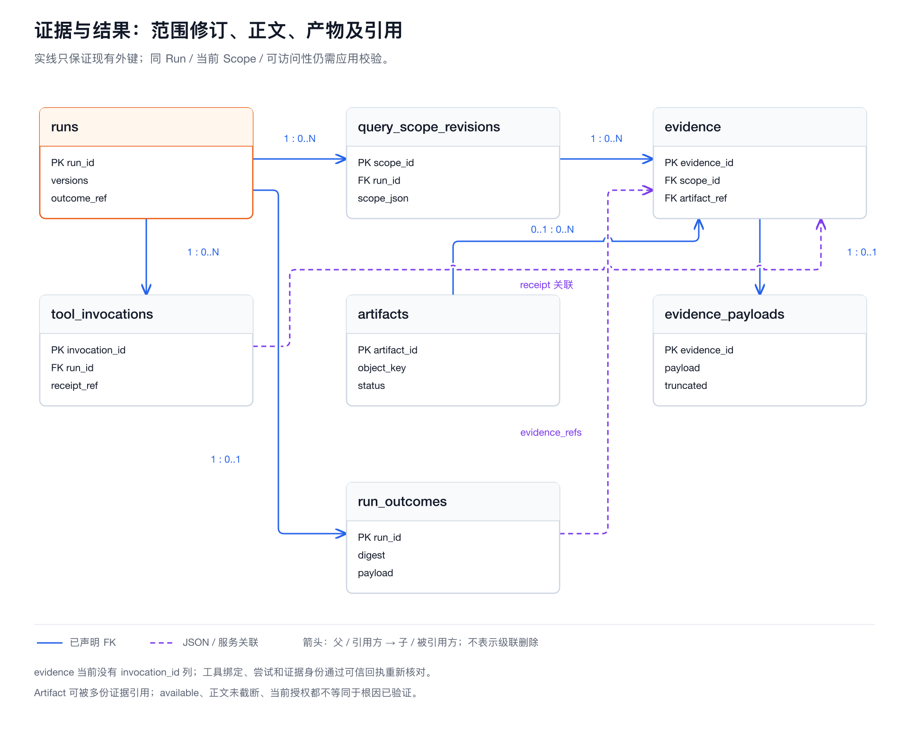

按当前 schema_agent_v3 重新生成的 Mermaid ER 图（仅列 PK/FK 列；省略所有指向 `teams` 的外键，且除 `teams` 自身外不列 team_id 列；来自其它分组的被引用表只列主键）：

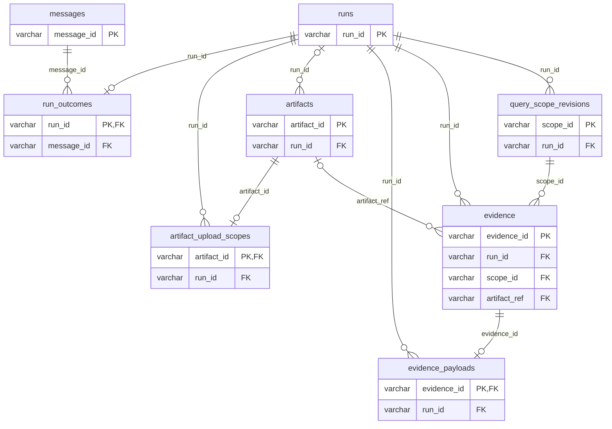

#### A.4.1 `query_scope_revisions`：查询范围修订

- 用途：查询范围修订。
- 语义说明（来自原文，已按 DDL 复核，业务规则以服务层为准）：同 Run version 递增，当前范围按最大版本解析；Scope 修改新增行，历史不改写。旧范围证据不能冒充新范围的正常结论。
- 引入/演进：首次出现于 schema_v1（0001_core）。

| 字段 | 类型 | 可空 | 默认 | 引入 | 说明 |
| --- | --- | --- | --- | --- | --- |
| `team_id` | `VARCHAR(36)` | 否 | — | v1 | 所属团队 UUID；租户隔离边界，不由模型或工具输出改写。 |
| `scope_id` | `VARCHAR(36)` | 否 | — | v1 | QueryScope 修订 UUID；是否存在物理 FK 以本表 FK 列表为准。 |
| `run_id` | `VARCHAR(36)` | 否 | — | v1 | 关联 Run UUID；所有读写同时限定 team_id 并检查业务归属。 |
| `version` | `BIGINT` | 否 | — | v1 | 资源内不可变内容发布序号；不与 CAS revision 混用。 |
| `scope_json` | `TEXT` | 否 | — | v1 | 已解析查询范围 JSON，包括服务、环境、区域和带时区时间窗。 |
| `hash` | `VARCHAR(64)` | 否 | — | v1 | 规范化版本内容的 SHA-256，小写十六进制；使用时核对内容。 |
| `created_by` | `VARCHAR(128)` | 否 | — | v1 | 创建记录的可信用户/服务主体。 |
| `created_at` | `BIGINT` | 否 | `0` | v1 | 创建时间，UTC 毫秒；DDL 默认 0，不代表有效时间 |
| `updated_at` | `BIGINT` | 否 | `0` | v1 | 最后变更时间，UTC 毫秒；DDL 默认 0，不代表有效时间 |

- 主键：`(scope_id)`
- 唯一约束：`(run_id, version)`；`(team_id, scope_id)`
- 外键：`(team_id) → (teams.team_id)`，ON DELETE RESTRICT；`(team_id, run_id) → (runs.team_id, runs.run_id)`，ON DELETE RESTRICT
- 显式索引：无（不含 PK/UNIQUE 隐式索引）

#### A.4.2 `evidence`：证据元数据

- 用途：证据元数据。
- 语义说明（来自原文，已按 DDL 复核，业务规则以服务层为准）：物理 FK 只分别保证 Run/Scope 同团队，服务还要检查同 Run。quality 对应领域 quality_status；summary 可能只是 digest，大正文使用 Artifact/正文表。
- 引入/演进：首次出现于 schema_v1（0001_core）。

| 字段 | 类型 | 可空 | 默认 | 引入 | 说明 |
| --- | --- | --- | --- | --- | --- |
| `team_id` | `VARCHAR(36)` | 否 | — | v1 | 所属团队 UUID；租户隔离边界，不由模型或工具输出改写。 |
| `evidence_id` | `VARCHAR(36)` | 否 | — | v1 | 证据 UUID；正文表与元数据表一对一。 |
| `run_id` | `VARCHAR(36)` | 否 | — | v1 | 关联 Run UUID；所有读写同时限定 team_id 并检查业务归属。 |
| `scope_id` | `VARCHAR(36)` | 否 | — | v1 | QueryScope 修订 UUID；是否存在物理 FK 以本表 FK 列表为准。 |
| `source` | `VARCHAR(128)` | 否 | — | v1 | 证据/事件来源键，按来源协议解释。 |
| `quality` | `VARCHAR(32)` | 否 | — | v1 | 证据质量：valid/empty/unavailable/conflicting/stale 等；当前也使用 truncated。 |
| `time_window` | `TEXT` | 否 | — | v1 | 证据实际查询窗 JSON；仓库可为 {}，值班可记录 observed_at_ms。 |
| `artifact_ref` | `VARCHAR(36)` | 是 | — | v1 | 关联 artifacts.artifact_id；大正文或文件的受控引用。 |
| `summary` | `TEXT` | 是 | — | v1 | 证据简述/摘要或知识问题描述；不保证是完整可读原文。 |
| `created_at` | `BIGINT` | 否 | `0` | v1 | 创建时间，UTC 毫秒；DDL 默认 0，不代表有效时间 |
| `updated_at` | `BIGINT` | 否 | `0` | v1 | 最后变更时间，UTC 毫秒；DDL 默认 0，不代表有效时间 |

- 主键：`(evidence_id)`
- 唯一约束：`(team_id, evidence_id)`
- 外键：`(team_id, artifact_ref) → (artifacts.team_id, artifacts.artifact_id)`，ON DELETE RESTRICT；`(team_id, scope_id) → (query_scope_revisions.team_id, query_scope_revisions.scope_id)`，ON DELETE RESTRICT；`(team_id, run_id) → (runs.team_id, runs.run_id)`，ON DELETE RESTRICT；`(team_id) → (teams.team_id)`，ON DELETE RESTRICT
- 显式索引：`ix_evidence_source`(run_id, source)

#### A.4.3 `evidence_payloads`：有界证据正文

- 用途：有界证据正文。
- 语义说明（来自原文，已按 DDL 复核，业务规则以服务层为准）：每 evidence_id 一份 payload；与 evidence 和 Run 一致性同事务核对。正文为工具协议 JSON 或 commit/path/lines 的仓库证据，truncated=1 不视为完整引用。
- 引入/演进：首次出现于 schema_v7（0008_evidence_payloads）。

| 字段 | 类型 | 可空 | 默认 | 引入 | 说明 |
| --- | --- | --- | --- | --- | --- |
| `team_id` | `VARCHAR(36)` | 否 | — | v7 | 所属团队 UUID；租户隔离边界，不由模型或工具输出改写。 |
| `evidence_id` | `VARCHAR(36)` | 否 | — | v7 | 证据 UUID；正文表与元数据表一对一。 |
| `run_id` | `VARCHAR(36)` | 否 | — | v7 | 关联 Run UUID；所有读写同时限定 team_id 并检查业务归属。 |
| `payload` | `TEXT` | 否 | — | v7 | 版本化正文；具体格式和可信边界见本表说明及 13.8。 |
| `truncated` | `BIGINT` | 否 | — | v7 | 0/1 整数截断标志；1 不能视为完整可访问的证据正文。 |
| `created_at` | `BIGINT` | 否 | — | v7 | 创建时间，UTC 毫秒 |

- 主键：`(evidence_id)`
- 唯一约束：`(team_id, evidence_id)`
- 外键：`(team_id, run_id) → (runs.team_id, runs.run_id)`，ON DELETE RESTRICT；`(team_id, evidence_id) → (evidence.team_id, evidence.evidence_id)`，ON DELETE RESTRICT
- 显式索引：无（不含 PK/UNIQUE 隐式索引）

#### A.4.4 `artifacts`：对象元数据

- 用途：对象元数据。
- 语义说明（来自原文，已按 DDL 复核，业务规则以服务层为准）：先 uploading，写对象并回读校验长度/sha256 后才 available；状态改变还须检查当前授权和 Scope。object_key 不是可公开 URL。
- 引入/演进：首次出现于 schema_v1（0001_core）。

| 字段 | 类型 | 可空 | 默认 | 引入 | 说明 |
| --- | --- | --- | --- | --- | --- |
| `team_id` | `VARCHAR(36)` | 否 | — | v1 | 所属团队 UUID；租户隔离边界，不由模型或工具输出改写。 |
| `artifact_id` | `VARCHAR(36)` | 否 | — | v1 | 文件产物 UUID。 |
| `run_id` | `VARCHAR(36)` | 是 | — | v1 | 关联 Run UUID；所有读写同时限定 team_id 并检查业务归属。 |
| `kind` | `VARCHAR(32)` | 否 | — | v1 | 类型分辨字段，按本表对应领域 DTO 校验。 |
| `object_key` | `TEXT` | 否 | — | v1 | 对象键；上传期间可以是 pending:<id>，不是下载 URL。 |
| `sha256` | `VARCHAR(64)` | 否 | — | v1 | 对象原始文件字节 SHA-256。 |
| `size` | `BIGINT` | 否 | — | v1 | 对象字节数；CHECK 禁止负数，大小上限另由服务校验。 |
| `status` | `VARCHAR(32)` | 否 | — | v1 | 状态字段；取值由领域服务约束，DDL 未声明 Enum/CHECK |
| `expires_at` | `BIGINT` | 是 | — | v1 | 到期 UTC 毫秒时间；到期不代表已经物理删除。 |
| `created_at` | `BIGINT` | 否 | `0` | v1 | 创建时间，UTC 毫秒；DDL 默认 0，不代表有效时间 |
| `updated_at` | `BIGINT` | 否 | `0` | v1 | 最后变更时间，UTC 毫秒；DDL 默认 0，不代表有效时间 |

- 主键：`(artifact_id)`
- 唯一约束：`(team_id, artifact_id)`
- 外键：`(team_id) → (teams.team_id)`，ON DELETE RESTRICT；`(team_id, run_id) → (runs.team_id, runs.run_id)`，ON DELETE RESTRICT
- CHECK：`size >= 0`（ck_artifacts_size_nonnegative）
- 显式索引：无（不含 PK/UNIQUE 隐式索引）

#### A.4.5 `artifact_upload_scopes`：上传范围绑定

- 用途：上传范围绑定。
- 语义说明（来自原文，已按 DDL 复核，业务规则以服务层为准）：artifact_id 与 Artifact 一对一；scope_id 当前无物理 FK。受理、完成、下载均重验同 Run 当前 Scope；无 Scope 时允许 NULL。
- 引入/演进：首次出现于 schema_v8（0009_artifact_upload_scopes）。

| 字段 | 类型 | 可空 | 默认 | 引入 | 说明 |
| --- | --- | --- | --- | --- | --- |
| `team_id` | `VARCHAR(36)` | 否 | — | v8 | 所属团队 UUID；租户隔离边界，不由模型或工具输出改写。 |
| `artifact_id` | `VARCHAR(36)` | 否 | — | v8 | 文件产物 UUID。 |
| `run_id` | `VARCHAR(36)` | 否 | — | v8 | 关联 Run UUID；所有读写同时限定 team_id 并检查业务归属。 |
| `scope_id` | `VARCHAR(36)` | 是 | — | v8 | QueryScope 修订 UUID；是否存在物理 FK 以本表 FK 列表为准。 |
| `created_at` | `BIGINT` | 否 | — | v8 | 创建时间，UTC 毫秒 |

- 主键：`(artifact_id)`
- 唯一约束：`(team_id, artifact_id)`
- 外键：`(team_id, artifact_id) → (artifacts.team_id, artifacts.artifact_id)`，ON DELETE RESTRICT；`(team_id, run_id) → (runs.team_id, runs.run_id)`，ON DELETE RESTRICT
- 显式索引：无（不含 PK/UNIQUE 隐式索引）

#### A.4.6 `run_outcomes`：最终结构化结果

- 用途：最终结构化结果。
- 语义说明（来自原文，已按 DDL 复核，业务规则以服务层为准）：run_id 是 PK，每 Run 一份最终结果；重放必须同 digest。response 是最终 RunView JSON 快照，读取仍需重验当前授权。payload 为 RunOutcome JSON。
- 引入/演进：首次出现于 schema_v4（0004_outcomes_events）。

| 字段 | 类型 | 可空 | 默认 | 引入 | 说明 |
| --- | --- | --- | --- | --- | --- |
| `team_id` | `VARCHAR(36)` | 否 | — | v4 | 所属团队 UUID；租户隔离边界，不由模型或工具输出改写。 |
| `run_id` | `VARCHAR(36)` | 否 | — | v4 | 关联 Run UUID；所有读写同时限定 team_id 并检查业务归属。 |
| `result_id` | `VARCHAR(36)` | 否 | — | v4 | 某 Run 最终结果 UUID，当前采用确定性身份。 |
| `digest` | `VARCHAR(64)` | 否 | — | v4 | 规范化 RunOutcome JSON 的 SHA-256。 |
| `payload` | `TEXT` | 否 | — | v4 | 版本化正文；具体格式和可信边界见本表说明及 13.8。 |
| `message_id` | `VARCHAR(36)` | 否 | — | v4 | 关联消息标识；run_events 可为尚未落成 messages 行的草稿标识。 |
| `response` | `TEXT` | 是 | — | v4 | 类型化恢复输入或最终返回视图 JSON，见本表说明。 |
| `created_at` | `BIGINT` | 否 | — | v4 | 创建时间，UTC 毫秒 |

- 主键：`(run_id)`
- 唯一约束：`(team_id, result_id)`
- 外键：`(team_id, message_id) → (messages.team_id, messages.message_id)`，ON DELETE RESTRICT；`(team_id, run_id) → (runs.team_id, runs.run_id)`，ON DELETE RESTRICT
- 显式索引：无（不含 PK/UNIQUE 隐式索引）

### A.5 工具调用与预算

本组 6 张表：`tool_invocations`、`runner_cleanup_obligations`、`usage_budget_policies`、`usage_reservations`、`usage_records`、`usage_quarantine`。

现有 ER 图（历史快照，命名可能仍为 workspace，见核对记录）：

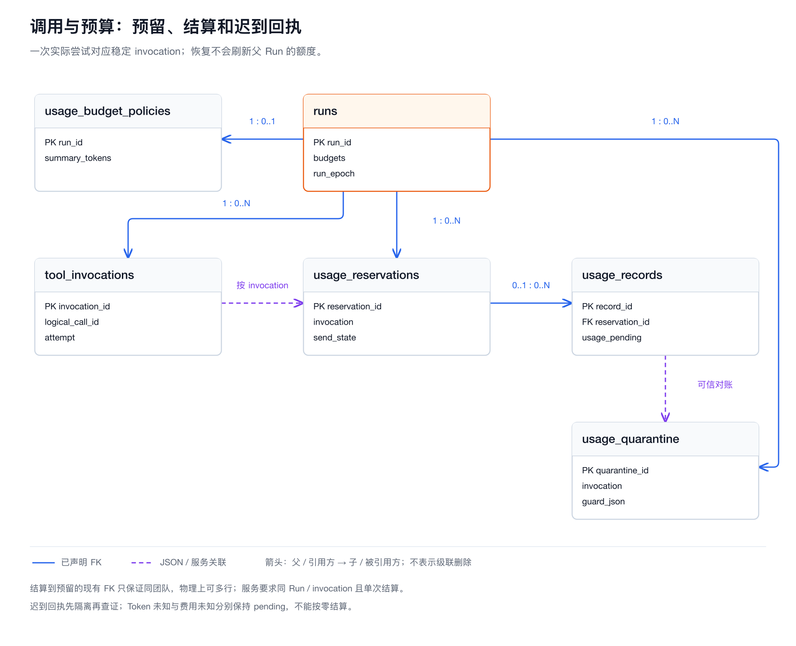

按当前 schema_agent_v3 重新生成的 Mermaid ER 图（仅列 PK/FK 列；省略所有指向 `teams` 的外键，且除 `teams` 自身外不列 team_id 列；来自其它分组的被引用表只列主键）：

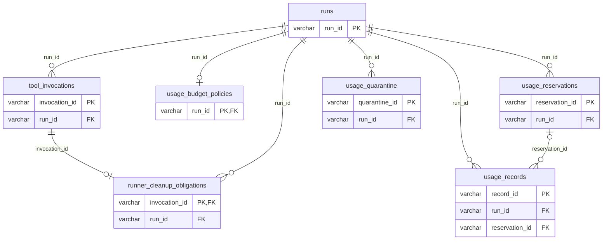

#### A.5.1 `tool_invocations`：工具与 Runner 调用台账

- 用途：工具与 Runner 调用台账。
- 语义说明（来自原文，已按 DDL 复核，业务规则以服务层为准）：tool_version 当前通常保存绑定 resource_id，Runner 路径可保存快照 ID；完整版本/hash/Scope 在回执核对。派发前保存 possibly_sent，未知结果不得自动重发。
- 引入/演进：首次出现于 schema_v1（0001_core）。

| 字段 | 类型 | 可空 | 默认 | 引入 | 说明 |
| --- | --- | --- | --- | --- | --- |
| `team_id` | `VARCHAR(36)` | 否 | — | v1 | 所属团队 UUID；租户隔离边界，不由模型或工具输出改写。 |
| `invocation_id` | `VARCHAR(36)` | 否 | — | v1 | 一次工具/Runner 执行尝试 UUID。 |
| `run_id` | `VARCHAR(36)` | 否 | — | v1 | 关联 Run UUID；所有读写同时限定 team_id 并检查业务归属。 |
| `logical_call_id` | `VARCHAR(128)` | 否 | — | v1 | 跨恢复稳定的逻辑工具调用标识。 |
| `tool_version` | `VARCHAR(128)` | 否 | — | v1 | 工具版本标识；调用台账与 Action 的实际编码不同，见本表说明。 |
| `args_hash` | `VARCHAR(64)` | 否 | — | v1 | 规范化参数摘要；审批表中严格等于 Action.payload_hash。 |
| `attempt` | `BIGINT` | 否 | — | v1 | 实际执行/发送尝试计数；纯查询、幂等重放和投影修复不能凭空增加。 |
| `status` | `VARCHAR(32)` | 否 | — | v1 | 状态字段；取值由领域服务约束，DDL 未声明 Enum/CHECK |
| `receipt_ref` | `TEXT` | 是 | — | v1 | 工具/Runner/Outbox 的可信回执 JSON，格式见本表说明及 13.8。 |
| `created_at` | `BIGINT` | 否 | `0` | v1 | 创建时间，UTC 毫秒；DDL 默认 0，不代表有效时间 |
| `updated_at` | `BIGINT` | 否 | `0` | v1 | 最后变更时间，UTC 毫秒；DDL 默认 0，不代表有效时间 |

- 主键：`(invocation_id)`
- 唯一约束：`(run_id, logical_call_id, attempt)`；`(team_id, invocation_id)`
- 外键：`(team_id) → (teams.team_id)`，ON DELETE RESTRICT；`(team_id, run_id) → (runs.team_id, runs.run_id)`，ON DELETE RESTRICT
- 显式索引：无（不含 PK/UNIQUE 隐式索引）

#### A.5.2 `runner_cleanup_obligations`：Runner 独立清理义务

- 用途：Runner 独立清理义务。
- 语义说明（来自原文，已按 DDL 复核，业务规则以服务层为准）：创建资源前提交；status=pending/cleaning/cleaned。维护领取不使用过期 Run Guard，但必须确认原执行失活及 daemon 一致；派发未确认不能因暂时查无资源就清除义务。
- 引入/演进：首次出现于 schema_v9（0010_runner_cleanup）。

| 字段 | 类型 | 可空 | 默认 | 引入 | 说明 |
| --- | --- | --- | --- | --- | --- |
| `team_id` | `VARCHAR(36)` | 否 | — | v9 | 所属团队 UUID；租户隔离边界，不由模型或工具输出改写。 |
| `invocation_id` | `VARCHAR(36)` | 否 | — | v9 | 一次工具/Runner 执行尝试 UUID。 |
| `run_id` | `VARCHAR(36)` | 否 | — | v9 | 关联 Run UUID；所有读写同时限定 team_id 并检查业务归属。 |
| `thread_id` | `VARCHAR(36)` | 否 | — | v9 | 业务会话 UUID；图执行的 configurable.thread_id 则固定使用 run_id。 |
| `job_id` | `VARCHAR(36)` | 否 | — | v9 | 本表所属或关联的 Job UUID；管理任务与 Run Job 使用不同表。 |
| `worker_id` | `VARCHAR(128)` | 否 | — | v9 | 本次执行 Worker 身份，必须与有效租约匹配。 |
| `run_epoch` | `BIGINT` | 否 | — | v9 | Run 执行所有权代数，接管后单调递增以拒绝旧执行写入。 |
| `daemon_id` | `VARCHAR(128)` | 否 | — | v9 | 受信 Docker Engine ID 或显式预置的 Podman 身份。 |
| `container_name` | `VARCHAR(64)` | 否 | — | v9 | 本次容器资源名，全表唯一，格式 dod-run-<32位十六进制>。 |
| `volume_name` | `VARCHAR(64)` | 否 | — | v9 | Runner 本次任务卷，全表唯一，格式 dod-task-<32位十六进制>。 |
| `status` | `VARCHAR(24)` | 否 | — | v9 | 状态字段；取值由领域服务约束，DDL 未声明 Enum/CHECK |
| `cleanup_owner` | `VARCHAR(36)` | 是 | — | v9 | 独立维护领取的随机所有者 UUID。 |
| `cleanup_until` | `BIGINT` | 是 | — | v9 | 独立维护领取的到期 UTC 毫秒时间。 |
| `attempts` | `BIGINT` | 否 | — | v9 | Runner 独立资源清理尝试次数。 |
| `next_retry_at` | `BIGINT` | 否 | — | v9 | 下次允许清理的 UTC 毫秒时间。 |
| `creation_steps` | `BIGINT` | 否 | — | v9 | 创建阶段位掩码：0→1 卷派发→3 卷确认→7 容器派发→15 容器确认。 |
| `created_at` | `BIGINT` | 否 | — | v9 | 创建时间，UTC 毫秒 |
| `updated_at` | `BIGINT` | 否 | — | v9 | 最后变更时间，UTC 毫秒 |

- 主键：`(invocation_id)`
- 唯一约束：`(container_name)`；`(team_id, invocation_id)`；`(volume_name)`
- 外键：`(team_id, invocation_id) → (tool_invocations.team_id, tool_invocations.invocation_id)`，ON DELETE RESTRICT；`(team_id, run_id) → (runs.team_id, runs.run_id)`，ON DELETE RESTRICT
- 显式索引：无（不含 PK/UNIQUE 隐式索引）

#### A.5.3 `usage_budget_policies`：固定预算解释

- 用途：固定预算解释。
- 语义说明（来自原文，已按 DDL 复核，业务规则以服务层为准）：每 Run 一行，接受时固定 summary_tokens；恢复不能重新降低预留。遗留策略无法证明时拒绝自动恢复，不猜值补零。
- 引入/演进：首次出现于 schema_v5（0006_usage_ledger）。

| 字段 | 类型 | 可空 | 默认 | 引入 | 说明 |
| --- | --- | --- | --- | --- | --- |
| `team_id` | `VARCHAR(36)` | 否 | — | v5 | 所属团队 UUID；租户隔离边界，不由模型或工具输出改写。 |
| `run_id` | `VARCHAR(36)` | 否 | — | v5 | 关联 Run UUID；所有读写同时限定 team_id 并检查业务归属。 |
| `summary_tokens` | `BIGINT` | 否 | — | v5 | 接受时固定的最终汇总 Token 预留上界，不是已消费量。 |
| `created_at` | `BIGINT` | 否 | — | v5 | 创建时间，UTC 毫秒 |

- 主键：`(run_id)`
- 唯一约束：无
- 外键：`(team_id, run_id) → (runs.team_id, runs.run_id)`，ON DELETE RESTRICT
- 显式索引：无（不含 PK/UNIQUE 隐式索引）

#### A.5.4 `usage_reservations`：实际调用额度预留

- 用途：实际调用额度预留。
- 语义说明（来自原文，已按 DDL 复核，业务规则以服务层为准）：新记录 kind 为 model/expert/evaluation/summary/tool，legacy 仅兼容历史。request_hash/guard_json 对新记录必填，model_attempts+tool_attempts=1 为应用约束。未知用量继续保守占额。
- 引入/演进：首次出现于 schema_v1（0001_core）。
- 列级演进：`kind` 于 schema_v5（0006_usage_ledger）追加；`request_hash` 于 schema_v5（0006_usage_ledger）追加；`guard_json` 于 schema_v5（0006_usage_ledger）追加；`scope_id` 于 schema_v5（0006_usage_ledger）追加；`model_attempts` 于 schema_v5（0006_usage_ledger）追加；`tool_attempts` 于 schema_v5（0006_usage_ledger）追加；`send_state` 于 schema_v5（0006_usage_ledger）追加。

| 字段 | 类型 | 可空 | 默认 | 引入 | 说明 |
| --- | --- | --- | --- | --- | --- |
| `team_id` | `VARCHAR(36)` | 否 | — | v1 | 所属团队 UUID；租户隔离边界，不由模型或工具输出改写。 |
| `reservation_id` | `VARCHAR(36)` | 否 | — | v1 | 本次实际调用的预算预留 UUID。 |
| `run_id` | `VARCHAR(36)` | 否 | — | v1 | 关联 Run UUID；所有读写同时限定 team_id 并检查业务归属。 |
| `invocation` | `VARCHAR(128)` | 否 | — | v1 | 一次实际调用尝试的稳定标识；网络重试使用新的尝试标识。 |
| `tokens` | `BIGINT` | 否 | — | v1 | 一次实际尝试预留的 Token 上界；工具通常为 0。 |
| `amount_micros` | `BIGINT` | 是 | — | v1 | 金额微单位整数；未知为 NULL，禁止以 0 代替未知。 |
| `currency` | `VARCHAR(3)` | 是 | — | v1 | 三位大写币种；已知金额必须同时有币种和计价版本。 |
| `pricing_version` | `VARCHAR(128)` | 否 | — | v1 | 计价版本或明确未知标识；恢复不能用当前价格覆盖历史。 |
| `status` | `VARCHAR(32)` | 否 | — | v1 | 状态字段；取值由领域服务约束，DDL 未声明 Enum/CHECK |
| `created_at` | `BIGINT` | 否 | `0` | v1 | 创建时间，UTC 毫秒；DDL 默认 0，不代表有效时间 |
| `updated_at` | `BIGINT` | 否 | `0` | v1 | 最后变更时间，UTC 毫秒；DDL 默认 0，不代表有效时间 |
| `kind` | `VARCHAR(32)` | 否 | `'legacy'` | v5 | 类型分辨字段，按本表对应领域 DTO 校验。 |
| `request_hash` | `VARCHAR(64)` | 是 | — | v5 | 规范化请求 SHA-256；同一幂等身份出现不同摘要必须冲突。 |
| `guard_json` | `TEXT` | 是 | — | v5 | 预留/回执产生时完整 ExecutionGuard 的规范化 JSON。 |
| `scope_id` | `VARCHAR(36)` | 是 | — | v5 | QueryScope 修订 UUID；是否存在物理 FK 以本表 FK 列表为准。 |
| `model_attempts` | `BIGINT` | 否 | `0` | v5 | 本次预留的实际模型尝试数，新记录通常为 0 或 1。 |
| `tool_attempts` | `BIGINT` | 否 | `0` | v5 | 本次预留的实际工具尝试数，新记录通常为 0 或 1。 |
| `send_state` | `VARCHAR(32)` | 否 | `'unsent'` | v5 | unsent/possibly_sent/sent；网络派发前持久化 possibly_sent。 |

- 主键：`(reservation_id)`
- 唯一约束：`(run_id, invocation)`；`(team_id, reservation_id)`
- 外键：`(team_id, run_id) → (runs.team_id, runs.run_id)`，ON DELETE RESTRICT；`(team_id) → (teams.team_id)`，ON DELETE RESTRICT
- CHECK：`tokens >= 0`（ck_usage_reservations_tokens_nonnegative）
- 显式索引：无（不含 PK/UNIQUE 隐式索引）

#### A.5.5 `usage_records`：调用结算

- 用途：调用结算。
- 语义说明（来自原文，已按 DDL 复核，业务规则以服务层为准）：每 Run/invocation 一份结算；usage_pending 和 cost_pending 独立，status 为 pending/settled。金额按币种聚合，未知不能记零；不能用旧 Guard 直接写主账。
- 引入/演进：首次出现于 schema_v1（0001_core）。
- 列级演进：`usage_pending` 于 schema_v5（0006_usage_ledger）追加；`cost_pending` 于 schema_v5（0006_usage_ledger）追加。

| 字段 | 类型 | 可空 | 默认 | 引入 | 说明 |
| --- | --- | --- | --- | --- | --- |
| `team_id` | `VARCHAR(36)` | 否 | — | v1 | 所属团队 UUID；租户隔离边界，不由模型或工具输出改写。 |
| `record_id` | `VARCHAR(36)` | 否 | — | v1 | 幂等响应或用量结算记录 UUID。 |
| `run_id` | `VARCHAR(36)` | 否 | — | v1 | 关联 Run UUID；所有读写同时限定 team_id 并检查业务归属。 |
| `invocation` | `VARCHAR(128)` | 否 | — | v1 | 一次实际调用尝试的稳定标识；网络重试使用新的尝试标识。 |
| `reservation_id` | `VARCHAR(36)` | 是 | — | v1 | 本次实际调用的预算预留 UUID。 |
| `input_tokens` | `BIGINT` | 是 | — | v1 | 实际输入 Token；未收到可信计量时为 NULL。 |
| `output_tokens` | `BIGINT` | 是 | — | v1 | 实际输出 Token；未收到可信计量时为 NULL。 |
| `amount_micros` | `BIGINT` | 是 | — | v1 | 金额微单位整数；未知为 NULL，禁止以 0 代替未知。 |
| `currency` | `VARCHAR(3)` | 是 | — | v1 | 三位大写币种；已知金额必须同时有币种和计价版本。 |
| `pricing_version` | `VARCHAR(128)` | 否 | — | v1 | 计价版本或明确未知标识；恢复不能用当前价格覆盖历史。 |
| `status` | `VARCHAR(32)` | 否 | — | v1 | 状态字段；取值由领域服务约束，DDL 未声明 Enum/CHECK |
| `created_at` | `BIGINT` | 否 | `0` | v1 | 创建时间，UTC 毫秒；DDL 默认 0，不代表有效时间 |
| `updated_at` | `BIGINT` | 否 | `0` | v1 | 最后变更时间，UTC 毫秒；DDL 默认 0，不代表有效时间 |
| `usage_pending` | `BIGINT` | 否 | `1` | v5 | 0/1 整数标志；1 表示实际 Token 计量仍未知。 |
| `cost_pending` | `BIGINT` | 否 | `1` | v5 | 0/1 整数标志；1 表示费用未确认，与 Token 计量独立。 |

- 主键：`(record_id)`
- 唯一约束：`(run_id, invocation)`；`(team_id, record_id)`
- 外键：`(team_id, run_id) → (runs.team_id, runs.run_id)`，ON DELETE RESTRICT；`(team_id, reservation_id) → (usage_reservations.team_id, usage_reservations.reservation_id)`，ON DELETE RESTRICT；`(team_id) → (teams.team_id)`，ON DELETE RESTRICT
- 显式索引：无（不含 PK/UNIQUE 隐式索引）

#### A.5.6 `usage_quarantine`：失效执行用量回执

- 用途：失效执行用量回执。
- 语义说明（来自原文，已按 DDL 复核，业务规则以服务层为准）：旧执行晚返回回执只写此隔离表；payload 为 ActualUsage，status=quarantined/reconciled，可信对账后才在当前上下文结算。
- 引入/演进：首次出现于 schema_v5（0006_usage_ledger）。

| 字段 | 类型 | 可空 | 默认 | 引入 | 说明 |
| --- | --- | --- | --- | --- | --- |
| `team_id` | `VARCHAR(36)` | 否 | — | v5 | 所属团队 UUID；租户隔离边界，不由模型或工具输出改写。 |
| `quarantine_id` | `VARCHAR(36)` | 否 | — | v5 | 失效执行的隔离用量回执 UUID。 |
| `run_id` | `VARCHAR(36)` | 否 | — | v5 | 关联 Run UUID；所有读写同时限定 team_id 并检查业务归属。 |
| `invocation` | `VARCHAR(128)` | 否 | — | v5 | 一次实际调用尝试的稳定标识；网络重试使用新的尝试标识。 |
| `receipt_hash` | `VARCHAR(64)` | 否 | — | v5 | 隔离用量回执摘要，用于去重同一迟到回执。 |
| `payload` | `TEXT` | 否 | — | v5 | 版本化正文；具体格式和可信边界见本表说明及 13.8。 |
| `guard_json` | `TEXT` | 否 | — | v5 | 预留/回执产生时完整 ExecutionGuard 的规范化 JSON。 |
| `status` | `VARCHAR(32)` | 否 | — | v5 | 状态字段；取值由领域服务约束，DDL 未声明 Enum/CHECK |
| `created_at` | `BIGINT` | 否 | — | v5 | 创建时间，UTC 毫秒 |

- 主键：`(quarantine_id)`
- 唯一约束：`(run_id, invocation, receipt_hash)`
- 外键：`(team_id, run_id) → (runs.team_id, runs.run_id)`，ON DELETE RESTRICT
- 显式索引：无（不含 PK/UNIQUE 隐式索引）

### A.6 外部动作与投递

本组 7 张表：`actions`、`approvals`、`outbox`、`action_policy_state`、`incidents`、`incident_links`、`incident_action_links`。

现有 ER 图（历史快照，命名可能仍为 workspace，见核对记录）：

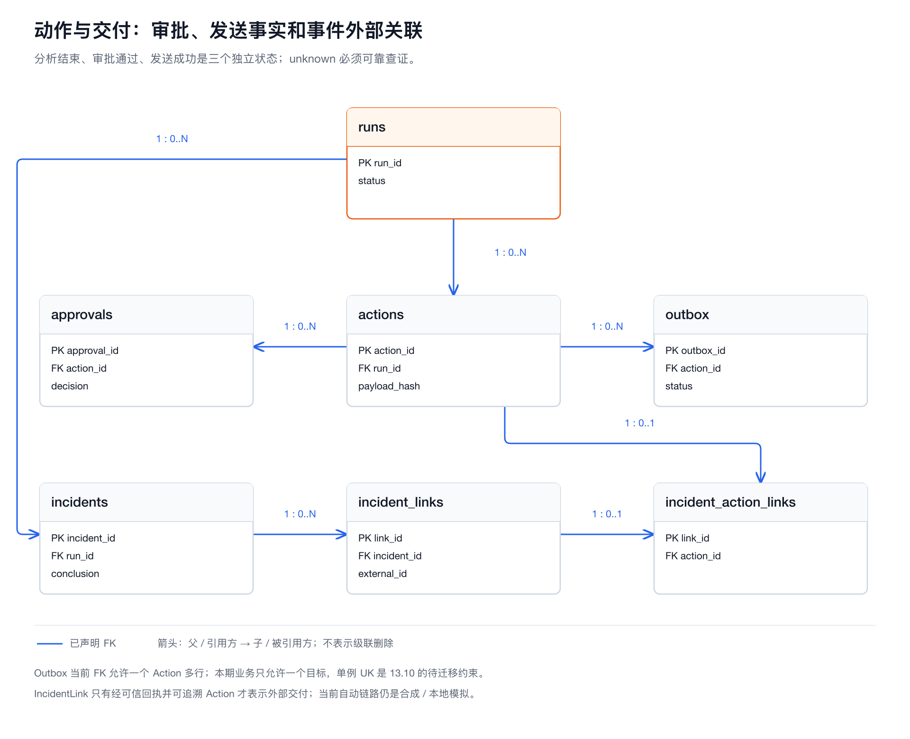

按当前 schema_agent_v3 重新生成的 Mermaid ER 图（仅列 PK/FK 列；省略所有指向 `teams` 的外键，且除 `teams` 自身外不列 team_id 列；来自其它分组的被引用表只列主键）：

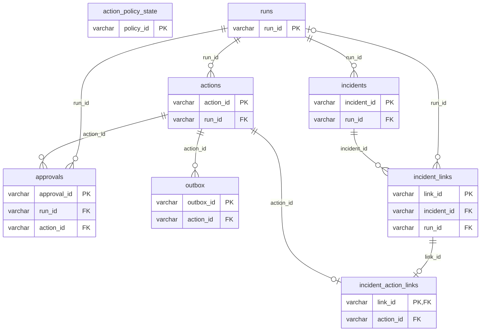

#### A.6.1 `actions`：外部逻辑动作

- 用途：外部逻辑动作。
- 语义说明（来自原文，已按 DDL 复核，业务规则以服务层为准）：tool_version 是 bindingID:version:hash 串；scope 实际是 QueryScope UUID 的 TEXT，非范围 JSON。payload_ref 含 binding/target/arguments；state 与投递状态分开。
- 引入/演进：首次出现于 schema_v1（0001_core）。

| 字段 | 类型 | 可空 | 默认 | 引入 | 说明 |
| --- | --- | --- | --- | --- | --- |
| `team_id` | `VARCHAR(36)` | 否 | — | v1 | 所属团队 UUID；租户隔离边界，不由模型或工具输出改写。 |
| `action_id` | `VARCHAR(36)` | 否 | — | v1 | 逻辑外部动作 UUID；也是提交给下游的稳定幂等身份。 |
| `run_id` | `VARCHAR(36)` | 否 | — | v1 | 关联 Run UUID；所有读写同时限定 team_id 并检查业务归属。 |
| `action_key` | `VARCHAR(128)` | 否 | — | v1 | 团队内唯一的业务逻辑动作键；不能按执行尝试重新随机生成。 |
| `tool_version` | `VARCHAR(128)` | 否 | — | v1 | 工具版本标识；调用台账与 Action 的实际编码不同，见本表说明。 |
| `payload_hash` | `VARCHAR(64)` | 否 | — | v1 | 规范化正文或动作参数的 SHA-256；动作算法见 13.8。 |
| `payload_ref` | `TEXT` | 否 | — | v1 | 持久正文 JSON，具体格式见本表；不是必然为对象存储引用。 |
| `scope` | `TEXT` | 否 | — | v1 | 模型范围/工具范围/动作 Scope，三者物理语义见本表说明。 |
| `state` | `VARCHAR(32)` | 否 | — | v1 | 逻辑动作状态，转换见第 14 节。 |
| `receipt` | `TEXT` | 是 | — | v1 | 可信回执 JSON；审批决定回执与外部业务发送回执不能混用。 |
| `revision` | `BIGINT` | 否 | `0` | v1 | 乐观并发版本，CAS 成功后递增；不等于内容发布序号。 |
| `created_at` | `BIGINT` | 否 | `0` | v1 | 创建时间，UTC 毫秒；DDL 默认 0，不代表有效时间 |
| `updated_at` | `BIGINT` | 否 | `0` | v1 | 最后变更时间，UTC 毫秒；DDL 默认 0，不代表有效时间 |

- 主键：`(action_id)`
- 唯一约束：`(team_id, action_id)`；`(team_id, action_key)`
- 外键：`(team_id, run_id) → (runs.team_id, runs.run_id)`，ON DELETE RESTRICT；`(team_id) → (teams.team_id)`，ON DELETE RESTRICT
- 显式索引：无（不含 PK/UNIQUE 隐式索引）

#### A.6.2 `approvals`：人工审批历史

- 用途：人工审批历史。
- 语义说明（来自原文，已按 DDL 复核，业务规则以服务层为准）：一个 Action 可有多次审批；decision=pending/approve/reject，receipt 为审批审计回执，不是业务成功。版本、目标、args_hash、策略、主体、期限全部绑定。
- 引入/演进：首次出现于 schema_v1（0001_core）。

| 字段 | 类型 | 可空 | 默认 | 引入 | 说明 |
| --- | --- | --- | --- | --- | --- |
| `team_id` | `VARCHAR(36)` | 否 | — | v1 | 所属团队 UUID；租户隔离边界，不由模型或工具输出改写。 |
| `approval_id` | `VARCHAR(36)` | 否 | — | v1 | 某一次审批 UUID；同一 Action 可保留多次审批历史。 |
| `run_id` | `VARCHAR(36)` | 否 | — | v1 | 关联 Run UUID；所有读写同时限定 team_id 并检查业务归属。 |
| `action_id` | `VARCHAR(36)` | 否 | — | v1 | 逻辑外部动作 UUID；也是提交给下游的稳定幂等身份。 |
| `tool_version` | `VARCHAR(128)` | 否 | — | v1 | 工具版本标识；调用台账与 Action 的实际编码不同，见本表说明。 |
| `target` | `TEXT` | 否 | — | v1 | 审批目标 JSON：server/credential_scope/tool_name。 |
| `args_hash` | `VARCHAR(64)` | 否 | — | v1 | 规范化参数摘要；审批表中严格等于 Action.payload_hash。 |
| `policy_hash` | `VARCHAR(64)` | 否 | — | v1 | 规范化授权策略的 SHA-256，发送/审批时重新核对。 |
| `subject` | `VARCHAR(128)` | 否 | — | v1 | 身份系统主体字符串，不要求为 UUID，不存认证 Token。 |
| `expires_at` | `BIGINT` | 否 | — | v1 | 到期 UTC 毫秒时间；到期不代表已经物理删除。 |
| `decision` | `VARCHAR(32)` | 否 | — | v1 | 审批/审计决定；准确取值和含义见本表说明。 |
| `receipt` | `TEXT` | 是 | — | v1 | 可信回执 JSON；审批决定回执与外部业务发送回执不能混用。 |
| `created_at` | `BIGINT` | 否 | `0` | v1 | 创建时间，UTC 毫秒；DDL 默认 0，不代表有效时间 |
| `updated_at` | `BIGINT` | 否 | `0` | v1 | 最后变更时间，UTC 毫秒；DDL 默认 0，不代表有效时间 |

- 主键：`(approval_id)`
- 唯一约束：`(team_id, approval_id)`
- 外键：`(team_id, action_id) → (actions.team_id, actions.action_id)`，ON DELETE RESTRICT；`(team_id) → (teams.team_id)`，ON DELETE RESTRICT；`(team_id, run_id) → (runs.team_id, runs.run_id)`，ON DELETE RESTRICT
- 显式索引：无（不含 PK/UNIQUE 隐式索引）

#### A.6.3 `outbox`：持久外部发送队列

- 用途：持久外部发送队列。
- 语义说明（来自原文，已按 DDL 复核，业务规则以服务层为准）：payload_ref 应与 Action 一致。先提交 sending 再 I/O；过期 sending 变 unknown，不自动重发。status=pending/sending/succeeded/unknown/dead；当前未声明 action_id 唯一性。
- 引入/演进：首次出现于 schema_v1（0001_core）。

| 字段 | 类型 | 可空 | 默认 | 引入 | 说明 |
| --- | --- | --- | --- | --- | --- |
| `team_id` | `VARCHAR(36)` | 否 | — | v1 | 所属团队 UUID；租户隔离边界，不由模型或工具输出改写。 |
| `outbox_id` | `VARCHAR(36)` | 否 | — | v1 | 外部动作发送记录 UUID。 |
| `action_id` | `VARCHAR(36)` | 否 | — | v1 | 逻辑外部动作 UUID；也是提交给下游的稳定幂等身份。 |
| `destination` | `VARCHAR(128)` | 否 | — | v1 | 部署注册的 sender/连接器键，不能是任意用户指定的 URL。 |
| `payload_ref` | `TEXT` | 否 | — | v1 | 持久正文 JSON，具体格式见本表；不是必然为对象存储引用。 |
| `status` | `VARCHAR(32)` | 否 | — | v1 | 状态字段；取值由领域服务约束，DDL 未声明 Enum/CHECK |
| `available_at` | `BIGINT` | 否 | — | v1 | 允许领取或重试的最早 UTC 毫秒时间。 |
| `attempt` | `BIGINT` | 否 | `0` | v1 | 实际执行/发送尝试计数；纯查询、幂等重放和投影修复不能凭空增加。 |
| `lease_owner` | `VARCHAR(128)` | 是 | — | v1 | 当前领取者身份，非持有期为空。 |
| `lease_until` | `BIGINT` | 是 | — | v1 | 领取到期 UTC 毫秒时间；与所有者和代数同时检查。 |
| `receipt_ref` | `TEXT` | 是 | — | v1 | 工具/Runner/Outbox 的可信回执 JSON，格式见本表说明及 13.8。 |
| `revision` | `BIGINT` | 否 | `0` | v1 | 乐观并发版本，CAS 成功后递增；不等于内容发布序号。 |
| `created_at` | `BIGINT` | 否 | `0` | v1 | 创建时间，UTC 毫秒；DDL 默认 0，不代表有效时间 |
| `updated_at` | `BIGINT` | 否 | `0` | v1 | 最后变更时间，UTC 毫秒；DDL 默认 0，不代表有效时间 |

- 主键：`(outbox_id)`
- 唯一约束：`(team_id, outbox_id)`
- 外键：`(team_id) → (teams.team_id)`，ON DELETE RESTRICT；`(team_id, action_id) → (actions.team_id, actions.action_id)`，ON DELETE RESTRICT
- 显式索引：`ix_outbox_claim`(status, available_at)

#### A.6.4 `action_policy_state`：部署动作策略单例

- 用途：部署动作策略单例。
- 语义说明（来自原文，已按 DDL 复核，业务规则以服务层为准）：系统级表无 team_id；policy_id 固定 deployment，策略内部逐项限定 team/agent/主体/工具/目标。CLI CAS 同步，Dispatcher 读取数据库权威版本。
- 引入/演进：首次出现于 schema_v12（0013_action_policy）。

| 字段 | 类型 | 可空 | 默认 | 引入 | 说明 |
| --- | --- | --- | --- | --- | --- |
| `policy_id` | `VARCHAR(16)` | 否 | — | v12 | 部署单例键，CHECK 固定为 deployment。 |
| `revision` | `BIGINT` | 否 | — | v12 | 乐观并发版本，CAS 成功后递增；不等于内容发布序号。 |
| `policy_hash` | `VARCHAR(64)` | 否 | — | v12 | 规范化授权策略的 SHA-256，发送/审批时重新核对。 |
| `policy_json` | `TEXT` | 否 | — | v12 | 完整部署策略 JSON；条目显式限定租户/Agent，不存凭据值。 |
| `updated_at` | `BIGINT` | 否 | — | v12 | 最后变更时间，UTC 毫秒 |

- 主键：`(policy_id)`
- 唯一约束：无
- 外键：无
- CHECK：`policy_id = 'deployment'`（ck_action_policy_state_action_policy_singleton）
- 显式索引：无（不含 PK/UNIQUE 隐式索引）

#### A.6.5 `incidents`：Duty Event

- 用途：Duty Event。
- 语义说明（来自原文，已按 DDL 复核，业务规则以服务层为准）：当前只投影 synthetic-alert-v2，conclusion={rule,status:alert_observed}、severity=unknown；字段存在不表示真实业务根因已验收。
- 引入/演进：首次出现于 schema_v1（0001_core）。

| 字段 | 类型 | 可空 | 默认 | 引入 | 说明 |
| --- | --- | --- | --- | --- | --- |
| `team_id` | `VARCHAR(36)` | 否 | — | v1 | 所属团队 UUID；租户隔离边界，不由模型或工具输出改写。 |
| `incident_id` | `VARCHAR(36)` | 否 | — | v1 | Duty Event 事件 UUID。 |
| `run_id` | `VARCHAR(36)` | 否 | — | v1 | 关联 Run UUID；所有读写同时限定 team_id 并检查业务归属。 |
| `source` | `VARCHAR(128)` | 否 | — | v1 | 证据/事件来源键，按来源协议解释。 |
| `service` | `VARCHAR(128)` | 否 | — | v1 | 业务服务标识。 |
| `conclusion` | `TEXT` | 否 | — | v1 | 事件结构化结论 JSON，不得把未验证模型自由文本直接当结论。 |
| `evidence` | `TEXT` | 否 | — | v1 | 事件证据关联 JSON；当前合成投影包含 scope_id/source_hash。 |
| `severity` | `VARCHAR(32)` | 否 | — | v1 | 事件严重程度；未确认时保持 unknown。 |
| `created_at` | `BIGINT` | 否 | `0` | v1 | 创建时间，UTC 毫秒；DDL 默认 0，不代表有效时间 |
| `updated_at` | `BIGINT` | 否 | `0` | v1 | 最后变更时间，UTC 毫秒；DDL 默认 0，不代表有效时间 |

- 主键：`(incident_id)`
- 唯一约束：`(team_id, incident_id)`
- 外键：`(team_id) → (teams.team_id)`，ON DELETE RESTRICT；`(team_id, run_id) → (runs.team_id, runs.run_id)`，ON DELETE RESTRICT
- 显式索引：`ix_incidents_service_time`(team_id, service, created_at)

#### A.6.6 `incident_links`：事件外部关联

- 用途：事件外部关联。
- 语义说明（来自原文，已按 DDL 复核，业务规则以服务层为准）：必须有可信外部回执才能登记已创建/已通知。proposed Action 不是外部单据；external_id 不能由模型编造。
- 引入/演进：首次出现于 schema_v1（0001_core）。

| 字段 | 类型 | 可空 | 默认 | 引入 | 说明 |
| --- | --- | --- | --- | --- | --- |
| `team_id` | `VARCHAR(36)` | 否 | — | v1 | 所属团队 UUID；租户隔离边界，不由模型或工具输出改写。 |
| `link_id` | `VARCHAR(36)` | 否 | — | v1 | 事件外部关联 UUID。 |
| `incident_id` | `VARCHAR(36)` | 否 | — | v1 | Duty Event 事件 UUID。 |
| `run_id` | `VARCHAR(36)` | 是 | — | v1 | 关联 Run UUID；所有读写同时限定 team_id 并检查业务归属。 |
| `external_system` | `VARCHAR(128)` | 否 | — | v1 | 外部系统/连接器标识。 |
| `external_id` | `VARCHAR(128)` | 否 | — | v1 | 由下游可信回执确认的工单、跟进或通知标识。 |
| `created_at` | `BIGINT` | 否 | `0` | v1 | 创建时间，UTC 毫秒；DDL 默认 0，不代表有效时间 |
| `updated_at` | `BIGINT` | 否 | `0` | v1 | 最后变更时间，UTC 毫秒；DDL 默认 0，不代表有效时间 |

- 主键：`(link_id)`
- 唯一约束：`(incident_id, external_system, external_id)`；`(team_id, link_id)`
- 外键：`(team_id) → (teams.team_id)`，ON DELETE RESTRICT；`(team_id, incident_id) → (incidents.team_id, incidents.incident_id)`，ON DELETE RESTRICT；`(team_id, run_id) → (runs.team_id, runs.run_id)`，ON DELETE RESTRICT
- 显式索引：无（不含 PK/UNIQUE 隐式索引）

#### A.6.7 `incident_action_links`：关联回执来源证明

- 用途：关联回执来源证明。
- 语义说明（来自原文，已按 DDL 复核，业务规则以服务层为准）：link_id 是 PK，team_id/action_id 唯一；证明某外部关联由该 Action 产生。Incident/Action/Run 同属关系还需服务校验。
- 引入/演进：首次出现于 schema_v17（0018_incident_action_links）。

| 字段 | 类型 | 可空 | 默认 | 引入 | 说明 |
| --- | --- | --- | --- | --- | --- |
| `team_id` | `VARCHAR(36)` | 否 | — | v17 | 所属团队 UUID；租户隔离边界，不由模型或工具输出改写。 |
| `link_id` | `VARCHAR(36)` | 否 | — | v17 | 事件外部关联 UUID。 |
| `action_id` | `VARCHAR(36)` | 否 | — | v17 | 逻辑外部动作 UUID；也是提交给下游的稳定幂等身份。 |

- 主键：`(link_id)`
- 唯一约束：`(team_id, action_id)`；`(team_id, link_id)`
- 外键：`(team_id, action_id) → (actions.team_id, actions.action_id)`，ON DELETE RESTRICT；`(team_id, link_id) → (incident_links.team_id, incident_links.link_id)`，ON DELETE RESTRICT
- 显式索引：无（不含 PK/UNIQUE 隐式索引）

### A.7 调度与巡检

本组 3 张表：`schedules`、`schedule_fires`、`schedule_manual_fires`。

现有 ER 图（历史快照，命名可能仍为 workspace，见核对记录）：

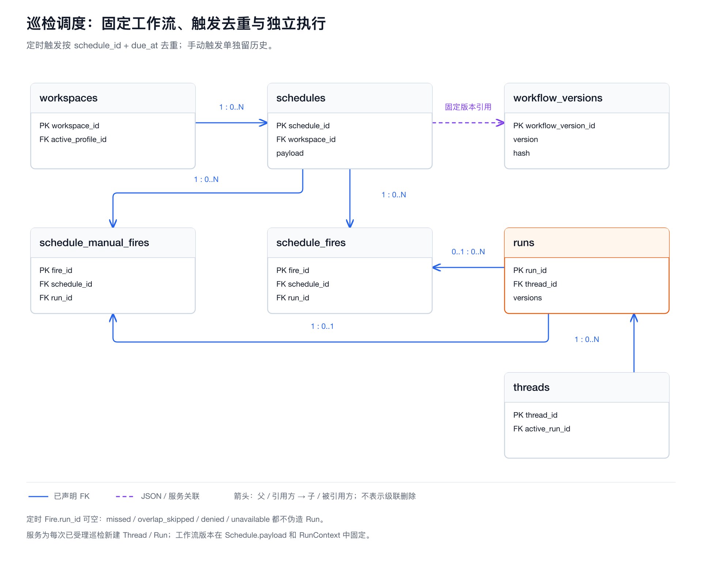

按当前 schema_agent_v3 重新生成的 Mermaid ER 图（仅列 PK/FK 列；省略所有指向 `teams` 的外键，且除 `teams` 自身外不列 team_id 列；来自其它分组的被引用表只列主键）：

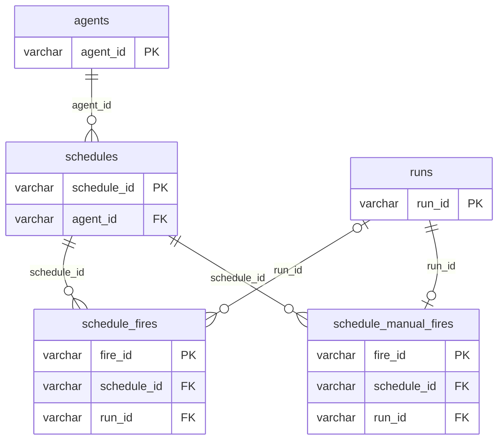

#### A.7.1 `schedules`：巡检配置

- 用途：巡检配置。
- 语义说明（来自原文，已按 DDL 复核，业务规则以服务层为准）：status=active/paused，当前 overlap_policy 仅 forbid；payload 固定 Workflow 版本/hash，但运行仍重验当前授权。next_due_at 和触发写入使用 revision CAS。
- 引入/演进：首次出现于 schema_v1（0001_core）。
- Agent 基线重命名：历史快照中的 `workspace_id` 列在 schema_agent_v1 中为 `agent_id`。

| 字段 | 类型 | 可空 | 默认 | 引入 | 说明 |
| --- | --- | --- | --- | --- | --- |
| `team_id` | `VARCHAR(36)` | 否 | — | v1 | 所属团队 UUID；租户隔离边界，不由模型或工具输出改写。 |
| `schedule_id` | `VARCHAR(36)` | 否 | — | v1 | 所属定时配置 UUID。 |
| `agent_id` | `VARCHAR(36)` | 否 | — | v1 | 所属 Agent UUID；关联须同时校验团队和资源作用域。 |
| `cron` | `VARCHAR(128)` | 否 | — | v1 | 已校验 cron 表达式。 |
| `timezone` | `VARCHAR(128)` | 否 | — | v1 | IANA 时区；所有标量 due_at 仍统一存 UTC 毫秒。 |
| `overlap_policy` | `VARCHAR(32)` | 否 | `'forbid'` | v1 | 调度重叠策略，当前仅支持 forbid。 |
| `next_due_at` | `BIGINT` | 是 | — | v1 | 下一次业务触发的 UTC 毫秒时间。 |
| `status` | `VARCHAR(32)` | 否 | — | v1 | 状态字段；取值由领域服务约束，DDL 未声明 Enum/CHECK |
| `payload` | `TEXT` | 否 | — | v1 | 版本化正文；具体格式和可信边界见本表说明及 13.8。 |
| `revision` | `BIGINT` | 否 | `0` | v1 | 乐观并发版本，CAS 成功后递增；不等于内容发布序号。 |
| `created_at` | `BIGINT` | 否 | `0` | v1 | 创建时间，UTC 毫秒；DDL 默认 0，不代表有效时间 |
| `updated_at` | `BIGINT` | 否 | `0` | v1 | 最后变更时间，UTC 毫秒；DDL 默认 0，不代表有效时间 |

- 主键：`(schedule_id)`
- 唯一约束：`(team_id, schedule_id)`
- 外键：`(team_id) → (teams.team_id)`，ON DELETE RESTRICT；`(team_id, agent_id) → (agents.team_id, agents.agent_id)`，ON DELETE RESTRICT
- 显式索引：无（不含 PK/UNIQUE 隐式索引）

#### A.7.2 `schedule_fires`：定时触发历史与去重

- 用途：定时触发历史与去重。
- 语义说明（来自原文，已按 DDL 复核，业务规则以服务层为准）：schedule_id/due_at 唯一，run_id 仅在真实受理后填写；当前状态为 started/missed/overlap_skipped/denied/unavailable，分别记录受理、错过、重叠跳过、拒绝和不可用。
- 引入/演进：首次出现于 schema_v1（0001_core）。

| 字段 | 类型 | 可空 | 默认 | 引入 | 说明 |
| --- | --- | --- | --- | --- | --- |
| `team_id` | `VARCHAR(36)` | 否 | — | v1 | 所属团队 UUID；租户隔离边界，不由模型或工具输出改写。 |
| `fire_id` | `VARCHAR(36)` | 否 | — | v1 | 一次定时或手动触发记录 UUID。 |
| `schedule_id` | `VARCHAR(36)` | 否 | — | v1 | 所属定时配置 UUID。 |
| `due_at` | `BIGINT` | 否 | — | v1 | 本次确定的 UTC 毫秒业务触发锚点，不是扫描时间。 |
| `run_id` | `VARCHAR(36)` | 是 | — | v1 | 关联 Run UUID；所有读写同时限定 team_id 并检查业务归属。 |
| `status` | `VARCHAR(32)` | 否 | — | v1 | 状态字段；取值由领域服务约束，DDL 未声明 Enum/CHECK |
| `created_at` | `BIGINT` | 否 | `0` | v1 | 创建时间，UTC 毫秒；DDL 默认 0，不代表有效时间 |
| `updated_at` | `BIGINT` | 否 | `0` | v1 | 最后变更时间，UTC 毫秒；DDL 默认 0，不代表有效时间 |

- 主键：`(fire_id)`
- 唯一约束：`(schedule_id, due_at)`；`(team_id, fire_id)`
- 外键：`(team_id, run_id) → (runs.team_id, runs.run_id)`，ON DELETE RESTRICT；`(team_id) → (teams.team_id)`，ON DELETE RESTRICT；`(team_id, schedule_id) → (schedules.team_id, schedules.schedule_id)`，ON DELETE RESTRICT
- 显式索引：无（不含 PK/UNIQUE 隐式索引）

#### A.7.3 `schedule_manual_fires`：手动触发历史

- 用途：手动触发历史。
- 语义说明（来自原文，已按 DDL 复核，业务规则以服务层为准）：独立记录 actor，不伪造定时 due_at；同团队 Run 只能关联一次手动触发。
- 引入/演进：首次出现于 schema_v11（0012_schedule_manual_fires）。

| 字段 | 类型 | 可空 | 默认 | 引入 | 说明 |
| --- | --- | --- | --- | --- | --- |
| `team_id` | `VARCHAR(36)` | 否 | — | v11 | 所属团队 UUID；租户隔离边界，不由模型或工具输出改写。 |
| `fire_id` | `VARCHAR(36)` | 否 | — | v11 | 一次定时或手动触发记录 UUID。 |
| `schedule_id` | `VARCHAR(36)` | 否 | — | v11 | 所属定时配置 UUID。 |
| `run_id` | `VARCHAR(36)` | 否 | — | v11 | 关联 Run UUID；所有读写同时限定 team_id 并检查业务归属。 |
| `actor` | `VARCHAR(128)` | 否 | — | v11 | 经过身份验证的操作主体，不存认证 Token。 |
| `created_at` | `BIGINT` | 否 | — | v11 | 创建时间，UTC 毫秒 |

- 主键：`(fire_id)`
- 唯一约束：`(team_id, fire_id)`；`(team_id, run_id)`
- 外键：`(team_id, schedule_id) → (schedules.team_id, schedules.schedule_id)`，ON DELETE RESTRICT；`(team_id, run_id) → (runs.team_id, runs.run_id)`，ON DELETE RESTRICT
- 显式索引：无（不含 PK/UNIQUE 隐式索引）

### A.8 Skill 与共享库

本组 3 张表：`skills`、`skill_versions`、`skill_drafts`。

按当前 schema_agent_v3 重新生成的 Mermaid ER 图（仅列 PK/FK 列；省略所有指向 `teams` 的外键，且除 `teams` 自身外不列 team_id 列；来自其它分组的被引用表只列主键）：

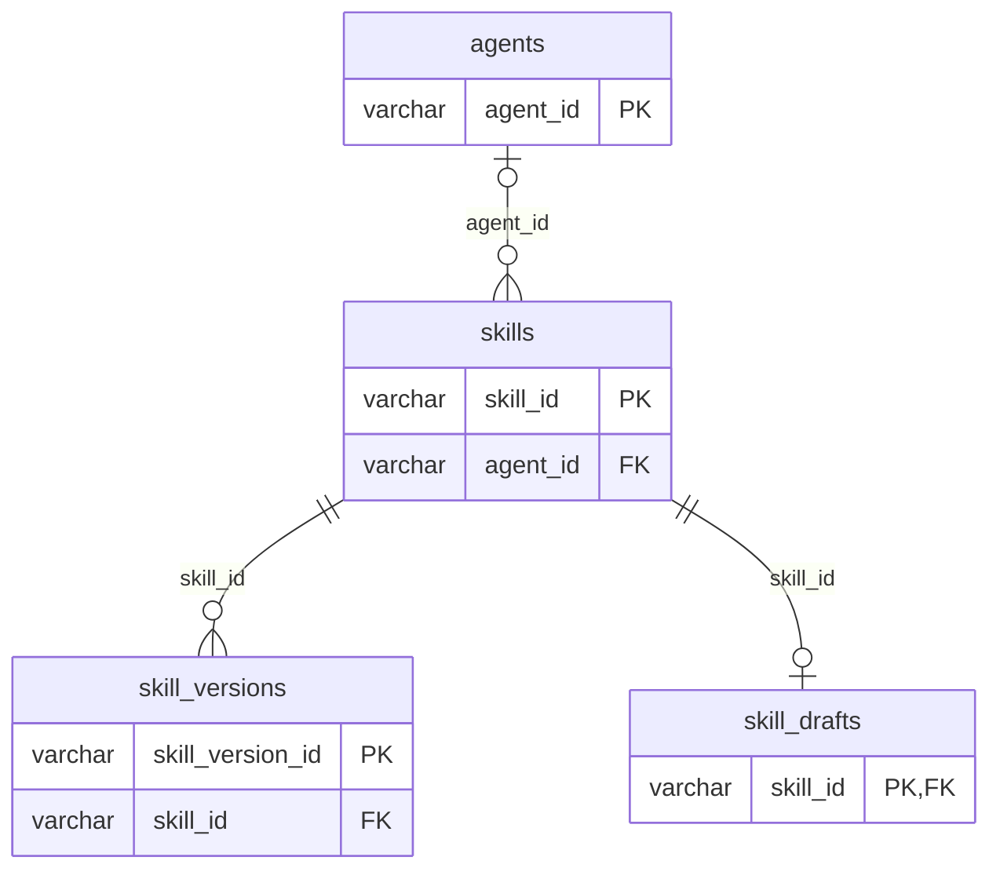

#### A.8.1 `skills`：Skill 管理身份

- 用途：Skill 管理身份。
- 语义说明（来自原文，已按 DDL 复核，业务规则以服务层为准）：agent_id=NULL 表示团队共享；非空时限对应 Agent。skills 表本身未声明名称唯一性；共享编辑库由第 13.2.60 节的 skill_drafts 约束团队内名称唯一。管理状态与发布版本状态分离。
- 引入/演进：首次出现于 schema_v1（0001_core）。
- Agent 基线重命名：历史快照中的 `workspace_id` 列在 schema_agent_v1 中为 `agent_id`。

| 字段 | 类型 | 可空 | 默认 | 引入 | 说明 |
| --- | --- | --- | --- | --- | --- |
| `team_id` | `VARCHAR(36)` | 否 | — | v1 | 所属团队 UUID；租户隔离边界，不由模型或工具输出改写。 |
| `skill_id` | `VARCHAR(36)` | 否 | — | v1 | Skill 管理身份 UUID。 |
| `agent_id` | `VARCHAR(36)` | 是 | — | v1 | 所属 Agent UUID；关联须同时校验团队和资源作用域。 |
| `name` | `VARCHAR(128)` | 否 | — | v1 | 资源名称；唯一性只以本表实际 UK 为准。 |
| `description` | `TEXT` | 是 | — | v1 | Skill 目录级说明，不等于完整 SKILL.md。 |
| `status` | `VARCHAR(32)` | 否 | — | v1 | 状态字段；取值由领域服务约束，DDL 未声明 Enum/CHECK |
| `revision` | `BIGINT` | 否 | `0` | v1 | 乐观并发版本，CAS 成功后递增；不等于内容发布序号。 |
| `created_at` | `BIGINT` | 否 | `0` | v1 | 创建时间，UTC 毫秒；DDL 默认 0，不代表有效时间 |
| `updated_at` | `BIGINT` | 否 | `0` | v1 | 最后变更时间，UTC 毫秒；DDL 默认 0，不代表有效时间 |

- 主键：`(skill_id)`
- 唯一约束：`(team_id, skill_id)`
- 外键：`(team_id) → (teams.team_id)`，ON DELETE RESTRICT；`(team_id, agent_id) → (agents.team_id, agents.agent_id)`，ON DELETE RESTRICT
- 显式索引：无（不含 PK/UNIQUE 隐式索引）

#### A.8.2 `skill_versions`：不可变 Skill 版本

- 用途：不可变 Skill 版本。
- 语义说明（来自原文，已按 DDL 复核，业务规则以服务层为准）：运行只允许 published。bundle_ref 支持 skill-manifest-v1:sha256:<摘要> 和历史包；hash 按导入格式解释，不能替换成单个资源摘要。
- 引入/演进：首次出现于 schema_v1（0001_core）。

| 字段 | 类型 | 可空 | 默认 | 引入 | 说明 |
| --- | --- | --- | --- | --- | --- |
| `team_id` | `VARCHAR(36)` | 否 | — | v1 | 所属团队 UUID；租户隔离边界，不由模型或工具输出改写。 |
| `skill_version_id` | `VARCHAR(36)` | 否 | — | v1 | 不可变 Skill 发布版本 UUID。 |
| `skill_id` | `VARCHAR(36)` | 否 | — | v1 | Skill 管理身份 UUID。 |
| `version` | `BIGINT` | 否 | — | v1 | 资源内不可变内容发布序号；不与 CAS revision 混用。 |
| `hash` | `VARCHAR(64)` | 否 | — | v1 | 规范化版本内容的 SHA-256，小写十六进制；使用时核对内容。 |
| `bundle_ref` | `TEXT` | 否 | — | v1 | 内容寻址 Skill 清单或受支持历史 ZIP 引用。 |
| `status` | `VARCHAR(32)` | 否 | — | v1 | 状态字段；取值由领域服务约束，DDL 未声明 Enum/CHECK |
| `created_at` | `BIGINT` | 否 | `0` | v1 | 创建时间，UTC 毫秒；DDL 默认 0，不代表有效时间 |
| `updated_at` | `BIGINT` | 否 | `0` | v1 | 最后变更时间，UTC 毫秒；DDL 默认 0，不代表有效时间 |

- 主键：`(skill_version_id)`
- 唯一约束：`(skill_id, version)`；`(team_id, skill_version_id)`
- 外键：`(team_id, skill_id) → (skills.team_id, skills.skill_id)`，ON DELETE RESTRICT；`(team_id) → (teams.team_id)`，ON DELETE RESTRICT
- 显式索引：无（不含 PK/UNIQUE 隐式索引）

#### A.8.3 `skill_drafts`：团队共享技能草稿

- 用途：团队共享技能草稿。
- 语义说明（来自原文，已按 DDL 复核，业务规则以服务层为准）：由 `0002_shared_skills` 增量迁移新增，不改写既有私有 Skill。草稿与发布版本分离，CAS 复用所属 skills 行的 revision，不另设独立草稿 revision。
- 引入/演进：Agent 库新增（schema_agent_v2 / 0002_shared_skills）。

| 字段 | 类型 | 可空 | 默认 | 引入 | 说明 |
| --- | --- | --- | --- | --- | --- |
| `skill_id` | `VARCHAR(36)` | 否 | — | agent_v2 | 所属 Skill UUID，也是草稿主键。 |
| `team_id` | `VARCHAR(36)` | 否 | — | agent_v2 | 所属团队 UUID。 |
| `name` | `VARCHAR(128)` | 否 | — | agent_v2 | 团队内唯一、创建后稳定的技能名称。 |
| `description` | `TEXT` | 否 | — | agent_v2 | 可编辑描述。 |
| `content` | `TEXT` | 否 | — | agent_v2 | 可编辑 Markdown 指令正文。 |
| `created_at` | `BIGINT` | 否 | — | agent_v2 | 创建时间，UTC 毫秒 |
| `updated_at` | `BIGINT` | 否 | — | agent_v2 | 最后变更时间，UTC 毫秒 |

- 主键：`(skill_id)`
- 唯一约束：`(team_id, name)`
- 外键：`(team_id, skill_id) → (skills.team_id, skills.skill_id)`，ON DELETE RESTRICT
- 显式索引：无（不含 PK/UNIQUE 隐式索引）

### A.9 其它：反馈、幂等、审计、管理任务、合成验证与协议元数据

本组 15 张表：`feedback`、`knowledge_gaps`、`idempotency_records`、`team_idempotency_records`、`source_events`、`audit_logs`、`admin_jobs`、`admin_job_events`、`synthetic_alert_sources`、`synthetic_result_bindings`、`synthetic_source_policy`、`synthetic_proposal_policy`、`synthetic_batch_policy`、`synthetic_action_policy_bindings`、`dod_storage_metadata`。

按当前 schema_agent_v3 重新生成的 Mermaid ER 图（仅列 PK/FK 列；省略所有指向 `teams` 的外键，且除 `teams` 自身外不列 team_id 列；来自其它分组的被引用表只列主键）：

```mermaid
erDiagram
  feedback {
    varchar feedback_id PK
    varchar run_id FK
  }
  knowledge_gaps {
    varchar gap_id PK
    varchar run_id FK
  }
  idempotency_records {
    varchar record_id PK
    varchar agent_id FK
  }
  team_idempotency_records {
    varchar record_id PK
  }
  source_events {
    varchar source_event_id PK
  }
  audit_logs {
    varchar audit_id PK
  }
  admin_jobs {
    varchar job_id PK
    varchar agent_id FK
  }
  admin_job_events {
    varchar job_id PK,FK
    bigint seq PK
  }
  synthetic_alert_sources {
    varchar run_id PK,FK
  }
  synthetic_result_bindings {
    varchar run_id PK,FK
  }
  synthetic_source_policy {
    varchar policy_id PK
  }
  synthetic_proposal_policy {
    varchar policy_id PK
  }
  synthetic_batch_policy {
    varchar policy_id PK
  }
  synthetic_action_policy_bindings {
    varchar action_id PK,FK
  }
  dod_storage_metadata
  runs {
    varchar run_id PK
  }
  agents {
    varchar agent_id PK
  }
  actions {
    varchar action_id PK
  }
  runs ||--o{ feedback : "run_id"
  runs ||--o{ knowledge_gaps : "run_id"
  agents ||--o{ idempotency_records : "agent_id"
  agents ||--o{ admin_jobs : "agent_id"
  admin_jobs ||--o{ admin_job_events : "job_id"
  runs ||--o| synthetic_alert_sources : "run_id"
  runs ||--o| synthetic_result_bindings : "run_id"
  actions ||--o| synthetic_action_policy_bindings : "action_id"
```

#### A.9.1 `feedback`：用户反馈

- 用途：用户反馈。
- 语义说明（来自原文，已按 DDL 复核，业务规则以服务层为准）：当前 problem_type=user_feedback，payload 含 subject/rating/comment；追加后独立于主回答和观测系统，外部评估失败不丢本地反馈。
- 引入/演进：首次出现于 schema_v1（0001_core）。

| 字段 | 类型 | 可空 | 默认 | 引入 | 说明 |
| --- | --- | --- | --- | --- | --- |
| `team_id` | `VARCHAR(36)` | 否 | — | v1 | 所属团队 UUID；租户隔离边界，不由模型或工具输出改写。 |
| `feedback_id` | `VARCHAR(36)` | 否 | — | v1 | 用户反馈记录 UUID。 |
| `run_id` | `VARCHAR(36)` | 否 | — | v1 | 关联 Run UUID；所有读写同时限定 team_id 并检查业务归属。 |
| `source_trace` | `TEXT` | 否 | — | v1 | 来源轨迹 JSON；至少关联 Run，知识问题还需关联真实调用/证据。 |
| `problem_type` | `VARCHAR(32)` | 否 | — | v1 | 反馈或知识问题分类；工具不可用不能直接记为知识缺失。 |
| `review_status` | `VARCHAR(32)` | 否 | — | v1 | 人工审核状态；pending 不能当作已审核知识或质量真值。 |
| `payload` | `TEXT` | 否 | — | v1 | 版本化正文；具体格式和可信边界见本表说明及 13.8。 |
| `created_at` | `BIGINT` | 否 | `0` | v1 | 创建时间，UTC 毫秒；DDL 默认 0，不代表有效时间 |
| `updated_at` | `BIGINT` | 否 | `0` | v1 | 最后变更时间，UTC 毫秒；DDL 默认 0，不代表有效时间 |

- 主键：`(feedback_id)`
- 唯一约束：`(team_id, feedback_id)`
- 外键：`(team_id) → (teams.team_id)`，ON DELETE RESTRICT；`(team_id, run_id) → (runs.team_id, runs.run_id)`，ON DELETE RESTRICT
- 显式索引：无（不含 PK/UNIQUE 隐式索引）

#### A.9.2 `knowledge_gaps`：知识缺口候选

- 用途：知识缺口候选。
- 语义说明（来自原文，已按 DDL 复核，业务规则以服务层为准）：表已定义，不能据此宣称检索评估闭环已完成。source_trace 必须对应真实检索，区分未命中/冲突/过期/不可用；发布前审核。
- 引入/演进：首次出现于 schema_v1（0001_core）。

| 字段 | 类型 | 可空 | 默认 | 引入 | 说明 |
| --- | --- | --- | --- | --- | --- |
| `team_id` | `VARCHAR(36)` | 否 | — | v1 | 所属团队 UUID；租户隔离边界，不由模型或工具输出改写。 |
| `gap_id` | `VARCHAR(36)` | 否 | — | v1 | 待审核知识缺口记录 UUID。 |
| `run_id` | `VARCHAR(36)` | 否 | — | v1 | 关联 Run UUID；所有读写同时限定 team_id 并检查业务归属。 |
| `source_trace` | `TEXT` | 否 | — | v1 | 来源轨迹 JSON；至少关联 Run，知识问题还需关联真实调用/证据。 |
| `problem_type` | `VARCHAR(32)` | 否 | — | v1 | 反馈或知识问题分类；工具不可用不能直接记为知识缺失。 |
| `review_status` | `VARCHAR(32)` | 否 | — | v1 | 人工审核状态；pending 不能当作已审核知识或质量真值。 |
| `summary` | `TEXT` | 否 | — | v1 | 证据简述/摘要或知识问题描述；不保证是完整可读原文。 |
| `created_at` | `BIGINT` | 否 | `0` | v1 | 创建时间，UTC 毫秒；DDL 默认 0，不代表有效时间 |
| `updated_at` | `BIGINT` | 否 | `0` | v1 | 最后变更时间，UTC 毫秒；DDL 默认 0，不代表有效时间 |

- 主键：`(gap_id)`
- 唯一约束：`(team_id, gap_id)`
- 外键：`(team_id, run_id) → (runs.team_id, runs.run_id)`，ON DELETE RESTRICT；`(team_id) → (teams.team_id)`，ON DELETE RESTRICT
- 显式索引：无（不含 PK/UNIQUE 隐式索引）

#### A.9.3 `idempotency_records`：Agent 幂等回执

- 用途：Agent 幂等回执。
- 语义说明（来自原文，已按 DDL 复核，业务规则以服务层为准）：作用域为 team/subject/agent/route/key；同键不同 request_hash 冲突。业务记录、HTTP 响应体及状态码同事务提交。
- 引入/演进：首次出现于 schema_v1（0001_core）。
- Agent 基线重命名：历史快照中的 `workspace_id` 列在 schema_agent_v1 中为 `agent_id`。

| 字段 | 类型 | 可空 | 默认 | 引入 | 说明 |
| --- | --- | --- | --- | --- | --- |
| `team_id` | `VARCHAR(36)` | 否 | — | v1 | 所属团队 UUID；租户隔离边界，不由模型或工具输出改写。 |
| `record_id` | `VARCHAR(36)` | 否 | — | v1 | 幂等响应或用量结算记录 UUID。 |
| `agent_id` | `VARCHAR(36)` | 否 | — | v1 | 所属 Agent UUID；关联须同时校验团队和资源作用域。 |
| `subject` | `VARCHAR(128)` | 否 | — | v1 | 身份系统主体字符串，不要求为 UUID，不存认证 Token。 |
| `route` | `VARCHAR(128)` | 否 | — | v1 | 规范化幂等操作键，可为领域操作名，不必等于请求 URL。 |
| `key` | `VARCHAR(128)` | 否 | — | v1 | 调用方幂等键，不是数据库主键。 |
| `request_hash` | `VARCHAR(64)` | 否 | — | v1 | 规范化请求 SHA-256；同一幂等身份出现不同摘要必须冲突。 |
| `response_ref` | `TEXT` | 否 | — | v1 | 原提交响应或回复映射的规范化 JSON，不是任意缓存地址。 |
| `status_code` | `BIGINT` | 否 | — | v1 | 原幂等响应的 HTTP 状态码。 |
| `expires_at` | `BIGINT` | 否 | — | v1 | 到期 UTC 毫秒时间；到期不代表已经物理删除。 |
| `created_at` | `BIGINT` | 否 | `0` | v1 | 创建时间，UTC 毫秒；DDL 默认 0，不代表有效时间 |
| `updated_at` | `BIGINT` | 否 | `0` | v1 | 最后变更时间，UTC 毫秒；DDL 默认 0，不代表有效时间 |

- 主键：`(record_id)`
- 唯一约束：`(team_id, record_id)`；`(team_id, subject, agent_id, route, key)`
- 外键：`(team_id, agent_id) → (agents.team_id, agents.agent_id)`，ON DELETE RESTRICT；`(team_id) → (teams.team_id)`，ON DELETE RESTRICT
- 显式索引：`ix_idempotency_expiry`(expires_at)

#### A.9.4 `team_idempotency_records`：团队级幂等回执

- 用途：团队级幂等回执。
- 语义说明（来自原文，已按 DDL 复核，业务规则以服务层为准）：作用域不含 Agent，用于团队/成员管理及创建 Agent；不能借用已有默认 Agent 的幂等范围，也不能与 Agent 幂等回执表混用。Agent 创建与团队级原始响应回执在同事务保存；重放仍检查当前成员、角色及 agent_scope，不能借旧回执绕过当前范围限制。
- 引入/演进：首次出现于 schema_v2（0002_team_receipts）。

| 字段 | 类型 | 可空 | 默认 | 引入 | 说明 |
| --- | --- | --- | --- | --- | --- |
| `team_id` | `VARCHAR(36)` | 否 | — | v2 | 所属团队 UUID；租户隔离边界，不由模型或工具输出改写。 |
| `record_id` | `VARCHAR(36)` | 否 | — | v2 | 幂等响应或用量结算记录 UUID。 |
| `subject` | `VARCHAR(128)` | 否 | — | v2 | 身份系统主体字符串，不要求为 UUID，不存认证 Token。 |
| `route` | `VARCHAR(128)` | 否 | — | v2 | 规范化幂等操作键，可为领域操作名，不必等于请求 URL。 |
| `key` | `VARCHAR(128)` | 否 | — | v2 | 调用方幂等键，不是数据库主键。 |
| `request_hash` | `VARCHAR(64)` | 否 | — | v2 | 规范化请求 SHA-256；同一幂等身份出现不同摘要必须冲突。 |
| `response_ref` | `TEXT` | 否 | — | v2 | 原提交响应或回复映射的规范化 JSON，不是任意缓存地址。 |
| `status_code` | `BIGINT` | 否 | — | v2 | 原幂等响应的 HTTP 状态码。 |
| `expires_at` | `BIGINT` | 否 | — | v2 | 到期 UTC 毫秒时间；到期不代表已经物理删除。 |
| `created_at` | `BIGINT` | 否 | `0` | v2 | 创建时间，UTC 毫秒；DDL 默认 0，不代表有效时间 |
| `updated_at` | `BIGINT` | 否 | `0` | v2 | 最后变更时间，UTC 毫秒；DDL 默认 0，不代表有效时间 |

- 主键：`(record_id)`
- 唯一约束：`(team_id, record_id)`；`(team_id, subject, route, key)`
- 外键：`(team_id) → (teams.team_id)`，ON DELETE RESTRICT
- 显式索引：`ix_team_idempotency_expiry`(expires_at)

#### A.9.5 `source_events`：入口事件去重和回复关联

- 用途：入口事件去重和回复关联。
- 语义说明（来自原文，已按 DDL 复核，业务规则以服务层为准）：同 team/connector/external_event 唯一，response_ref 可存 Run/Thread 受理或回复映射。当前没有独立 run_id/thread_id/engine 列，不能独自完成跨引擎切流。
- 引入/演进：首次出现于 schema_v1（0001_core）。

| 字段 | 类型 | 可空 | 默认 | 引入 | 说明 |
| --- | --- | --- | --- | --- | --- |
| `team_id` | `VARCHAR(36)` | 否 | — | v1 | 所属团队 UUID；租户隔离边界，不由模型或工具输出改写。 |
| `source_event_id` | `VARCHAR(36)` | 否 | — | v1 | 本地入口事件记录 UUID，不是外部事件 ID。 |
| `connector_id` | `VARCHAR(128)` | 否 | — | v1 | 部署注册的来源连接器键。 |
| `external_event_id` | `VARCHAR(128)` | 否 | — | v1 | 外部事件标识，须包含来源协议规定的去重作用域。 |
| `request_hash` | `VARCHAR(64)` | 否 | — | v1 | 规范化请求 SHA-256；同一幂等身份出现不同摘要必须冲突。 |
| `response_ref` | `TEXT` | 是 | — | v1 | 原提交响应或回复映射的规范化 JSON，不是任意缓存地址。 |
| `expires_at` | `BIGINT` | 否 | — | v1 | 到期 UTC 毫秒时间；到期不代表已经物理删除。 |
| `created_at` | `BIGINT` | 否 | `0` | v1 | 创建时间，UTC 毫秒；DDL 默认 0，不代表有效时间 |
| `updated_at` | `BIGINT` | 否 | `0` | v1 | 最后变更时间，UTC 毫秒；DDL 默认 0，不代表有效时间 |

- 主键：`(source_event_id)`
- 唯一约束：`(team_id, connector_id, external_event_id)`；`(team_id, source_event_id)`
- 外键：`(team_id) → (teams.team_id)`，ON DELETE RESTRICT
- 显式索引：无（不含 PK/UNIQUE 隐式索引）

#### A.9.6 `audit_logs`：追加审计

- 用途：追加审计。
- 语义说明（来自原文，已按 DDL 复核，业务规则以服务层为准）：业务 Store 不提供修改已发布审计行；不是数据库触发器级不可篡改保证。decision 保存 allowed/denied 或固定执行结果，trace 仅脱敏关联。
- 引入/演进：首次出现于 schema_v1（0001_core）。

| 字段 | 类型 | 可空 | 默认 | 引入 | 说明 |
| --- | --- | --- | --- | --- | --- |
| `team_id` | `VARCHAR(36)` | 否 | — | v1 | 所属团队 UUID；租户隔离边界，不由模型或工具输出改写。 |
| `audit_id` | `VARCHAR(36)` | 否 | — | v1 | 审计记录 UUID。 |
| `actor` | `VARCHAR(128)` | 否 | — | v1 | 经过身份验证的操作主体，不存认证 Token。 |
| `object` | `TEXT` | 否 | — | v1 | 审计目标资源 ID 或规范化对象描述。 |
| `operation` | `VARCHAR(128)` | 否 | — | v1 | 稳定审计操作名，如 action.propose。 |
| `decision` | `VARCHAR(128)` | 否 | — | v1 | 审批/审计决定；准确取值和含义见本表说明。 |
| `trace` | `TEXT` | 否 | — | v1 | 脱敏审计关联 JSON，禁止凭据和模型内部思考。 |
| `created_at` | `BIGINT` | 否 | `0` | v1 | 创建时间，UTC 毫秒；DDL 默认 0，不代表有效时间 |
| `updated_at` | `BIGINT` | 否 | `0` | v1 | 最后变更时间，UTC 毫秒；DDL 默认 0，不代表有效时间 |

- 主键：`(audit_id)`
- 唯一约束：`(team_id, audit_id)`
- 外键：`(team_id) → (teams.team_id)`，ON DELETE RESTRICT
- 显式索引：`ix_audit_time`(team_id, created_at)

#### A.9.7 `admin_jobs`：持久管理任务

- 用途：持久管理任务。
- 语义说明（来自原文，已按 DDL 复核，业务规则以服务层为准）：kind 为 model_probe/tool_probe/repo_sync/skill_import/artifact_upload 等。payload 按类型验证，result_ref 保存结果；与 Run Job 分开领取和授权，guard_revision 独立 fencing。
- 引入/演进：首次出现于 schema_v1（0001_core）。
- Agent 基线重命名：历史快照中的 `workspace_id` 列在 schema_agent_v1 中为 `agent_id`。

| 字段 | 类型 | 可空 | 默认 | 引入 | 说明 |
| --- | --- | --- | --- | --- | --- |
| `team_id` | `VARCHAR(36)` | 否 | — | v1 | 所属团队 UUID；租户隔离边界，不由模型或工具输出改写。 |
| `job_id` | `VARCHAR(36)` | 否 | — | v1 | 本表所属或关联的 Job UUID；管理任务与 Run Job 使用不同表。 |
| `agent_id` | `VARCHAR(36)` | 否 | — | v1 | 所属 Agent UUID；关联须同时校验团队和资源作用域。 |
| `subject` | `VARCHAR(128)` | 否 | — | v1 | 身份系统主体字符串，不要求为 UUID，不存认证 Token。 |
| `kind` | `VARCHAR(32)` | 否 | — | v1 | 类型分辨字段，按本表对应领域 DTO 校验。 |
| `status` | `VARCHAR(32)` | 否 | — | v1 | 状态字段；取值由领域服务约束，DDL 未声明 Enum/CHECK |
| `payload` | `TEXT` | 否 | — | v1 | 版本化正文；具体格式和可信边界见本表说明及 13.8。 |
| `request_hash` | `VARCHAR(64)` | 否 | — | v1 | 规范化请求 SHA-256；同一幂等身份出现不同摘要必须冲突。 |
| `idempotency_key` | `VARCHAR(128)` | 否 | — | v1 | 调用方幂等键，仅在本表规定作用域内解释。 |
| `idempotency_expires_at` | `BIGINT` | 否 | — | v1 | 管理命令幂等有效期的 UTC 毫秒时间。 |
| `lease_owner` | `VARCHAR(128)` | 是 | — | v1 | 当前领取者身份，非持有期为空。 |
| `lease_until` | `BIGINT` | 是 | — | v1 | 领取到期 UTC 毫秒时间；与所有者和代数同时检查。 |
| `attempt` | `BIGINT` | 否 | `0` | v1 | 实际执行/发送尝试计数；纯查询、幂等重放和投影修复不能凭空增加。 |
| `available_at` | `BIGINT` | 否 | — | v1 | 允许领取或重试的最早 UTC 毫秒时间。 |
| `result_ref` | `TEXT` | 是 | — | v1 | 已校验管理任务结果/错误 JSON。 |
| `revision` | `BIGINT` | 否 | `0` | v1 | 乐观并发版本，CAS 成功后递增；不等于内容发布序号。 |
| `guard_revision` | `BIGINT` | 否 | `0` | v1 | 租约或管理任务领取的内部 CAS 版本，不是公开 Run revision。 |
| `last_event_seq` | `BIGINT` | 否 | `0` | v1 | 该 Run/管理任务已分配的最高持久事件序号。 |
| `created_at` | `BIGINT` | 否 | `0` | v1 | 创建时间，UTC 毫秒；DDL 默认 0，不代表有效时间 |
| `updated_at` | `BIGINT` | 否 | `0` | v1 | 最后变更时间，UTC 毫秒；DDL 默认 0，不代表有效时间 |

- 主键：`(job_id)`
- 唯一约束：`(team_id, agent_id, subject, kind, idempotency_key)`；`(team_id, job_id)`
- 外键：`(team_id, agent_id) → (agents.team_id, agents.agent_id)`，ON DELETE RESTRICT；`(team_id) → (teams.team_id)`，ON DELETE RESTRICT
- 显式索引：`ix_admin_jobs_claim`(status, available_at)

#### A.9.8 `admin_job_events`：管理任务事件

- 用途：管理任务事件。
- 语义说明（来自原文，已按 DDL 复核，业务规则以服务层为准）：与 admin_jobs.last_event_seq 同事务分配；不能与 Run SSE 共用序号空间。payload 仅脱敏管理事件 JSON。
- 引入/演进：首次出现于 schema_v1（0001_core）。

| 字段 | 类型 | 可空 | 默认 | 引入 | 说明 |
| --- | --- | --- | --- | --- | --- |
| `team_id` | `VARCHAR(36)` | 否 | — | v1 | 所属团队 UUID；租户隔离边界，不由模型或工具输出改写。 |
| `job_id` | `VARCHAR(36)` | 否 | — | v1 | 本表所属或关联的 Job UUID；管理任务与 Run Job 使用不同表。 |
| `seq` | `BIGINT` | 否 | — | v1 | 当前 Run 或管理任务内部从 1 开始的单调事件序号。 |
| `type` | `VARCHAR(128)` | 否 | — | v1 | 公开版本化事件类型，Run 事件见第 12.2 节。 |
| `payload` | `TEXT` | 否 | — | v1 | 版本化正文；具体格式和可信边界见本表说明及 13.8。 |
| `occurred_at` | `BIGINT` | 否 | — | v1 | 持久事件所用 UTC 毫秒时间。 |

- 主键：`(job_id, seq)`
- 唯一约束：无
- 外键：`(team_id, job_id) → (admin_jobs.team_id, admin_jobs.job_id)`，ON DELETE RESTRICT
- 显式索引：`ix_admin_events_time`(occurred_at)

#### A.9.9 `synthetic_alert_sources`：合成告警来源快照

- 用途：合成告警来源快照。
- 语义说明（来自原文，已按 DDL 复核，业务规则以服务层为准）：仅 development/test 使用；payload 为已签名 synthetic-alert-v2，payload_hash 是规范化来源摘要。identity_id 为空的历史来源拒绝使用，不补猜身份。
- 引入/演进：首次出现于 schema_v13（0014_synthetic_alert_sources）。
- 列级演进：`identity_id` 于 schema_v15（0016_synthetic_identity）追加。

| 字段 | 类型 | 可空 | 默认 | 引入 | 说明 |
| --- | --- | --- | --- | --- | --- |
| `team_id` | `VARCHAR(36)` | 否 | — | v13 | 所属团队 UUID；租户隔离边界，不由模型或工具输出改写。 |
| `run_id` | `VARCHAR(36)` | 否 | — | v13 | 关联 Run UUID；所有读写同时限定 team_id 并检查业务归属。 |
| `connector_id` | `VARCHAR(128)` | 否 | — | v13 | 部署注册的来源连接器键。 |
| `payload` | `TEXT` | 否 | — | v13 | 版本化正文；具体格式和可信边界见本表说明及 13.8。 |
| `payload_hash` | `VARCHAR(64)` | 否 | — | v13 | 规范化正文或动作参数的 SHA-256；动作算法见 13.8。 |
| `created_at` | `BIGINT` | 否 | — | v13 | 创建时间，UTC 毫秒 |
| `identity_id` | `VARCHAR(128)` | 是 | — | v15 | 精确部署服务身份键；历史合成来源可空，空时不得补猜身份。 |

- 主键：`(run_id)`
- 唯一约束：`(team_id, run_id)`
- 外键：`(team_id, run_id) → (runs.team_id, runs.run_id)`，ON DELETE RESTRICT
- 显式索引：无（不含 PK/UNIQUE 隐式索引）

#### A.9.10 `synthetic_result_bindings`：合成结果绑定

- 用途：合成结果绑定。
- 语义说明（来自原文，已按 DDL 复核，业务规则以服务层为准）：固定恢复候选摘要与最终校正/脱敏投影摘要，防止重放接受另一个候选。
- 引入/演进：首次出现于 schema_v14（0015_synthetic_result_bindings）。

| 字段 | 类型 | 可空 | 默认 | 引入 | 说明 |
| --- | --- | --- | --- | --- | --- |
| `team_id` | `VARCHAR(36)` | 否 | — | v14 | 所属团队 UUID；租户隔离边界，不由模型或工具输出改写。 |
| `run_id` | `VARCHAR(36)` | 否 | — | v14 | 关联 Run UUID；所有读写同时限定 team_id 并检查业务归属。 |
| `candidate_digest` | `VARCHAR(64)` | 否 | — | v14 | 图产生的候选 Outcome 的 SHA-256。 |
| `projection_digest` | `VARCHAR(64)` | 否 | — | v14 | 最终范围校正/脱敏后持久 Outcome 的 SHA-256。 |

- 主键：`(run_id)`
- 唯一约束：`(team_id, run_id)`
- 外键：`(team_id, run_id) → (runs.team_id, runs.run_id)`，ON DELETE RESTRICT
- 显式索引：无（不含 PK/UNIQUE 隐式索引）

#### A.9.11 `synthetic_source_policy`：合成来源授权单例

- 用途：合成来源授权单例。
- 语义说明（来自原文，已按 DDL 复核，业务规则以服务层为准）：policy_id=deployment；仅为开发测试来源 grant 的数据库权威快照，不替代生产真实协议授权。
- 引入/演进：首次出现于 schema_v16（0017_synthetic_source_policy）。

| 字段 | 类型 | 可空 | 默认 | 引入 | 说明 |
| --- | --- | --- | --- | --- | --- |
| `policy_id` | `VARCHAR(16)` | 否 | — | v16 | 部署单例键，CHECK 固定为 deployment。 |
| `revision` | `BIGINT` | 否 | — | v16 | 乐观并发版本，CAS 成功后递增；不等于内容发布序号。 |
| `policy_hash` | `VARCHAR(64)` | 否 | — | v16 | 规范化授权策略的 SHA-256，发送/审批时重新核对。 |
| `policy_json` | `TEXT` | 否 | — | v16 | 完整部署策略 JSON；条目显式限定租户/Agent，不存凭据值。 |
| `updated_at` | `BIGINT` | 否 | — | v16 | 最后变更时间，UTC 毫秒 |

- 主键：`(policy_id)`
- 唯一约束：无
- 外键：无
- CHECK：`policy_id = 'deployment'`（ck_synthetic_source_policy_synthetic_source_singleton）
- 显式索引：无（不含 PK/UNIQUE 隐式索引）

#### A.9.12 `synthetic_proposal_policy`：合成单动作规则单例

- 用途：合成单动作规则单例。
- 语义说明（来自原文，已按 DDL 复核，业务规则以服务层为准）：dod.v14 可信提议规则；模型正文不能注册任意动作、目标或审批人。
- 引入/演进：首次出现于 schema_v18（0019_synthetic_proposal_policy）。

| 字段 | 类型 | 可空 | 默认 | 引入 | 说明 |
| --- | --- | --- | --- | --- | --- |
| `policy_id` | `VARCHAR(16)` | 否 | — | v18 | 部署单例键，CHECK 固定为 deployment。 |
| `revision` | `BIGINT` | 否 | — | v18 | 乐观并发版本，CAS 成功后递增；不等于内容发布序号。 |
| `policy_hash` | `VARCHAR(64)` | 否 | — | v18 | 规范化授权策略的 SHA-256，发送/审批时重新核对。 |
| `policy_json` | `TEXT` | 否 | — | v18 | 完整部署策略 JSON；条目显式限定租户/Agent，不存凭据值。 |
| `updated_at` | `BIGINT` | 否 | — | v18 | 最后变更时间，UTC 毫秒 |

- 主键：`(policy_id)`
- 唯一约束：无
- 外键：无
- CHECK：`policy_id = 'deployment'`（ck_synthetic_proposal_policy_synthetic_proposal_singleton）
- 显式索引：无（不含 PK/UNIQUE 隐式索引）

#### A.9.13 `synthetic_batch_policy`：合成多动作规则单例

- 用途：合成多动作规则单例。
- 语义说明（来自原文，已按 DDL 复核，业务规则以服务层为准）：dod.v15 有界多动作规则，与单动作策略分别维护 revision/hash。
- 引入/演进：首次出现于 schema_v20（0021_synthetic_batch_policy）。

| 字段 | 类型 | 可空 | 默认 | 引入 | 说明 |
| --- | --- | --- | --- | --- | --- |
| `policy_id` | `VARCHAR(16)` | 否 | — | v20 | 部署单例键，CHECK 固定为 deployment。 |
| `revision` | `BIGINT` | 否 | — | v20 | 乐观并发版本，CAS 成功后递增；不等于内容发布序号。 |
| `policy_hash` | `VARCHAR(64)` | 否 | — | v20 | 规范化授权策略的 SHA-256，发送/审批时重新核对。 |
| `policy_json` | `TEXT` | 否 | — | v20 | 完整部署策略 JSON；条目显式限定租户/Agent，不存凭据值。 |
| `updated_at` | `BIGINT` | 否 | — | v20 | 最后变更时间，UTC 毫秒 |

- 主键：`(policy_id)`
- 唯一约束：无
- 外键：无
- CHECK：`policy_id = 'deployment'`（ck_synthetic_batch_policy_synthetic_batch_singleton）
- 显式索引：无（不含 PK/UNIQUE 隐式索引）

#### A.9.14 `synthetic_action_policy_bindings`：合成动作策略绑定

- 用途：合成动作策略绑定。
- 语义说明（来自原文，已按 DDL 复核，业务规则以服务层为准）：每 Action 固定来源与提议策略 revision/hash；发送前当前策略不匹配则拒绝，不能审批后更换规则。
- 引入/演进：首次出现于 schema_v19（0020_synthetic_action_policy）。

| 字段 | 类型 | 可空 | 默认 | 引入 | 说明 |
| --- | --- | --- | --- | --- | --- |
| `team_id` | `VARCHAR(36)` | 否 | — | v19 | 所属团队 UUID；租户隔离边界，不由模型或工具输出改写。 |
| `action_id` | `VARCHAR(36)` | 否 | — | v19 | 逻辑外部动作 UUID；也是提交给下游的稳定幂等身份。 |
| `source_revision` | `BIGINT` | 否 | — | v19 | 创建动作时来源策略修订号。 |
| `source_hash` | `VARCHAR(64)` | 否 | — | v19 | 创建动作时来源策略 SHA-256。 |
| `proposal_revision` | `BIGINT` | 否 | — | v19 | 创建动作时单动作/多动作规则修订号。 |
| `proposal_hash` | `VARCHAR(64)` | 否 | — | v19 | 创建动作时提议规则的 SHA-256。 |

- 主键：`(action_id)`
- 唯一约束：`(team_id, action_id)`
- 外键：`(team_id, action_id) → (actions.team_id, actions.action_id)`，ON DELETE RESTRICT
- 显式索引：无（不含 PK/UNIQUE 隐式索引）

#### A.9.15 `dod_storage_metadata`：协议元数据单例

- 用途：协议元数据单例。
- 语义说明（来自原文，已按 DDL 复核，业务规则以服务层为准）：协议元数据的单例约束沿用本节物理声明；ready 要求恰好一行，并匹配新源码声明的存储协议和 Codec。旧基线为 dod-storage-v1/dod-checkpoint-v1，不能据此允许 Workspace 旧库进入 Agent 运行时；这些标记均不等于 Alembic revision。
- 引入/演进：首次出现于 schema_v1（0001_core）。

| 字段 | 类型 | 可空 | 默认 | 引入 | 说明 |
| --- | --- | --- | --- | --- | --- |
| `schema_version` | `TEXT` | 否 | — | v1 | 版本标记；事件信封为字符串 1，与存储协议 dod-storage-agent-v1 分开。 |
| `checkpoint_codec_version` | `TEXT` | 否 | — | v1 | 检查点编码协议标记，当前 dod-checkpoint-v1。 |

- 主键：无主键（单行协议表，SQLite 隐含 rowid）
- 唯一约束：无
- 外键：无
- 显式索引：无（不含 PK/UNIQUE 隐式索引）

### A.10.1 Workspace 历史链（schema_v1…schema_v20）

| Schema | 迁移 | Schema 变化 | 迁移的数据行为（取自迁移代码） |
| --- | --- | --- | --- |
| schema_v1 | `0001_core` | 建立 59 张基线表，含 workspaces、graph_checkpoints、dod_storage_metadata | core 迁移用 metadata.create_all 建表并写入协议元数据一行 |
| schema_v2 | `0002_team_receipts` | 新增 team_idempotency_records | 0002 把 v1 idempotency_records 中 team.create/team.member 回执迁入，活跃回执结果冲突则中止 |
| schema_v3 | `0003_run_timing` | runs 增 started_at、active_elapsed_ms、active_since | 0003 遇到 run_epoch 大于 0 的已执行 Run 即中止，不推断历史耗时 |
| schema_v4 | `0004_outcomes_events` | 新增 run_outcomes；run_events 增 schema_version、message_id；runs 增 event_floor | 0004 仅 DDL |
| （无） | `0005_resume_protocol` | 0005_resume_protocol 无 Schema 变化 | 把 resume_requests 的 accepted 归一为 submitted，interrupts 的 applied 归一为 consumed；存在歧义别名则中止 |
| schema_v5 | `0006_usage_ledger` | usage_reservations 增 7 列，usage_records 增 2 列；新增 usage_quarantine、usage_budget_policies | 0006 若旧表已有数据则中止，不臆造网络尝试次数 |
| schema_v6 | `0007_tool_drafts` | 新增 tool_binding_drafts | 0007 仅 DDL |
| schema_v7 | `0008_evidence_payloads` | 新增 evidence_payloads | 0008 不为历史证据补造正文 |
| schema_v8 | `0009_artifact_upload_scopes` | 新增 artifact_upload_scopes | 0009 仅 DDL |
| schema_v9 | `0010_runner_cleanup` | 新增 runner_cleanup_obligations | 0010 仅 DDL |
| schema_v10 | `0011_workflow_versions` | 新增 workflow_versions | 0011 仅 DDL |
| schema_v11 | `0012_schedule_manual_fires` | 新增 schedule_manual_fires | 0012 仅 DDL |
| schema_v12 | `0013_action_policy` | 新增 action_policy_state 单例表 | 0013 仅 DDL |
| schema_v13 | `0014_synthetic_alert_sources` | 新增 synthetic_alert_sources | 0014 仅 DDL |
| schema_v14 | `0015_synthetic_result_bindings` | 新增 synthetic_result_bindings | 0015 仅 DDL |
| schema_v15 | `0016_synthetic_identity` | synthetic_alert_sources 增 identity_id | 0016 add_column，可空，历史来源保持未证明 |
| schema_v16 | `0017_synthetic_source_policy` | 新增 synthetic_source_policy 单例表 | 0017 仅 DDL |
| schema_v17 | `0018_incident_action_links` | 新增 incident_action_links | 0018 仅 DDL |
| schema_v18 | `0019_synthetic_proposal_policy` | 新增 synthetic_proposal_policy 单例表 | 0019 仅 DDL |
| schema_v19 | `0020_synthetic_action_policy` | 新增 synthetic_action_policy_bindings | 0020 仅 DDL |
| schema_v20 | `0021_synthetic_batch_policy` | 新增 synthetic_batch_policy 单例表 | 0021 仅 DDL；Workspace 链终点，共 59 表 575 字段 |

### A.10.2 Agent 链（schema_agent_v1…v3）

| Schema | 迁移 | Schema 变化 | 迁移的数据行为 |
| --- | --- | --- | --- |
| schema_agent_v1 | `0001_agent_domain` | 由 schema_v20 机械重命名得到 59 张表（`workspaces→agents`，13 处 `workspace_id→agent_id`），写入 `dod-storage-agent-v1` / `dod-checkpoint-v1` | 仅限全新库；库内已有任何表即抛错，不转换 Workspace 数据 |
| schema_agent_v2 | `0002_shared_skills` | 新增 `skill_drafts`（7 列） | 仅 DDL |
| schema_agent_v3 | `0003_run_trace_contexts` | 新增 `run_trace_contexts`（4 列） | 仅 DDL |

### A.10.3 时间线图

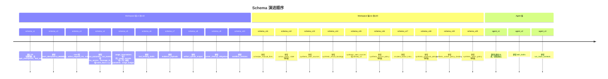

---

## A.11 核对记录

### A.11.1 方法

1. 用 Python（`-I` 隔离模式）导入 `schema_v1…v20` 与 `schema_agent_v1…v3` 的 SQLAlchemy `metadata`，逐版本抽取表、列（类型/可空/server_default）、PK/UNIQUE/FK/CHECK、索引，并对相邻版本做 diff 得到“引入/追加”版本；以 `schema_agent_v3` 为最终形态。
2. 将抽取结果与原文 13.2 各表的字段表与 PK/UK/FK/索引/CHECK 行逐项比对。
3. 迁移文件另行阅读，确认数据迁移行为、无触发器、无元数据之外的 DDL。

### A.11.2 数量核对

| 项 | 本文（DDL） | 原文 | 结论 |
| --- | --- | --- | --- |
| 最终表数 | 61 | 61（59 + skill_drafts + run_trace_contexts） | 一致 |
| 最终字段数 | 586 | 586 | 一致 |
| Agent 基线（v1）表 / 字段 | 59 / 575 | 59 / 575 | 一致 |
| 显式二级索引 | 13 | 逐表列出 | 一致 |
| CHECK | 7 | 逐表列出 | 一致 |

### A.11.3 与原文的差异与注意点

| 编号 | 位置 | 差异 / 注意点 | 处理 |
| --- | --- | --- | --- |
| D1 | 字段表 | 全部 61 表 586 字段的类型、可空、默认与原文逐项一致，仅 `run_events.schema_version` 的默认在抽取中表现为字符串 `1`（原文写 `'1'`），为格式差异，非实质差异 | 本文按列类型呈现：BIGINT 默认不带引号，字符串默认带引号 |
| D2 | 原文 13.2.61 | `run_trace_contexts` 表无“默认”列、未写“显式索引”行与 PK/FK 的统一格式；DDL 实际无二级索引、无 server_default | 本文补齐，实质一致 |
| D3 | 原文 13.2.57 | `dod_storage_metadata` 无主键、无唯一约束，单例性不由 DDL 保证（靠应用校验“恰好一行”） | 本文显式标注“无主键” |
| D4 | 版本对应 | 原文以迁移编号描述（如 `0021_synthetic_batch_policy`），而 `schema_vN` 与迁移编号自 v5 起错位 1（`0005_resume_protocol` 仅数据迁移） | 本文 A.10 给出对照表 |
| D5 | ER 图 12、17 | 现有 PNG 仍用 `workspaces` / `workspace_id` 且 12 号含 `model_profiles.active_version` 等简写，对应重构前快照 | 引用但标注历史；各分组新增 Mermaid ER 为当前形态 |
| D6 | ER 图 11、13–16 | 均为 flowchart 手绘关系（非 erDiagram），只列部分字段；13 号含 `graph_checkpoints`/`graph_pending_writes`，本文将检查点单独成组 | 引用于对应分组，不作字段依据 |
| D7 | 约束命名 | CHECK 名由命名约定生成（如 `ck_teams_active_executions_nonnegative`），原文未列名称 | 本文列出名称 |
| D8 | 字段说明 | 业务语义与枚举取值来自原文，DDL 无 Enum/CHECK 可验证；原文中泛化的“状态/角色”描述本文改写为“DDL 未声明 Enum/CHECK” | 取值以服务层代码为准，本文不逐一核对（待核） |

### A.11.4 待核项

- 各 `status`、`role`、`kind`、`decision` 等状态列的合法取值与状态机：DDL 未约束，本文未对照应用代码逐一验证（待核）。
- 各 `*_json`、`payload`、`response_ref` 等 TEXT 列的内部 JSON Schema：不在 DDL 范围，见原文 13.8，未在本文核对（待核）。
- 字段说明列的业务文字未逐条对照 Store/Service 代码；若与代码冲突，以代码为准。
- 迁移的真实执行时间/发布日期：仓库内无记录，时间线只表示顺序。
